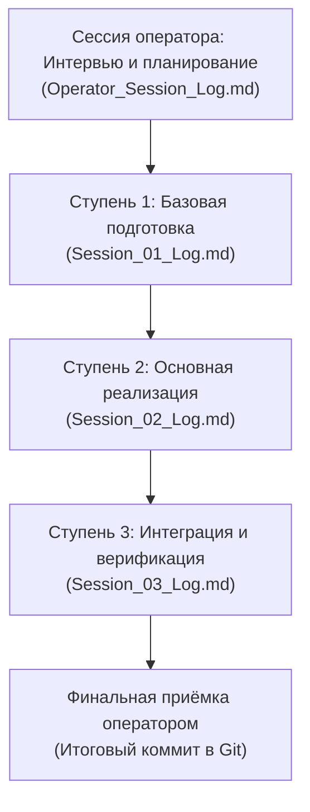

# Генеральный план группы задач: MM-DD_NN_Task_Name

> [!NOTE]
> **Мастер-план координации группы связанных сессий платформы «Турбаза»**  
> Настоящий документ задаёт сквозную цель, архитектурные рамки, методику выполнения и строгую последовательность автономных сессий внутри пакета задач `sessions/2026/MM-DD_NN_[Название_задачи]/`.  
> Ссылка на утверждённый мастер-план регистрируется в [Current_Topic_and_process.md](../../Current_Topic_and_process.md) как активный ориентир разработки.

---

## 1. Паспорт группы задач
- **Идентификатор группы:** `MM-DD_NN_[Название_задачи]`
- **Дата создания плана:** [Дата]
- **Оператор сессии:** Артём Владимирович Шамсутдинов
- **Модель-архитектор плана:** [Название модели, создавшей генеральный план, например: Gemini 3.8 Flash]
- **Протокол сессии оператора:** [Operator_Session_Log.md](./Operator_Session_Log.md)
- **Указатель темы и процесса:** [Current_Topic_and_process.md](../../Current_Topic_and_process.md)
- **Целевая система / модуль:** [Указать каталог или компонент, например: `applications_presentations/...`]
- **Текущий статус плана:** [Проектирование / В реализации / Завершён]

---

## 2. Цель и методика генерального плана

### 2.1. Стратегическая цель
[Исчерпывающее, строгое описание цели: какую проблему решает пакет задач, какие архитектурные, продуктовые или визуальные эффекты достигаются для платформы «Турбаза»].

### 2.2. Методика и жизненный цикл пакета задач
1. **Интервью и проектирование:** в сессии оператора ([Operator_Session_Log.md](./Operator_Session_Log.md)) модель проводит серию уточняющих интервью для выявления всех требований, ограничений и критериев приёмки, после чего формирует настоящий документ.
2. **Регистрация в процессе:** ссылка на данный мастер-план вносится в [Current_Topic_and_process.md](../../Current_Topic_and_process.md).
3. **Генерация планов автономных сессий:** в той же сессии оператора формируются индивидуальные планы ([Session_01_Plan.md](./Session_01_Plan.md), [Session_02_Plan.md](./Session_02_Plan.md) и т.д.) со сгруппированными списками задач и критериями приёмки ([Session_01_Checklist.md](./Session_01_Checklist.md)).
4. **Автономное исполнение по ступеням:** каждая ступень запускается как самостоятельная сессия назначенной модели с возможностью привлечения под-агентов (`invoke_subagent`).
5. **Фиксация завершения ступени:** по завершении сессии соответствующий чекбокс ступени в данном плане маркируется как завершённый `[x]` с указанием даты и ссылки на лог. Завершённые ступени повторно не запускаются.

---

## 3. Творческая и инженерная атрибуция моделей

1. **Атрибуция архитектора плана:**
   Настоящим подтверждается полная авторская, методологическая и структурная атрибуция модели **[Название модели, например: Gemini 3.8 Flash]** как архитектора, спроектировавшего генеральный план, логику декомпозиции задач, рабочие списки и контрольные чеклисты автономных сессий настоящего пакета задач.
2. **Атрибуция моделей-исполнителей автономных сессий:**
   Каждая модель, выполняющая отдельную ступень (сессию), обладает признанным авторским и инженерным статусом соавтора результатов своего этапа.
3. **Обязательная директива автономным моделям:**
   Каждая автономная модель обязана вносить сведения о своей авторской и инженерной атрибуции во все создаваемые и модифицируемые ею материалы (в метаданные файлов, титульные слайды, паспорта документов и блоки авторства).

---

## 4. Последовательность и ступени автономных сессий

Ниже приведена строгая последовательность выполнения этапов пакета. Каждая ступень снабжена местом для маркировки завершения:

---

### [ ] Ступень 1. [Краткое название ступени 1]
- **Статус выполнения:** `[ ] Не начата` / `[ ] В работе` / `[x] Завершена`
- **Дата и время завершения:** [ГГГГ-ММ-ДД ЧЧ:ММ]
- **Назначенная модель-исполнитель:** `[Название модели, например: Claude 3.7 Sonnet / Gemini 3.8 Flash]`
- **Использование под-агентов:** Разрешено (`invoke_subagent` для параллельных подзадач)
- **Документы ступени:**
  - [Session_01_Plan.md](./Session_01_Plan.md) — детальный план со списками задач
  - [Session_01_Log.md](./Session_01_Log.md) — протокол автономного выполнения
  - [Session_01_Checklist.md](./Session_01_Checklist.md) — чеклист верификации
- **Суть и решаемые задачи:**
  [Краткое, ёмкое объяснение того, что именно делает данная сессия после указания оператором на данную ступень].
- **Входные условия:** [Что требуется на входе]
- **Ожидаемые результаты:** [Перечень создаваемых артефактов]

---

### [ ] Ступень 2. [Краткое название ступени 2]
- **Статус выполнения:** `[ ] Не начата` / `[ ] В работе` / `[x] Завершена`
- **Дата и время завершения:** [ГГГГ-ММ-ДД ЧЧ:ММ]
- **Назначенная модель-исполнитель:** `[Название модели]`
- **Использование под-агентов:** Разрешено
- **Документы ступени:**
  - [Session_02_Plan.md](./Session_02_Plan.md) — детальный план со списками задач
  - [Session_02_Log.md](./Session_02_Log.md) — протокол автономного выполнения
  - [Session_02_Checklist.md](./Session_02_Checklist.md) — чеклист верификации
- **Суть и решаемые задачи:**
  [Краткое, ёмкое объяснение содержания автономной работы].
- **Входные условия:** Успешное завершение Ступени 1 (`Session_01_Checklist.md` подтверждён).
- **Ожидаемые результаты:** [Перечень артефактов]

---

### [ ] Ступень 3. [Краткое название ступени 3]
- **Статус выполнения:** `[ ] Не начата` / `[ ] В работе` / `[x] Завершена`
- **Дата и время завершения:** [ГГГГ-ММ-ДД ЧЧ:ММ]
- **Назначенная модель-исполнитель:** `[Название модели]`
- **Использование под-агентов:** Разрешено
- **Документы ступени:**
  - [Session_03_Plan.md](./Session_03_Plan.md) — детальный план со списками задач
  - [Session_03_Log.md](./Session_03_Log.md) — протокол автономного выполнения
  - [Session_03_Checklist.md](./Session_03_Checklist.md) — чеклист верификации
- **Суть и решаемые задачи:**
  [Краткое объяснение этапа интеграции и финализации].
- **Входные условия:** Успешное завершение Ступени 2.
- **Ожидаемые результаты:** Прохождение полного набора автоматических тестов, отсутствие переполнений, генерация чистого отчёта.

---

## 5. Сводная матрица контроля и завершения ступеней

| Ступень | Название задачи | Модель-исполнитель | Документы (План / Лог / Чеклист) | Статус | Отметка завершения |
| :---: | :--- | :---: | :---: | :---: | :---: |
| **01** | [Название 01] | `[Модель]` | [План](./Session_01_Plan.md) • [Лог](./Session_01_Log.md) • [Чеклист](./Session_01_Checklist.md) | Ожидает | `[ ]` Завершено |
| **02** | [Название 02] | `[Модель]` | [План](./Session_02_Plan.md) • [Лог](./Session_02_Log.md) • [Чеклист](./Session_02_Checklist.md) | Ожидает | `[ ]` Завершено |
| **03** | [Название 03] | `[Модель]` | [План](./Session_03_Plan.md) • [Лог](./Session_03_Log.md) • [Чеклист](./Session_03_Checklist.md) | Ожидает | `[ ]` Завершено |

---

## 6. Обязательные инварианты пакета задач
1. **Инвариант относительной навигации:** ссылки строятся строго локально (`./`, `../`, `../../`). Абсолютные пути (`/Users/...`) запрещены.
2. **Языковой стандарт:** чистая русская речь, отсутствие англицизмов, корпоративных местоимений («мы/наш») и оценочных ярлыков.
3. **Строгая привязка терминов:** термин «суверенитет» применяется строго к государству, Отечеству и национальной юрисдикции; для узлов, смартфонов и граждан применяются понятия автономии и неприкосновенности частной жизни.
4. **Инвариант Git-сохранений:**
   - В сессии оператора коммит выполняется после каждого диалогового шага;
   - В автономных сессиях коммит выполняется **в конце каждой группы задач** со всеми изменениями с момента предыдущего коммита.
5. **Фиксация атрибуции:** все участвующие модели сохраняют авторские пометки в созданных файлах.
