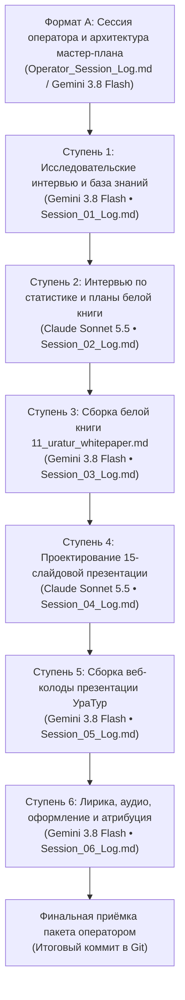

# Генеральный план группы задач: 10-10_02_Uratur_whitepaper_and_presentation

> [!NOTE]
> **Мастер-план создания белой книги и 15-страничной презентации приложения «УраТур»**  
> Настоящий документ регламентирует сквозную архитектурную, исследовательскую, издательскую и производственную программу создания полного комплекса материалов флагманского туристического приложения экосистемы «Турбаза» — **«УраТур»**.  
> Ссылка на утверждённый мастер-план зарегистрирована в [Current_Topic_and_process.md](../../Current_Topic_and_process.md) как активный ориентир разработки.

---

## 1. Паспорт группы задач
- **Идентификатор группы:** `10-10_02_Uratur_whitepaper_and_presentation`
- **Дата создания плана:** 10 октября 2026 г.
- **Оператор сессии:** Артём Владимирович Шамсутдинов
- **Модель-архитектор мастер-плана:** Gemini 3.8 Flash
- **Исходный файл темы:** [10-10_02_Uratur_whitepaper_and_presentation.md](../prompts/10-10_02_Uratur_whitepaper_and_presentation.md)
- **Протокол сессии оператора:** [Operator_Session_Log.md](./Operator_Session_Log.md)
- **Протокол проектной сессии Формата А:** [10-10_02_uratur_whitepaper_and_presentation_plan.md](../10-10_02_uratur_whitepaper_and_presentation_plan.md)
- **Указатель темы и процесса:** [Current_Topic_and_process.md](../../Current_Topic_and_process.md)
- **Целевые артефакты экосистемы:**
  - База знаний и исследовательские документы: [shared_docs/whitepapers/applications/uratur/](../../../shared_docs/whitepapers/applications/uratur/)
  - Планы и спецификации белой книги: [shared_docs/whitepapers/ПЛАН_11_Уратур.md](../../../shared_docs/whitepapers/ПЛАН_11_Уратур.md), [shared_docs/whitepapers/ИНФОРМАЦИЯ_К_ПЛАНУ_11_Уратур.md](../../../shared_docs/whitepapers/ИНФОРМАЦИЯ_К_ПЛАНУ_11_Уратур.md)
  - Итоговая белая книга: [shared_docs/whitepapers/11_uratur_whitepaper.md](../../../shared_docs/whitepapers/11_uratur_whitepaper.md)
  - План презентации: [applications_presentations/ПЛАН_ФИНАЛ_04_УраТур.md](../../../applications_presentations/ПЛАН_ФИНАЛ_04_УраТур.md)
  - Финальная презентация: [applications_presentations/04_uratur_app_presentation/](../../../applications_presentations/04_uratur_app_presentation/)
- **Текущий статус плана:** В реализации (планы ступеней сформированы)

---

## 2. Стратегическая цель и методика генерального плана

### 2.1. Стратегическая цель
Создать всесторонне аргументированную, строгую белую книгу № 11 («УраТур») и высококачественную 15-страничную интерактивную веб-презентацию приложения «УраТур» с озвучиванием и эмоционально-лирическим контекстом. 

Приложение «УраТур» позиционируется как суверенный децентрализованный туристический навигатор, краеведческий реестр и автономный планировщик маршрутов (от пешеходных городских прогулок до межрегиональных экспедиций), опирающийся на:
1. Архитектуру трёх уровней платформы «Турбаза» («Лист» $\to$ «Ветка» $\to$ «Ствол»);
2. Локальную обработку данных на устройствах пользователей без передачи персональных маршрутов во внешние облака;
3. Встроенную систему защиты детей на базе сущностей `AIREntity`, тем с возрастным цензом и автоматических проверок Листа;
4. Возрастную дифференциацию маршрутов для семей с детьми;
5. Гибридную интеграцию с Яндекс Картами при сохранении суверенной приватности точек интереса;
6. Использование статистики общественных хранилищ географических веток и общественных тегов для механической подачи идей путешественникам.

### 2.2. Методика и жизненный цикл пакета задач
1. **Интервью и проектирование (Ступени 1 и 2):** Сбор концептуальных требований через структурированные интервью автора проекта, документирование архитектурных механизмов в `shared_docs/whitepapers/applications/uratur/`, разработка детальных планов белой книги № 11.
2. **Издательская сборка белой книги (Ступень 3):** Компиляция академического текста `11_uratur_whitepaper.md` со строгим соблюдением инвариантов белых книг платформы (математический аппарат, диаграммы Mermaid, отсутствие корпоративных штампов, суверенитет как прерогатива государства).
3. **Проектирование презентации (Ступень 4):** Разработка 15-слайдового пошагового плана презентации в соответствии со стандартами биллборд-верстки и драматургии платформы.
4. **Сборка веб-колоды (Ступень 5):** Вёрстка презентации на изолированном CSS-движке (`deck.css`) с интерактивным плеером (`presentation_deck.md`).
5. **Лирическое обогащение, дикторский текст и финальное оформление (Ступень 6):** Добавление эмоционально-лирического контекста, увеличение хронометража звучания, синтез нейроаудио (DmitryNeural), художественная доводка слайдов, zero-overflow тестирование и фиксация соавторства моделей.
6. **Автономность и фиксация в Git:** Каждая автономная ступень выполняется назначенной моделью самостоятельно. Списки дел сгруппированы, в конце каждой группы задач выполняется обязательный Git-коммит.

---

## 3. Творческая и инженерная атрибуция моделей

1. **Атрибуция архитектора мастер-плана:**
   Настоящим подтверждается полная авторская, методологическая и структурная атрибуция модели **Gemini 3.8 Flash** как архитектора, спроектировавшего генеральный план декомпозиции, исследовательские траектории, рабочие списки и контрольные чеклисты автономных сессий настоящего пакета задач.
2. **Атрибуция моделей-исполнителей автономных сессий:**
   - **Gemini 3.8 Flash:** проведение исследовательской серии интервью Ступени 1, компиляция белой книги Ступени 3, сборка веб-колоды Ступени 5, написание дикторского текста, эмоционально-лирическое обогащение нарратива и художественное оформление слайдов Ступени 6.
   - **Claude Sonnet 5.5:** проведение интервью по статистическим программным модулям и создание планов белой книги Ступени 2, проектирование 15-страничной структуры презентации Ступени 4.
3. **Обязательная директива автономным моделям:**
   Каждая модель обязана вносить сведения о своей авторской, инженерной и драматургической атрибуции во все создаваемые ею материалы (в метаданные файлов, титульные слайды, паспорта документов, блоки авторства и логи сессий).

---

## 4. Последовательность и ступени автономных сессий

---

### [x] Ступень 1. Исследовательские интервью автора и формирование базы знаний «УраТур»
- **Статус выполнения:** `[x] Завершена`
- **Дата и время завершения:** 10 октября 2026 г., 18:16
- **Назначенная модель-исполнитель:** `Gemini 3.8 Flash`
- **Использование под-агентов:** Разрешено (`invoke_subagent` для параллельного анализа и веб-поиска)
- **Документы ступени:**
  - [Session_01_Plan.md](./Session_01_Plan.md) — детальный план со списками задач
  - [Session_01_Log.md](./Session_01_Log.md) — протокол выполнения
  - [Session_01_Checklist.md](./Session_01_Checklist.md) — чеклист верификации
- **Суть и решаемые задачи:**
  Проведение серии структурированных интервью автора проекта по 5 направлениям с фиксацией отдельных аналитических документов в каталоге `shared_docs/whitepapers/applications/uratur/`:
  1. *Система защиты детей в Турбазе:* использование концепта [10_05_01_Age_restrictions.md](../../../shared_docs/comments/2026/10_05_01_Age_restrictions.md) (`AIREntity`, денормализация `min_age`, возрастной ценз тем и тегов, встроенная фильтрация запросов Листа через JOIN/LEFT JOIN);
  2. *Концепция приложения УраТур и возрастная дифференциация:* профиль приложения, семейный контекст, мульти-хранилищная декомпозиция, порог $\min(\text{Ages})$;
  3. *Интеграция с Яндекс Картами:* гибридная связка локальных хранилищ Листа и картографических сервисов Яндекса (тайлы, геокодирование, автомобильная маршрутизация до стоянки, смарт-контракты разделения прибыли, локальные тропы на Листе);
  4. *Общественный вклад УраТура:* руководство экосистемного воздействия по эталону `GoGetter_Ecosystem_Impact_Guide.md` для 7 уровней общества (семьи, детские сады, школы, гиды/МСП, сообщества, муниципалитеты, субъекты РФ);
  5. *Историческое развитие УраТура:* систематизация истоков из [10-06_01_Urarun-Uratur_History.md](../../../shared_docs/comments/2026/10-06_01_Urarun-Uratur_History.md) (от замысла частного планировщика 18 лет назад, официального логотипа Минцифры и симуляции НСНК к автономному планировщику 2026 года).
- **Входные условия:** Наличие исходных заметок в `shared_docs/comments/`.
- **Ожидаемые результаты:** 5 структурированных документов в `shared_docs/whitepapers/applications/uratur/` (созданы и верифицированы).

---

### [x] Ступень 2. Статистические модули, план белой книги и аналитические материалы
- **Статус выполнения:** `[x] Завершена`
- **Дата и время завершения:** 10 октября 2026 г., 19:26
- **Назначенная модель-исполнитель:** `Claude Sonnet 5.5`
- **Использование под-агентов:** Разрешено
- **Документы ступени:**
  - [Session_02_Plan.md](./Session_02_Plan.md) — детальный план со списками задач
  - Протокол выполнения не ведётся (решение оператора: без записи сессии)
  - [Session_02_Checklist.md](./Session_02_Checklist.md) — чеклист верификации
- **Суть и решаемые задачи:**
  1. Проведение интервью с автором об алгоритмической механике использования локальной статистики общественных хранилищ Листа, найденных через географические ветки Турбазы и отфильтрованных общественными тегами;
  2. Фиксация документа `shared_docs/whitepapers/applications/uratur/Статистические_программные_модули_УраТура.md` (для будущего использования в Белой книге № 12 об Экосистеме);
  3. Разработка мастер-плана белой книги `shared_docs/whitepapers/ПЛАН_11_Уратур.md`;
  4. Разработка справочника аналитических данных `shared_docs/whitepapers/ИНФОРМАЦИЯ_К_ПЛАНУ_11_Уратур.md`.
- **Входные условия:** Успешное завершение Ступени 1 (`Session_01_Checklist.md` принят).
- **Ожидаемые результаты:** `04_Статистические_программные_модули_УраТура.md`, `ПЛАН_11_Уратур.md`, `ИНФОРМАЦИЯ_К_ПЛАНУ_11_Уратур.md`.

---

### [x] Ступень 3. Издательская сборка белой книги «УраТур»
- **Статус выполнения:** `[x] Завершена`
- **Дата и время завершения:** 10 октября 2026 г., 20:05
- **Назначенная модель-исполнитель:** `Gemini 3.8 Flash`
- **Использование под-агентов:** Разрешено
- **Документы ступени:**
  - [Session_03_Plan.md](./Session_03_Plan.md) — детальный план со списками задач
  - [Session_03_Log.md](./Session_03_Log.md) — протокол выполнения
  - [Session_03_Checklist.md](./Session_03_Checklist.md) — чеклист верификации
- **Суть и решаемые задачи:**
  Компиляция полного текста белой книги `shared_docs/whitepapers/11_uratur_whitepaper.md` строго по разделам `ПЛАН_11_Уратур.md` на основе `ИНФОРМАЦИЯ_К_ПЛАНУ_11_Уратур.md`. Строгое соблюдение академического стиля, диаграмм Mermaid, формул KaTeX, терминологических инвариантов и локальных ссылок.
- **Входные условия:** Успешное завершение Ступени 2.
- **Ожидаемые результаты:** Готовая белая книга `shared_docs/whitepapers/11_uratur_whitepaper.md` (создана, проверена, 15 схем Mermaid валидированы без замечаний, 84 855 знаков).

---

### [x] Ступень 4. Разработка 15-страничного плана презентации «УраТур»
- **Статус выполнения:** `[x] Завершена`
- **Дата и время завершения:** 10 октября 2026 г., 20:14
- **Назначенная модель-исполнитель:** `Claude Sonnet 5.5`
- **Использование под-агентов:** Разрешено
- **Документы ступени:**
  - [Session_04_Plan.md](./Session_04_Plan.md) — детальный план со списками задач
  - Протокол выполнения не ведётся (решение оператора: без записи сессии)
  - [Session_04_Checklist.md](./Session_04_Checklist.md) — чеклист верификации
- **Суть и решаемые задачи:**
  Разработка детального сценария и пошаговой структуры презентации на 15 слайдов: `applications_presentations/ПЛАН_ФИНАЛ_04_УраТур.md`. Проектирование драматургической дуги (от проблем централизованных сервисов к суверенному краеведению и экосистеме), структуры контентных карточек, формул и визуальных акцентов каждого слайда.
- **Входные условия:** Успешное завершение Ступени 3 (готовая белая книга № 11).
- **Ожидаемые результаты:** `applications_presentations/ПЛАН_ФИНАЛ_04_УраТур.md`.

---

### [ ] Ступень 5. Сборка и структурирование веб-презентации «УраТур»
- **Статус выполнения:** `[ ] Не начата`
- **Дата и время завершения:** —
- **Назначенная модель-исполнитель:** `Gemini 3.8 Flash`
- **Использование под-агентов:** Разрешено
- **Документы ступени:**
  - [Session_05_Plan.md](./Session_05_Plan.md) — детальный план со списками задач
  - [Session_05_Log.md](./Session_05_Log.md) — протокол выполнения
  - [Session_05_Checklist.md](./Session_05_Checklist.md) — чеклист верификации
- **Суть и решаемые задачи:**
  Сборка веб-колоды в каталоге `applications_presentations/04_uratur_app_presentation/`:
  - Обновление `docs/presentation_deck.md` на 15 слайдов строго по плану Ступени 4;
  - Актуализация структуры `docs/presentation_outline.md`;
  - Настройка isolated-стилей `docs/deck.css` с соблюдением биллборд-масштабов;
  - Первичный прогон валидатора `check-decks`.
- **Входные условия:** Успешное завершение Ступени 4.
- **Ожидаемые результаты:** Сформированная веб-колода презентации `04_uratur_app_presentation`.

---

### [ ] Ступень 6. Лирическое обогащение, дикторский текст, озвучивание и художественное оформление
- **Статус выполнения:** `[ ] Не начата`
- **Дата и время завершения:** —
- **Назначенная модель-исполнитель:** `Gemini 3.8 Flash`
- **Использование под-агентов:** Разрешено
- **Документы ступени:**
  - [Session_06_Plan.md](./Session_06_Plan.md) — детальный план со списками задач
  - [Session_06_Log.md](./Session_06_Log.md) — протокол выполнения
  - [Session_06_Checklist.md](./Session_06_Checklist.md) — чеклист верификации
- **Суть и решаемые задачи:**
  1. Написание эмоционального, образного и глубокого текста диктора и слайдов с устранением излишней «сухости»;
  2. Увеличение продолжительности звучания слайдов (хронометраж может превышать 15 минут для обеспечения глубокого погружения);
  3. Синтез нейроаудио через Microsoft Edge TTS (`ru-RU-DmitryNeural`);
  4. Художественное оформление слайдов (инфографика, цветовые акценты, карточки);
  5. Включение обязательной атрибуции авторства Gemini 3.8 Flash как создателя лирической составляющей и художественного оформления на первых и последних слайдах, наряду с атрибуцией автору платформы и моделям;
  6. Проверка отсутствия переполнений (Zero-Overflow) через `npm run check-decks`.
- **Входные условия:** Успешное завершение Ступени 5.
- **Ожидаемые результаты:** Полностью готовая презентация с аудиодорожками, скриншотами и нулевым переполнением.

---

## 5. Сводная матрица контроля и завершения ступеней

| Ступень | Название задачи | Модель-исполнитель | Документы (План / Лог / Чеклист) | Статус | Отметка завершения |
| :---: | :--- | :---: | :---: | :---: | :---: |
| **01** | Исследовательские интервью и база знаний УраТура | `Gemini 3.8 Flash` | [План](./Session_01_Plan.md) • [Лог](./Session_01_Log.md) • [Чеклист](./Session_01_Checklist.md) | Завершена успешно | `[x]` Завершена |
| **02** | Статистические модули и планы белой книги | `Claude Sonnet 5.5` (в плане указан `Claude Sonnet 5.5`) | [План](./Session_02_Plan.md) • [Чеклист](./Session_02_Checklist.md) | Завершена успешно | `[x]` Завершена |
| **03** | Издательская сборка белой книги № 11 | `Gemini 3.8 Flash` | [План](./Session_03_Plan.md) • [Лог](./Session_03_Log.md) • [Чеклист](./Session_03_Checklist.md) | Завершена успешно | `[x]` Завершена |
| **04** | Проектирование 15-страничной презентации | `Claude Sonnet 5.5` | [План](./Session_04_Plan.md) • [Чеклист](./Session_04_Checklist.md) | Завершена успешно | `[x]` Завершена |
| **05** | Сборка и структурирование веб-колоды | `Gemini 3.8 Flash` | [План](./Session_05_Plan.md) • [Лог](./Session_05_Log.md) • [Чеклист](./Session_05_Checklist.md) | Готова к старту | `[ ]` Не начата |
| **06** | Лирика, дикторский текст, аудио и оформление | `Gemini 3.8 Flash` | [План](./Session_06_Plan.md) • [Лог](./Session_06_Log.md) • [Чеклист](./Session_06_Checklist.md) | Ожидает Ступени 5 | `[ ]` Не начата |

---

## 6. Обязательные инварианты пакета задач
1. **Инвариант относительной навигации:** ссылки строятся строго локально (`./`, `../`, `../../`). Машинозависимые абсолютные пути (`/Users/...`, `file:///Users/...`) категорически запрещены.
2. **Языковой стандарт:** чистая русская речь, отсутствие англицизмов, корпоративных местоимений («мы/наш») и оценочных ярлыков.
3. **Строгая привязка терминов:** термин «суверенитет» применяется строго к государству, Отечеству и национальной юрисдикции; для узлов, смартфонов и граждан применяются понятия автономии и неприкосновенности частной жизни.
4. **Инвариант Git-сохранений:**
   - В сессии оператора коммит выполняется после каждого диалогового шага;
   - В автономных сессиях коммит выполняется **в конце каждой группы задач** со всеми изменениями с момента предыдущего коммита.
5. **Фиксация атрибуции:** все участвующие модели сохраняют авторские пометки в созданных файлах; модель Gemini 3.8 Flash отмечается как соавтор лирической составляющей и визуального оформления на слайдах презентации.
