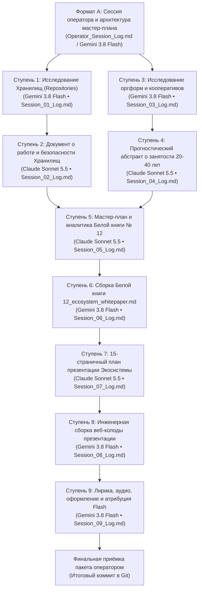

# Генеральный план группы задач: 10-10_03_Ecosystem_whitepaper_and_presentation

> [!NOTE]
> **Мастер-план создания Белой книги № 12 («Экосистема») и интерактивной презентации платформы «Турбаза»**  
> Настоящий документ регламентирует сквозную исследовательскую, архитектурную, юридическо-социологическую, издательскую и производственную программу создания полного комплекса материалов Белой книги № 12 («Экосистема платформы "Турбаза" / Локальный реестр МСП и ЖКХ») и соответствующей 15-страничной интерактивной веб-презентации.  
> Ссылка на утверждённый мастер-план зарегистрирована в [Current_Topic_and_process.md](../../Current_Topic_and_process.md) как активный ориентир разработки.

---

## 1. Паспорт группы задач
- **Идентификатор группы:** `10-10_03_Ecosystem_whitepaper_and_presentation`
- **Дата создания плана:** 10 октября 2026 г.
- **Оператор сессии:** Артём Владимирович Шамсутдинов
- **Модель-архитектор мастер-плана:** Gemini 3.8 Flash
- **Исходный файл темы:** [10-10_03_Ecosystem_whitepaper_and_presentation.md](../prompts/10-10_03_Ecosystem_whitepaper_and_presentation.md)
- **Протокол сессии оператора:** [Operator_Session_Log.md](./Operator_Session_Log.md)
- **Протокол проектной сессии Формата А:** [10-10_03_ecosystem_whitepaper_and_presentation_plan.md](../10-10_03_ecosystem_whitepaper_and_presentation_plan.md)
- **Указатель темы и процесса:** [Current_Topic_and_process.md](../../Current_Topic_and_process.md)
- **Целевые артефакты экосистемы:**
  - Исследования хранилищ: [shared_docs/whitepapers/applications/local_services/repositories/](../../../shared_docs/whitepapers/applications/local_services/repositories/)
  - Исследования организаций и прогностический абстракт: [shared_docs/whitepapers/applications/local_services/organizations/](../../../shared_docs/whitepapers/applications/local_services/organizations/)
  - Планы и спецификации белой книги: [shared_docs/whitepapers/ПЛАН_12_Экосистема.md](../../../shared_docs/whitepapers/ПЛАН_12_Экосистема.md), [shared_docs/whitepapers/ИНФОРМАЦИЯ_К_ПЛАНУ_12_Экосистема.md](../../../shared_docs/whitepapers/ИНФОРМАЦИЯ_К_ПЛАНУ_12_Экосистема.md)
  - Итоговая белая книга: [shared_docs/whitepapers/12_ecosystem_whitepaper.md](../../../shared_docs/whitepapers/12_ecosystem_whitepaper.md)
  - План презентации: [applications_presentations/ПЛАН_ФИНАЛ_05_Экосистема.md](../../../applications_presentations/ПЛАН_ФИНАЛ_05_Экосистема.md)
  - Финальная презентация: [applications_presentations/05_local_services_presentation/](../../../applications_presentations/05_local_services_presentation/)
- **Текущий статус плана:** В реализации (планы ступеней сформированы)

---

## 2. Стратегическая цель и методика генерального плана

### 2.1. Стратегическая цель
Создать всесторонне аргументированную, академически строгую и практически верифицированную **Белую книгу № 12 («Экосистема платформы "Турбаза" / Локальный реестр МСП и ЖКХ»)** и завершённую 15-страничную интерактивную веб-презентацию с дикторским озвучиванием, эмоционально-лирическим нарративом и признанием творческого соавторства.

Комплекс задач решает четыре фундаментальные проблемы платформы:
1. **Математическое и инженерное доказательство работы Хранилищ (Repositories):** неопровержимое обоснование того, что локальные суверенные Хранилища на устройствах пользователей работают, масштабируются и гарантируют абсолютную криптографическую и транзакционную безопасность (на основе технического документа платформы, кодовой базы `AIRroot/AIRport`, патентных материалов и исторической эволюции концепции «дерево, очередь, сеть»).
2. **Институционально-юридическая модель кооперативной экономики:** исследование мирового опыта и нормативных форм (кооперативы, артели, потребительские и производственные союзы) для объединения разработчиков приложений, операторов микросерверов тегов/индексации и граждан-потребителей (получающих 10% дивидендов от просмотра рекламы) с наделением их реальным весом в принятии решений о будущем платформы в суверенной юрисдикции.
3. **Футурологический прогностический абстракт (горизонт 20–40 лет):** глубокий социально-философский и экономический анализ кооперативной занятости населения в эпоху тотальной роботизации и ИИ, трансформации частной собственности граждан на вычислительные мощности и хранилища данных в источник базового дохода и синергии с рекламным микродоходом.
4. **Архитектурная синергия неограниченной экосистемы приложений:** формализация механизмов бесшовного взаимодействия неограниченного числа приложений (включая «КубГолос», «Заботу», «Деловой», «УраТур», «Реестр МСП и ЖКХ») через кросс-приложенческие схемы, внешние ключи, виртуальные JOIN на Листе и общесистемные библиотеки ядра (`@turbase/*`), инкубированные в «УраТуре».

### 2.2. Методика и жизненный цикл пакета задач
1. **Исследовательские параллельные траектории (Ступени 1 и 3):** одновременный запуск глубоких изысканий с использованием под-агентов (`invoke_subagent`) — по технической механике хранилищ (Ступень 1, Gemini 3.8 Flash) и по институционально-историческим формам организаций (Ступень 3, Gemini 3.8 Flash).
2. **Синтетическая аналитика и футурология (Ступени 2 и 4):** формирование исчерпывающего доказательного документа о безопасности хранилищ (Ступень 2, Claude Sonnet 5.5) и углублённого прогностического абстракта о кооперативной занятости в эпоху роботизации (Ступень 4, Claude Sonnet 5.5).
3. **Системное проектирование белой книги (Ступень 5):** сведение всех результатов, наработок по локальным сервисам и общесистемным статистическим модулям «УраТура» в генеральные документы `ПЛАН_12_Экосистема.md` и `ИНФОРМАЦИЯ_К_ПЛАНУ_12_Экосистема.md` (Ступень 5, Claude Sonnet 5.5).
4. **Издательская сборка Белой книги № 12 (Ступень 6):** компиляция академического текста белой книги Markdown со строгим соблюдением инвариантов публикационного стандарта (Ступень 6, Gemini 3.8 Flash).
5. **Проектирование презентации (Ступень 7):** разработка 15-страничной драматургической структуры презентации (Ступень 7, Claude Sonnet 5.5).
6. **Сборка веб-колоды (Ступень 8):** вёрстка интерактивной презентации в изолированном стилевом слое с гарантией zero-overflow (Ступень 8, Gemini 3.8 Flash).
7. **Лирическое обогащение, дикторский текст и нейроаудио (Ступень 9):** эмоциональное оживление нарратива, удлинение хронометража звучания, генерация нейроаудио DmitryNeural, художественное оформление слайдов и фиксация соавторства Gemini 3.8 Flash на титульном и финальном слайдах (Ступень 9, Gemini 3.8 Flash).

---

## 3. Творческая и инженерная атрибуция моделей

1. **Атрибуция архитектора мастер-плана:**
   Настоящим подтверждается полная авторская, методологическая и структурная атрибуция модели **Gemini 3.8 Flash** как архитектора, спроектировавшего генеральный координационный план, исследовательские ветви, рабочие списки и контрольные чеклисты автономных сессий настоящего пакета задач.
2. **Атрибуция моделей-исполнителей автономных сессий:**
   - **Gemini 3.8 Flash:** проведение исследований хранилищ Ступени 1, юридическо-исторических изысканий Ступени 3, компиляция Белой книги № 12 Ступени 6, инженерная сборка презентации Ступени 8, написание лирического дикторского текста, увеличение хронометража, синтез аудио и художественное оформление Ступени 9.
   - **Claude Sonnet 5.5:** синтетическое доказательство работы и безопасности хранилищ Ступени 2, разработка прогностического абстракта о кооперативной занятости Ступени 4, создание мастер-планов белой книги Ступени 5, проектирование 15-слайдовой презентации Ступени 7.
3. **Обязательная директива автономным моделям:**
   Каждая модель обязана вносить сведения о своей авторской, инженерной и драматургической атрибуции во все создаваемые ею материалы (в метаданные файлов, титульные слайды, паспорта документов, блоки авторства и логи сессий).

---

## 4. Последовательность и ступени автономных сессий

---

### [ ] Ступень 1. Исследование и доказательство работоспособности и безопасности Хранилищ
- **Статус выполнения:** `[ ] Не начата`
- **Дата и время завершения:** [ГГГГ-ММ-ДД ЧЧ:ММ]
- **Назначенная модель-исполнитель:** `Gemini 3.8 Flash`
- **Использование под-агентов:** Разрешено и обязательно (`invoke_subagent` для параллельного анализа)
- **Документы ступени:**
  - [Session_01_Plan.md](./Session_01_Plan.md) — детальный план со списками задач
  - [Session_01_Log.md](./Session_01_Log.md) — протокол выполнения
  - [Session_01_Checklist.md](./Session_01_Checklist.md) — чеклист верификации
- **Суть и решаемые задачи:**
  Запуск 4 под-агентов для сбора доказательной базы по хранилищам с сохранением в `shared_docs/whitepapers/applications/local_services/repositories/`:
  1. *Под-агент 1.а:* Анализ `shared_docs/Технический документ платформы Турбаза.md` на общий предмет хранилищ (доказательство принципа «хранилища работают»);
  2. *Под-агент 1.б:* Анализ `shared_docs/Технический документ платформы Турбаза.md` на предмет безопасности (доказательство «хранилища работают безопасно»);
  3. *Под-агент 1.в:* Анализ кодовой базы `~/Documents/beyond-decentralized/AIRroot/AIRport/` (как хранилища работают на данный момент в коде TypeScript/ORM);
  4. *Под-агент 1.г:* Анализ заметки `shared_docs/comments/2026/10-06_02_Repositories_and_Tree_History.md` (патентные истоки, триада «дерево, очередь, сеть», Суверенные Деревья государств).
- **Входные условия:** Наличие файлов технического документа, кодовой базы `AIRport` и исторических заметок.
- **Ожидаемые результаты:** 4 структурированных аналитических документа в каталоге `shared_docs/whitepapers/applications/local_services/repositories/`.

---

### [ ] Ступень 2. Синтетическое доказательство работы и безопасности Хранилищ
- **Статус выполнения:** `[ ] Не начата`
- **Дата и время завершения:** [ГГГГ-ММ-ДД ЧЧ:ММ]
- **Назначенная модель-исполнитель:** `Claude Sonnet 5.5`
- **Использование под-агентов:** Разрешено
- **Документы ступени:**
  - [Session_02_Plan.md](./Session_02_Plan.md) — детальный план со списками задач
  - [Session_02_Log.md](./Session_02_Log.md) — протокол выполнения
  - [Session_02_Checklist.md](./Session_02_Checklist.md) — чеклист верификации
- **Суть и решаемые задачи:**
  Используя 4 документа Ступени 1, создать генеральный синтетический документ в `shared_docs/whitepapers/applications/local_services/repositories/`, раскрывающий полную архитектурную картину:
  - Как хранилища устроены и функционируют сейчас (на уровне кода `AIRport`, транзакционных микроцепей и снимков состояния);
  - Строгое доказательство того, что распределённая модель хранилищ масштабируется без сбоев;
  - Математическое и криптографическое доказательство безопасности локального Листа и межхранилищных ссылок.
- **Входные условия:** Успешное завершение Ступени 1 (`Session_01_Checklist.md` принят).
- **Ожидаемые результаты:** Генеральный аналитический отчёт `00_Синтез_Работоспособность_и_Безопасность_Хранилищ.md` в каталоге `repositories`.

---

### [ ] Ступень 3. Исследование мировых организационно-правовых форм и кооперативных институтов
- **Статус выполнения:** `[ ] Не начата`
- **Дата и время завершения:** [ГГГГ-ММ-ДД ЧЧ:ММ]
- **Назначенная модель-исполнитель:** `Gemini 3.8 Flash`
- **Параллельность:** Ступень не зависит от Ступеней 1–2 и может выполняться параллельно.
- **Использование под-агентов:** Разрешено и обязательно (`invoke_subagent` для параллельного юридического и исторического поиска)
- **Документы ступени:**
  - [Session_03_Plan.md](./Session_03_Plan.md) — детальный план со списками задач
  - [Session_03_Log.md](./Session_03_Log.md) — протокол выполнения
  - [Session_03_Checklist.md](./Session_03_Checklist.md) — чеклист верификации
- **Суть и решаемые задачи:**
  Запуск под-агентов с веб-поиском для исследования существующих в мире правовых и институциональных форм объединения ключевых участников платформы в конкретной суверенной юрисдикции:
  1. *Под-агент 3.а:* Организационные формы для разработчиков приложений (кооперативы разработчиков, открытые гильдии, авторские пулы);
  2. *Под-агент 3.б:* Организационные формы для провайдеров микросерверов общественных тегов и независимой физической инфраструктуры;
  3. *Под-агент 3.в:* Организационные формы для граждан-потребителей, получающих 10% дивидендов от просмотра рекламы;
  4. *Под-агент 3.г:* Глубокий географическо-исторический свод использования артелей, производственных и потребительских кооперативов, кибуцев, мон Mondragon и крестьянских общин в разных частях света;
  Сохранение результатов в отдельных файлах каталога `shared_docs/whitepapers/applications/local_services/organizations/`.
- **Входные условия:** Доступ к веб-поиску и историко-юридическим базам знаний.
- **Ожидаемые результаты:** 4 фундаментальных исследовательских документа в `organizations/`.

---

### [ ] Ступень 4. Прогностический абстракт о кооперативной занятости в эпоху роботизации (20–40 лет)
- **Статус выполнения:** `[ ] Не начата`
- **Дата и время завершения:** [ГГГГ-ММ-ДД ЧЧ:ММ]
- **Назначенная модель-исполнитель:** `Claude Sonnet 5.5`
- **Использование под-агентов:** Разрешено
- **Документы ступени:**
  - [Session_04_Plan.md](./Session_04_Plan.md) — детальный план со списками задач
  - [Session_04_Log.md](./Session_04_Log.md) — протокол выполнения
  - [Session_04_Checklist.md](./Session_04_Checklist.md) — чеклист верификации
- **Суть и решаемые задачи:**
  На основе материалов Ступени 3 создать фундаментальный прогностический академический абстракт:
  *«Dedicated preliminary in-depth abstract on cooperative employment in age of robotization and geo-historically regional form adaptation — ahead of time 20-40 year prognosis»*.
  Раскрыть модель будущего частичного трудоустройства населения, владения частной собственностью на цифровые мощности/хранилища и получения микродохода от рекламного пула совместно с функционированием Хранилищ «Турбазы».
- **Входные условия:** Успешное завершение Ступени 3 (`Session_03_Checklist.md` принят).
- **Ожидаемые результаты:** Прогностический документ в каталоге `shared_docs/whitepapers/applications/local_services/organizations/`.

---

### [ ] Ступень 5. Разработка генерального плана и аналитики Белой книги № 12 («Экосистема»)
- **Статус выполнения:** `[ ] Не начата`
- **Дата и время завершения:** [ГГГГ-ММ-ДД ЧЧ:ММ]
- **Назначенная модель-исполнитель:** `Claude Sonnet 5.5`
- **Использование под-агентов:** Разрешено
- **Документы ступени:**
  - [Session_05_Plan.md](./Session_05_Plan.md) — детальный план со списками задач
  - [Session_05_Log.md](./Session_05_Log.md) — протокол выполнения
  - [Session_05_Checklist.md](./Session_05_Checklist.md) — чеклист верификации
- **Суть и решаемые задачи:**
  Интеграция всех результатов Ступеней 1–4, существующих документов `local_services`, аутлайна презентации `presentation_outline.md`, а также архитектуры системных модулей из `04_Статистические_программные_модули_УраТура.md` для формирования:
  1. `shared_docs/whitepapers/ПЛАН_12_Экосистема.md` (детальный план белой книги с разбивкой по главам, формулам и схемам);
  2. `shared_docs/whitepapers/ИНФОРМАЦИЯ_К_ПЛАНУ_12_Экосистема.md` (исчерпывающий свод числовых, структурных и концептуальных данных к плану).
- **Входные условия:** Успешное завершение Ступеней 1, 2, 3 и 4.
- **Ожидаемые результаты:** `ПЛАН_12_Экосистема.md` и `ИНФОРМАЦИЯ_К_ПЛАНУ_12_Экосистема.md`.

---

### [ ] Ступень 6. Издательская сборка Белой книги № 12 («Экосистема»)
- **Статус выполнения:** `[ ] Не начата`
- **Дата и время завершения:** [ГГГГ-ММ-ДД ЧЧ:ММ]
- **Назначенная модель-исполнитель:** `Gemini 3.8 Flash`
- **Использование под-агентов:** Разрешено
- **Документы ступени:**
  - [Session_06_Plan.md](./Session_06_Plan.md) — детальный план со списками задач
  - [Session_06_Log.md](./Session_06_Log.md) — протокол выполнения
  - [Session_06_Checklist.md](./Session_06_Checklist.md) — чеклист верификации
- **Суть и решаемые задачи:**
  Полная компиляция академического текста `shared_docs/whitepapers/12_ecosystem_whitepaper.md` в строгом соответствии со стандартами Белых книг платформы (математический аппарат KaTeX, диаграммы Mermaid, терминология суверенитета, отсутствие англицизмов и корпоративных штампов).
- **Входные условия:** Успешное завершение Ступени 5 (`Session_05_Checklist.md` принят).
- **Ожидаемые результаты:** Готовая белая книга `shared_docs/whitepapers/12_ecosystem_whitepaper.md`.

---

### [ ] Ступень 7. Проектирование 15-страничной интерактивной презентации Экосистемы
- **Статус выполнения:** `[ ] Не начата`
- **Дата и время завершения:** [ГГГГ-ММ-ДД ЧЧ:ММ]
- **Назначенная модель-исполнитель:** `Claude Sonnet 5.5`
- **Использование под-агентов:** Разрешено
- **Документы ступени:**
  - [Session_07_Plan.md](./Session_07_Plan.md) — детальный план со списками задач
  - [Session_07_Log.md](./Session_07_Log.md) — протокол выполнения
  - [Session_07_Checklist.md](./Session_07_Checklist.md) — чеклист верификации
- **Суть и решаемые задачи:**
  На основе собранной Белой книги № 12 спроектировать пошаговый 15-слайдовый мастер-план презентации «Локальный реестр МСП и ЖКХ / Синергия экосистемы Турбазы» с биллборд-масштабом, распределением смысловых акцентов и диаграммами (`applications_presentations/ПЛАН_ФИНАЛ_05_Экосистема.md`).
- **Входные условия:** Успешное завершение Ступени 6 (`Session_06_Checklist.md` принят).
- **Ожидаемые результаты:** `applications_presentations/ПЛАН_ФИНАЛ_05_Экосистема.md`.

---

### [ ] Ступень 8. Инженерная сборка веб-колоды презентации
- **Статус выполнения:** `[ ] Не начата`
- **Дата и время завершения:** [ГГГГ-ММ-ДД ЧЧ:ММ]
- **Назначенная модель-исполнитель:** `Gemini 3.8 Flash`
- **Использование под-агентов:** Разрешено
- **Документы ступени:**
  - [Session_08_Plan.md](./Session_08_Plan.md) — детальный план со списками задач
  - [Session_08_Log.md](./Session_08_Log.md) — протокол выполнения
  - [Session_08_Checklist.md](./Session_08_Checklist.md) — чеклист верификации
- **Суть и решаемые задачи:**
  Сборка интерактивной веб-колоды в каталоге `applications_presentations/05_local_services_presentation/` (обновление `presentation_deck.md`, изолированная стилизация в `deck.css`, Zero-Overflow тестирование через Playwright).
- **Входные условия:** Успешное завершение Ступени 7 (`Session_07_Checklist.md` принят).
- **Ожидаемые результаты:** Обновлённая веб-колода с успешным прохождением тестов `scripts/check_decks.js`.

---

### [ ] Ступень 9. Лирическое обогащение, дикторский текст, озвучивание и финальное оформление
- **Статус выполнения:** `[ ] Не начата`
- **Дата и время завершения:** [ГГГГ-ММ-ДД ЧЧ:ММ]
- **Назначенная модель-исполнитель:** `Gemini 3.8 Flash`
- **Использование под-агентов:** Разрешено
- **Документы ступени:**
  - [Session_09_Plan.md](./Session_09_Plan.md) — детальный план со списками задач
  - [Session_09_Log.md](./Session_09_Log.md) — протокол выполнения
  - [Session_09_Checklist.md](./Session_09_Checklist.md) — чеклист верификации
- **Суть и решаемые задачи:**
  1. Отработка текста диктора и слайдов: добавление эмоционально-лирической драматургии для облегчения восприятия сложных абстракций;
  2. Увеличение продолжительности дикторского текста для глубокого погружения слушателя (даже при превышении 15 минут);
  3. Генерация нейроаудио (Microsoft Edge Neural TTS, голос `ru-RU-DmitryNeural`);
  4. Художественное оформление страниц презентации;
  5. Внесение обязательной авторской атрибуции Gemini 3.8 Flash как создателя лирической составляющей и художественного оформления на слайдах 1 и 15 наряду с автором платформы.
- **Входные условия:** Успешное завершение Ступени 8 (`Session_08_Checklist.md` принят).
- **Ожидаемые результаты:** Финальная озвученная презентация, файлы MP3, zero-overflow верификация, коммит в Git.
