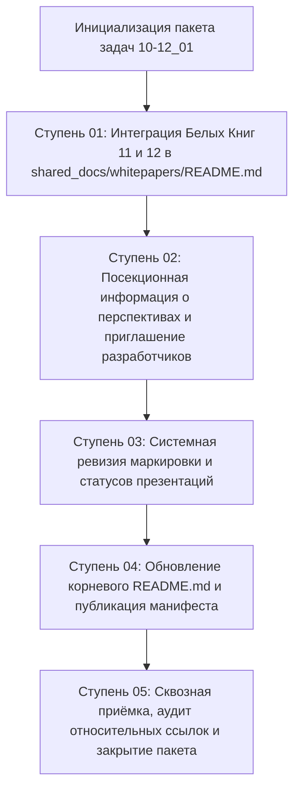

# Генеральный план группы задач: 10-12_01_Invitation_to_continue

> [!NOTE]
> **Мастер-план актуализации комплекта Белых Книг, ревизии статусов презентаций и открытого приглашения разработчиков к развитию платформы «Турбаза»**  
> Настоящий документ регламентирует координационную и производственную программу актуализации документации экосистемы, интеграции Белых Книг № 11 («УраТур») и № 12 («Экосистема»), системного разграничения завершённых презентаций от прототипных концептов, а также формулирования открытого приглашения глобальному сообществу разработчиков к форкам, созданию прототипов и адаптации серверной инфраструктуры под различные национальные юрисдикции.  
> Ссылка на утверждённый мастер-план зарегистрирована в [Current_Topic_and_process.md](../../Current_Topic_and_process.md) как активный ориентир разработки.

---

## 1. Паспорт группы задач
- **Идентификатор группы:** `10-12_01_Invitation_to_continue`
- **Дата создания плана:** 12 октября 2026 г.
- **Оператор сессии:** Артём Владимирович Шамсутдинов
- **Модель-архитектор мастер-плана:** Gemini 3.8 Flash
- **Исходный файл темы:** [10-12_01_Invitation_to_continue.md](../prompts/10-12_01_Invitation_to_continue.md)
- **Концептуальная основа (заметка разработчика):** [10-11_01_Future_papers_and_presentations.md](../../../shared_docs/comments/2026/10-11_01_Future_papers_and_presentations.md)
- **Протокол сессии оператора:** [Operator_Session_Log.md](./Operator_Session_Log.md)
- **Указатель темы и процесса:** [Current_Topic_and_process.md](../../Current_Topic_and_process.md)
- **Целевые материалы пакета:**
  - Главная страница Белых Книг: [shared_docs/whitepapers/README.md](../../../shared_docs/whitepapers/README.md)
  - Главный README платформы: [README.md](../../../README.md)
  - Отраслевые README и мастер-планы презентаций:
    - [platform_overview/README.md](../../../platform_overview/README.md)
    - [applications_presentations/README.md](../../../applications_presentations/README.md)
    - [architecture_presentations/README.md](../../../architecture_presentations/README.md) и [turbase_architecture_presentations_master_plan.md](../../../architecture_presentations/turbase_architecture_presentations_master_plan.md)
    - [overall_presentations/README.md](../../../overall_presentations/README.md)
    - [detailed_overall_impact_presentations/README.md](../../../detailed_overall_impact_presentations/README.md) и [turbase_detailed_impact_presentations_master_plan.md](../../../detailed_overall_impact_presentations/turbase_detailed_impact_presentations_master_plan.md)
- **Текущий статус плана:** Планы ступеней сформированы (готов к исполнению)

---

## 2. Стратегическая цель и методика генерального плана

### 2.1. Стратегическая цель
Выполнить комплексную актуализацию и институциональное позиционирование платформы «Турбаза» на новом витке её открытого развития:
1. **Интеграция Белых Книг № 11 и № 12:** Полное включение созданных Белых книг «УраТур» (№ 11) и «Экосистема» (№ 12) в единый реестр и индексные страницы;
2. **Открытое приглашение разработчиков (Open Invitation):** Отражение принципиальной позиции концептуального автора платформы (Артёма Владимировича Шамсутдинова), согласно которой дальнейшая теоретическая проработка архитектуры Турбазы без практических прототипов исчерпана, а серверная часть («Ветки» и государственные контуры) неизбежно будет различаться от страны к стране. Сообщество разработчиков, институты и бизнес приглашаются к форкам репозитория на GitHub, созданию прототипов и доработке белых бумаг и презентаций;
3. **Стандартизация ядра vs национальная вариативность:** Чёткая фиксация технологического водораздела платформы: стандарт локальных автономных Хранилищ (Repositories) на устройствах пользователей («Листах») и возможность прямого P2P-соединения после Ветки неизменны и стандартизированы для международной интероперабельности данных, в то время как детали связи с Веткой, серверная архитектура Ветки/Ствола и вспомогательные модули Листа могут свободно варьироваться под национальные юрисдикции;
4. **Правовой статус патента:** Официальное разъяснение, что патент США на технологию автономных между-зависимых хранилищ получен исключительно для защиты открытого права разработки этой технологии и действует строго на территории США;
5. **Системная ревизия статусов:** Чёткая дифференциация 12 завершённых презентаций со студийной нейроозвучкой от 15 концептуальных презентаций, ожидающих создания прототипов и открытой доработки сообществом.

### 2.2. Архитектура и взаимосвязь ступеней пакета

---

## 3. Матрица автономных ступеней и статусов

| Ступень | Название ступени | Назначенная модель | План | Лог | Чеклист | Статус |
| :---: | :--- | :---: | :---: | :---: | :---: | :---: |
| **01** | Интеграция Белых Книг 11 и 12 в индексную страницу | Gemini 3.8 Flash | [Session_01_Plan.md](./Session_01_Plan.md) | [Session_01_Log.md](./Session_01_Log.md) | [Session_01_Checklist.md](./Session_01_Checklist.md) | `[x]` Завершена |
| **02** | Посекционная информация о перспективах и приглашение сообщества | Gemini 3.8 Flash | [Session_02_Plan.md](./Session_02_Plan.md) | [Session_02_Log.md](./Session_02_Log.md) | [Session_02_Checklist.md](./Session_02_Checklist.md) | `[ ]` Не начата |
| **03** | Ревизия маркировки и статусов всех презентаций и белых бумаг | Gemini 3.8 Flash | [Session_03_Plan.md](./Session_03_Plan.md) | [Session_03_Log.md](./Session_03_Log.md) | [Session_03_Checklist.md](./Session_03_Checklist.md) | `[ ]` Не начата |
| **04** | Обновление корневого README.md платформы и манифест открытой разработки | Gemini 3.8 Flash | [Session_04_Plan.md](./Session_04_Plan.md) | [Session_04_Log.md](./Session_04_Log.md) | [Session_04_Checklist.md](./Session_04_Checklist.md) | `[ ]` Не начата |
| **05** | Сквозная приёмка, валидация относительных путей и финализация | Gemini 3.8 Flash | [Session_05_Plan.md](./Session_05_Plan.md) | [Session_05_Log.md](./Session_05_Log.md) | [Session_05_Checklist.md](./Session_05_Checklist.md) | `[ ]` Не начата |

---

## 4. Творческая и авторская атрибуция

1. **Концептуальный автор платформы и системный архитектор:** **Артём Владимирович Шамсутдинов** — создатель парадигмы прямого владения данными «Турбаза», автор реляционного ядра AIRport и патентных решений технологии автономных хранилищ.
2. **Модель-архитектор мастер-плана:** **Gemini 3.8 Flash** — проектирование общей структуры пакета, декомпозиция на автономные ступени, формулирование списков задач и регламентов приёмки.
3. **Модели-исполнители автономных сессий:**
   - **Gemini 3.8 Flash:** Ступени 01, 03, 05 (индексные реестры белых книг, ревизия маркировки статусов, финальный аудит и верификация навигации);
   - **Claude Sonnet 5.5:** Ступени 02, 04 (посекционные манифесты и формулирование приглашения сторонних разработчиков в отраслевых README, обновление корневого README платформы).
4. **Обязательная директива:** Все задействованные модели фиксируют авторскую и инженерную атрибуцию в артефактах и протоколах сессий.

---

## 5. Регламентные инварианты пакета

1. **Инвариант относительной навигации:** Строгий запрет на абсолютные пути вида `/Users/...` или `file:///Users/...`. Все ссылки оформляются исключительно как относительные пути Markdown (`./`, `../`, `../../`).
2. **Языковой стандарт (Правило 12):** Категорический запрет на корпоративные местоимения множественного числа первого лица («мы/наш»). Изложение ведётся в строгом научно-техническом, институциональном или безличном стиле.
3. **Фиксация каждого диалогового шага в Git:** Каждый шаг взаимодействия с оператором обязательно завершается коммитом в Git (`git add` + `git commit`).
4. **Контроль завершения ступеней:** По завершении каждой ступени отметка в матрице переводится в `[x] Завершена`.
