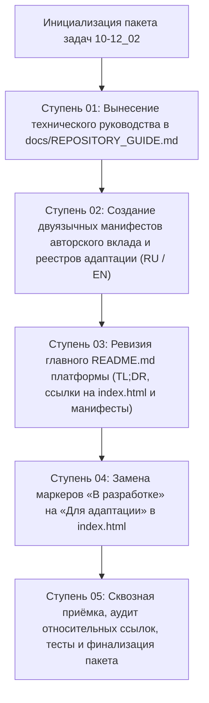

# Генеральный план группы задач: 10-12_02_Cleanup_README_and_index

> [!NOTE]
> **Мастер-план структурного разделения документации репозитория, манифеста завершения авторского документирования платформы «Турбаза» и адаптации витрины презентаций**  
> Настоящий документ регламентирует координационную и производственную программу структурной разгрузки главного `README.md`, выделения технического руководства по репозиторию в отдельный документ, официального и подробного закрепления завершения авторского этапа документирования концептуальным автором Артёмом Владимировичем Шамсутдиновым, формирования двуязычного манифеста перехода к созданию практических прототипов суверенными участниками ассоциации, лаконичного оформления портала репозитория со ссылкой на витрину и блоком «TL;DR» (RU/EN), а также обновления маркеров статусов в витрине `index.html` («В разработке» $\to$ «Для адаптации»).  
> Ссылка на утверждённый мастер-план зарегистрирована в [Current_Topic_and_process.md](../../Current_Topic_and_process.md) как активный ориентир разработки.

---

## 1. Паспорт группы задач
- **Идентификатор группы:** `10-12_02_Cleanup_README_and_index`
- **Дата создания плана:** 12 октября 2026 г.
- **Оператор сессии:** Артём Владимирович Шамсутдинов
- **Модель-архитектор мастер-плана:** Gemini 3.8 Flash
- **Исходный файл темы:** [10-12_02_Cleanup_README_and_index.md](../prompts/10-12_02_Cleanup_README_and_index.md)
- **Концептуальная основа (заметки автора):**
  - [10-11_01_Future_papers_and_presentations.md](../../../shared_docs/comments/2026/10-11_01_Future_papers_and_presentations.md) — перспективы будущих презентаций и переход к созданию прототипов;
  - [09-12_01_Smart_Contracts.md](../../../shared_docs/comments/2026/09-12_01_Smart_Contracts.md) — концепция двухуровневых смарт-контрактов FSM O(1);
  - [10-12_05_Why_social_rating.md](../../../shared_docs/comments/2026/10-12_05_Why_social_rating.md) — открытый социальный рейтинг и экономический рейтинг ЦБ;
  - [10-12_03_Why_Data_sovereignty.md](../../../shared_docs/comments/2026/10-12_03_Why_Data_sovereignty.md) — фундаментальные принципы цифрового суверенитета данных;
- **Протокол сессии оператора:** [Operator_Session_Log.md](./Operator_Session_Log.md)
- **Указатель темы и процесса:** [Current_Topic_and_process.md](../../Current_Topic_and_process.md)
- **Целевые материалы пакета:**
  - Техническое руководство по репозиторию: [docs/REPOSITORY_GUIDE.md](../../../docs/REPOSITORY_GUIDE.md)
  - Авторский вклад и реестр суверенной адаптации (RU): [docs/AUTHOR_CONTRIBUTION_AND_SOVEREIGN_ADAPTATION_RU.md](../../../docs/AUTHOR_CONTRIBUTION_AND_SOVEREIGN_ADAPTATION_RU.md)
  - Авторский вклад и реестр суверенной адаптации (EN): [docs/AUTHOR_CONTRIBUTION_AND_SOVEREIGN_ADAPTATION_EN.md](../../../docs/AUTHOR_CONTRIBUTION_AND_SOVEREIGN_ADAPTATION_EN.md)
  - Главный README платформы: [README.md](../../../README.md)
  - Главная витрина презентаций и белых бумаг: [index.html](../../../index.html)
- **Текущий статус плана:** Планы ступеней сформированы (готов к исполнению)

---

## 2. Стратегическая цель и методика генерального плана

### 2.1. Стратегическая цель
Выполнить качественную структурную реорганизацию входной документации и публичной витрины платформы «Турбаза»:
1. **Вынесение технической документации репозитория:** Перенос подробных инструкций по устройству репозитория, зависимостям (`install_build_dependencies.sh`, `install_regen_dependencies.sh`), сборочным командам NPM Workspaces (`rebuild-*`, `regen-*`) и архитектурным инвариантам в отдельное специализированное руководство [docs/REPOSITORY_GUIDE.md](../../../docs/REPOSITORY_GUIDE.md), оставив в конце главного [README.md](../../../README.md) прозрачную ссылку.
2. **Фиксация завершения авторского этапа документирования:** Отражение принципиальной позиции концептуального автора платформы (Артёма Владимировича Шамсутдинова) о том, что авторский вклад в теоретическую документацию платформы исчерпывающе завершён (вся имеющаяся концептуальная информация зафиксирована). Дальнейшее теоретизирование исчерпано, а выявленные в процессе детали требуют разработки действующих практических прототипов перед последующим документированием.
3. **Призыв к суверенному прототипированию (Ассоциация «Турбаза»):** Разработка прототипов рекомендуется институтам, бизнесу и разработчикам в суверенных государствах, заинтересованных в ассоциативном участии в платформе «Турбаза», поскольку серверная архитектура («Ветка», «Ствол») и правовые контуры неизбежно будут различаться под национальные юрисдикции (согласно заметке автора [Future papers and presentations](../../../shared_docs/comments/2026/10-11_01_Future_papers_and_presentations.md)).
4. **Реестр готовых материалов и проектов для адаптации (на русском и английском языках):**
   - а. «Парадигмальный сдвиг» — вводное концептуальное объяснение платформы «Турбаза»;
   - б. «Анатомия и Архитектура платформы» — вводное объяснение архитектуры, подлежащее дальнейшей отдельной разработке в [architecture_presentations](../../../architecture_presentations/README.md) каждой суверенной платформой;
   - в. «Суверенная экономика и смарт-контракты» — связь платформы с суверенной финансовой системой смарт-контрактов (заметка [09-12_01_Smart_Contracts.md](../../../shared_docs/comments/2026/09-12_01_Smart_Contracts.md), [Белая книга 06 по FSM O(1) контрактам ЦБ](../../../shared_docs/whitepapers/06_cbr_smart_contracts_fsm_whitepaper.pdf), заметка [10-12_05_Why_social_rating.md](../../../shared_docs/comments/2026/10-12_05_Why_social_rating.md) и [Белая книга 07 по рейтинговым системам](../../../shared_docs/whitepapers/07_social_economic_ratings_whitepaper.pdf));
   - г. «Архитектура Цифрового Суверенитета» — базовые принципы суверенитета данных (заметка [10-12_03_Why_Data_sovereignty.md](../../../shared_docs/comments/2026/10-12_03_Why_Data_sovereignty.md));
   - д. «Матрица Ценности для Стейкхолдеров» — общая ценность для участников экосистемы, подлежащая дальнейшей суверенной разработке в [detailed_overall_impact_presentations](../../../detailed_overall_impact_presentations/README.md);
   - е. «КубГолос: измерять и складывать» — системообразующее приложение и его детальная проработка ([Белая книга 08](../../../shared_docs/whitepapers/08_votecube_whitepaper.md));
   - ё. «Забота: вкладывать и просматривать» — системообразующее приложение и его детальная проработка ([Белая книга 09](../../../shared_docs/whitepapers/09_sapoto_whitepaper.md));
   - ж. «Деловой: исполнять и связывать» — системообразующее приложение и его детальная проработка ([Белая книга 10](../../../shared_docs/whitepapers/10_gogetter_whitepaper.md));
   - з. Белая книга 11 «УраТур» — автономное планирование путешествий ([Белая книга 11](../../../shared_docs/whitepapers/11_uratur_whitepaper.md)), презентация оставлена для суверенной доработки;
   - и. Белая книга 12 «Экосистема приложений прямого владения данными» ([Белая книга 12](../../../shared_docs/whitepapers/12_ecosystem_whitepaper.md)), презентация оставлена для суверенной доработки.
   Все документы и презентации подлежат суверенной доработке государств-участников под свою специфику. Оформление выполняется в двух файлах: [docs/AUTHOR_CONTRIBUTION_AND_SOVEREIGN_ADAPTATION_RU.md](../../../docs/AUTHOR_CONTRIBUTION_AND_SOVEREIGN_ADAPTATION_RU.md) и [docs/AUTHOR_CONTRIBUTION_AND_SOVEREIGN_ADAPTATION_EN.md](../../../docs/AUTHOR_CONTRIBUTION_AND_SOVEREIGN_ADAPTATION_EN.md) с полной проверкой кликабельности и истинности ссылок.
5. **Лаконичный главный README.md платформы:** Размещение ссылки на [index.html](../../../index.html) презентаций и белых бумаг, лаконичного двуязычного блока «TL;DR» (RU / EN), прямых ссылок на два манифеста авторского вклада и ссылки на техническое руководство в конце документа.
6. **Актуализация статусов витрины index.html:** Замена всех маркеров «В разработке» на «Для адаптации» в коде [index.html](../../../index.html).

### 2.2. Архитектура и взаимосвязь ступеней пакета

---

## 3. Матрица автономных ступеней и статусов

| Ступень | Название ступени | Назначенная модель | План | Лог | Чеклист | Статус |
| :---: | :--- | :---: | :---: | :---: | :---: | :---: |
| **01** | Вынесение технического руководства по репозиторию в `docs/REPOSITORY_GUIDE.md` | Gemini 3.8 Flash | [Session_01_Plan.md](./Session_01_Plan.md) | [Session_01_Log.md](./Session_01_Log.md) | [Session_01_Checklist.md](./Session_01_Checklist.md) | `[x]` Завершена |
| **02** | Создание двуязычных манифестов авторского вклада и реестров адаптации (RU / EN) | Claude Sonnet 5.5 | [Session_02_Plan.md](./Session_02_Plan.md) | [Session_02_Log.md](./Session_02_Log.md) | [Session_02_Checklist.md](./Session_02_Checklist.md) | `[x]` Завершена |
| **03** | Ревизия и оптимизация главного README.md (ссылка на витрину, TL;DR RU/EN, манифесты) | Claude Sonnet 5.5 | [Session_03_Plan.md](./Session_03_Plan.md) | [Session_03_Log.md](./Session_03_Log.md) | [Session_03_Checklist.md](./Session_03_Checklist.md) | `[x]` Завершена |
| **04** | Актуализация статусов в витрине `index.html` («В разработке» $\to$ «Для адаптации») | Gemini 3.8 Flash | [Session_04_Plan.md](./Session_04_Plan.md) | [Session_04_Log.md](./Session_04_Log.md) | [Session_04_Checklist.md](./Session_04_Checklist.md) | `[ ]` Не начата |
| **05** | Сквозная приёмка, аудит относительных путей, тесты и закрытие пакета | Gemini 3.8 Flash | [Session_05_Plan.md](./Session_05_Plan.md) | [Session_05_Log.md](./Session_05_Log.md) | [Session_05_Checklist.md](./Session_05_Checklist.md) | `[ ]` Не начата |

---

## 4. Творческая и авторская атрибуция

1. **Концептуальный автор платформы и системный архитектор:** **Артём Владимирович Шамсутдинов** — создатель парадигмы прямого владения данными «Турбаза», автор реляционного ядра AIRport и патентных решений технологии автономных хранилищ.
2. **Модель-архитектор мастер-плана:** **Gemini 3.8 Flash** — проектирование общей структуры пакета, декомпозиция на 5 автономных ступеней, регламентация жизненного цикла и критериев качества.
3. **Модели-исполнители автономных сессий:**
   - **Gemini 3.8 Flash:** Ступени 01, 04, 05 (вынесение технического руководства по репозиторию, замена маркеров статусов в `index.html`, сквозной аудит и тестирование);
   - **Claude Sonnet 5.5:** Ступени 02, 03 (глубокая концептуальная проработка двуязычных манифестов завершения авторского документирования на RU и EN, ревизия главного `README.md` с лаконичным TL;DR).
4. **Обязательная директива:** Все задействованные модели обязаны фиксировать авторскую и инженерную атрибуцию в артефактах и протоколах сессий.

---

## 5. Регламентные инварианты пакета

1. **Инвариант относительной навигации:** Строгий запрет на абсолютные пути вида `/Users/...` или `file:///Users/...`. Все ссылки оформляются исключительно как относительные пути Markdown (`./`, `../`, `../../`).
2. **Языковой стандарт (Правило 12):** Категорический запрет на корпоративные местоимения множественного числа первого лица («мы/наш»). Изложение ведётся в строгом научно-техническом, институциональном или безличном стиле.
3. **Фиксация каждого диалогового шага в Git:** Каждый шаг взаимодействия с оператором обязательно завершается коммитом в Git (`git add` + `git commit`).
4. **Контроль завершения ступеней:** По завершении каждой ступени отметка в матрице переводится в `[x] Завершена`.
