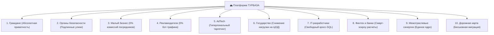
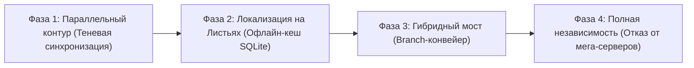

# Комплексный отраслевой эффект платформы «Турбаза»

**Белая Книга: Анализ социально-экономического эффекта для 10 категорий участников экосистемы, расчет TCO и стратегия миграции**  
*Версия: 2.4 (2026)*  
*Статус: Аналитический и экономический отчет*  
*Классификация: Экономика данных, TCO-анализ, цифровая трансформация*  

---

## Аннотация

Настоящий аналитический документ представляет комплексный анализ социально-экономических эффектов от внедрения платформы **«Турбаза»** для десяти ключевых групп участников цифровой экономики: граждан, правоохранительных органов, малого и среднего бизнеса (МСП), рекламодателей, рекламных платформ (AdTech), государственной инфраструктуры, IT-разработчиков, финтех-сектора и банков.

В документе приводится финансово-экономический расчет снижения совокупной стоимости владения (TCO) серверной инфраструктурой на 90–95%, устранение платформенного посреднического сбора в 30%, а также детализируется четырехэтапная стратегия плавной и безопасной миграции существующих корпоративных и государственных систем на распределенную трехуровневую топологию прямого владения данными.

<!-- pagebreak -->

## Содержание

1. [Методология оценки социально-экономического эффекта](#1-методология-оценки-социально-экономического-эффекта)
2. [Матрица ценности для 10 категорий участников экосистемы](#2-матрица-ценности-для-10-категорий-участников-экосистемы)
3. [Финансовая модель и радикальное снижение TCO (-90%)](#3-финансовая-модель-и-радикальное-снижение-tco--90)
4. [Ликвидация платформенной монополии и комиссий 30%](#4-ликвидация-платформенной-монополии-и-комиссий-30)
5. [Поэтапная дорожная карта независимой миграции](#5-поэтапная-дорожная-карта-независимой-миграции)
6. [Заключение](#6-заключение)

<!-- pagebreak -->

## 1. Методология оценки социально-экономического эффекта

Оценка эффекта от перехода на платформу «Турбаза» опирается на сопоставление прямых финансовых затрат (CapEx/OpEx), косвенных издержек (ущерб от утечек данных, штрафы регуляторов, потери от мошенничества) и синергетического мультипликатора локальной кооперации.

```
┌─────────────────────────────────────────────────────────────┐
│                 ФОРМУЛА ЭКОНОМИЧЕСКОГО ЭФФЕКТА              │
├─────────────────────────────────────────────────────────────┤
│  Э = ΔTCO (Инфраструктура) + ΔКомиссии (Без монополий 30%)  │
│      + ΔУщерб (0 утечек частных данных) + ΔСинергия (Кросс-SQL)   │
└─────────────────────────────────────────────────────────────┘
```

<!-- pagebreak -->

## 2. Матрица ценности для 10 категорий участников экосистемы



### Детальная матрица преимуществ:

| Сектор | Текущая проблема в облаке | Решение в «Турбазе» | Ключевой эффект |
| :--- | :--- | :--- | :--- |
| **1. Граждане** | Утечки ПДн, агрессивный спам, слежка | Данные на Листе в SQLite, частное остаётся частным | **100% приватность** |
| **2. Безопасность** | Фальсификация логов на серверах | Подписи ГОСТ, неизменяемый WAL | **Юридическая сила улик** |
| **3. МСП / Самозанятые** | Комиссии агрегаторов до 30% | Прямой контакт с жителями за 2 мс | **+30% чистой прибыли** |
| **4. Рекламодатели** | До 60% кликфрода и скликивания ботами | Показы только проверенным Листьям | **0% потерь бюджета** |
| **5. AdTech платформы** | Запреты third-party cookies, слежка | Локальный мэтчинг на Листе и четырёхсторонний сплит (10% десятина гражданину, рекламная площадка, разработчики, арендаторы мощностей) | **Прозрачная выручка** |
| **6. Государство** | Дефицит мощностей в ЦОД, санкции | Распределение вычислений на край | **-90% затрат бюджета** |
| **7. Разработчики** | Медленный REST API, сложные микросервисы | Нативный SQL JOIN между схемами | **Ускорение разработки 5x** |
| **8. Финтех / Банки** | Высокий риск банковского фрода | Аппаратные ключи, смарт-эскроу | **Мгновенный клиринг** |
| **9. Межотраслевые связи**| Разрозненные базы данных компаний | Композитные внешние ключи | **Сквозные сервисы** |
| **10. ИТ-инфраструктура**| Опасность «big bang» миграции | 4-фазный параллельный переход | **0 рисков простоя** |

<!-- pagebreak -->

## 3. Финансовая модель и радикальное снижение TCO (-90%)

Традиционная облачная архитектура требует экспоненциального наращивания вычислительных мощностей серверов при росте пользовательской базы. В «Турбазе» вычислительная мощность масштабируется линейно и бесплатно вместе с подключением новых смартфонов граждан.

### Сравнительный расчет стоимости обслуживания 5 млн пользователей:

```
┌─────────────────────────────────────────────────────────────┐
│             РАСЧЕТ ГОДОВОГО БЮДЖЕТА ИНФРАСТРУКТУРЫ          │
├──────────────────────────────┬──────────────┬───────────────┤
│ Категория затрат             │ Облачный ЦОД │ «Турбаза»     │
├──────────────────────────────┼──────────────┼───────────────┤
│ Серверные стойки и облака    │ 180 млн руб. │ 8 млн руб.    │
│ Магистральный трафик         │ 65 млн руб.  │ 4 млн руб.    │
│ Лицензии корпоративных СУБД  │ 45 млн руб.  │ 0 руб.        │
│ Информационная безопасность  │ 50 млн руб.  │ 6 млн руб.    │
│ Эксплуатация и DevOps        │ 80 млн руб.  │ 12 млн руб.   │
├──────────────────────────────┼──────────────┼───────────────┤
│ ИТОГО В ГОД:                 │ 420 млн руб. │ 30 млн руб.   │
│ ЧИСТАЯ ЭКОНОМИЯ:             │ —            │ 390 млн руб.! │
└──────────────────────────────┴──────────────┴───────────────┘
```

Экономия достигается за счет того, что операции фильтрации, сортировки, валидации форм и рендеринга выполняются непосредственно процессорами устройств граждан.

<!-- pagebreak -->

## 4. Новая роль торговых площадок и оптимизация комиссионной нагрузки

В традиционной платформенной модели централизованные маркетплейсы и агрегаторы берут на себя капитальные затраты на поддержание серверов и привлечение трафика, взимая с бизнеса до трети выручки за услуги посредничества.

«Турбаза» трансформирует эту модель, создавая условия как для прямого P2P-обмена, так и для качественного развития торговых платформ:
- **Базовый прямой доступ:** Предприниматели получают возможность прямого взаимодействия с жителями своего района через открытые районные Ветки и локальные реестры услуг без обязательных посреднических комиссий.
- **Новая ценность цифровых торговых площадок:** Маркетплейсы обретают роль доверенных представителей и гарантов для потребителей, предоставляя подтверждённые гарантии качества, арбитраж и безопасный эскроу-сервис.
- **Инфраструктурные и аналитические сервисы:** Торговые платформы могут выступать провайдерами Ветвей для открытых коммерческих тем и товарных тегов, предоставлять глубокие аналитические срезы рынка и создавать передовые прикладные модули с расширенным функционалом сверх базовых возможностей платформы.
- **Прямые расчеты:** Оплата по смарт-контрактам в Цифровом рубле обеспечивает чистоту сделок и мгновенный расчет без кассовых разрывов.

### Многоукладный баланс экосистемы провайдеров (60% / 20% / 20%)

Инфраструктура платформы опирается на гармоничный многоукладный баланс:
1. **Коммерческие структуры (~60% вала данных, ~20% приложений):** зрелые сервисы высокого качества (доставка, навигация, логистика, медиаплатформы) функционируют на платформе прямого владения данными с гарантией безопасности профилей и частных данных граждан;
2. **Кооперативы провайдеров и артели разработчиков (~20% данных, ~80% приложений):** независимые производственные кооперативы (артели, Закон № 41-ФЗ) и потребительские общества (Закон РФ № 3085-1) создают основной спектр прикладных модулей и поддерживают распределённые серверы хранения;
3. **Государственная территориально-административная вертикаль (~20% данных):** узлы Ветка $\to$ Областная ветка $\to$ Ствол, обеспечивающие 100% суверенную безопасность данных, соблюдение 152-ФЗ и 63-ФЗ и территориальную верификацию граждан.

### Разнообразие узлов: теговые индексы и многотеговая координация

В дополнение к территориальной топологии в сети развёртываются функциональные серверы поиска:
- **Серверы теговых индексов (`Tag Index Server`):** легковесные узлы на мощностях кооперативов и арендованных стационарных ПК граждан (глава 34 ГК РФ, п. 4 ст. 420 НК РФ), хранящие компактные дескрипторы связей `<тег, репозиторий>` (&lt;128 байт) без медиафайлов;
- **Серверы координации многотеговых запросов (`Query Coordinator / Join Assembler`):** опрашивают мощности тегов и соединяют составные условия от меньшего объёма к большему, предотвращая перегрузку мобильных каналов.

### Партнёрство с бизнесом и эволюция инфраструктуры хранения

На начальных этапах развития цифровых платформ серверная централизация была единственно возможным ответом на ограниченную мощность абонентских устройств и незрелость сетей. Коммерческие ИТ-гиганты создали первоклассную инфраструктуру, обеспечивают миллионы рабочих мест, формируют крупные налоговые поступления в бюджет и финансируют пенсионные фонды.

«Турбаза» принципиально не пытается вытеснить существующий бизнес или централизованные сервисы с рынка. Напротив, доступ к информации из независимых источников непосредственно на пользовательских устройствах в реальном времени многократно расширяет и углубляет существующие рынки, создавая новые плодотворные ниши для общественных, кооперативных и частных приложений, в то время как коммерческий сектор получает качественно новые горизонты масштабирования без неподъёмного роста серверных затрат на TCO.

Инфраструктура хранения данных развивается по органической эволюционной траектории:
1. **Стартовый этап:** основные мощности для хранения и синхронизации зашифрованных данных предоставляют государственные территориально-административные Ветки, гарантирующие суверенную безопасность и строгое соблюдение 152-ФЗ;
2. **Перспективное расширение:** граждане и сообщества получают полную свободу выбора — от легко подключаемых домашних семейных узлов и кооперативных хранилищ сообществ (потребительские общества по Закону РФ № 3085-1, аренда мощностей по главе 34 ГК РФ) до сертифицированных коммерческих дата-центров (ЦОД) для высоконагруженных задач.

### Кооперативы разработчиков и открытость ядра
Создатели платформы действуют как равноправный производственный кооператив (артель по Закону № 41-ФЗ), монетизируя свой труд на общих основаниях через базовые прикладные решения («КубГолос», «Забота», «Деловой», «УраТур») и интерфейсные компоненты, тогда как системные модули ядра протокола открыты и бесплатны для всех разработчиков. Первоначальный концептуальный вклад автора безвозмездно передан обществу.

<!-- pagebreak -->

## 5. Поэтапная дорожная карта независимой миграции

Переход на архитектуру прямого владения данными «Турбазы» не требует единовременного слома существующих корпоративных систем («Big Bang rewrite»). Дорожная карта включает 4 плавные фазы:



1. **Фаза 1 — Теневой контур (Параллельная репликация):** Развертывание шлюзов «Ветка» рядом с существующими базами данных. Данные дублируются в автономные доверенные хранилища без изменения клиентских приложений.
2. **Фаза 2 — Внедрение Leaf SDK в мобильные клиенты:** Клиентские приложения получают локальную базу SQLite. Запросы на чтение переключаются на локальный движок (<1 мс).
3. **Фаза 3 — Децентрализация записи через `@Api()`:** Все мутации начинают подписываться ключами устройств и проходить через Branch Pipeline. Серверные кластеры освобождаются от 80% нагрузки.
4. **Фаза 4 — Полная независимость:** Отключение тяжелых зарубежных СУБД. Система полностью переходит на трехуровневую топологию Лист-Ветка-Ствол с интеграцией ЕСИА, СБП и ГИС ЖКХ.

<!-- pagebreak -->

## 6. Заключение

Внедрение платформы «Турбаза» обеспечивает системный синергетический эффект национального масштаба:
- **Экономия бюджетных и корпоративных средств:** Сокращение затрат на ЦОД и серверы более чем на 90%.
- **Развитие МСП:** Возврат 30% комиссионных платежей в реальный сектор экономики городов и районов.
- **Гарантированная кибербезопасность:** Полное искоренение риска утечек баз персональных данных благодаря парадигме «частное остаётся частным».
- **Готовность к автономной работе:** Полная устойчивость национальной инфраструктуры при любых внешних ограничениях.

---

*Авторы: Аналитический совет по социально-экономическому развитию платформы «Турбаза»*  
*Материалы отраслевых презентаций: [detailed_overall_impact_presentations/](../../detailed_overall_impact_presentations)*
