# «УраТур»: находить, беречь и сопровождать
**Белая книга № 11: возрастная защита на уровне ядра, общественные теги и кооперативные индексы, статистика на Листе и работа с картами без передачи троп**
*Версия: 1.0 (2026)*
*Статус: проектная концепция*
*Классификация: прикладной уровень платформы «Турбаза»*

> *Автор: Артём Владимирович Шамсутдинов, разработчик платформы цифрового суверенитета государства «Турбаза» — интернета автономных и частных данных / открытого стека AIRport.*
> *Методология подготовки: замысел приложения «УраТур» (первая идея автора о создании программы), архитектура возрастной защиты на уровне ядра Листа, идеи общественных тегов и кооперативных индексов, гибридной работы с картографическими сервисами, вывода статистических модулей на уровень платформы и все решения по семейному путешествию сформированы автором. Планирование документа выполнено моделью Claude Sonnet 5.5; распределение понятий между книгами комплекта и порядок изложения предложены ею и приняты автором. Базу знаний приложения подготовила модель Gemini 3.8 Flash. Детальная проработка текста выполнена моделью Gemini 3.8 Flash.*

---

## Аннотация

Настоящая Белая книга представляет проектную концепцию и инженерно-технические основы приложения «УраТур» — четвёртого прикладного решения платформы «Турбаза». В то время как «КубГолос» решает задачу многофакторного измерения общественного согласия, «Забота» накапливает жизненный опыт взаимопомощи, а «Деловой» обеспечивает координацию и исполнение жизненных планов, «УраТур» вводит в экосистему измерения физического пространства, топологии местности, возраста участников и движения во времени. На примере «УраТура» отрабатываются критически важные общесистемные механизмы: возрастная защита на уровне ядра Листа без сбора документов и передачи возраста наружу, открытые общественные теги с распределённой сетью индексных узлов на сбалансированных хронологических деревьях, детерминированная механическая подача идей путешественникам, локальный статистический конвейер планирования и динамического сопровождения в пути без подключения к сети связи, а также модель гибридного взаимодействия с внешними картографическими сервисами без раскрытия пешеходных треков граждан. Документ ориентирован на архитекторов распределённых систем, инженеров краеведческих и геоинформационных платформ, организаторов детско-юношеского и семейного туризма, а также специалистов по защите персональных данных и информационной безопасности.

---

## Как читать эту книгу

Книга представляет собой законченное техническое и методологическое описание прикладной системы и спроектирована для автономного изучения. Читателю не требуется детальное знакомство с предшествующими документами комплекта: все базовые концепции распределённого стека снабжены краткими пояснениями. 

В исследовании выдержан строгий академический и доказательный стиль. Архитектура «Турбазы» опирается на глубокое уважение к достижениям картографических сервисов, разработчиков геоинформационных систем и туристических каталогов. Предлагаемые решения не призваны противопоставлять себя действующим службам, а раскрывают альтернативную инженерную модель, при которой данные о семье, физической подготовке и точном маршруте остаются на персональном устройстве пользователя («Листе»), в то время как описания природных объектов и инфраструктуры формируются сообществами в открытых децентрализованных реестрах.

Количественные показатели и формулы, приведённые в тексте, представляют собой проектные ориентиры, алгоритмические модели и условные вычислительные примеры для иллюстрации логики работы системы; они не являются медицинскими нормами или абсолютными гарантиями безопасности в походах. В соответствии с канонами серии белых книг платформы в текст не включаются фрагменты программного кода, названия служебных классов и низкоуровневые идентификаторы таблиц баз данных.

> [!NOTE]
> **Из предыдущих книг комплекта: базовые концепции платформы**
> * **Лист, Ветка, Ствол и хранилище:** трёхзвенная распределённая топология платформы. «Лист» — персональное устройство гражданина (смартфон или персональный компьютер), где локально хранятся и обрабатываются данные. «Ветка» — связной координационный узел района или округа. «Ствол» — национальный уровень платформы. «Хранилище» — неделимая атомарная реляционная единица данных с собственным ключом симметричного шифрования и локальным журналом изменений.
> * **Принцип «Пиши только своё» (Белые книги № 08 и № 09):** фундаментальный инвариант распределённого ядра платформы: каждый участник вносит записи исключительно в собственный локальный журнал изменений и физически не имеет технической возможности перезаписать или удалить чужие данные.
> * **Двухконтурность и невидящая Ветка (Белая книга № 08):** строгое архитектурное разделение информационных потоков на открытый общественный контур, доступный для индексации и поиска, и защищённый контур частных данных, где промежуточный узел («Ветка») ретранслирует зашифрованные пакеты, не обладая ключами доступа к их содержимому.
> * **Тег и внешняя метка (Белая книга № 10 «Деловой»):** инструмент гибкой каталогизации информации. В «Деловом» внешняя метка создаётся локально на устройстве гражданина и привязывается к чужой открытой записи без внесения изменений в исходный объект и без раскрытия факта категоризации третьим лицам.
> * **Случай и шаблон (Белая книга № 09 «Забота»):** смысловые структуры фиксации жизненного опыта. «Случай» представляет собой конкретную жизненную ситуацию человека, а проверенная и обезличенная последовательность шагов оформляется как воспроизводимый «Шаблон», доступный для использования другими участниками.
> * **Дело и органайзер «Деловой» (Белая книга № 10):** высокоуровневая организационная единица, связывающая коренную задачу, дерево подзадач, сроки и исполнителей в рамках отдельного изолированного хранилища.
> * **Рейтинг вкладов по теме и верифицированный автор (Белая книга № 09):** открытая децентрализованная оценка общественной репутации, формируемая на основе подтверждённого полезного вклада гражданина в конкретной тематической сфере («Опыт»). Наличие подтверждённого Опыта позволяет верифицировать авторство маршрутов и рекомендаций без раскрытия персональных сведений.
> * **Распределение выручки и доля гражданина (Белые книги № 06 и № 08):** нормативно-алгоритмическая модель смарт-контрактов платформы, закрепляющая обязательную десятину (не менее 10% валового дохода от коммерческих показов или транзакций) в пользу конечного гражданина, чьё внимание или данные задействованы в процессе.

---

## 1. Задача и место приложения в платформе

Организация любого путешествия — от короткой семейной прогулки выходного дня по историческому центру города до автономного многодневного похода по горным хребтам — требует одновременной обработки трёх категорий данных, которые принципиально трудно совместить в рамках централизованной серверной архитектуры:
1. Подробных пространственных сведений о местности: картографической подложки, профиля высот, троп, расположения питьевых родников, стоянок, перевалов, укрытий и сопутствующей инфраструктуры;
2. Детальных конфиденциальных сведений о составе группы: возрасте участников, наличии маленьких детей или пожилых родственников, уровне их физической выносливости, опыте походов и медицинских ограничениях;
3. Непрерывных данных о текущем положении группы, динамике её движения, оставшихся запасах светлого времени и заряде аккумуляторов средств связи.

В традиционных облачных геоинформационных сервисах и туристических каталогах для выполнения расчётов все три информационных потока передаются на центральные серверы поставщика услуги. В результате сервис неизбежно аккумулирует подробную картину личной и семейной жизни граждан: историю перемещений, состав семьи, привычные часы отдыха и персональные интересы. Кроме того, при выходе группы за пределы зоны уверенного покрытия сотовой связи облачный навигатор теряет вычислительную опору, оставляя туристов без адаптивной подсказки в критический момент изменения погоды или наступления сумерек.

Платформа «Турбаза» предлагает альтернативное инженерное решение. Сведения о семье, возрасте детей, физическом темпе и точном географическом положении группы остаются исключительно на персональном устройстве пользователя — на «Листе». Описания троп, достопримечательностей, родников и стоянок хранятся в открытых общественных хранилищах краеведческих объединений и туристических клубов. Все вычислительные операции — от подбора маршрута и расчёта энергозатрат до динамической оценки запаса светлого времени — выполняются детерминированным статистическим конвейером непосредственно на процессоре смартфона без подключения к внешним серверам.

В комплекте прикладных решений платформы «Турбаза» приложение «УраТур» занимает особое место, замыкая цикл взаимодействия человека с окружающей средой:

$$«КубГолос»\;(\text{Оценка и согласие}) \longleftrightarrow «Забота»\;(\text{Опыт и взаимопомощь}) \longleftrightarrow «Деловой»\;(\text{Координация и планы}) \longleftrightarrow «УраТур»\;(\text{Пространство и движение})$$

Приложение «УраТур» использует пользовательскую оболочку органайзера «Деловой» как готовый исполнительский каркас. Любой выбранный маршрут или этап экспедиции развёртывается на Листе как Дело, где контрольные точки выступают подзадачами, а временные ориентиры автоматически синхронизируются с локальным семейным календарём.

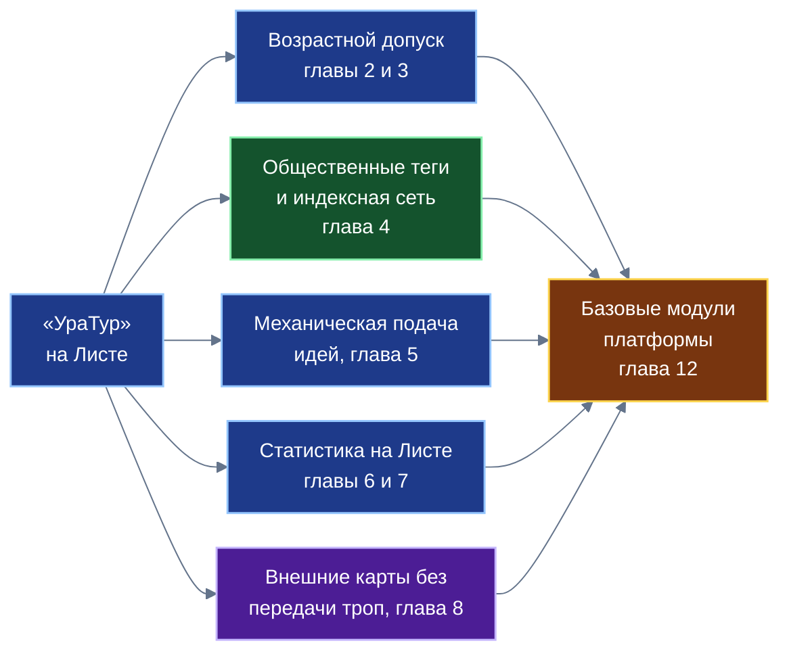
*Схема 1. Пять вкладов приложения; каждый проектируется как общий модуль платформы.*

Системная роль «УраТура» заключается в том, что на нём отрабатываются базовые механизмы платформы, востребованные далеко за пределами туристической отрасли:

| № | Вклад приложения «УраТур» | Назначение для платформы как общего модуля | Глава |
| :---: | :--- | :--- | :---: |
| 1 | **Возрастной допуск к хранилищу** | Защита детей на уровне ядра Листа без сбора документов и передачи возраста наружу | 2 |
| 2 | **Семейный профиль на Листе** | Образец применения возрастного допуска: одна поездка — несколько хранилищ | 3 |
| 3 | **Общественные теги** | Открытая децентрализованная каталогизация без единого владельца витрины | 4 |
| 4 | **Механическая подача идей** | Прозрачный подбор без скрытых оценок: результат полностью воспроизводим | 5 |
| 5 | **Статистический конвейер на Листе** | Модуль пространственно-временной статистики для приложений с координатами и временем | 6 |
| 6 | **Сопровождение в пути без связи** | Контроллер исполнения планов с динамическим анализом заката и резервными путями | 7 |
| 7 | **Гибридная работа с картами** | Общий порядок подключения внешних сервисов с сохранением тайны частной жизни | 8 |
| 8 | **Общественный вклад на семи уровнях** | Методологический образец оценки комплексного социально-экономического эффекта | 9 |
| 9 | **Исторический контекст замысла** | Преемственность идей трёхзвенного Дерева и прямой связи устройств от 2007 года | 11 |
| 10 | **Системное абстрагирование библиотек** | Формирование общесистемных модулей ядра для Белой книги № 12 («Экосистема») | 12 |

---

## 2. Защита детей на уровне ядра Листа

Обеспечение информационной безопасности и физического благополучия подрастающего поколения представляет собой важнейшую государственную и общественную задачу. Родители и педагоги стремятся оградить детей от потенциально опасного контента, чрезмерных физических нагрузок и рискованных маршрутов. Однако в большинстве современных информационных систем реализация возрастного контроля требует либо передачи персональных данных ребёнка (свидетельства о рождении, профилей в социальных сетях) внешним коммерческим операторам, либо использования разрозненных настроек в каждом отдельном приложении, которые легко отключаются или обходятся.

Платформа «Турбаза» закладывает систему защиты детей непосредственно в распределённое ядро операционной среды «Листа». Механизм опирается на следующие базовые принципы:
1. **Общесистемная основа записей данных:** все сущности реляционных таблиц платформы строятся на единой базовой структуре, содержащей показатель минимального возраста допустимого просмотра.
2. **Хранилище как неделимая единица информации и допуска:** все записи распределены по отдельным хранилищам, обладающим собственными ключами шифрования и журналами изменений. Хранилища группируются под определёнными тематическими разделами платформы («Темами»). Как темы, так и общественные теги обладают собственными возрастными ограничениями.
3. **Шкала возрастного допуска:** для разграничения информации принят ряд значений:
$$\mathbb{A} = \{0, 6, 12, 16, 18\}$$
Данный числовой ряд соответствует категориям, закреплённым законом о защите детей от информации, причиняющей вред их здоровью и развитию. Для информационной продукции эти категории установлены законодательством, а для описания сложности туристических маршрутов тот же числовой ряд используется как удобная согласованная шкала, сопоставляющая информационную нагрузку и объективные требования к самостоятельности участников.
4. **Денормализация допуска при создании записей:** для обеспечения высокой скорости выборки данных на мобильных устройствах при создании или изменении хранилища его возрастной показатель копируется непосредственно в записи внутренних таблиц. Это позволяет мобильной СУБД на Листе выполнять мгновенную фильтрацию по локальному индексу без накладных расходов на межтабличные соединения. Пометка носит строго локальный характер и наружу не синхронизируется.
5. **Перспектива ролевого разделения:** архитектура платформы допускает наличие нескольких ролей внутри одного хранилища, когда отдельные записи журнала шифруются разными ключами, что в будущем позволит реализовать дифференцированный допуск внутри единого хранилища. На текущем этапе развития платформы действует надёжное и строгое правило: одно хранилище — один уровень возрастного допуска.

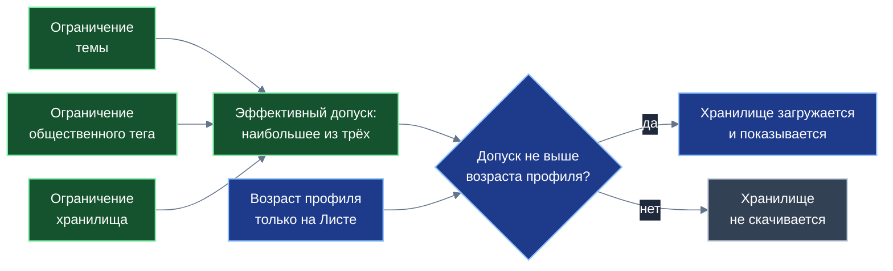
*Схема 2. Три открытых ограничения сводятся к максимуму; решение принимает Лист по возрасту, который не покидает устройство.*

Результирующий эффективный допуск объекта формируется как максимум из ограничений его темы, присвоенных общественных тегов и самого хранилища:

$$A_{\text{eff}} = \max\big(A_{\text{тема}},\; A_{\text{тег}},\; A_{\text{хран}}\big)$$

Отображение объекта на экране устройства пользователя считается допустимым тогда и только тогда, когда эффективный допуск не превышает подтверждённого возраста текущего локального профиля:

$$A_{\text{eff}} \le A_{\text{польз}}$$

Ключевой гарантией системы является то, что проверка этого условия встраивается ядром Листа автоматически в каждый поисковый и аналитический запрос к локальной базе данных. Разработчик прикладного приложения не пишет код проверки возраста вручную и лишён технической возможности обойти её из пользовательского интерфейса. При конструировании запроса прикладной разработчик определяет лишь режим обработки связанных структур данных:

| Признак | Строгий режим (внутреннее соединение) | Мягкий режим (внешнее соединение) |
| :--- | :--- | :--- |
| **Что получает пользователь** | Только те комплексные записи, у которых разрешены все связанные составные части | Записи с показом разрешённых частей; недопустимые части не возвращаются |
| **Прикладной сценарий** | Маршрут, содержащий категорийное скальное ответвление с допуском 16, для ребёнка 11 лет скрывается целиком | Основной безопасный семейный маршрут отображается, а опасное ответвление с допуском 16 исключается из выдачи |
| **Критерий выбора разработчиком** | Составная часть теряет практический смысл или безопасность без остальных элементов | Составная часть полезна и безопасна сама по себе даже при скрытии недоступных ответвлений |
| **Общий инвариант безопасности** | Записи, превышающие возраст активного профиля, исключаются из выдачи в обоих режимах | |

Вторым рубежом защиты выступает упреждающее отсечение данных (Pre-emptive Pruning). Если эффективный допуск хранилища $A_{\text{eff}}$ превышает возраст профиля пользователя $A_{\text{польз}}$, Лист вообще не отправляет сетевой запрос на скачивание данного хранилища со связного узла («Ветки»). Это даёт тройной положительный эффект: радикально экономится мобильный сетевой трафик, не расходуется постоянная память смартфона, а на устройстве ребёнка физически отсутствуют недопустимые материалы, что исключает возможность их извлечения даже при прямом анализе файлов операционной системы.

При этом защита тайны частной жизни остаётся абсолютной: числовой возраст пользователя хранится исключительно в локальной защищённой памяти Листа. Ветки и Ствол оперируют лишь открытыми сведениями о хранилищах (их идентификаторами, контрольными суммами и присвоенными допусками), никогда не получая сведений о возрасте конкретного человека. Сам механизм подтверждения возраста проектируется нейтральным к источнику удостоверения: от локального родительского контроля внутри семьи до государственных шлюзов идентификации, если такое требование будет установлено законодательством страны.

| Узел платформы | Что видит данный узел | Чего данный узел принципиально не видит |
| :--- | :--- | :--- |
| **Лист пользователя** | Свой локальный профиль, возраст участников, открытые сведения о доступных хранилищах | Профили, списки задач и маршруты других участников сети |
| **Ветка (районный узел)** | Открытые сведения о хранилищах (допуск, тема), список запрошенных идентификаторов хранилищ | Числовой возраст пользователя, состав семьи, маршруты внутри хранилищ |
| **Ствол (национальный узел)** | Сводные статистические срезы реестров и открытые метаданные тем | Локальные профили и индивидуальные запросы конкретного Листа |
| **Соседний Лист в сети** | Только те материалы и отчёты, которые пользователь явно опубликовал в открытом хранилище | Семейный профиль, личные заметки, историю перемещений и неотправленные треки |

**Границы применения механизма:**
1. Надежность работы возрастного допуска непосредственно зависит от достоверности возраста, указанного в локальном профиле устройства. Система предотвращает непреднамеренный доступ ребёнка к нежелательным материалам, однако не заменяет родительского внимания и воспитания.
2. Необходимо строго различать два смысла возрастной шкалы: законодательно установленный допуск к информационной продукции и экспертную оценку физической пригодности туристического маршрута. Настоящая работа не объявляет физические пороги юридическими нормами.
3. Состав идентификаторов запрашиваемых хранилищ теоретически может позволить внешнему наблюдателю косвенно предположить возрастную группу пользователя. В качестве перспективной защитной меры проектируется предварительная загрузка полных открытых списков метаданных района с последующей фильтрацией на Листе.
4. Разграничение доступа к отдельным записям внутри одного хранилища с использованием разных ключей шифрования относится к перспективным направлениям развития криптографического ядра платформы; на текущем этапе действует строгое разграничение на уровне неделимых хранилищ.

---

## 3. Семейное путешествие: профиль, порог и разбиение на хранилища

Организация совместного отдыха родителей с детьми разного возраста представляет собой сложную логистическую задачу, в которой требования к безопасности, физической доступности и эмоциональной насыщенности маршрута часто вступают в прямое противоречие. То, что доступно и интересно подростку тринадцати лет (крутые скальные гребни, категорийные подъёмы, длительные переходы), оказывается физически непосильным или опасным для пятилетнего ребёнка, которому требуются пологие тропы, частые привалы, обустроенные санитарные зоны и гарантированная близость питьевой воды.

В приложении «УраТур» вся информация о составе семейной группы концентрируется в локальном семейном профиле на Листе родителей. Профиль включает возраст каждого участника, его индивидуальный походный опыт, физические особенности и ограничения. Эти данные никогда не передаются во внешнюю сеть и служат основанием для локальной фильтрации маршрутов.

Для простых однодневных путешествий (прогулок по городским паркам, экскурсий в музеи-заповедники, выходов к оборудованным пригородным полянам) отбор вариантов производится по строгому правилу семейного порога. Порог семьи вычисляется как возраст самого младшего участника экспедиции:

$$A_{\text{семья}} = \min_{u \in \text{Семья}} \text{Age}_u$$

Применение данного порога в поисковом запросе автоматически отсекает из выдачи любые маршруты, сложность или информационный допуск которых превышают возможности младшего ребёнка: из перечня предложений исключаются скальные осыпи, глубокие броды, маршруты вдоль неограждённых обрывов и протяжённые переходы без источников питьевой воды.

Однако для сложных и многодневных экспедиций использование единого порога по младшему участнику привело бы к искусственному обеднению программы для старших детей и взрослых. В таких ситуациях в «УраТуре» применяется ключевое проектное правило платформы: **мульти-хранилищная декомпозиция экспедиции**. Поскольку хранилище является неделимой атомарной единицей шифрования и допуска, сложная составная поездка разделяется на несколько функциональных хранилищ:
1. **Общесемейное базовое хранилище (допуск 0+):** включает координаты подъезда на автомобиле, точку автостоянки, оборудованный базовый лагерь с костровищем, безопасную дощатую экологическую тропу к лесному роднику и визит-центр природного парка. Это хранилище синхронизируется на устройства всех членов семьи, включая пятилетнего ребёнка.
2. **Категорийное радиальное хранилище (допуск 12+):** описывает радиальный выход на высокогорный скальный хребет с суммарным набором высоты 650 метров, прохождением каменистых осыпей-курумников, крутыми участками с перильной страховкой и видовыми площадками на гребне. Данное хранилище синхронизируется исключительно на смартфоны родителей и тринадцатилетнего подростка.

На смартфоне младшего ребёнка второе хранилище физически отсутствует: благодаря механизму упреждающего отсечения ядро Листа не запрашивает его с районной Ветки. В результате ребёнок не видит рискованных ответвлений в своём интерфейсе и не стремится отклониться от безопасного базового периметра.

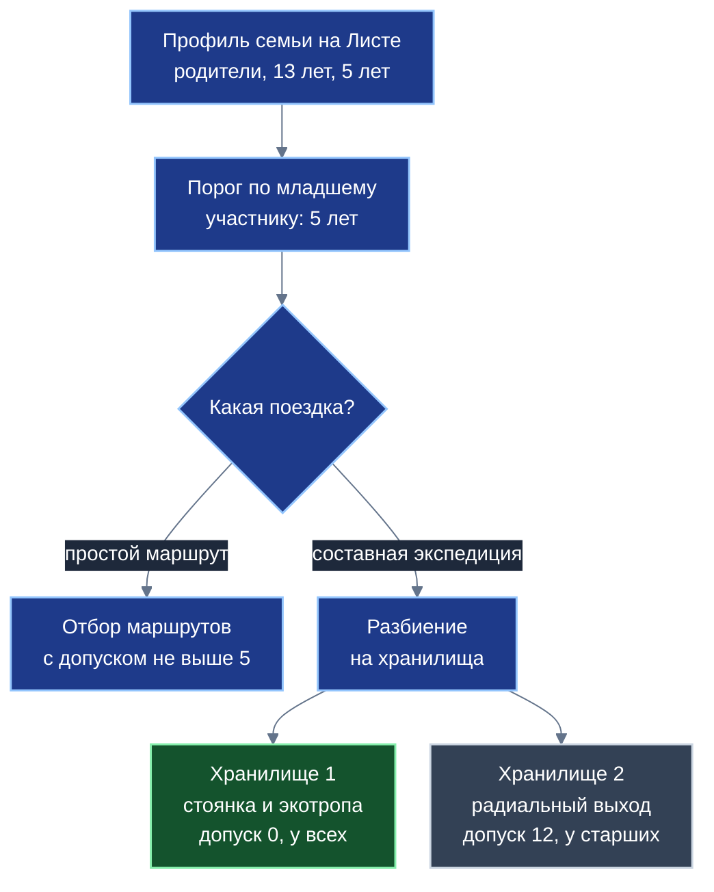
*Схема 3. Условный пример: на устройстве младшего ребёнка второго хранилища нет.*

Оба механизма — фильтрация по порогу младшего и мульти-хранилищная декомпозиция — гармонично дополняют друг друга. В дорожную карту развития «УраТура» закладывается стандартизированная структура цифровой карточки маршрута, включающая комплекс объективных физических и эксплуатационных параметров:
- протяжённость в километрах и суммарный набор высоты;
- наибольший уклон на критических участках;
- категорию технической сложности (от 1 — семейная прогулка до 5 — категорийная экспедиция);
- наличие проверенных источников питьевой воды и обустроенных санитарных зон;
- доступность для перемещения с детскими и прогулочными колясками;
- долю маршрута, находящуюся в зоне уверенного приёма сотовой связи;
- нормативное расчётное время прибытия спасательных подразделений МЧС;
- рекомендуемую сезонность и чувствительность тропы к затяжным дождям или паводкам.

Для предварительной калибровки семейных планов в системе используются проектные ориентиры допустимых нагрузок для детей различных возрастных групп:

| Возрастная категория | Наибольший переход за день | Наибольший набор высоты | Тип допустимого покрытия | Необходимые инфраструктурные условия |
| :---: | :---: | :---: | :--- | :--- |
| **0–3 года** | до 3 км (коляска, слинг) | до 50 м | Асфальт, утрамбованный грунт, настилы | Близость медпункта, оборудованные санитарные зоны |
| **4–6 лет** | до 5–6 км | до 150 м | Утоптанные грунтовые тропы без осыпей | Питьевые родники, отсутствие обрывов и бродов |
| **7–11 лет** | до 12–15 км | до 400 м | Лесные тропы, умеренные каменистые участки | Наличие навесов и укрытий, устойчивая сотовая связь |
| **12–15 лет** | до 20–25 км | до 900 м | Горные тропы, курумник, неглубокие броды | Навыки ориентирования, предварительный инструктаж |

*Ориентиры проектные, требуют проверки специалистами; не являются нормами.*

---

## 4. Общественные теги и кооперативная индексная сеть

Классификация объектов окружающего мира в туризме и краеведении принципиально многомерна. Любой природный или исторический ориентир — родник, перевал, скальный останец, стоянка у реки или пещера — одновременно характеризуется множеством независимых срезов:
- тематическим (семейный отдых, спортивный сплав, историческая реконструкция, геологический памятник);
- сезонным и временным (доступно в мае, золотая осень, проходимо по зимнику, паводковая опасность);
- географическим и ландшафтным (бассейн реки, горный хребет, карстовая полость, темнохвойная тайга);
- эксплуатационным и бытовым (питьевая вода проверена, место под палатки, оборудованное костровище, доступность для маломобильных граждан).

Попытка уложить такое богатство признаков в жёсткую иерархическую структуру («папки внутри папок») неизбежно ведёт к дублированию сущностей или потере смысловых связей. В то же время централизованные каталоги и коммерческие витрины страдают от двух системных уязвимостей: зависимости описаний от произвола владельца витрины (платное продвижение позиций, цензура или удаление объектов) и риска замусоривания (спам, накрутки ботами, нерелевантные рекламные отметки).

Платформа «Турбаза» решает эту дилемму через архитектуру **общественных тегов и кооперативной индексной сети**. Важно подчеркнуть принципиальное различие между механизмами каталогизации:

| Признак сравнения | Личная и внешняя метка («Деловой») | Общественный тег («УраТур») |
| :--- | :--- | :--- |
| **Место физического хранения** | На персональном устройстве владельца (Листе) | В распределённом открытом реестре индексных узлов сети |
| **Область видимости** | Строго конфиденциальна, видна только создателю | Публична, доступна для поиска всем участникам экосистемы |
| **Функциональное назначение** | Персональная приоритизация и каталогизация личных планов | Общественная каталогизация троп, стоянок, родников и памятников |
| **Формирование правил проверки** | Индивидуальное решение владельца метки | Регламент профильного кооператива энтузиастов |
| **Состав сохраняемой записи** | Локальная метка и ссылка на идентификатор объекта | Компактная запись связи общественного тега и хранилища |
| **Возрастное разграничение** | Не применимо к личным заметкам на Листе | Закрепляется за тегом и участвует в расчёте допуска |

Основу открытой каталогизации составляют тематические кооперативы энтузиастов — добровольные объединения, обладающие глубокими предметными компетенциями в своей сфере: клубы водного туризма, краеведческие общества, ассоциации сельского и экологического туризма, добровольные поисково-спасательные и маркировочные отряды (например, «Кооператив водных маршрутов Урала»). Кооператив вырабатывает прозрачные стандарты верификации меток, координирует маркировку троп на местности и поддерживает инфраструктуру распределённых индексных узлов.

**Индексный узел** представляет собой стационарный домашний или офисный компьютер участника кооператива, обладающий постоянным широкополосным подключением к сети и сдаваемый кооперативу в аренду. В отличие от тяжёлых файловых хранилищ, индексный узел не хранит фотографии, видеозаписи и подробные треки: он обслуживает исключительно сверхлёгкие **записи связи** между тегом и хранилищем объекта:
- глобальный идентификатор хранилища (16 байт);
- название объекта (в среднем 48 байт);
- метку времени создания объекта (8 байт);
- метку времени присвоения тега (8 байт);
- географические границы территории — ограничивающий прямоугольник (16 байт);
- контрольную сумму (хэш) текущего состояния хранилища (32 байта).

Суммарный размер одной записи связи составляет порядка ста с небольшим байт (около 128–150 байт). Благодаря такой компактности стандартный накопитель ёмкостью 300 Гбайт при средней заполненности страниц около 69% способен вместить порядка 700 миллионов записей связей, обеспечивая обслуживание целых регионов без закупки дорогостоящего серверного оборудования.

Поскольку объект может быть создан много лет назад, а новый общественный тег присвоен ему сегодня, в системе явно сосуществуют две временные координаты ($t_{\text{созд}}$ и $t_{\text{тег}}$). В результате новые записи связи регулярно вставляются в середину хронологической шкалы. Для эффективного поиска по времени индексный узел организует записи в **хронологическое сбалансированное B+-дерево**. Ключом дерева выступает пара «временная метка, хэш идентификатора». При заполнении страницы (емкостью 512 записей) страница делится пополам, медианный ключ перемещается на верхний ярус, а листовые узлы связываются двунаправленными ссылками.

Глубина такого дерева при ёмкости страницы в сотни записей растёт крайне медленно:

$$h \le \left\lceil \log_{256} N \right\rceil$$

Для массива в один миллион записей глубина дерева составляет всего 3 уровня, а для массива в миллиард записей — 4 уровня, что гарантирует мгновенный логарифмический поиск. Двунаправленная связь между листьями обеспечивает эффективное чтение временных интервалов («сплавы за май 2026 года») без возврата к корню дерева, а курсорная выдача (пара «время, идентификатор последней записи») исключает пропуски и повторы при одновременных параллельных вставках.

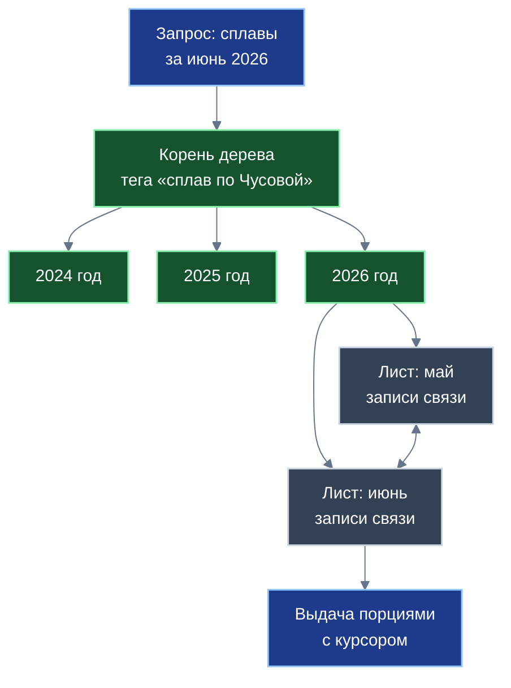
*Схема 4. Листья дерева связаны в обе стороны: период читается без возврата к корню.*

При выполнении сложных поисковых запросов с несколькими тегами (например, «Южный Урал», «пеший поход», «стоянка с родником», «детский маршрут») прямолинейная перекачка всех списков на пользовательское устройство потребовала бы передачи десятков мегабайт трафика (13–22 Мбайт). Вместо этого применяется алгоритм координированной сборки. Сервер сборки групп тегов предварительно опрашивает индексные узлы о мощности каждого тега и выстраивает последовательность обработки строго от наименьшего (самого селективного) списка к наибольшему:

$$\text{детский маршрут (84)} \longrightarrow \text{стоянка с родником (3 200)} \longrightarrow \text{пеший поход (45 000)} \longrightarrow \text{Южный Урал (120 000)}$$

Пересечение упорядоченных списков осуществляется с использованием прыжкового алгоритма (Leapfrog Triejoin, Veldhuizen, 2014). Временная сложность такого соединения оценивается как:

$$O\left(k \cdot N_{\min} \cdot \log\frac{N_{\max}}{N_{\min}}\right)$$

Для 84 исходных элементов самого редкого тега алгоритм выполняет логарифмические прыжки по старшим индексам (порядка 880 шагов на пару списков), передавая по сети лишь точечные шестнадцатибайтные идентификаторы (суммарно около 1,3 Кбайт). В результате проверки отсекаются нерелевантные объекты, оставляя на выходе 19, а затем ровно 12 проверенных стоянок.

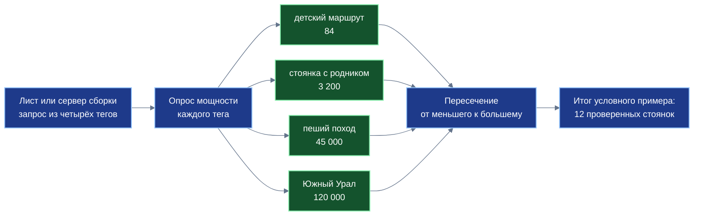
*Схема 5. Числа условные. Пересечение начинается с самого малочисленного тега, поэтому по сети идут лишь идентификаторы.*

Если пользователь ищет редкую или сугубо личную комбинацию меток и не желает раскрывать вектор своих интересов внешним серверам сборки, операция пересечения переносится на Лист. Устройство запрашивает у узлов только компактные срезы редких тегов по отдельности и производит прыжковое пересечение в оперативной памяти. В этом случае ни один сторонний узел сети не видит полного состава запроса.

Оперативная производительность сети поддерживается трехуровневым кэшированием на индексных узлах:
- оперативная очередь FIFO для мгновенно меняющихся выборок (оперативные предупреждения о ветровалах, размывах мостов или весенних паводках);
- алгоритмы вытеснения LRU/LFU для долговременных региональных срезов;
- постоянный срез «Топ-1000 новейших объектов» в оперативной памяти каждого узла.

| Потенциальный риск сети | Сущность риска | Проектное направление защиты (без абсолютных гарантий) |
| :--- | :--- | :--- |
| **Временная недоступность узла** | Домашний компьютер участника отключен от сети | Закрепление каждого тега за группой резервных узлов; автоматическое переключение |
| **Недобросовестный узел** | Выдача неполных или сфальсифицированных списков | Сверка контрольной суммы состояния хранилища с локальным Листом и соседними узлами |
| **Замусоривание тегов спамом** | Массовая простановка нерелевантных меток | Верификация авторов по рейтингу Опыта в «Заботе»; коллегиальная модерация кооператива |
| **Утечка вектора интересов** | Сопоставление сетевого адреса с запрашиваемыми тегами | Раздельные асинхронные запросы к разным узлам; локальная сборка списков на Листе |
| **Юридическая ответственность** | Статус арендатора домашнего индексного узла | Узлы оперируют лишь компактными метаданными; выработка правового регламента кооперативов |
| **Сезонные всплески нагрузки** | Массовые запросы в период летних отпусков | Готовые срезы популярных направлений в оперативной памяти; распределение очередей |

---

## 5. Механическая подача идей

В современных цифровых сервисах подбор вариантов путешествий традиционно возлагается на закрытые алгоритмические «чёрные ящики» — так называемые рекомендательные системы. Пользователь не имеет возможности проверить, почему ему предложен конкретный отель, база отдыха или экскурсионный маршрут, а коммерческие поставщики имеют экономический стимул продвигать оплаченные позиции и рекламные интеграции в ущерб объективным интересам туриста.

В приложении «УраТур» реализован принципиально иной подход: **механическая, алгоритмически прозрачная и проверяемая подача идей**. Подбор маршрута представляет собой строгий математический конвейер, в котором полностью отсутствуют скрытые коммерческие веса, а результат вычислений строго детерминирован и воспроизводим: один и тот же набор входных условий гарантированно порождает один и тот же перечень предложений.

Система черпает варианты из трёх независимых источников:
1. **Готовые проверенные шаблоны в теме «Заботы»:** маршруты выходного дня, школьные краеведческие экспедиции, кольцевые прогулки по малым городам. Гражданин загружает шаблон в один клик, адаптирует его под параметры своей семьи и сохраняет как автономное Дело в личное хранилище.
2. **Открытые хранилища краеведов и энтузиастов («А как насчёт такого плана?»):** путешественники публикуют свои завершённые маршруты в открытых ветках для взаимного обсуждения. Пользователь может скопировать удачный маршрут целиком или позаимствовать его отдельные участки, при этом исходные личные даты и семейные данные автора остаются закрытыми.
3. **Локальный детерминированный синтез на Листе:** устройство сопоставляет свободные временные интервалы из календаря органайзера «Деловой», открытые точки интереса в заданном радиусе транспортной доступности и параметры семейного профиля.

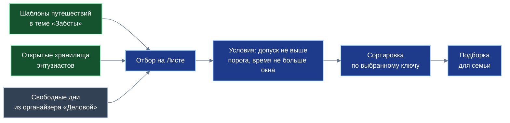
*Схема 6. Один и тот же ввод даёт один и тот же вывод; ключ сортировки выбирает пользователь.*

Выбор источника данных полностью принадлежит гражданину: если человек предпочитает полную изоляцию, подбор идей осуществляется исключительно на Листе по предварительно загруженным данным без единого обращения к внешним узлам.

Конвейер механического отбора состоит из последовательных шагов:
- Шаг 1: Конъюнкция общественных тегов (формирование базового списка кандидатов через индексную сеть или локальную базу данных);
- Шаг 2: Проверка возрастного допуска ($A_{\text{eff}} \le A_{\text{семья}}$);
- Шаг 3: Сопоставление расчётного времени маршрута со свободным окном календаря в «Деловом» ($T_{\text{план}} \le T_{\text{окно}}$);
- Шаг 4: Прозрачная сортировка по выбранному пользователем объективному ключу:
  - по геометрической близости к текущей точке или базовому лагерю;
  - по дате последней проверки состояния тропы волонтёрами;
  - по минимальному суммарному перепаду высот.

| Этап конвейера | Входные данные | Критерий фильтрации или действия | Проверка воспроизводимости |
| :--- | :--- | :--- | :--- |
| **1. Пересечение тегов** | Общественные теги | Конъюнкция множеств через прыжковое пересечение | Тождественный состав записей связей |
| **2. Возрастной фильтр** | Возраст младшего ($A_{\text{семья}}$) | Исключение объектов с $A_{\text{eff}} > A_{\text{семья}}$ | Строгое математическое неравенство |
| **3. Временной фильтр** | Календарь «Делового» | Расчётное время маршрута $T_{\text{план}} \le T_{\text{окно}}$ | Сверка с графиком занятости на Листе |
| **4. Упорядочивание** | Пользовательский ключ | Сортировка по возрастанию или убыванию метрики | Детерминированный порядок в выдаче |

В системе принципиально отсутствует коммерческое ранжирование: ни один объект не может подняться в списке выдачи за счёт рекламной оплаты. Пользователь в любой момент может изменить критерий сортировки и непосредственно наблюдать, как меняется результирующая подборка.

---

## 6. Статистический конвейер на Листе: планирование

Планирование реального пешеходного или комбинированного перехода требует точного математического моделирования затрат времени и физических сил группы. Если расчёт производится с ошибкой, группа рискует не успеть до наступления темноты до оборудованной стоянки, что в условиях горно-таёжного рельефа резко увеличивает риск переохлаждения, травматизма и потери ориентиров.

В приложении «УраТур» расчёт характеристик перехода возлагается на детерминированный статистический конвейер, работающий непосредственно на Листе. Конвейер непрерывно обрабатывает четыре входных информационных потока:

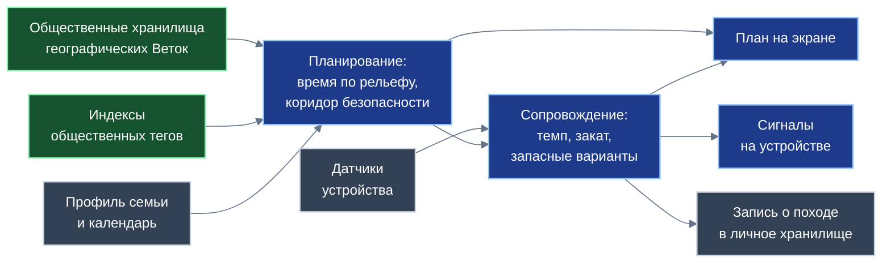
*Схема 7. Расчёты выполняются на устройстве; личные данные и телеметрия наружу не уходят.*

Базовый расчёт скорости передвижения группы по рельефу опирается на классическую эмпирическую зависимость, предложенную швейцарско-американским географом Вальдо Тоблером (Tobler's Hiking Function, 1993):

$$W(s) = 6\,\exp\left(-3{,}5\,\lvert s + 0{,}05\rvert\right)\ \text{км/ч}$$

где $s = \tan\theta = \Delta h / \Delta d$ представляет собой уклон склона (подъём положителен, спуск отрицателен). На идеальной горизонтали опорная скорость составляет $W(0) \approx 5{,}04$ км/ч. Наибольшая скорость (около 6,0 км/ч) достигается при лёгком комфортном спуске с уклоном $s = -0{,}05$ (около −5%). При крутых спусках скорость начинает падать из-за необходимости торможения и контроля постановки стопы, а на крутых подъёмах темп движения снижается экспоненциально.

Нормированная расчётная скорость движения группы на конкретном элементарном отрезке маршрута вычисляется с учётом базового темпа пешехода, характера дорожного покрытия и состава участников:

$$v(s) = v_0 \cdot \frac{W(s)}{W(0)} \cdot K_{\text{пов}} \cdot K_{\text{гр}},\quad v_0 = 5{,}0\ \text{км/ч}$$

Для различных типов поверхностей приняты следующие проектные коэффициенты покрытия $K_{\text{пов}}$:
- асфальтированные парковые дорожки, деревянные настилы: $1{,}0$;
- утрамбованная сухая лесная грунтовка: $0{,}9$;
- каменистые горные тропы, курумники: $0{,}6$;
- заболоченные низины, влажный песок, сыпучая осыпь: $0{,}4$.

Коэффициент готовности группы $K_{\text{гр}} \in [0{,}5;\ 1{,}0]$ калибруется по самому медленному участнику:

$$K_{\text{гр}} = \min_{u \in \text{Группа}} \psi(\text{возраст}_u,\ \text{подготовка}_u)$$

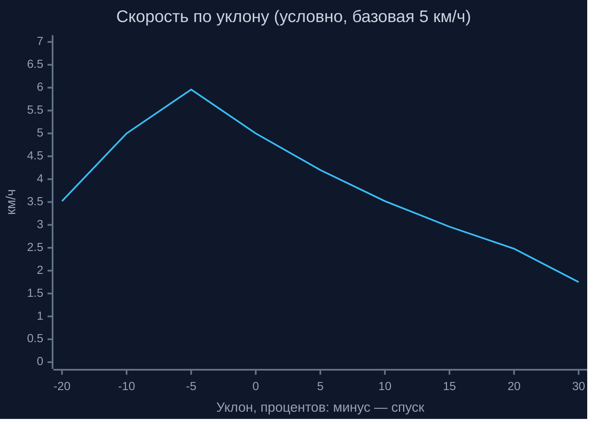
*Схема 8. Наибольшая скорость на лёгком спуске; на подъёмах скорость падает быстро. Значения условные, без поправок на покрытие и группу.*

Общее расчётное время маршрута складывается из чистого времени движения и обязательных технологических привалов:

$$T_{\text{план}} = \sum_{i=1}^{N} \frac{\Delta L_i}{v(s_i)} + \sum_{j=1}^{M} T_{\text{прив}}^{(j)}$$

Для групп с детьми действует проектное правило распределения привалов: десять минут отдыха на каждые пятьдесят минут непрерывного движения.

**Условный вычислительный пример:** Семья с ребёнком планирует переход, состоящий из двух участков:
- Участок 1: 3,0 км по ровной лесной тропе ($s = 0\%$, $K_{\text{пов}} = 0{,}9$, $K_{\text{гр}} = 0{,}6$). Скорость составляет $v_1 = 5{,}0 \cdot 1{,}0 \cdot 0{,}9 \cdot 0{,}6 = 2{,}7$ км/ч. Время движения: $3{,}0 / 2{,}7 \approx 1{,}11$ ч (66,7 минут).
- Участок 2: 1,0 км с подъёмом $10\%$ по той же тропе ($W(0{,}10) \approx 3{,}55$ км/ч). Скорость составляет $v_2 = 5{,}0 \cdot (3{,}55 / 5{,}04) \cdot 0{,}9 \cdot 0{,}6 \approx 1{,}90$ км/ч. Время движения: $1{,}0 / 1{,}90 \approx 0{,}526$ ч (31,5 минут).
- Суммарное время движения: $66{,}7 + 31{,}5 = 98{,}2$ минут. Количество обязательных привалов: $\lfloor 98{,}2 / 50 \rfloor = 1$ привал длительностью 10 минут.
- Полное плановое время перехода: $98{,}2 + 10{,}0 = 108{,}2$ минут (1 час 48 минут).

На этапе планирования конвейер также рассчитывает **коридор безопасности** — непрерывный профиль расстояний от каждой точки нитки маршрута до ключевых объектов жизнеобеспечения: источников питьевой воды, оборудованных укрытий от непогоды, автомобильных дорог общего пользования и границ зон устойчивой сотовой связи. Для каждой возрастной категории задаётся проектный предельный радиус автономности (например, не далее 7 км от проезжей дороги для семей с детьми до 8 лет). В случае выхода нитки маршрута за пределы радиуса система формирует предупреждение и предлагает промежуточные точки схода.

*Оговорки:* зависимость Тоблера выведена для пеших переходов налегке и не учитывает вес экспедиционных рюкзаков, штормовой ветер и накопление физической усталости; проектные коэффициенты требуют уточнения в полевых испытаниях.

---

## 7. Сопровождение в пути: темп, свет и перестройка маршрута

Реальные условия похода неизбежно вносят коррективы в исходный график: дети устают, ухудшается погода, тропу может размыть дождём или завалить упавшими деревьями. В тайге, горах или глубоких ущельях сотовая связь отсутствует на протяжении десятков километров. Если навигационная система способна работать только при наличии подключения к серверу, туристы оказываются один на один с нарастающим отставанием от графика.

В «УраТуре» сопровождение группы на маршруте возложено на автономный бортовой контроллер, работающий полностью локально. Контроллер решает ключевую задачу: **обеспечить заблаговременное обнаружение критического отставания от графика и организовать безопасный сход или перестройку маршрута задолго до наступления сумерек**.

Конвейер сопровождения включает следующие функциональные звенья:
1. **Первичная фильтрация шума спутниковых координат:** в условиях плотного леса или скальных ущелий спутниковый сигнал испытывает многолучевые переотражения, приводящие к скачкам координат («дребезгу стоянки»). Локальный фильтр отсекает высокочастотные геометрические выбросы.
2. **Экспоненциальное сглаживание темпа:** мгновенная скорость ходьбы подвержена резким колебаниям при минутных остановках (поправить рюкзак, завязать шнурки, сделать глоток воды). Для оценки реальной динамики вычисляется экспоненциальное скользящее среднее темпа (EMA):
$$v_{\text{ф}}(t) = \alpha\, v_{\text{мгн}}(t) + (1-\alpha)\, v_{\text{ф}}(t-\Delta t),\quad \alpha = \frac{2}{K+1}$$
При окне усреднения $K = 15$ минут и минутном интервале измерений параметр сглаживания равен $\alpha = 0{,}125$.
3. **Отношение фактического темпа к плановому:** контроллер непрерывно сопоставляет сглаженную скорость с плановым нормативом для текущего уклона:
$$\delta_v(t) = \frac{v_{\text{ф}}(t)}{v_{\text{план}}(s(t))}$$
Кратковременные остановки (до 3–5 минут) вызывают локальное проседание сглаженной скорости, однако показатель быстро возвращается в норму. Устойчивым замедлением признаётся ситуация, когда $\delta_v(t) < 0{,}75$ сохраняется непрерывно дольше 30 минут.

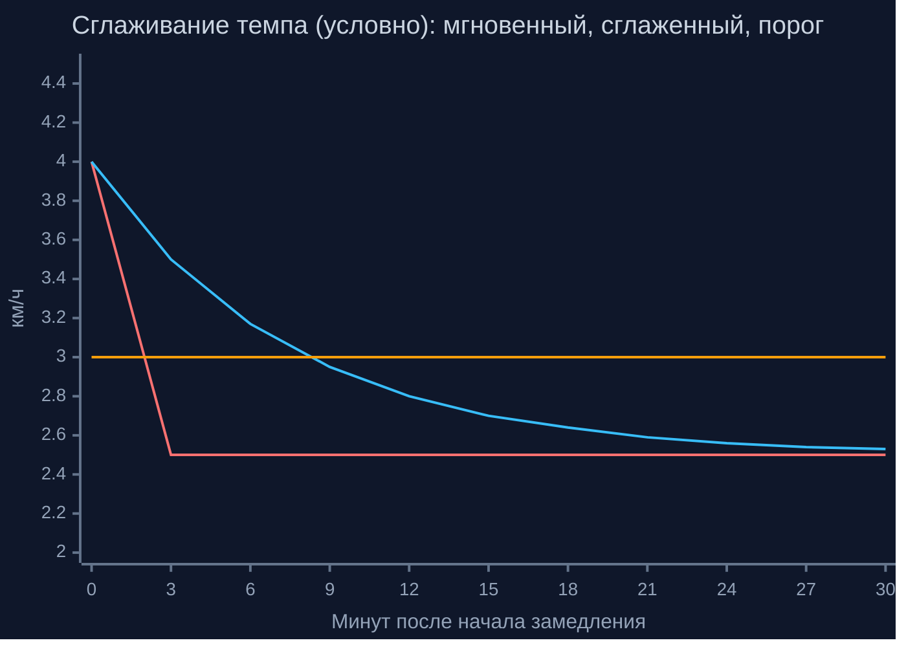
*Схема 10. Сглаженный темп следует за мгновенным с запаздыванием и пересекает порог около девятой минуты; сигнал подаётся, лишь когда снижение выдержано дольше 30 минут. Значения условные.*

4. **Бортовой расчёт захода солнца:** точное астрономическое время захода вычисляется процессором смартфона по общеизвестным формулам небесной механики (алгоритм Ж. Мееса и калькулятора NOAA) на основе текущей географической широты $\varphi$, долготы $\lambda$ и календарной даты, с обязательным учётом атмосферной рефракции и углового диаметра солнечного диска (зенитный угол $90{,}833^\circ$):
$$\cos\omega_0 = \frac{\cos 90{,}833^\circ}{\cos\varphi\,\cos\delta} - \tan\varphi\,\tan\delta$$
где $\delta$ — склонение Солнца, а часовой угол $\omega_0$ переводится в местное солнечное время. В полярных широтах при наступлении полярного дня или полярной ночи ($\lvert \cos\omega_0 \rvert > 1$) закат не определён, о чём система явно информирует пользователя, отключая привязку к сумеркам.
5. **Ожидаемое время прибытия (ETA) и запас светлого времени:** с учётом текущего замедления $\delta_v$ пересчитывается прогноз прибытия на целевую стоянку:
$$\text{ETA} = t + \sum_{k=\text{тек}}^{\text{финиш}} \frac{\Delta L_k}{\delta_v\, v_{\text{план}}(s_k)},\qquad \Delta T_{\text{зап}} = t_{\text{закат}} - \text{ETA}$$
По величине запаса светлого времени $\Delta T_{\text{зап}}$ система классифицирует текущую ситуацию по трём зонам:
- **Зелёная зона ($\Delta T_{\text{зап}} \ge 2$ часа):** запас времени достаточен, группа движется по утверждённому плану;
- **Жёлтая зона ($1 \le \Delta T_{\text{зап}} < 2$ часа):** формируется рекомендация о мягкой коррекции (сократить длительность ближайших привалов для компенсации отставания);
- **Красная зона ($\Delta T_{\text{зап}} < 1$ часа):** активируется режим жёсткой коррекции: контроллер автоматически запускает конечный автомат подбора альтернативных вариантов.

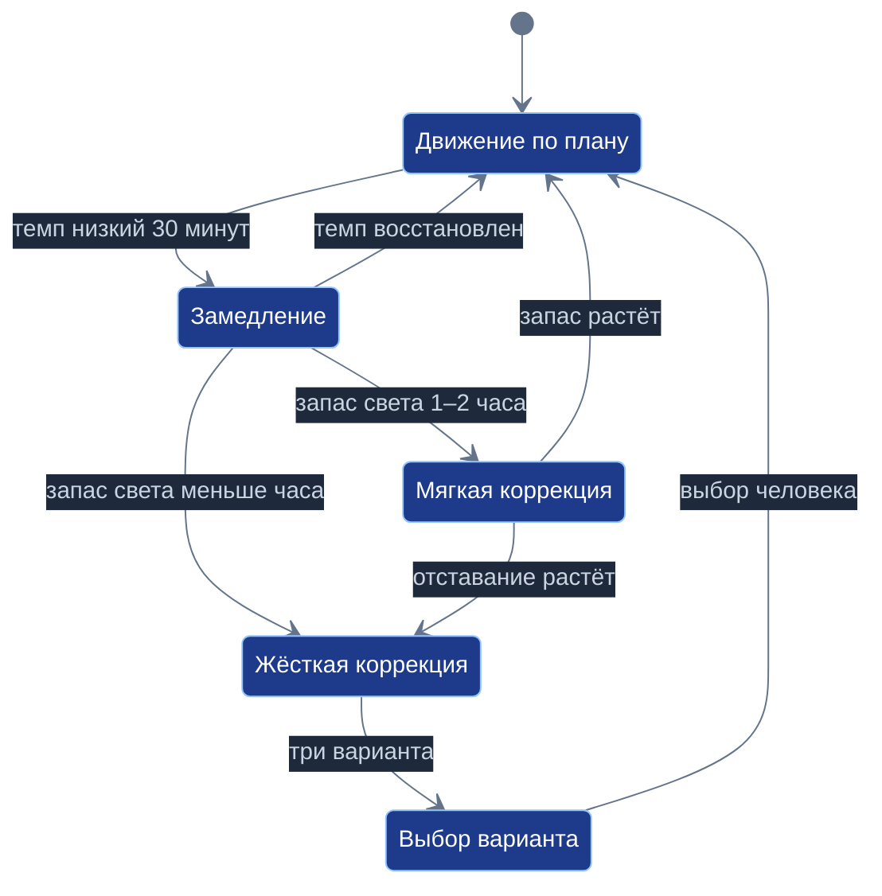
*Схема 9. Автомат только предлагает; план заменяет человек одним нажатием.*

При входе в состояние жёсткой коррекции система формирует для руководителя группы три наглядные готовые альтернативы:
- **Вариант А (Ближайшая промежуточная стоянка):** проверенная стоянка с родником в пределах 1–2 часов пологого хода;
- **Вариант Б (Срезной обход):** отказ от радиального подъёма на вершину и переход по пологой низинной тропе прямо к базовому лагерю;
- **Вариант В (Аварийный сход):** кратчайший безопасный выход к автомобильной дороге общего пользования, доступной для проезда экстренных служб.

Каждый вариант сопровождается карточкой с расчётным временем прибытия засветло, перепадом высот и сложностью. Автомат никогда не принимает решение за человека: замена маршрута происходит только после явного нажатия кнопки руководителем группы. При этом вся телеметрия и история перемещений сохраняются исключительно в личном хранилище Листа и наружу не передаются.

---

## 8. Работа с картографическими сервисами

Создание полноценного автономного приложения для путешествий невозможно в отрыве от развитой картографической инфраструктуры: спутниковых снимков высокого разрешения, актуальных слоёв автомобильных дорог, адресных баз и данных о текущей дорожной обстановке (пробках). В Российской Федерации такой признанной инфраструктурой обладают отечественные сервисы, в первую очередь Яндекс Карты.

Однако традиционное встраивание картографических SDK в мобильные приложения несёт риск компрометации частной жизни: сервис получает не только факт обращения к карте, но и непрерывный поток геопозиций, подробные пешеходные треки по лесным массивам, личные стоянки и сведения о составе семьи.

Платформа «Турбаза» формулирует модель уважительного и взаимовыгодного сотрудничества с поставщиками геоданных, основанную на **трех режимах взаимодействия, архитектурном разделении графа и платформенных смарт-контрактах распределения выручки**.

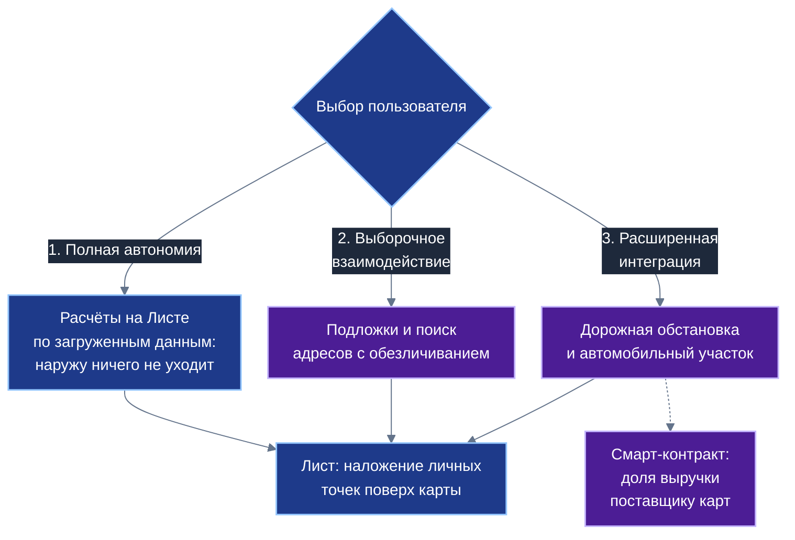
*Схема 11. Степень участия сервиса карт выбирает пользователь; личные точки всегда накладываются на Листе.*

Гражданин свободно выбирает один из трёх режимов взаимодействия в зависимости от стоящей задачи:

| Режим работы | Что передаётся наружу | Что остаётся строго на Листе | Для каких ситуаций предназначен |
| :--- | :--- | :--- | :--- |
| **1. Полная автономия** | Никаких сетевых запросов не отправляется | Все профили, треки, точки интереса и расчеты | Походы в удалённых районах без связи; режим повышенной приватности |
| **2. Выборочное взаимодействие** | Обезличенные запросы тайловых подложек района и поиск адресов | Личные метки, маршруты, состав группы и телеметрия | Подготовка к поездке, изучение детальных картографических слоев |
| **3. Расширенная интеграция** | Запрос дорожной обстановки и маршрутизация автотранспорта | Пешеходные лесные тропы, родники, палаточные стоянки и радиалки | Доезд на автомобиле до точки старта пешеходной части маршрута |

Ключевым инженерным решением выступает **разделение графа движения**. Маршрут естественным образом разделяется на две непересекающиеся части:
- **Автомобильный отрезок («от дома до лесничества»):** прокладывается через API картографического сервиса с учётом дорожной сети, скоростных ограничений и актуальных дорожных заторов;
- **Пешеходный отрезок («от лесничества по хребту до стоянки у родника»):** строится, отображается и сопровождается исключительно на Листе по локальным данным общественных хранилищ.

Внешний картографический сервис видит лишь начальную и конечную точку автомобильного участка (при необходимости начало маршрута может задаваться с приблизительной точностью для маскировки места жительства). Ни одна точка пешеходного трека, ни один радиальный выход и ни одна личная стоянка при штатной работе системы сервису карт не передаются.

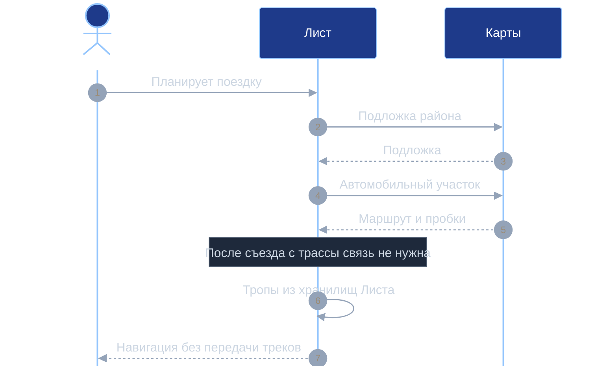
*Схема 12. Сервис карт участвует только в автомобильном участке; пешеходная часть остаётся на Листе.*

Для работы в полевых условиях Лист осуществляет предварительную фоновую загрузку картографической подложки района с запасом (буферной зоной). При этом учитывается, что стандартные условия бесплатного использования открытых API картографических сервисов ограничивают долговременное локальное кэширование геоданных; поэтому реализация данного механизма в промышленной среде предполагает заключение партнёрского соглашения с поставщиком карт на согласованных условиях.

| Передаваемые сведения | Режим 1 (Автономия) | Режим 2 (Выборочный) | Режим 3 (Расширенный) |
| :--- | :---: | :---: | :---: |
| **Географический район подложки** | не передаётся | передаётся (обезличенно) | передаётся |
| **Точки автомобильного участка** | не передаются | не передаются | передаются (старт и финиш авто) |
| **Пешеходные треки и стоянки** | не передаются | не передаются | не передаются |
| **Состав семьи и возраст детей** | не передаются | не передаются | не передаются |
| **Текущее положение в походе** | не передаётся | не передаётся | не передаётся |

Взаимодействие опирается на модель двух независимых контуров учётных записей:
- **Анонимный контур:** используется на этапе предварительного поиска идей и планирования маршрута под временным идентификатором;
- **Подтверждённый расчётный контур:** задействуется на этапе фактического исполнения поездки для расчётов по смарт-контрактам платформы (оплата платных сервисов, автостоянок, лицензий на посещение национальных парков), не связывая историю анонимного поиска с платёжным счётом.

Экономическая модель строится на справедливом распределении выручки от рекламы и сервисных подписок через смарт-контракты платформы (Белая книга № 06). Поставщик картографических услуг получает гарантированную долю за использование его инфраструктуры, а законная десятина (не менее 10% валового дохода) начисляется на счёт гражданина. Поставщик карт также мог бы разработать легковесные специализированные библиотеки для Листа, осуществляющие первичную обработку векторных тайлов непосредственно на устройстве пользователя.

Рекламная составляющая организуется без выгрузки данных о семье: архитектура допускает передачу обезличенных общих статистических срезов района либо загрузку на устройство списков локальных объявлений с их последующим автономным подбором на Листе.

---

## 9. Общественный вклад на семи уровнях

Экосистемное воздействие прикладных решений платформы «Турбаза» раскрывается в соответствии с методологическим каноном, впервые апробированным в руководстве по общественному эффекту органайзера «Деловой» (GoGetter Ecosystem Impact Guide). Социально-экономическая ценность приложения «УраТур» не сводится к удобству отдельного пользователя, а формирует многоуровневую систему взаимных связей и общественных благ.

В основании архитектуры лежат три незыблемых инженерных принципа: автономная обработка данных на Листе, встроенный возрастной допуск с неделимостью хранилищ и открытые кооперативные индексные сети. Опираясь на этот фундамент, приложение приносит ощутимую пользу на семи последовательных уровнях общества:

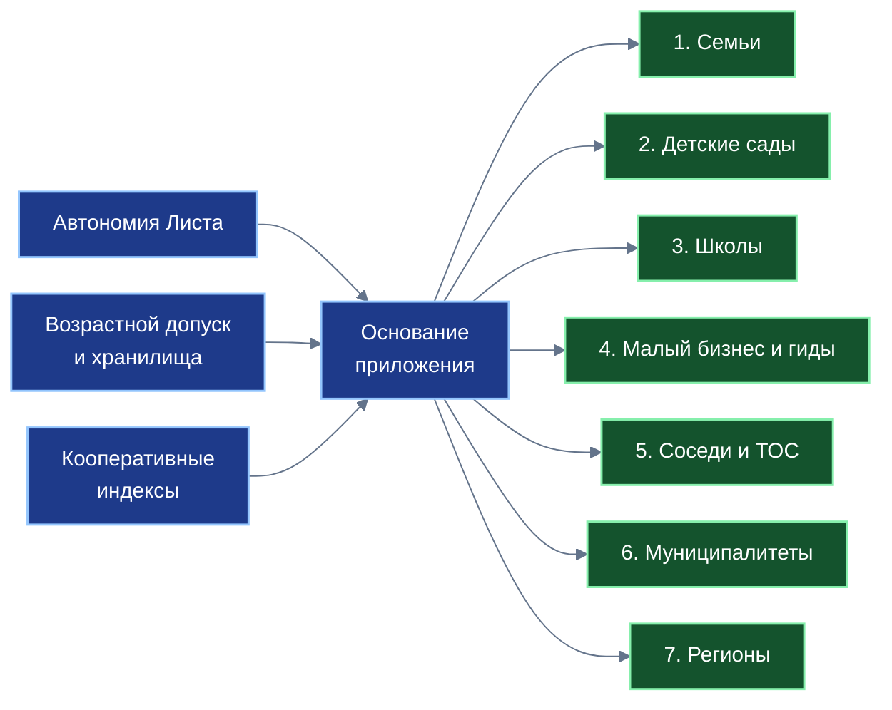
*Схема 13. Три опоры дают ценность на каждом из семи уровней общества.*

1. **Семьи:** родители получают надежный инструмент совместного созидательного досуга. Автоматический отбор маршрутов по семейному порогу $\min(\text{Ages})$ исключает риск попадания с маленькими детьми на опасные или физически непосильные участки. Тайна частной жизни защищена: семейные планы, фотографии и точные перемещения никогда не уходят на внешние серверы.
2. **Детские сады и дошкольные группы:** воспитатели и родители организуют безопасные ознакомительные экскурсии по коротким экологическим микротропам (ориентировочно 1,5–2 км). Карточки маршрутов содержат описания местной флоры и фауны, а строгий возрастной фильтр гарантирует наличие ограждений, пологих настилов, санитарных зон и полное отсутствие опасных крутых склонов.
3. **Школы и учреждения дополнительного образования:** учителя географии, биологии и истории получают среду для проведения «живых уроков» на местности. Подростки на практике осваивают базовые навыки безопасности жизнедеятельности: чтение рельефа, ориентирование без сотовой связи, расчёт ходового времени засветло, бережное отношение к природе и правила разбивки полевого лагеря.
4. **Малый бизнес, самозанятые и краеведческие гиды:** сертифицированные экскурсоводы, инструкторы спортивного туризма, владельцы сельских гостевых домов, пасечники и мастера народных ремёсел получают возможность публиковать свои точки притяжения и авторские программы в открытых географических ветках. Взаимодействие с туристами строится напрямую через смарт-контракты платформы без уплаты посреднических комиссий коммерческим агрегаторам.
5. **Соседи и территориальное общественное самоуправление (ТОС):** жители микрорайонов и поселений создают локальные прогулочные маршруты по окрестным скверам и рощам, фиксируют состояние родников, мостиков и лестниц. Координация благоустройства и проведение экологических субботников осуществляются в органичной связке с приложением «Забота».
6. **Муниципалитеты и администрации округов:** местные органы самоуправления получают доступ к агрегированным обезличенным данным о востребованности туристских направлений без слежки за конкретными людьми. Это позволяет точно планировать установку навигационных указателей, беседок и организацию вывоза мусора, а также заблаговременно перенаправлять потоки отдыхающих для снижения антропогенной нагрузки на хрупкие природные урочища.
7. **Субъекты Российской Федерации (Регионы):** объединение районных Веток формирует единый каркас межрегиональных туристских коридоров (в качестве примеров: Большая Уральская тропа, Байкальская тропа, кольцевые маршруты древних городов). Краеведческие описания сохраняют народные топонимы, сказания и культурное наследие коренных народов, а массив геоданных о тропах и объектах Отечества хранится строго в инфраструктуре Российской Федерации.

| Уровень общества | Основная ценность | Механизм платформы «Турбаза» | Проектная оговорка |
| :--- | :--- | :--- | :--- |
| **1. Семьи** | Безопасный отбор маршрутов; тайна семейных планов | Порог семьи по младшему; локальный семейный профиль на Листе | Параметры выносливости проектные |
| **2. Детские сады** | Короткие экотропы, наглядные карточки живой природы | Допуск 0+; жесткая фильтрация по инфраструктуре безопасности | Протяженность 1,5–2 км как ориентир |
| **3. Школы** | Практическое краеведение, навыки ориентирования в поле | Школьные хранилища программ; шаблоны из темы «Заботы» | Условный пример школьного плана |
| **4. Малый бизнес и гиды** | Прямой выход к туристам без посреднических барьеров | Открытые точки интереса; смарт-контракты расчетов | Без оценочных суждений о чужой практике |
| **5. Соседи и ТОС** | Дворовые тропы; бережный контроль родников и полян | Общественные теги; координация дел через «Заботу» | Без абстрактных экономических прогнозов |
| **6. Муниципалитеты** | Обезличенные данные о нагрузке на рекреационные зоны | Агрегированные статистические срезы по районам Веток | Порядок передачи данных утверждается отдельно |
| **7. Регионы** | Межрегиональные тропы; сохранение культурной памяти | Связывание Веток; хранение данных в юрисдикции РФ | Названия коридоров приведены как примеры |

---

## 10. Три практических примера

Для комплексной иллюстрации работы системы рассмотрим три условных сценария, охватывающих различные масштабы и категории участников:

| Пример | Задействованные главы книги | Что остаётся строго приватным | Что публикуется в открытый контур | Что получает экосистема платформы |
| :--- | :--- | :--- | :--- | :--- |
| **1. Семейная экспедиция на Южный Урал** | Главы 2, 3, 6, 7, 8 | Состав семьи, возраст детей, телеметрия, треки | Добровольный отчёт об отдыхе по завершении | Образец составной поездки и работы контроллера в пути |
| **2. Экотропа детсада и школьный поход** | Главы 2, 3, 5, 9 | Поимённые списки детей, контакты родителей | Описание учебной экотропы и видовой состав | Образец применения возрастного допуска учреждениями |
| **3. Кооператив водных маршрутов** | Главы 4, 5, 8, 9 | Поисковые интересы конкретного сплавщика | Общественные теги и записи связей реки | Образец развёртывания кооперативной индексной сети |

### Пример 1. Составная семейная экспедиция на Южный Урал
Семья из четырёх человек (родители, тринадцатилетний сын и пятилетняя дочь) отправляется в трёхдневный поход в горно-таёжный район Южного Урала (условный район национального парка Таганай).
1. **Подготовка и разделение данных:** на Листе родителей формируется план из двух хранилищ:
   - *Хранилище 1 (допуск 0+):* автомобильный подъезд к центральной усадьбе парка, стоянка, оборудованный палаточный приют у подножия хребта и обустроенная дощатая тропа к роднику Белый Ключ. Это хранилище загружается на смартфоны всех участников.
   - *Хранилище 2 (допуск 12+):* сложный радиальный выход на вершину скального хребта через курумники с набором высоты 650 метров. Хранилище загружается только на устройства родителей и сына; на смартфоне пятилетней дочери оно отсутствует.
2. **Расчёт графика:** статистический конвейер рассчитывает время радиального подъема по функции Тоблера ($K_{\text{пов}} = 0{,}6$, $K_{\text{гр}} = 0{,}8$). Общее расчётное время выхода — 3 часа 40 минут.
3. **События на маршруте:** во время подъёма на курумнике темп старшей группы замедляется из-за дождя. Контроллер сглаживает мгновенные колебания темпа методом экспоненциального скользящего среднего ($\alpha = 0{,}125$). Через 30 минут устойчивого отставания ($\delta_v = 0{,}68$) контроллер рассчитывает точное время захода солнца на широте $55^\circ$ с. ш. (19:20) и определяет, что расчетное время возвращения с вершины смещается на 18:50, сокращая запас светлого времени до 30 минут (красная зона).
4. **Адаптация плана:** конечный автомат активирует подбор альтернатив и выводит руководителю карточку варианта Б: срезной обход траверсом по пологой нижней тропе в базовый лагерь в обход скального гребня с расчётным прибытием в 17:30 (запас 1 час 50 минут). Руководитель группы подтверждает замену маршрута одним нажатием. Вся семья возвращается в лагерь засветло. Личные треки и данные темпа остаются строго в смартфонах участников.

### Пример 2. Экологическая тропа детского сада и школьный краеведческий поход
Воспитатель детского сада и учитель биологии средней школы готовят полевые занятия в пригородном лесопарке.
1. **Подбор идеи:** воспитатель использует приложение «УраТур», выбирая шаблон экскурсии из темы «Заботы». Система производит механический отбор: пересечение тегов «детский маршрут» и «хвойный лес» при жестком возрастном ограничении 0+. В выдачу попадает кольцевой дощатый маршрут протяженностью 1,8 км с оборудованными беседками и наглядными стендами о жизни муравейников и птиц.
2. **Школьная программа:** учитель биологии берёт базовую нитку той же тропы, но расширяет её дополнительным радиальным участком до исторического карьера с геологическими обнажениями (допуск 6+).
3. **Исполнение:** оба мероприятия развёртываются как Дела в «Деловом». Поимённые списки учащихся и медицинские сведения не покидают устройств педагогов. Педагоги дополняют описание объектов новыми фотографиями следов животных и передают обезличенный шаблон обратно в тему «Заботы» на пользу другим образовательным учреждениям.

### Пример 3. Кооператив водных маршрутов
Региональный клуб любителей водного туризма организует каталогизацию сплавных маршрутов по горно-таёжной реке (условно — река Чусовая).
1. **Развёртывание сети:** пять энтузиастов клуба предоставляют стационарные домашние компьютеры под индексные узлы кооператива. На узлах формируются хронологические B+-деревья записей связей по общественным тегам «сплав по Чусовой», «стоянка с родником», «категорийный перекат», «семейный экипаж».
2. **Многотеговый поиск:** семья сплавщиков формирует запрос на поиск стоянки с питьевым родником, пригодной для группы с детьми на участке реки между двумя мостами. Сервер сборки опрашивает мощности тегов и за доли секунды выполняет прыжковое пересечение списков, передавая туристу компактные идентификаторы двенадцати подходящих стоянок (трафик 1,3 Кбайт).
3. **Оперативная актуализация:** при весеннем паводке один из экипажей фиксирует подтопление стоянки у скалы Разбойник. Метка оперативно обновляется в очереди FIFO индексных узлов и мгновенно учитывается всеми группами на воде при получении курсорных обновлений.

---

## 11. Из истории замысла

История приложения «УраТур» занимает исключительное место в летописи разработки платформы «Турбаза». Замысел создания частного автономного планировщика путешествий зародился **девятнадцать лет назад (в 2007 году)** и стал **исторически самой первой идеей создания прикладной программы** в жизни автора платформы Артёма Владимировича Шамсутдинова.

В 2007 году концепция формировалась вокруг человека и его непосредственного взаимодействия с пространством: создать инструмент, который помогал бы путешественнику прокладывать маршруты, бережно хранить воспоминания и исследовать мир в собственном ритме, без привязки к внешним серверам и навязанным алгоритмам. Единственным материальным свидетельством того времени остался лист бумаги с цветным логотипом, нарисованным автором вручную. Позднее цифровая версия этого логотипа заняла достойное место на 27-й странице расширенной русской версии официальной презентации платформы, направленной в Министерство цифрового развития, связи и массовых коммуникаций Российской Федерации.

Художественное решение логотипа отражает глубокий гуманистический замысел автора:
- небесный горизонт с летящим пассажирским лайнером, открывающим просторы дальних путешествий;
- буквы «УРАТУР» в радужной гамме, каждая из которых наполнена символикой движения и познания: горная тропа с победным флажком на вершине, циферблат часов с делениями компаса, геодезический триангуляционный знак и шагающий путник с посохом, вантовый мост над рекой и топографическая карта, объектив фотоаппарата для запечатления моментов;
- широкая дуговая стрелка, символизирующая надёжное, безопасное и гарантированное возвращение домой;
- три стихии перемещения: автомобиль для дорог, моторный катер для водных артерий и пешие туристы с рюкзаками.

Первоначально проект именовался **«Urarun»** — динамичное слияние радостного восклицания «Ура!» и слова «бег», отражавшее концепцию быстрого, вдохновляющего пробега по новым странам и достопримечательностям городов. Впоследствии имя преобразовалось в гармоничное русское название **«УраТур»**.

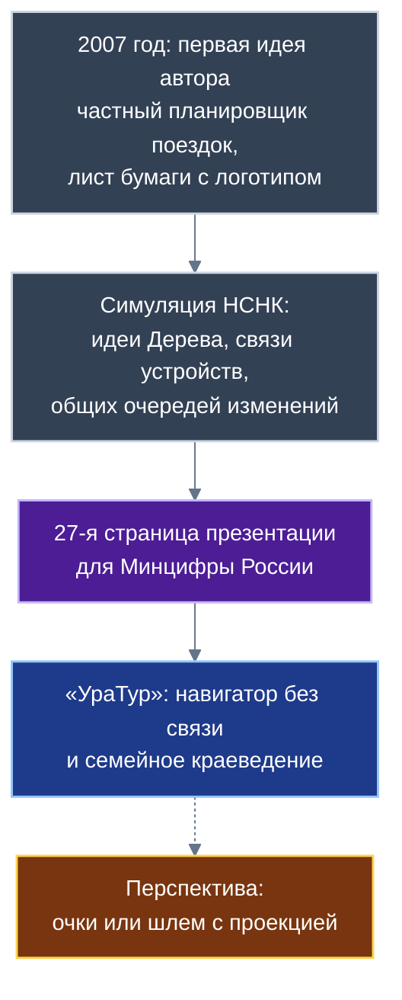
*Схема 14. Путь замысла от рисунка на бумаге до приложения; перспектива показана пунктиром.*

Ключевой этап кристаллизации архитектуры произошёл в ходе разработки концепции тактической симуляции **«Не Смертельный Не Калечащий» бой (НСНК)**. Замысел НСНК носил принципиально гуманистический характер: разработать модель нелетального тактического противоборства, в которой все участники остаются живы, целы и невредимы. Автор оценивает эту мировоззренческую идею как несоизмеримо более важную, чем сама платформа «Турбаза», однако признаёт, что время её широкого воплощения пока не пришло.

При этом именно инженерное моделирование симуляции НСНК позволило сформулировать фундаментальные принципы построения распределённых систем:
1. **Топология Дерева:** для симуляции требовались три независимых контура серверов — по одному на каждую из противоборствующих сторон и третий независимый сервер для наблюдателей («ООН»), транслирующий объективную карту местности. Декомпозиция армейских подразделений (сервер на полк, сервер на батальон) породила иерархическую древовидную топологию «Лист — Ветка — Ствол».
2. **Прямое одноранговое взаимодействие в связке с Ветками:** на тактической карте требовалась прямая связь между устройствами участников (AIRport P2P), однако сама по себе она не могла работать без устойчивой серверной координации («Веток»).
3. **Общие очереди изменений:** необходимость мгновенной синхронизации обстановки без задержек привела к открытию механизма общих очередей изменений в журналах локальных хранилищ.

В ходе проектирования симуляции НСНК родилась и концепция дополненной реальности (AR) — защищённого тактического шлема с оптической проекцией оперативной обстановки, целей и ориентиров непосредственно на стекло перед глазами бойца. В мирном краеведческом навигаторе «УраТур» эта идея трансформируется в перспективную возможность использования легких носимых очков или шлемов: проекцию нитки тропы на развилках, контуров горных вершин, указателей на скрытые родники и кратких исторических справок о памятниках. В настоящем выпуске основной упор сделан на доступный смартфон без связи, однако внутренняя архитектура хранилищ и индексов «УраТура» изначально готова к сопряжению с носимыми устройствами будущего.

---

## 12. Что станет базовым модулем; границы роли; открытые вопросы

### 12.1. Каталог выводимых платформенных модулей
Приложение «УраТур» спроектировано как прикладной полигон платформы «Турбаза». Семь ключевых алгоритмических и инфраструктурных решений, успешно отработанных на задачах навигации и семейного туризма, абстрагируются в универсальные системные модули ядра:

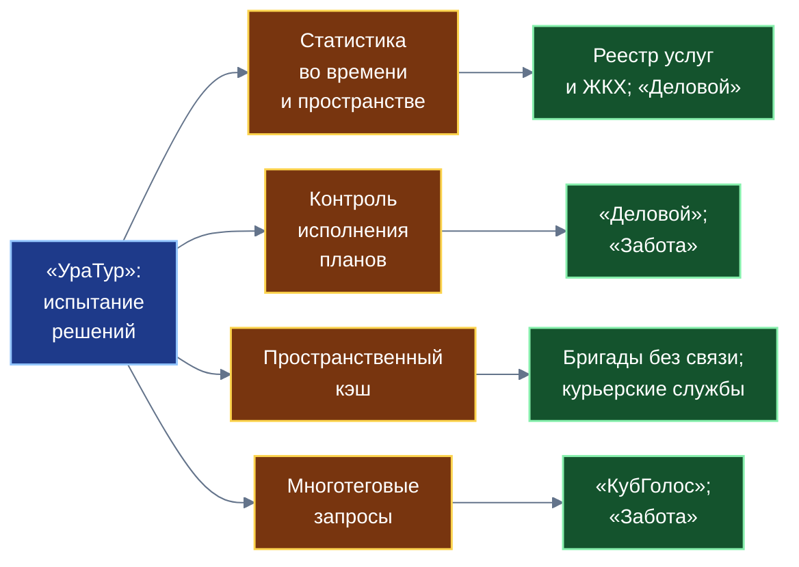
*Схема 15. Четыре статистических модуля, испытанных в «УраТуре», нужны и другим приложениям; остальные модули — в таблице главы 12.*

| Платформенный модуль | Первичная отработка в «УраТуре» | Где будет использоваться в экосистеме платформы |
| :--- | :--- | :--- |
| **Возрастной допуск ядра Листа** | Главы 2 и 3 (защита детей, семейный порог) | Любое приложение экосистемы с разновозрастными материалами |
| **Общественные теги и индексная сеть** | Глава 4 (кооперативы, B+-деревья) | Все приложения с открытыми публичными реестрами |
| **Оптимизатор многотеговых запросов** | Главы 4 и 5 (Leapfrog Triejoin) | Выборка петиций в «КубГолосе», поиск помощи в «Заботе» |
| **Пространственно-временная статистика** | Глава 6 (функция Тоблера, коридоры) | Реестр услуг и ЖКХ (плотность аварий), статистика в «Деловом» |
| **Контроллер исполнения планов** | Глава 7 (EMA-темп, автомат перестройки) | Органайзер «Деловой» (перенос дел), визиты помощи в «Заботе» |
| **Менеджер пространственного кэша** | Глава 8 (буферные зоны тайлов) | Выездные аварийные бригады ЖКХ, курьерские службы без связи |
| **Адаптер внешних сервисов с контрактом** | Глава 8 (смарт-контракт, разделение графа) | Транспортные операторы, логистика, государственные реестры |

Детальные программные спецификации данных библиотек станут предметом Белой книги № 12 («Экосистема платформы «Турбаза»»).

### 12.2. Порядок вывода библиотек в платформу
Перенос решений из прикладного слоя в ядро платформы подчиняется четырехфазному жизненному циклу:
1. *Фаза инкубации:* отработка алгоритмов на реальных полевых треках Южного Урала в составе прикладного кода «УраТура»;
2. *Фаза универсализации:* выделение обобщенных программных интерфейсов, не зависящих от туристской предметной области;
3. *Фаза поставки в ядро:* включение модулей в стандартную поставку дистрибутива Листа платформы «Турбаза»;
4. *Фаза стандартизации:* нормативная фиксация архитектурных спецификаций в Белой книге № 12.

### 12.3. Границы роли приложения
Для исключения неоправданных ожиданий принципиально зафиксировать границы возможностей приложения «УраТур»:
- «УраТур» не подменяет собой государственные спасательные службы (МЧС России) и не гарантирует абсолютную безопасность в походе: статистика на Листе выступает помощником человека, но не отменяет профессиональной подготовки, дисциплины и необходимого снаряжения;
- Приложение не конкурирует с картографическими сервисами и не «заменяет» их, а предлагает модель уважительного партнёрства с сохранением приватности граждан;
- Система не устанавливает юридический возраст человека (это прерогатива законодательства и родителей);
- Приложение не гарантирует безошибочность описаний троп: достоверность поддерживается сообществами туристов и рейтингом Опыта «Заботы»;
- Сервис никогда не передает пешеходные треки внешним картографическим платформам;
- Алгоритмы приложения никогда не принимают решения за человека, оставляя выбор направления руководителю группы.

### 12.4. Открытые вопросы для будущих исследований
Ряд институциональных и инженерных вопросов намеренно отнесен на дальнейшие этапы развития платформы:
1. *Экономика индексных узлов:* определение справедливых механизмов вознаграждения владельцев домашних ПК, сдающих мощности в аренду кооперативам тегов;
2. *Правовые соглашения с картографическими сервисами:* согласование условий долговременного автономного кэширования подложек для работы в зонах отсутствия связи;
3. *Экспертная калибровка нагрузок:* проведение совместных медико-биологических исследований со специалистами спортивного туризма и педиатрии для уточнения коэффициентов выносливости детей;
4. *Косвенное определение возраста по набору хранилищ:* разработка алгоритмов маскировки запросов Листа через предварительное скачивание полных региональных списков метаданных;
5. *Порядок внутренней проверки меток:* регламент разрешения споров внутри кооперативов общественных тегов в зависимости от законодательства стран и моделей децентрализованного управления.

---

## 13. Заключение и связь с комплектом

Белая книга № 11 завершает формирование прикладного квартета флагманских решений платформы цифрового суверенитета государства «Турбаза». Появление приложения «УраТур» наполняет распределённую экосистему новым жизненным качеством — измерением физического пространства, топологии рельефа, времени движения и безопасности подрастающего поколения.

Сквозной анализ архитектурных решений позволяет сформулировать пять главных итогов:
1. **Возрастная защита на уровне ядра:** реализация возрастного допуска непосредственно в поисковом конвейере СУБД Листа доказывает, что эффективная защита детей от нежелательных материалов и чрезмерных физических рисков достижима без сбора персональных документов и без передачи возраста внешним облачным сервисам.
2. **Открытая кооперативная каталогизация:** общественные теги, поддерживаемые профильными объединениями на сбалансированных хронологических B+-деревьях с прыжковым пересечением списков, создают устойчивую альтернативу монопольным коммерческим витринам, сохраняя свободу распространения знаний о природе родного края.
3. **Автономия и детерминированность вычислений:** статистический конвейер планирования и динамического сопровождения в пути продемонстрировал, что процессор современного смартфона способен выполнять расчеты энергозатрат, захода солнца и подбора запасных путей без единого байта сетевого трафика.
4. **Партнёрство без компрометации приватности:** архитектурное разделение графа движения позволяет объединить мощь развитых сервисов автомобильной навигации (Яндекс Карт) с абсолютной неприкосновенностью частных пешеходных треков граждан.
5. **Системный вклад в платформу:** разработанные модули пространственно-временной статистики, многотеговой фильтрации и контроля исполнения планов становятся достоянием всей экосистемы и закладывают фундамент завершающей Белой книги № 12 («Экосистема платформы «Турбаза»»).

В связке системообразующих приложений:

$$«КубГолос»\;(\text{Согласие}) \longleftrightarrow «Забота»\;(\text{Опыт}) \longleftrightarrow «Деловой»\;(\text{Планы}) \longleftrightarrow «УраТур»\;(\text{Действие в пространстве})$$

граждане получают целостный, самодостаточный и технологически суверенный цифровой мир, в котором высокие технологии служат человеку, оберегают семью и бережно хранят память поколений.

---

## Библиография

1. *Шамсутдинов А. В.* Платформа цифрового суверенитета государства «Турбаза» — интернет автономных и частных данных / стек AIRport. Техническая спецификация платформы. — 2026.
2. *Шамсутдинов А. В., Gemini 3.8 Flash, Claude Sonnet 5.5.* Белая книга № 08: «КубГолос» — измерение общественного согласия через многофакторную оценку. — 2026.
3. *Шамсутдинов А. В., Gemini 3.8 Flash, Claude Sonnet 5.5.* Белая книга № 09: «Забота» — открытое жизненное знание и взаимная поддержка. — 2026.
4. *Шамсутдинов А. В., Gemini 3.8 Flash, Claude Sonnet 5.5.* Белая книга № 10: «Деловой» — исполнять и связывать. Дело как хранилище и контракт, теги, группы опросов и связь двух рейтингов. — 2026.
5. *Шамсутдинов А. В.* Белая книга № 06: Смарт-контракты и минимальные конечные автоматы платформы «Турбаза». — 2026.
6. *Шамсутдинов А. В.* Белая книга № 07: Социальный и экономический рейтинги: институциональная архитектура децентрализованного доверия. — 2026.
7. *Федеральный закон Российской Федерации № 436-ФЗ* «О защите детей от информации, причиняющей вред их здоровью и развитию».
8. *Veldhuizen T.* Leapfrog Triejoin: a simple, worst-case optimal join algorithm // International Conference on Database Theory (ICDT). — 2014.
9. *Tobler W.* Three presentations on geographical analysis and modeling // National Center for Geographic Information and Analysis (NCGIA) Technical Report 93-1. — 1993.
10. *Meeus J.* Astronomical Algorithms. 2nd ed. — Willmann-Bell, Richmond, VA, 1998.
11. *Salzberg B., Tsotras V. J.* Comparison of access methods for time-evolving data // ACM Computing Surveys. — 1999. — Vol. 31, No. 2. — P. 158–221.
12. *Yao A. C.* On random 2-3 trees // Acta Informatica. — 1978. — Vol. 9, No. 2. — P. 159–170.
