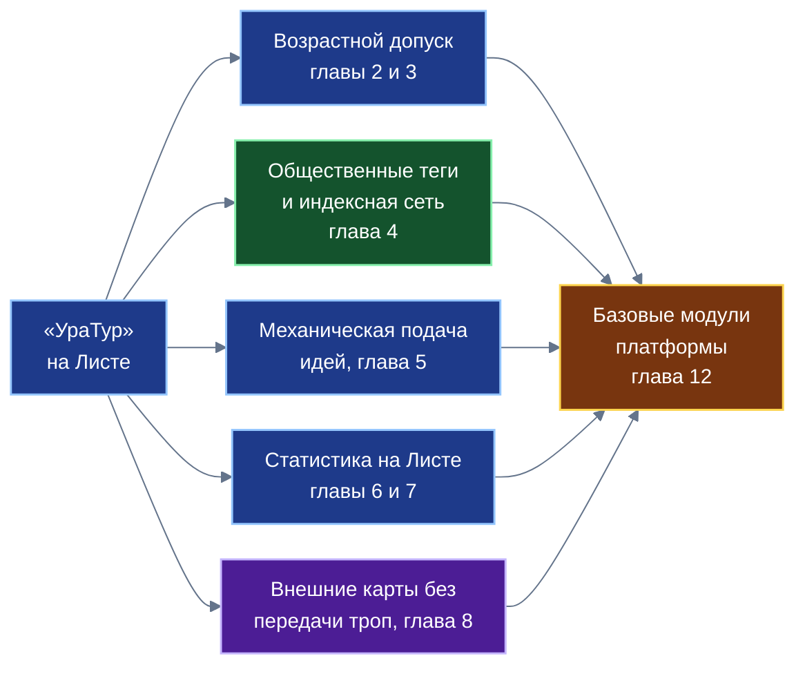
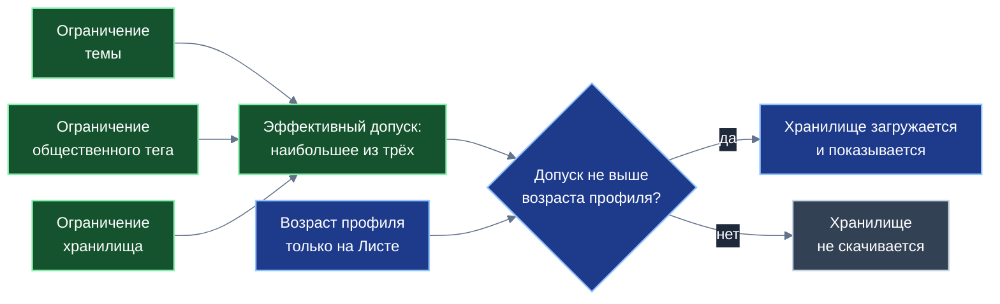

# «УраТур»: находить, беречь и сопровождать
**Белая книга № 11: возрастная защита на уровне ядра, общественные теги и кооперативные индексы, статистика на Листе и работа с картами без передачи троп**
*Версия: 1.0 (2026)*
*Статус: проектная концепция*
*Классификация: прикладной уровень платформы «Турбаза»*

> *Автор: Артём Владимирович Шамсутдинов, разработчик платформы цифрового суверенитета государства «Турбаза» — интернета автономных и частных данных / открытого стека AIRport.*
> *Методология подготовки: замысел приложения «УраТур» (первая идея автора о создании программы), архитектура возрастной защиты на уровне ядра Листа, идеи общественных тегов и кооперативных индексов, гибридной работы с картографическими сервисами, вывода статистических модулей на уровень платформы и все решения по семейному путешествию сформированы автором. Планирование документа выполнено моделью Claude Sonnet 5.5; распределение понятий между книгами комплекта и порядок изложения предложены ею и приняты автором. Базу знаний приложения подготовила модель Gemini 3.8 Flash. Детальная проработка текста выполнена моделью Gemini 3.8 Flash.*

---

## Аннотация

Настоящая Белая книга представляет проектную концепцию и инженерно-технические основы приложения «УраТур» — четвёртого прикладного решения платформы «Турбаза». В то время как «КубГолос» решает задачу многофакторного измерения общественного согласия, «Забота» накапливает жизненный опыт взаимопомощи, а «Деловой» обеспечивает координацию и исполнение жизненных планов, «УраТур» вводит в экосистему измерения физического пространства, топологии местности, возраста участников и движения во времени. На примере «УраТура» отрабатываются критически важные общесистемные механизмы: возрастная защита на уровне ядра Листа без сбора документов и передачи возраста наружу, открытые общественные теги с распределённой сетью индексных узлов на сбалансированных хронологических деревьях, детерминированная механическая подача идей путешественникам, локальный статистический конвейер планирования и динамического сопровождения в пути без подключения к сети связи, а также модель гибридного взаимодействия с внешними картографическими сервисами без раскрытия пешеходных треков граждан. Документ ориентирован на архитекторов распределённых систем, инженеров краеведческих и геоинформационных платформ, организаторов детско-юношеского и семейного туризма, а также специалистов по защите персональных данных и информационной безопасности.

---

## Как читать эту книгу

Книга представляет собой законченное техническое и методологическое описание прикладной системы и спроектирована для автономного изучения. Читателю не требуется детальное знакомство с предшествующими документами комплекта: все базовые концепции распределённого стека снабжены краткими пояснениями. 

В исследовании выдержан строгий академический и доказательный стиль. Архитектура «Турбазы» опирается на глубокое уважение к достижениям картографических сервисов, разработчиков геоинформационных систем и туристических каталогов. Предлагаемые решения не призваны противопоставлять себя действующим службам, а раскрывают альтернативную инженерную модель, при которой данные о семье, физической подготовке и точном маршруте остаются на персональном устройстве пользователя («Листе»), в то время как описания природных объектов и инфраструктуры формируются сообществами в открытых децентрализованных реестрах.

Количественные показатели и формулы, приведённые в тексте, представляют собой проектные ориентиры, алгоритмические модели и условные вычислительные примеры для иллюстрации логики работы системы; они не являются медицинскими нормами или абсолютными гарантиями безопасности в походах. В соответствии с канонами серии белых книг платформы в текст не включаются фрагменты программного кода, названия служебных классов и низкоуровневые идентификаторы таблиц баз данных.

> [!NOTE]
> **Из предыдущих книг комплекта: базовые концепции платформы**
> * **Лист, Ветка, Ствол и хранилище:** трёхзвенная распределённая топология платформы. «Лист» — персональное устройство гражданина (смартфон или персональный компьютер), где локально хранятся и обрабатываются данные. «Ветка» — связной координационный узел района или округа. «Ствол» — национальный уровень платформы. «Хранилище» — неделимая атомарная реляционная единица данных с собственным ключом симметричного шифрования и локальным журналом изменений.
> * **Принцип «Пиши только своё» (Белые книги № 08 и № 09):** фундаментальный инвариант распределённого ядра платформы: каждый участник вносит записи исключительно в собственный локальный журнал изменений и физически не имеет технической возможности перезаписать или удалить чужие данные.
> * **Двухконтурность и невидящая Ветка (Белая книга № 08):** строгое архитектурное разделение информационных потоков на открытый общественный контур, доступный для индексации и поиска, и защищённый контур частных данных, где промежуточный узел («Ветка») ретранслирует зашифрованные пакеты, не обладая ключами доступа к их содержимому.
> * **Тег и внешняя метка (Белая книга № 10 «Деловой»):** инструмент гибкой каталогизации информации. В «Деловом» внешняя метка создаётся локально на устройстве гражданина и привязывается к чужой открытой записи без внесения изменений в исходный объект и без раскрытия факта категоризации третьим лицам.
> * **Случай и шаблон (Белая книга № 09 «Забота»):** смысловые структуры фиксации жизненного опыта. «Случай» представляет собой конкретную жизненную ситуацию человека, а проверенная и обезличенная последовательность шагов оформляется как воспроизводимый «Шаблон», доступный для использования другими участниками.
> * **Дело и органайзер «Деловой» (Белая книга № 10):** высокоуровневая организационная единица, связывающая коренную задачу, дерево подзадач, сроки и исполнителей в рамках отдельного изолированного хранилища.
> * **Рейтинг вкладов по теме и верифицированный автор (Белая книга № 09):** открытая децентрализованная оценка общественной репутации, формируемая на основе подтверждённого полезного вклада гражданина в конкретной тематической сфере («Опыт»). Наличие подтверждённого Опыта позволяет верифицировать авторство маршрутов и рекомендаций без раскрытия персональных сведений.
> * **Распределение выручки и доля гражданина (Белые книги № 06 и № 08):** нормативно-алгоритмическая модель смарт-контрактов платформы, закрепляющая обязательную десятину (не менее 10% валового дохода от коммерческих показов или транзакций) в пользу конечного гражданина, чьё внимание или данные задействованы в процессе.

---

## 1. Задача и место приложения в платформе

Организация любого путешествия — от короткой семейной прогулки выходного дня по историческому центру города до автономного многодневного похода по горным хребтам — требует одновременной обработки трёх категорий данных, которые принципиально трудно совместить в рамках централизованной серверной архитектуры:
1. Подробных пространственных сведений о местности: картографической подложки, профиля высот, троп, расположения питьевых родников, стоянок, перевалов, укрытий и сопутствующей инфраструктуры;
2. Детальных конфиденциальных сведений о составе группы: возрасте участников, наличии маленьких детей или пожилых родственников, уровне их физической выносливости, опыте походов и медицинских ограничениях;
3. Непрерывных данных о текущем положении группы, динамике её движения, оставшихся запасах светлого времени и заряде аккумуляторов средств связи.

В традиционных облачных геоинформационных сервисах и туристических каталогах для выполнения расчётов все три информационных потока передаются на центральные серверы поставщика услуги. В результате сервис неизбежно аккумулирует подробную картину личной и семейной жизни граждан: историю перемещений, состав семьи, привычные часы отдыха и персональные интересы. Кроме того, при выходе группы за пределы зоны уверенного покрытия сотовой связи облачный навигатор теряет вычислительную опору, оставляя туристов без адаптивной подсказки в критический момент изменения погоды или наступления сумерек.

Платформа «Турбаза» предлагает альтернативное инженерное решение. Сведения о семье, возрасте детей, физическом темпе и точном географическом положении группы остаются исключительно на персональном устройстве пользователя — на «Листе». Описания троп, достопримечательностей, родников и стоянок хранятся в открытых общественных хранилищах краеведческих объединений и туристических клубов. Все вычислительные операции — от подбора маршрута и расчёта энергозатрат до динамической оценки запаса светлого времени — выполняются детерминированным статистическим конвейером непосредственно на процессоре смартфона без подключения к внешним серверам.

В комплекте прикладных решений платформы «Турбаза» приложение «УраТур» занимает особое место, замыкая цикл взаимодействия человека с окружающей средой:

$$«КубГолос»\;(\text{Оценка и согласие}) \longleftrightarrow «Забота»\;(\text{Опыт и взаимопомощь}) \longleftrightarrow «Деловой»\;(\text{Координация и планы}) \longleftrightarrow «УраТур»\;(\text{Пространство и движение})$$

Приложение «УраТур» использует пользовательскую оболочку органайзера «Деловой» как готовый исполнительский каркас. Любой выбранный маршрут или этап экспедиции развёртывается на Листе как Дело, где контрольные точки выступают подзадачами, а временные ориентиры автоматически синхронизируются с локальным семейным календарём.

*Схема 1. Пять вкладов приложения; каждый проектируется как общий модуль платформы.*

Системная роль «УраТура» заключается в том, что на нём отрабатываются базовые механизмы платформы, востребованные далеко за пределами туристической отрасли:

| № | Вклад приложения «УраТур» | Назначение для платформы как общего модуля | Глава |
| :---: | :--- | :--- | :---: |
| 1 | **Возрастной допуск к хранилищу** | Защита детей на уровне ядра Листа без сбора документов и передачи возраста наружу | 2 |
| 2 | **Семейный профиль на Листе** | Образец применения возрастного допуска: одна поездка — несколько хранилищ | 3 |
| 3 | **Общественные теги** | Открытая децентрализованная каталогизация без единого владельца витрины | 4 |
| 4 | **Механическая подача идей** | Прозрачный подбор без скрытых оценок: результат полностью воспроизводим | 5 |
| 5 | **Статистический конвейер на Листе** | Модуль пространственно-временной статистики для приложений с координатами и временем | 6 |
| 6 | **Сопровождение в пути без связи** | Контроллер исполнения планов с динамическим анализом заката и резервными путями | 7 |
| 7 | **Гибридная работа с картами** | Общий порядок подключения внешних сервисов с сохранением тайны частной жизни | 8 |
| 8 | **Общественный вклад на семи уровнях** | Методологический образец оценки комплексного социально-экономического эффекта | 9 |
| 9 | **Исторический контекст замысла** | Преемственность идей трёхзвенного Дерева и прямой связи устройств от 2007 года | 11 |
| 10 | **Системное абстрагирование библиотек** | Формирование общесистемных модулей ядра для Белой книги № 12 («Экосистема») | 12 |

---

## 2. Защита детей на уровне ядра Листа

Обеспечение информационной безопасности и физического благополучия подрастающего поколения представляет собой важнейшую государственную и общественную задачу. Родители и педагоги стремятся оградить детей от потенциально опасного контента, чрезмерных физических нагрузок и рискованных маршрутов. Однако в большинстве современных информационных систем реализация возрастного контроля требует либо передачи персональных данных ребёнка (свидетельства о рождении, профилей в социальных сетях) внешним коммерческим операторам, либо использования разрозненных настроек в каждом отдельном приложении, которые легко отключаются или обходятся.

Платформа «Турбаза» закладывает систему защиты детей непосредственно в распределённое ядро операционной среды «Листа». Механизм опирается на следующие базовые принципы:
1. **Общесистемная основа записей данных:** все сущности реляционных таблиц платформы строятся на единой базовой структуре, содержащей показатель минимального возраста допустимого просмотра.
2. **Хранилище как неделимая единица информации и допуска:** все записи распределены по отдельным хранилищам, обладающим собственными ключами шифрования и журналами изменений. Хранилища группируются под определёнными тематическими разделами платформы («Темами»). Как темы, так и общественные теги обладают собственными возрастными ограничениями.
3. **Шкала возрастного допуска:** для разграничения информации принят ряд значений:
$$\mathbb{A} = \{0, 6, 12, 16, 18\}$$
Данный числовой ряд соответствует категориям, закреплённым законом о защите детей от информации, причиняющей вред их здоровью и развитию. Для информационной продукции эти категории установлены законодательством, а для описания сложности туристических маршрутов тот же числовой ряд используется как удобная согласованная шкала, сопоставляющая информационную нагрузку и объективные требования к самостоятельности участников.
4. **Денормализация допуска при создании записей:** для обеспечения высокой скорости выборки данных на мобильных устройствах при создании или изменении хранилища его возрастной показатель копируется непосредственно в записи внутренних таблиц. Это позволяет мобильной СУБД на Листе выполнять мгновенную фильтрацию по локальному индексу без накладных расходов на межтабличные соединения. Пометка носит строго локальный характер и наружу не синхронизируется.
5. **Перспектива ролевого разделения:** архитектура платформы допускает наличие нескольких ролей внутри одного хранилища, когда отдельные записи журнала шифруются разными ключами, что в будущем позволит реализовать дифференцированный допуск внутри единого хранилища. На текущем этапе развития платформы действует надёжное и строгое правило: одно хранилище — один уровень возрастного допуска.

*Схема 2. Три открытых ограничения сводятся к максимуму; решение принимает Лист по возрасту, который не покидает устройство.*

Результирующий эффективный допуск объекта формируется как максимум из ограничений его темы, присвоенных общественных тегов и самого хранилища:

$$A_{\text{eff}} = \max\big(A_{\text{тема}},\; A_{\text{тег}},\; A_{\text{хран}}\big)$$

Отображение объекта на экране устройства пользователя считается допустимым тогда и только тогда, когда эффективный допуск не превышает подтверждённого возраста текущего локального профиля:

$$A_{\text{eff}} \le A_{\text{польз}}$$

Ключевой гарантией системы является то, что проверка этого условия встраивается ядром Листа автоматически в каждый поисковый и аналитический запрос к локальной базе данных. Разработчик прикладного приложения не пишет код проверки возраста вручную и лишён технической возможности обойти её из пользовательского интерфейса. При конструировании запроса прикладной разработчик определяет лишь режим обработки связанных структур данных:

| Признак | Строгий режим (внутреннее соединение) | Мягкий режим (внешнее соединение) |
| :--- | :--- | :--- |
| **Что получает пользователь** | Только те комплексные записи, у которых разрешены все связанные составные части | Записи с показом разрешённых частей; недопустимые части не возвращаются |
| **Прикладной сценарий** | Маршрут, содержащий категорийное скальное ответвление с допуском 16, для ребёнка 11 лет скрывается целиком | Основной безопасный семейный маршрут отображается, а опасное ответвление с допуском 16 исключается из выдачи |
| **Критерий выбора разработчиком** | Составная часть теряет практический смысл или безопасность без остальных элементов | Составная часть полезна и безопасна сама по себе даже при скрытии недоступных ответвлений |
| **Общий инвариант безопасности** | Записи, превышающие возраст активного профиля, исключаются из выдачи в обоих режимах | |

Вторым рубежом защиты выступает упреждающее отсечение данных (Pre-emptive Pruning). Если эффективный допуск хранилища $A_{\text{eff}}$ превышает возраст профиля пользователя $A_{\text{польз}}$, Лист вообще не отправляет сетевой запрос на скачивание данного хранилища со связного узла («Ветки»). Это даёт тройной положительный эффект: радикально экономится мобильный сетевой трафик, не расходуется постоянная память смартфона, а на устройстве ребёнка физически отсутствуют недопустимые материалы, что исключает возможность их извлечения даже при прямом анализе файлов операционной системы.

При этом защита тайны частной жизни остаётся абсолютной: числовой возраст пользователя хранится исключительно в локальной защищённой памяти Листа. Ветки и Ствол оперируют лишь открытыми сведениями о хранилищах (их идентификаторами, контрольными суммами и присвоенными допусками), никогда не получая сведений о возрасте конкретного человека. Сам механизм подтверждения возраста проектируется нейтральным к источнику удостоверения: от локального родительского контроля внутри семьи до государственных шлюзов идентификации, если такое требование будет установлено законодательством страны.

| Узел платформы | Что видит данный узел | Чего данный узел принципиально не видит |
| :--- | :--- | :--- |
| **Лист пользователя** | Свой локальный профиль, возраст участников, открытые сведения о доступных хранилищах | Профили, списки задач и маршруты других участников сети |
| **Ветка (районный узел)** | Открытые сведения о хранилищах (допуск, тема), список запрошенных идентификаторов хранилищ | Числовой возраст пользователя, состав семьи, маршруты внутри хранилищ |
| **Ствол (национальный узел)** | Сводные статистические срезы реестров и открытые метаданные тем | Локальные профили и индивидуальные запросы конкретного Листа |
| **Соседний Лист в сети** | Только те материалы и отчёты, которые пользователь явно опубликовал в открытом хранилище | Семейный профиль, личные заметки, историю перемещений и неотправленные треки |

**Границы применения механизма:**
1. Надежность работы возрастного допуска непосредственно зависит от достоверности возраста, указанного в локальном профиле устройства. Система предотвращает непреднамеренный доступ ребёнка к нежелательным материалам, однако не заменяет родительского внимания и воспитания.
2. Необходимо строго различать два смысла возрастной шкалы: законодательно установленный допуск к информационной продукции и экспертную оценку физической пригодности туристического маршрута. Настоящая работа не объявляет физические пороги юридическими нормами.
3. Состав идентификаторов запрашиваемых хранилищ теоретически может позволить внешнему наблюдателю косвенно предположить возрастную группу пользователя. В качестве перспективной защитной меры проектируется предварительная загрузка полных открытых списков метаданных района с последующей фильтрацией на Листе.
4. Разграничение доступа к отдельным записям внутри одного хранилища с использованием разных ключей шифрования относится к перспективным направлениям развития криптографического ядра платформы; на текущем этапе действует строгое разграничение на уровне неделимых хранилищ.
