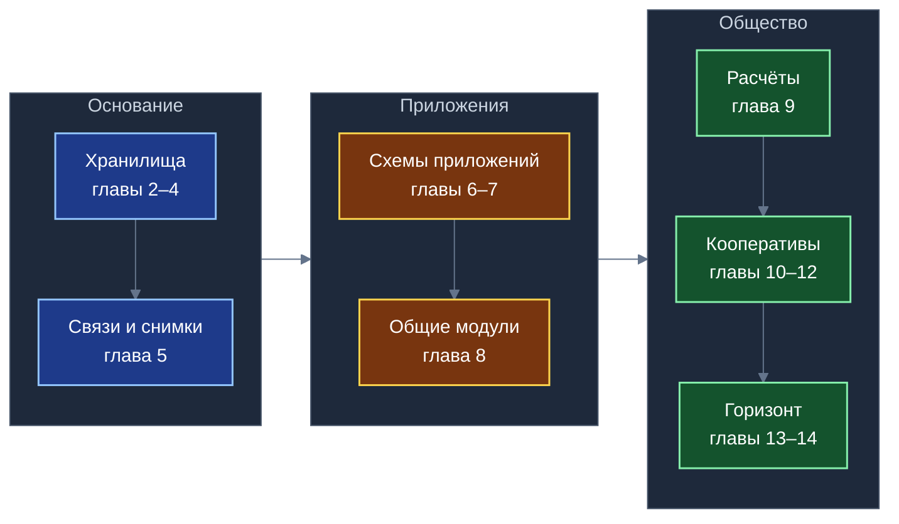

# «Экосистема платформы «Турбаза»»: хранилища, неограниченное число приложений, общие модули и кооперативный строй
**Белая книга № 12: как устроены и почему надёжны автономные хранилища, как соединяются приложения, какие модули становятся общими и кто обслуживает платформу**
*Версия: 1.0 (2026)*
*Статус: проектная концепция*
*Классификация: общесистемный уровень платформы «Турбаза»*

> *Автор концепции и системный архитектор платформы: Артём Владимирович Шамсутдинов, разработчик платформы цифрового суверенитета государства «Турбаза» — интернета автономных и частных данных / открытого стека AIRport; изобретатель по патенту США 10 902 016 B2.*  
> 
> *Вклад моделей и методология подготовки книги:*  
> * **Архитектура мастер-плана пакета задач «Экосистема» и исследовательские отчёты о хранилищах (Ступень 1) и об организационно-правовых формах и кооперативных институтах (Ступень 3):** модель **Gemini 3.8 Flash** под концептуальным руководством автора.  
> * **Синтетическое доказательство работы и безопасности хранилищ (Ступень 2) и прогностический абстракт о кооперативной занятости на горизонте 20–40 лет (Ступень 4):** модель **Claude Sonnet 5.5**.  
> * **Планирование книги и справочник (Ступень 5):** модель **Claude Sonnet 5.5**; распределение понятий между книгами комплекта и логический порядок изложения предложены ею и приняты автором.  
> * **Издательская сборка, математический аппарат и литературная проработка текста (Ступень 6):** модель **Gemini 3.8 Flash**.

---

## Аннотация

Настоящая Белая книга представляет собой завершающий общесистемный труд серии монографий платформы «Турбаза». В то время как предшествующие Белые книги детально исследовали базовую топологию суверенных узлов, экономику интерфейсов и четыре базовых прикладных приложения («КубГолос», «Забота», «Деловой», «УраТур»), настоящая работа объединяет всю конструкцию в единую институциональную, математическую и архитектурную модель неограниченной экосистемы. В книге решаются четыре фундаментальные задачи: строгое доказательство масштабируемости и безопасности малых автономных хранилищ данных; формализация механизмов бесконфликтного взаимодействия неограниченного числа независимых приложений через виртуальные соединения на пользовательском устройстве; разработка многоуровневой кооперативно-правовой модели для разработчиков, операторов узлов и граждан; а также формирование долгосрочного футурологического прогноза трансформации занятости и частной собственности на вычислительные мощности на горизонте 20–40 лет в условиях глубокой роботизации. Исследование адресовано архитекторам распределённых баз данных, системным аналитикам, юристам в сфере кооперативного права, экономистам цифровых рынков и специалистам по защите конфиденциальности данных.

---

## Как читать эту книгу

Книга спроектирована как самодостаточный труд, позволяющий изучить системные принципы платформы «Турбаза» без обязательного обращения к предшествующим выпускам серии. При этом в тексте последовательно выдерживается строгий академический тон: архитектурные и экономические выводы отделены от предположений, а границы доказанности зафиксированы в явном виде. Модель опирается на глубокое уважение к существующим академическим и промышленным решениям в области реляционных баз данных, распределённых реестров, кооперативного движения и безналичных расчётных систем; платформа рассматривается как созидательный свод отечественных инженерных идей, направленных на пользу граждан и общества, защиту частной жизни и укрепление цифрового суверенитета Отечества.

Математические формулы, временные оценки и экономические показатели приведены в качестве проектных ориентиров и аналитических расчётов на базе заданных допущений, а не в качестве безусловных коммерческих обещаний или гарантированных выплат. В тексте намеренно не приводятся фрагменты низкоуровневого программного кода, служебные имена системных файлов и баз данных, а технические механизмы описываются строгими русскоязычными терминами теории реляционных систем, криптографии и распределённых транзакций.

> [!NOTE]
> **Из предыдущих книг комплекта: базовые концепции платформы**
> * **Лист, Ветка, Ствол и хранилище (Белые книги № 03 и № 11):** трёхзвенная распределённая топология. «Лист» — персональное устройство гражданина (смартфон, рабочий компьютер), исполняющее логику и хранящее личные данные. «Ветка» — доверенный координационный узел района, муниципалитета или отраслевого сообщества. «Ствол» — общегосударственный координационный уровень платформы. «Хранилище» — минимальная неделимая реляционная единица данных с собственным симметричным ключом и локальным журналом изменений.
> * **Принцип «Пиши только своё» (Белые книги № 08 и № 09):** базовый транзакционный инвариант, исключающий распределённые блокировки: каждый участник вносит изменения исключительно в виде собственных подписанных записей и не имеет технической возможности напрямую перезаписать или стереть чужие строки данных.
> * **Самозапечатывающаяся страница (Белая книга № 09):** блочная структура организации связей «один ко многим», объединяющая около 1000 лёгких проекций внешних записей; по заполнении страница криптографически запечатывается и кэшируется на Листе бессрочно.
> * **Тег и внешняя метка (Белые книги № 10 и № 11):** открытая смысловая метка в децентрализованном реестре, связывающая объекты без изменения их исходных хранилищ и без раскрытия факта локальной группировки третьим лицам.
> * **Дерево тем и сложение вверх (Белая книга № 08):** иерархический тематический классификатор, обеспечивающий быстрое локальное префиксное сканирование на Листе и агрегацию публичной статистики на вышестоящих узлах без раскрытия персональных сведений граждан.
> * **Два контура репутации (Белые книги № 07 и № 09):** строгое институциональное разделение социального рейтинга вкладов («Опыт», рассчитываемый открыто по тематическим деревьям взаимопомощи) и закрытого экономического рейтинга (формируемого в контуре Банка России на основе фактического исполнения смарт-контрактов).
> * **Дело и контракт второго уровня (Белая книга № 10):** прикладная единица организации совместной деятельности в органайзере, изолированная в собственном хранилище и сопряжённая с взаимными обязательствами сторон.
> * **Возрастной допуск и эффективный допуск (Белая книга № 11):** децентрализованный механизм фильтрации контента на уровне ядра Листа, рассчитывающий эффективное ограничение как максимум из возрастных маркировок темы, тега и хранилища без передачи персонального возраста пользователя во внешнюю сеть.
> * **Распределение выручки и десятина (Белые книги № 06 и № 08):** фундаментальное правило платформенной экономики, гарантирующее перечисление десятины (10% валового рекламного бюджета) непосредственно гражданину, подтвердившему внимание к материалу.
> * **Кооператив тегов и индексный узел (Белая книга № 11):** инфраструктурное объединение владельцев вычислительных мощностей, обеспечивающее независимое хранение и поиск открытых индексных деревьев связей без единого централизованного монопольного поискового агрегатора.

---

## Терминологический глоссарий для читателя

| Термин | Понятийное определение |
|---|---|
| Лист, Ветка, Ствол | Три звена распределённой топологии: устройство гражданина, районный или отраслевой координационный сервер, государственный координационный контур |
| Хранилище | Автономная реляционная единица данных с собственным журналом криптографически подписанных записей, собственным ключом симметричного шифрования и замкнутым кругом участников; сетевая транзакция затрагивает ровно одно хранилище |
| Запись | Атомарная строка данных прикладной схемы; адресуется глобальной тройкой: идентификатор хранилища, идентификатор автора, локальный порядковый номер записи автора |
| Журнал | Строго упорядоченная цепочка криптографически подписанных дельт изменений хранилища; каждая дельта включает хэш предыдущего состояния |
| Дельта | Набор изменённых и созданных строк в рамках одной завершённой локальной транзакции |
| Принцип «Пиши только своё» | Архитектурное правило, согласно которому участник порождает только собственные подписанные записи и не может изменять строки других участников |
| Внешний ключ | Межхранилищная ссылка из записи одного хранилища на запись другого, выраженная тройкой адресации |
| Снимок (историческая копия) | Неизменяемая копия внешней записи вместе с транзитивно достижимыми записями, запечатанная в хранилище-источник в момент фиксации ссылки |
| Транзитивное замыкание | Полное множество взаимосвязанных записей, достижимых по цепочке внешних ключей от исходной точки |
| Страница | Самозапечатывающийся реляционный блок, вмещающий порядка 1000 проекций записей для связей «один ко многим» |
| Схема приложения | Множество реляционных таблиц, декларируемых прикладным пакетом и принадлежащих исключительно данному приложению |
| Дополнительная таблица приложения | Таблица расширения, создаваемая новым приложением и ссылающаяся внешним ключом на базовую запись чужой схемы без мутации исходной таблицы |
| Однонаправленная иерархия схем | Принцип архитектурной упорядоченности схем данных: вышестоящая схема зависит только от схем нижележащих уровней, исключая циклические зависимости |
| Виртуальный объект | Составная реляционная сущность, динамически конструируемая ядром Листа в оперативной памяти путём соединения базовой записи и таблиц расширений |
| Внутреннее и внешнее соединение | Режимы локального конструирования объекта: строгое соединение требует наличия всех связанных компонентов, внешнее соединение допускает пустые поля |
| Ролевая изоляция по ключам | Модель разграничения доступа, при которой расшифрование полей виртуального объекта определяется наличием у участника ключей соответствующих хранилищ |
| Общий модуль платформы | Алгоритмическая или инфраструктурная подсистема, прошедшая апробацию в прикладном приложении и стандартизированная для всей платформы |
| Понятийная спецификация | Архитектурное описание общего модуля, фиксирующее его назначение, входы, выходы, инварианты, вычислительную сложность и потребителей без программного кода |
| Эффективный допуск | Наибольшее значение из возрастных порогов темы, тега и хранилища, сопоставляемое с локальным возрастом пользователя на Листе |
| Общественный тег, индексный узел | Открытая общедоступная смысловая метка; персональный узел участника, обслуживающий запросы к децентрализованному индексу |
| Функция распределения выручки | Алгоритмически детерминированное правило автоматического расщепления платежа между авторами задействованных программных модулей |
| Десятина | Нормативная доля рекламного бюджета, направляемая гражданину за подтверждённое внимание (10%) |
| Контракт первого и второго уровней | Публичный контракт конечного автомата на платформе Банка России с малым числом участников; приватный контракт сторон внутри локального хранилища |
| Арность контракта | Количество сторон-получателей средств, участвующих в единой финансовой операции расщепления платежа |
| Неделимый фонд | Законодательно защищённая часть имущества кооператива, не подлежащая разделу между пайщиками и обеспечивающая технологическую преемственность |
| Производственный кооператив (артель) | Коммерческая корпоративная форма личного трудового участия специалистов по Закону № 41-ФЗ |
| Ассоциация (союз) стандартов | Некоммерческая корпорация по статье 123.8 Гражданского кодекса Российской Федерации, утверждающая технические протоколы и схемы |
| Потребительское общество | Некоммерческая организация по Закону РФ № 3085-1, аккумулирующая инфраструктурные паи и предоставляющая ресурсы пайщикам по себестоимости |
| Потребительский союз граждан | Общегражданское кооперативное объединение пайщиков; высшим органом управления выступает представительное собрание уполномоченных |
| Собрание уполномоченных | Демократический представительный орган управления союза, формируемый делегатами территориальных и профессиональных округов |
| Ассоциированное членство | Форма участия в кооперативе с внесением паевого взноса и правом совещательного голоса без обязательного личного трудового участия |
| Кооператив кооперативов | Многоуровневая федеративная структура кооперативных объединений, согласующая общие правила инфраструктуры и протоколов |
| Подтверждение внимания | Криптографически верифицируемое вычисление на процессоре Листа факта восприятия рекламного материала без передачи личного профиля |
| Слепой маркер | Механизм подтверждения статуса реального физического лица через ЕСИА без раскрытия персональных данных внешним контрагентам |
| Портфель дохода домохозяйства | Многокомпонентная структура обеспечения материальной устойчивости семьи из пяти независимых источников в условиях роботизации |
| Открытый вызов | Метод прикладного интерфейса, опубликованный приложением для регламентированного межпрограммного взаимодействия на Листе |
| Заглушка вызова | Локальный программный адаптер открытого вызова, сериализующий обращение в межпроцессное сообщение ядру Листа |
| Колокация | Физическое размещение записей разных прикладных схем в едином хранилище при совпадении их жизненного цикла и состава участников |
| Связующая сущность (связка) | Реляционная запись, хранящаяся в одном из хранилищ и связывающая через внешние ключи данные независимых хранилищ |
| Реестр версий приложений | Системный каталог установленных пакетов и межпакетных ссылок ядра Листа, оперирующий компактными числовыми индексами |
| Изолированная среда приложения | Защищённая среда исполнения прикладного интерфейса Листа без прямого доступа к файловой базе данных и оперативной памяти соседей |
| Прототип на TypeScript | Действующая кодовая база реляционного ядра и прикладных решений, используемая для отладки, верификации и работы веб-клиентов |
| Аннотации к общим типам | Метаданные типов данных, предназначенные для автоматизированной трансляции ядра и прикладных схем в бинарный код WebAssembly |
| AssemblyScript | Строго типизированный язык компиляции в WebAssembly, рассматриваемый как целевая среда высокопроизводительного исполнения на Листе |
| Категории истинности (Д / С / О) | Статус научных положений книги: Доказано при допущениях (Д), Сводится к допущениям стойкости (С), Открытый вопрос для исследований (О) |

---

## Содержание

- **Аннотация**
- **Как читать эту книгу**
- **Врезка: Из предыдущих книг комплекта: базовые концепции платформы**
- **Терминологический глоссарий для читателя**
- **Глава 1. От четырёх приложений к неограниченной экосистеме**
  - 1.1. Институциональный кризис централизованных платформ и пределы облачных монополий
  - 1.2. Архитектурный манифест «Турбазы»: четыре задачи книги и структура комплекса
  - 1.3. Начальные прикладные решения и статус зрелости компонентов платформы
  - 1.4. Принцип неограниченной экосистемы: математическая и системная сущность аддитивного масштабирования
- **Глава 2. Хранилище: единица данных, прав и ключа**
  - 2.1. Формальное математическое определение хранилища и адресация записей
  - 2.2. Логическое разделение и единое физическое пространство Листа
  - 2.3. Структура криптографического журнала и четырёхуровневая транзакция
  - 2.4. Путь записи и инвариант локальной атомарности
  - 2.5. Исторический генезис концепции и фундаментальные утверждения о хранилищах
- **Глава 3. Почему хранилища работают и масштабируются**
  - 3.1. Утверждение об отсутствии распределённых блокировок
  - 3.2. Теорема о детерминированной сходимости состояний
  - 3.3. Линейная масштабируемость сети и формула совокупной пропускной способности
  - 3.4. Пределы пропускной способности и защита от проблемы «горячего хранилища»
  - 3.5. Двухстадийный приём дельт и численный модельный расчёт
- **Глава 4. Безопасность хранилищ**
  - 4.1. Топология доверия и модель противников
  - 4.2. Криптографические допущения стойкости и формат защищённой дельты
  - 4.3. Теоремы о конфиденциальности, подлинности и изоляции приложений
  - 4.4. Механизм отсечения исключённого участника и стирание данных через уничтожение ключа
  - 4.5. Постквантовая защита, утечки метаданных и реестр остаточных рисков
- **Глава 5. Связи между хранилищами: внешние ключи и снимки**
  - 5.1. Проблема связанных данных в распределённых асинхронных средах
  - 5.2. Механизм снимка по транзитивному замыканию и оценка экспоненциального роста
  - 5.3. Четыре системных эффекта архитектуры снимков
  - 5.4. Самозапечатывающиеся страницы коллекций и теоретические основания локальных моделей
- **Глава 6. Неограниченное число приложений: схемы, чтение, вызовы и связки**
  - 6.1. Сравнительный анализ подходов к расширению схем данных
  - 6.2. Режим единого чтения локальной базы и виртуальные реляционные объекты
  - 6.3. Регламентированная запись через открытые вызовы и диспетчеризацию ядра
  - 6.4. Паттерны колокации и связующих сущностей
  - 6.5. Декларативные зависимости схем и аддитивная эволюция платформы
- **Глава 7. Локальный реестр МСП и ЖКХ и сквозной сценарий**
  - 7.1. Назначение локального каталога мастеров и районных сервисов
  - 7.2. Сквозной жизненный сценарий взаимодействия пяти приложений
  - 7.3. Суверенное ведение дел самозанятого и децентрализованный учёт в сфере ЖКХ
- **Глава 8. Общие модули платформы и среда их исполнения**
  - 8.1. Принцип вывода зрелых алгоритмов в общесистемные библиотеки
  - 8.2. Сводный каталог модулей платформы
  - 8.3. Понятийные спецификации шести базовых алгоритмических модулей
  - 8.4. Роль ассоциации стандартов и технического комитета
  - 8.5. Среда исполнения: прототип на TypeScript и стратегия перехода к AssemblyScript
- **Глава 9. Экономика: распределение выручки и расчёты**
  - 9.1. Детерминированная функция распределения выручки программных деревьев
  - 9.2. Архитектура трёхуровневых расчётов и преодоление проблемы высокой арности контрактов
  - 9.3. Экономика индексных узлов: себестоимость, энергопотребление и точка окупаемости
- **Глава 10. Кооперативные институты**
  - 10.1. Преодоление институциональных барьеров через артельные объединения
  - 10.2. Институциональная триада разработчиков программного обеспечения
  - 10.3. Инфраструктурные потребительские общества владельцев узлов
  - 10.4. Потребительский союз граждан и защита от недобросовестных узлов
  - 10.5. Кооператив кооперативов как федеративная модель управления
- **Глава 11. Рекламный дивиденд и граждане**
  - 11.1. Экономическая природа платформенной десятины
  - 11.2. Локальное вычисление внимания и защита от фальсификаций через ЕСИА
  - 11.3. Формула расчёта дивиденда и сценарный численный анализ
- **Глава 12. Исторический опыт и адаптация форм**
  - 12.1. Отечественные традиции артельного самоуправления и потребительской кооперации
  - 12.2. Мировой опыт автономных экономических объединений
  - 12.3. Синтез уроков прошлого и региональная адаптация институтов
- **Глава 13. Горизонт через 20–40 лет: кооперативная занятость в эпоху роботизации**
  - 13.1. Технологические вызовы тотальной автоматизации и роботизации
  - 13.2. Частная собственность граждан на средства цифрового производства
  - 13.3. Модель сбалансированного портфеля доходов домохозяйства
  - 13.4. Три сценария социально-экономической динамики и границы защитной роли хранилищ
- **Глава 14. Доказано, принято, открыто; границы роли**
  - 14.1. Сводный реестр утверждений платформы
  - 14.2. Реестр открытых научно-инженерных и институциональных вопросов
  - 14.3. Границы ответственности и роли платформы «Турбаза» в обществе
- **Глава 15. Заключение и связь с комплектом**
- **Библиография**

---

## Глава 1. От четырёх приложений к неограниченной экосистеме

### 1.1. Институциональный кризис централизованных платформ и пределы облачных монополий

Современная индустрия информационных технологий подошла к фундаментальному пределу эффективности централизованной облачной архитектуры. На протяжении трёх десятилетий доминирующая парадигма построения информационных систем исходила из предпосылки о необходимости концентрации пользовательских данных в гигантских монолитных центрах обработки данных. Такая концентрация породила системный институциональный кризис, проявляющийся сразу в нескольких взаимосвязанных плоскостях.

Во-первых, централизованная модель привела к тотальной фрагментации и изоляции сведений о человеке. Личные данные гражданина оказались искусственно расщеплены между десятками не сообщающихся между собой корпоративных серверов: сведения о здоровье заперты в закрытых базах медицинских центров, история финансовых расчётов — в серверах кредитных организаций, домашние дела и бытовые задачи — в закрытых облачных органайзерах, а данные о соседском общении и взаимопомощи — в базах социальных сетей. Ни гражданин, ни используемые им программы не имеют технической возможности соединить эти данные на едином реляционном экране без преодоления межведомственных барьеров и риска неконтролируемой компрометации информации.

Во-вторых, централизация баз данных сформировала критическую угрозу информационной безопасности общества. Концентрация десятков миллионов профилей в единых хранилищах превращает центральные серверы в привлекательные мишени для атак. Любая компрометация единого хранилища влечёт за собой массовую утечку персональных сведений граждан. Попытки защитить централизованные базы данных приводят к экспоненциальному росту накладных расходов на кибербезопасность, однако принципиально не устраняют ключевой фактор риска — наличие единой точки отказа и единого центра концентрации конфиденциальных сведений.

В-третьих, корпоративная монополия на платформенную инфраструктуру создала непреодолимые экономические барьеры для независимых разработчиков и субъектов малого предпринимательства. В традиционной экосистеме автор нового прикладного сервиса вынужден либо создавать с нуля собственную дорогостоящую серверную инфраструктуру, либо подчиняться условиям монопольных платформ, отдавая существенную долю формируемой выручки за доступ к аудитории и рискуя внезапным изменением правил доступа к интерфейсам. При этом сами граждане, чьё внимание и активность создают экономическую ценность платформы, полностью отчуждены от распределения доходов и управления правилами экосистемы.

### 1.2. Архитектурный манифест «Турбазы»: четыре задачи книги и структура комплекса

Платформа «Турбаза» предлагает радикальный выход из институционального тупика облачной централизации. Основополагающий архитектурный манифест платформы утверждает: **вычислительные мощности и суверенное хранение данных должны быть возвращены на персональные устройства граждан**. Пользовательское устройство (смартфон, ноутбук, рабочая станция) сегодня обладает вычислительной мощью, оперативной памятью и скоростью дискового накопителя, многократно превосходящими параметры серверов недавнего прошлого. 

Вместо того чтобы передавать личную информацию на удалённые серверы, платформа «Турбаза» разворачивает на устройстве гражданина полноценный реляционный узел — «Лист». Лист хранит автономные хранилища данных, исполняет прикладную бизнес-логику, изолирует криптографические ключи и выполняет локальные реляционные соединения таблиц без сетевых задержек. Промежуточные серверы («Ветки») и общегосударственные координационные узлы («Ствол») освобождаются от обязанности расшифровывать и хранить пользовательские данные, превращаясь в высокопроизводительные невидящие транспортные и координационные каналы.

*Схема 1. Книга движется от основания (хранилища) через приложения к обществу (расчёты, кооперативы, горизонт).*

Настоящая Белая книга призвана дать целостный, академически строгий и доказательный ответ на четыре фундаментальные проблемы построения такой распределённой среды:
1. **Математическая и инженерная состоятельность хранилищ:** строгое доказательство того, что малые независимые хранилища на персональных устройствах масштабируются линейно, гарантируют сходимость данных и обеспечивают конфиденциальность и целостность при строго сформулированных криптографических допущениях (главы 2–4);
2. **Архитектура неограниченной экосистемы приложений:** формализация механизмов бесшовного соединения произвольного количества прикладных схем через внешние ключи, снимки транзитивного замыкания, оперативные виртуальные соединения и общие библиотеки платформы без изменения чужого исходного кода и схем (главы 5–8);
3. **Институционально-кооперативная модель:** разработка правовых и экономических механизмов объединения разработчиков программ, операторов инфраструктурных узлов и граждан в самоуправляемые артели и союзы с прозрачным алгоритмическим распределением выручки и защитой права голоса (главы 9–12);
4. **Долгосрочный прогностический анализ занятости:** исследование роли личной собственности граждан на средства цифрового производства и локальные хранилища как основы материальной автономии домохозяйств на горизонте 20–40 лет в условиях глубокой роботизации экономики (главы 13–14).

### 1.3. Начальные прикладные решения и статус зрелости компонентов платформы

Для верификации и практической отработки архитектурных принципов платформы был спроектирован комплект из четырёх начальных прикладных решений, каждое из которых валидирует свой спектр системных задач:
- **«КубГолос» (Белая книга № 08):** валидирует механизмы децентрализованного измерения общественного согласия, многофакторные опросы со 100 базисными пунктами, префиксную навигацию по деревьям тем и агрегацию сумм вверх по территориальной иерархии;
- **«Забота» (Белая книга № 09):** валидирует алгоритмы накопления жизненного опыта взаимопомощи, реляционную модель «Ситуация + Случай + Разговор», самозапечатывающиеся страницы коллекций и распределённое вычисление тематического социального рейтинга («Опыт»);
- **«Деловой» (Белая книга № 10):** валидирует управление жизненными планами, координацию поручений, распределение прав доступа по правилу «Одно Дело — одно хранилище» и связывание прикладных задач с коммерческими смарт-контрактами второго уровня;
- **«УраТур» (Белая книга № 11):** валидирует обработку физического пространства, защиту детей на уровне ядра СУБД Листа через эффективный возрастной допуск, открытые общественные теги на сбалансированных индексных деревьях и локальный статистический конвейер планирования маршрутов.
- **«Локальный реестр МСП и ЖКХ» (глава 7 настоящей книги):** выступает пятым, интеграционным сценарием, на котором проверяется композиция всех предыдущих сервисов при решении повседневных бытовых задач жильцов, мастеров шаговой доступности и обслуживающих организаций.

Для сохранения исследовательской строгости и исключения завышенных ожиданий платформа разделяет состояние готовности механизмов на то, что уже функционирует в работающем коде ядра, и то, что специфицировано в качестве целевой архитектуры.

| Механизм платформы | Статус реализации | Инженерная характеристика |
|---|---|---|
| Реляционное хранилище, участник, журнал истории (четыре уровня) | Реализовано в коде | Работает в открытом коде ядра; обеспечивает транзакционный учёт изменений |
| Базовая запись с составным ключом из трёх компонентов | Реализовано в коде | Работает в коде ядра; обеспечивает глобальную бесконфликтную адресацию |
| Копирование внешней записи и учёт локальных снимков | Реализовано в коде | Работает в коде ядра; устраняет каскадные сетевые блокировки |
| Песочница приложений и шлюз межпроцессных сообщений | Реализовано в коде | Работает в коде ядра; изолирует память приложений в браузере |
| Вызовы между приложениями через изолированные среды | Реализовано в прототипе | Работает в режиме браузера; валидация типов аргументов задана как заготовка |
| Колокация записей и связующие сущности в схемах данных | Реализовано в прототипе | Отработано на связках задач, целей и обсуждений в прототипе |
| Соединение таблиц нескольких приложений в едином запросе | Реализовано в прототипе | Подтверждено выполнением локальных реляционных выборок до пяти таблиц |
| Криптографический профиль ГОСТ («Кузнечик», «Стрибог», ГОСТ Р 34.10-2012, ML-DSA) | Задано спецификацией | Целевой криптографический профиль платформы; подлежит реализации и аттестации |
| Серверные протоколы узлов Ветки и Ствола (секвенсор, квоты) | Задано спецификацией | Целевая сетевая архитектура координационных узлов платформы |
| Механизм ветвления ключей при исключении и стирание через ключ | Задано спецификацией | Проектная модель управления доступом и соблюдения законодательства о данных |

Приведённая классификация демонстрирует: фундаментальное реляционное ядро данных, модель адресации, транзакционные дельты и локальные соединения проверены на уровне работающего программного прототипа. В свою очередь, криптографический профиль по государственным стандартам и протоколы вышестоящих серверных узлов строго специфицированы и подлежат реализации на последующих этапах развития экосистемы.

### 1.4. Принцип неограниченной экосистемы: математическая и системная сущность аддитивного масштабирования

Термин «неограниченная экосистема» в контексте платформы «Турбаза» не является метафорой или маркетинговой декларацией. Он фиксирует строгое архитектурное свойство системы: **отсутствие встроенного алгоритмического предела на количество подключаемых независимых приложений и схем данных**.

В традиционных реляционных базах данных добавление каждого нового функционального модуля сопровождается усложнением центральной схемы: расширением таблиц, добавлением внешних ключей, перестройкой индексов и увеличением графа блокировок при одновременной записи. Начиная с некоторого порога сложности, централизованная СУБД сталкивается с деградацией производительности и рисками транзакционного взаимного блокирования.

Архитектура «Турбазы» решает эту проблему посредством трёх математических и топологических свойств:
1. **Факторизация транзакционного пространства:** каждая сетевая транзакция ограничена рамками ровно одного малого хранилища; транзакции разных хранилищ взаимно независимы и не разделяют общих блокировок;
2. **Аддитивное расширение схем данных:** новое приложение подключается к экосистеме исключительно путём создания собственных таблиц, которые ссылаются на базовые записи предшествующих приложений по неизменяемым внешним ключам, не требуя модификации чужих структур данных;
3. **Локализация соединений на Листе:** сборка комплексного пользовательского интерфейса, агрегирующего поля десятков различных приложений, выполняется непосредственно в памяти персонального устройства участника локальным механизмом реляционного соединения.

Таким образом, подключение сотого или тысячного приложения к платформе «Турбаза» не вносит дополнительных накладных расходов в работу уже существующих сервисов. Практические пределы масштабирования экосистемы определяются не ограничениями архитектуры схем, а физической пропускной способностью связных узлов («Веток») и организационной эффективностью процедур стандартизации интерфейсов в ассоциациях разработчиков.
