# «Экосистема платформы «Турбаза»»: хранилища, неограниченное число приложений, общие модули и кооперативный строй
**Белая книга № 12: как устроены и почему надёжны автономные хранилища, как соединяются приложения, какие модули становятся общими и кто обслуживает платформу**
*Версия: 1.0 (2026)*
*Статус: проектная концепция*
*Классификация: общесистемный уровень платформы «Турбаза»*

> *Автор концепции и системный архитектор платформы: Артём Владимирович Шамсутдинов, разработчик платформы цифрового суверенитета государства «Турбаза» — интернета автономных и частных данных / открытого стека AIRport; изобретатель по патенту США 10 902 016 B2.*  
> 
> *Вклад моделей и методология подготовки книги:*  
> * **Архитектура мастер-плана пакета задач «Экосистема» и исследовательские отчёты о хранилищах (Ступень 1) и об организационно-правовых формах и кооперативных институтах (Ступень 3):** модель **Gemini 3.8 Flash** под концептуальным руководством автора.  
> * **Синтетическое доказательство работы и безопасности хранилищ (Ступень 2) и прогностический абстракт о кооперативной занятости на горизонте 20–40 лет (Ступень 4):** модель **Claude Sonnet 5.5**.  
> * **Планирование книги и справочник (Ступень 5):** модель **Claude Sonnet 5.5**; распределение понятий между книгами комплекта и логический порядок изложения предложены ею и приняты автором.  
> * **Издательская сборка, математический аппарат и литературная проработка текста (Ступень 6):** модель **Gemini 3.8 Flash**.

---

## Аннотация

Настоящая Белая книга представляет собой завершающий общесистемный труд серии монографий платформы «Турбаза». В то время как предшествующие Белые книги детально исследовали базовую топологию распределённых узлов, экономику интерфейсов и четыре базовых прикладных приложения («КубГолос», «Забота», «Деловой», «УраТур»), настоящая работа объединяет всю конструкцию в единую институциональную, математическую и архитектурную модель неограниченной экосистемы. В книге решаются четыре фундаментальные задачи: строгое доказательство масштабируемости и безопасности малых автономных хранилищ данных; формализация механизмов бесконфликтного взаимодействия неограниченного числа независимых приложений через виртуальные соединения на пользовательском устройстве; разработка многоуровневой кооперативно-правовой модели для разработчиков, операторов узлов и граждан; а также формирование долгосрочного футурологического прогноза трансформации занятости и частной собственности на вычислительные мощности на горизонте 20–40 лет в условиях глубокой роботизации. Исследование адресовано архитекторам распределённых баз данных, системным аналитикам, юристам в сфере кооперативного права, экономистам цифровых рынков и специалистам по защите конфиденциальности данных.

---

## Как читать эту книгу

Книга спроектирована как самодостаточный труд, позволяющий изучить системные принципы платформы «Турбаза» без обязательного обращения к предшествующим выпускам серии. При этом в тексте последовательно выдерживается строгий академический тон: архитектурные и экономические выводы отделены от предположений, а границы доказанности зафиксированы в явном виде. Модель опирается на глубокое уважение к существующим мировым и российским академическим и промышленным решениям в области реляционных баз данных, распределённых реестров, кооперативного движения и безналичных расчётных систем. Платформа создаётся как открытый фундамент для формирования международной сети суверенных деревьев данных. Настоящая серия монографий адресована в первую очередь российским инженерам с надеждой на то, что Россия займёт ведущую роль первого разработчика открытого эталонного кода платформы, на котором смогут базироваться суверенные деревья государств мира; одновременно труд открыт международному сообществу, и разработчикам всех стран предлагается переводить материалы на свои языки и создавать собственные национальные адаптации платформы на базе единого открытого стандарта автономных хранилищ.

Математические формулы, временные оценки и экономические показатели приведены в качестве проектных ориентиров и аналитических расчётов на базе заданных допущений, а не в качестве безусловных коммерческих обещаний или гарантированных выплат. В тексте намеренно не приводятся фрагменты низкоуровневого программного кода, служебные имена системных файлов и баз данных, а технические механизмы описываются строгими русскоязычными терминами теории реляционных систем, криптографии и распределённых транзакций.

> [!NOTE]
> **Из предыдущих книг комплекта: базовые концепции платформы**
> * **Лист, Ветка, Ствол и хранилище (Белые книги № 03 и № 11):** трёхзвенная распределённая топология. «Лист» — персональное устройство гражданина (смартфон, рабочий компьютер), исполняющее логику и хранящее личные данные. «Ветка» — доверенный координационный узел района, муниципалитета или отраслевого сообщества. «Ствол» — общегосударственный координационный уровень платформы. «Хранилище» — минимальная неделимая реляционная единица данных с собственным симметричным ключом и локальным журналом изменений.
> * **Принцип «Пиши только своё» (Белые книги № 08 и № 09):** базовый транзакционный инвариант, исключающий распределённые блокировки: каждый участник вносит изменения исключительно в виде собственных подписанных записей и не имеет технической возможности напрямую перезаписать или стереть чужие строки данных.
> * **Самозапечатывающаяся страница (Белая книга № 09):** блочная структура организации связей «один ко многим», объединяющая около 1000 лёгких проекций внешних записей; по заполнении страница криптографически запечатывается и кэшируется на Листе бессрочно.
> * **Тег и внешняя метка (Белые книги № 10 и № 11):** открытая смысловая метка в децентрализованном реестре, связывающая объекты без изменения их исходных хранилищ и без раскрытия факта локальной группировки третьим лицам.
> * **Дерево тем и сложение вверх (Белая книга № 08):** иерархический тематический классификатор, обеспечивающий быстрое локальное префиксное сканирование на Листе и агрегацию публичной статистики на вышестоящих узлах без раскрытия персональных сведений граждан.
> * **Два контура репутации (Белые книги № 07 и № 09):** строгое институциональное разделение социального рейтинга вкладов («Опыт», рассчитываемый открыто по тематическим деревьям взаимопомощи) и закрытого экономического рейтинга (формируемого в контуре Банка России на основе фактического исполнения смарт-контрактов).
> * **Дело и контракт второго уровня (Белая книга № 10):** прикладная единица организации совместной деятельности в органайзере, изолированная в собственном хранилище и сопряжённая с взаимными обязательствами сторон.
> * **Возрастной допуск и эффективный допуск (Белая книга № 11):** децентрализованный механизм фильтрации контента на уровне ядра Листа, рассчитывающий эффективное ограничение как максимум из возрастных маркировок темы, тега и хранилища без передачи персонального возраста пользователя во внешнюю сеть.
> * **Распределение выручки и десятина (Белые книги № 06 и № 08):** фундаментальное правило платформенной экономики, гарантирующее перечисление десятины (10% валового рекламного бюджета) непосредственно гражданину, подтвердившему внимание к материалу.
> * **Кооператив тегов и индексный узел (Белая книга № 11):** инфраструктурное объединение владельцев вычислительных мощностей, обеспечивающее независимое хранение и поиск открытых индексных деревьев связей без единого централизованного монопольного поискового агрегатора.

---

## Терминологический глоссарий для читателя

| Термин | Понятийное определение |
|---|---|
| Лист, Ветка, Ствол | Три звена распределённой топологии: устройство гражданина, районный или отраслевой координационный сервер, государственный координационный контур |
| Хранилище | Автономная реляционная единица данных с собственным журналом криптографически подписанных записей, собственным ключом симметричного шифрования и замкнутым кругом участников; сетевая транзакция затрагивает ровно одно хранилище |
| Запись | Атомарная строка данных прикладной схемы; адресуется глобальной тройкой: идентификатор хранилища, идентификатор автора, локальный порядковый номер записи автора |
| Журнал | Строго упорядоченная цепочка криптографически подписанных дельт изменений хранилища; каждая дельта включает хэш предыдущего состояния |
| Дельта | Набор изменённых и созданных строк в рамках одной завершённой локальной транзакции |
| Принцип «Пиши только своё» | Архитектурное правило, согласно которому участник порождает только собственные подписанные записи и не может изменять строки других участников |
| Внешний ключ | Межхранилищная ссылка из записи одного хранилища на запись другого, выраженная тройкой адресации |
| Снимок (историческая копия) | Неизменяемая копия внешней записи вместе с транзитивно достижимыми записями, запечатанная в хранилище-источник в момент фиксации ссылки |
| Транзитивное замыкание | Полное множество взаимосвязанных записей, достижимых по цепочке внешних ключей от исходной точки |
| Страница | Самозапечатывающийся реляционный блок, вмещающий порядка 1000 проекций записей для связей «один ко многим» |
| Схема приложения | Множество реляционных таблиц, декларируемых прикладным пакетом и принадлежащих исключительно данному приложению |
| Дополнительная таблица приложения | Таблица расширения, создаваемая новым приложением и ссылающаяся внешним ключом на базовую запись чужой схемы без мутации исходной таблицы |
| Однонаправленная иерархия схем | Принцип архитектурной упорядоченности схем данных: вышестоящая схема зависит только от схем нижележащих уровней, исключая циклические зависимости |
| Виртуальный объект | Составная реляционная сущность, динамически конструируемая ядром Листа в оперативной памяти путём соединения базовой записи и таблиц расширений |
| Внутреннее и внешнее соединение | Режимы локального конструирования объекта: строгое соединение требует наличия всех связанных компонентов, внешнее соединение допускает пустые поля |
| Ролевая изоляция по ключам | Модель разграничения доступа, при которой расшифрование полей виртуального объекта определяется наличием у участника ключей соответствующих хранилищ |
| Общий модуль платформы | Алгоритмическая или инфраструктурная подсистема, прошедшая апробацию в прикладном приложении и стандартизированная для всей платформы |
| Понятийная спецификация | Архитектурное описание общего модуля, фиксирующее его назначение, входы, выходы, инварианты, вычислительную сложность и потребителей без программного кода |
| Эффективный допуск | Наибольшее значение из возрастных порогов темы, тега и хранилища, сопоставляемое с локальным возрастом пользователя на Листе |
| Общественный тег, индексный узел | Открытая общедоступная смысловая метка; персональный узел участника, обслуживающий запросы к децентрализованному индексу |
| Функция распределения выручки | Алгоритмически детерминированное правило автоматического расщепления платежа между авторами задействованных программных модулей |
| Десятина | Нормативная доля рекламного бюджета, направляемая гражданину за подтверждённое внимание (10%) |
| Контракт первого и второго уровней | Публичный контракт конечного автомата на платформе Банка России с малым числом участников; приватный контракт сторон внутри локального хранилища |
| Арность контракта | Количество сторон-получателей средств, участвующих в единой финансовой операции расщепления платежа |
| Неделимый фонд | Законодательно защищённая часть имущества кооператива, не подлежащая разделу между пайщиками и обеспечивающая технологическую преемственность |
| Производственный кооператив (артель) | Коммерческая корпоративная форма личного трудового участия специалистов по Закону № 41-ФЗ |
| Ассоциация (союз) стандартов | Некоммерческая корпорация по статье 123.8 Гражданского кодекса Российской Федерации, утверждающая технические протоколы и схемы |
| Потребительское общество | Некоммерческая организация по Закону РФ № 3085-1, аккумулирующая инфраструктурные паи и предоставляющая ресурсы пайщикам по себестоимости |
| Потребительский союз граждан | Общегражданское кооперативное объединение пайщиков; высшим органом управления выступает представительное собрание уполномоченных |
| Собрание уполномоченных | Демократический представительный орган управления союза, формируемый делегатами территориальных и профессиональных округов |
| Ассоциированное членство | Форма участия в кооперативе с внесением паевого взноса и правом совещательного голоса без обязательного личного трудового участия |
| Кооператив кооперативов | Многоуровневая федеративная структура кооперативных объединений, согласующая общие правила инфраструктуры и протоколов |
| Подтверждение внимания | Криптографически верифицируемое вычисление на процессоре Листа факта восприятия рекламного материала без передачи личного профиля |
| Слепой маркер | Механизм подтверждения статуса реального физического лица через ЕСИА без раскрытия персональных данных внешним контрагентам |
| Портфель дохода домохозяйства | Многокомпонентная структура обеспечения материальной устойчивости семьи из пяти независимых источников в условиях роботизации |
| Открытый вызов | Метод прикладного интерфейса, опубликованный приложением для регламентированного межпрограммного взаимодействия на Листе |
| Заглушка вызова | Локальный программный адаптер открытого вызова, сериализующий обращение в межпроцессное сообщение ядру Листа |
| Колокация | Физическое размещение записей разных прикладных схем в едином хранилище при совпадении их жизненного цикла и состава участников |
| Связующая сущность (связка) | Реляционная запись, хранящаяся в одном из хранилищ и связывающая через внешние ключи данные независимых хранилищ |
| Реестр версий приложений | Системный каталог установленных пакетов и межпакетных ссылок ядра Листа, оперирующий компактными числовыми индексами |
| Изолированная среда приложения | Защищённая среда исполнения прикладного интерфейса Листа без прямого доступа к файловой базе данных и оперативной памяти соседей |
| Прототип на TypeScript | Действующая кодовая база реляционного ядра и прикладных решений, используемая для отладки, верификации и работы веб-клиентов |
| Аннотации к общим типам | Метаданные типов данных, предназначенные для автоматизированной трансляции ядра и прикладных схем в бинарный код WebAssembly |
| AssemblyScript | Строго типизированный язык компиляции в WebAssembly, рассматриваемый как целевая среда высокопроизводительного исполнения на Листе |
| Категории истинности (Д / С / О) | Статус научных положений книги: Доказано при допущениях (Д), Сводится к допущениям стойкости (С), Открытый вопрос для исследований (О) |

---

## Содержание

- **Аннотация**
- **Как читать эту книгу**
- **Врезка: Из предыдущих книг комплекта: базовые концепции платформы**
- **Терминологический глоссарий для читателя**
- **Глава 1. От четырёх приложений к неограниченной экосистеме**
  - 1.1. Институциональный кризис централизованных платформ и пределы облачных монополий
  - 1.2. Архитектурный манифест «Турбазы»: четыре задачи книги и структура комплекса
  - 1.3. Начальные прикладные решения и статус зрелости компонентов платформы
  - 1.4. Принцип неограниченной экосистемы: математическая и системная сущность аддитивного масштабирования
- **Глава 2. Хранилище: единица данных, прав и ключа**
  - 2.1. Формальное математическое определение хранилища и адресация записей
  - 2.2. Логическое разделение и единое физическое пространство Листа
  - 2.3. Структура криптографического журнала и четырёхуровневая транзакция
  - 2.4. Путь записи и инвариант локальной атомарности
  - 2.5. Исторический генезис концепции и фундаментальные утверждения о хранилищах
- **Глава 3. Почему хранилища работают и масштабируются**
  - 3.1. Утверждение об отсутствии распределённых блокировок
  - 3.2. Теорема о детерминированной сходимости состояний
  - 3.3. Линейная масштабируемость сети и формула совокупной пропускной способности
  - 3.4. Пределы пропускной способности и защита от проблемы «горячего хранилища»
  - 3.5. Двухстадийный приём дельт и численный модельный расчёт
- **Глава 4. Безопасность хранилищ**
  - 4.1. Топология доверия и модель противников
  - 4.2. Криптографические допущения стойкости и формат защищённой дельты
  - 4.3. Теоремы о конфиденциальности, подлинности и изоляции приложений
  - 4.4. Механизм отсечения исключённого участника и стирание данных через уничтожение ключа
  - 4.5. Постквантовая защита, утечки метаданных и реестр остаточных рисков
- **Глава 5. Связи между хранилищами: внешние ключи и снимки**
  - 5.1. Проблема связанных данных в распределённых асинхронных средах
  - 5.2. Механизм снимка по транзитивному замыканию и оценка экспоненциального роста
  - 5.3. Четыре системных эффекта архитектуры снимков
  - 5.4. Самозапечатывающиеся страницы коллекций и теоретические основания локальных моделей
- **Глава 6. Неограниченное число приложений: схемы, чтение, вызовы и связки**
  - 6.1. Сравнительный анализ подходов к расширению схем данных
  - 6.2. Режим единого чтения локальной базы и виртуальные реляционные объекты
  - 6.3. Регламентированная запись через открытые вызовы и диспетчеризацию ядра
  - 6.4. Паттерны колокации и связующих сущностей
  - 6.5. Декларативные зависимости схем и аддитивная эволюция платформы
- **Глава 7. Локальный реестр МСП и ЖКХ и сквозной сценарий**
  - 7.1. Назначение локального каталога мастеров и районных сервисов
  - 7.2. Сквозной жизненный сценарий взаимодействия пяти приложений
  - 7.3. Автономное ведение дел самозанятого и децентрализованный учёт в сфере ЖКХ
- **Глава 8. Общие модули платформы и среда их исполнения**
  - 8.1. Принцип вывода зрелых алгоритмов в общесистемные библиотеки
  - 8.2. Сводный каталог модулей платформы
  - 8.3. Понятийные спецификации шести базовых алгоритмических модулей
  - 8.4. Роль ассоциации стандартов и технического комитета
  - 8.5. Среда исполнения: прототип на TypeScript и стратегия перехода к AssemblyScript
- **Глава 9. Экономика: распределение выручки и расчёты**
  - 9.1. Детерминированная функция распределения выручки программных деревьев
  - 9.2. Архитектура трёхуровневых расчётов и преодоление проблемы высокой арности контрактов
  - 9.3. Экономика индексных узлов: себестоимость, энергопотребление и точка окупаемости
- **Глава 10. Кооперативные институты**
  - 10.1. Преодоление институциональных барьеров через артельные объединения
  - 10.2. Институциональная триада разработчиков программного обеспечения
  - 10.3. Инфраструктурные потребительские общества владельцев узлов
  - 10.4. Потребительский союз граждан и защита от недобросовестных узлов
  - 10.5. Кооператив кооперативов как федеративная модель управления
- **Глава 11. Рекламный дивиденд и граждане**
  - 11.1. Экономическая природа платформенной десятины
  - 11.2. Локальное вычисление внимания и защита от фальсификаций через ЕСИА
  - 11.3. Формула расчёта дивиденда и сценарный численный анализ
- **Глава 12. Исторический опыт и адаптация форм**
  - 12.1. Российские традиции артельного самоуправления и потребительской кооперации
  - 12.2. Мировой опыт автономных экономических объединений
  - 12.3. Синтез уроков прошлого и региональная адаптация институтов
- **Глава 13. Горизонт через 20–40 лет: кооперативная занятость в эпоху роботизации**
  - 13.1. Технологические вызовы тотальной автоматизации и роботизации
  - 13.2. Частная собственность граждан на средства цифрового производства
  - 13.3. Модель сбалансированного портфеля доходов домохозяйства
  - 13.4. Три сценария социально-экономической динамики и границы защитной роли хранилищ
- **Глава 14. Доказано, принято, открыто; границы роли**
  - 14.1. Сводный реестр утверждений платформы
  - 14.2. Реестр открытых научно-инженерных и институциональных вопросов
  - 14.3. Границы ответственности и роли платформы «Турбаза» в обществе
- **Глава 15. Заключение и связь с комплектом**
- **Библиография**

---

## Глава 1. От четырёх приложений к неограниченной экосистеме

### 1.1. Институциональный кризис централизованных платформ и пределы облачных монополий

Современная индустрия информационных технологий подошла к фундаментальному пределу эффективности централизованной облачной архитектуры. На протяжении трёх десятилетий доминирующая парадигма построения информационных систем исходила из предпосылки о необходимости концентрации пользовательских данных в гигантских монолитных центрах обработки данных. Такая концентрация породила системный институциональный кризис, проявляющийся сразу в нескольких взаимосвязанных плоскостях.

Во-первых, централизованная модель привела к тотальной фрагментации и изоляции сведений о человеке. Личные данные гражданина оказались искусственно расщеплены между десятками не сообщающихся между собой корпоративных серверов: сведения о здоровье заперты в закрытых базах медицинских центров, история финансовых расчётов — в серверах кредитных организаций, домашние дела и бытовые задачи — в закрытых облачных органайзерах, а данные о соседском общении и взаимопомощи — в базах социальных сетей. Ни гражданин, ни используемые им программы не имеют технической возможности соединить эти данные на едином реляционном экране без преодоления межведомственных барьеров и риска неконтролируемой компрометации информации.

Во-вторых, централизация баз данных сформировала критическую угрозу информационной безопасности общества. Концентрация десятков миллионов профилей в единых хранилищах превращает центральные серверы в привлекательные мишени для атак. Любая компрометация единого хранилища влечёт за собой массовую утечку персональных сведений граждан. Попытки защитить централизованные базы данных приводят к экспоненциальному росту накладных расходов на кибербезопасность, однако принципиально не устраняют ключевой фактор риска — наличие единой точки отказа и единого центра концентрации конфиденциальных сведений.

В-третьих, корпоративная монополия на платформенную инфраструктуру создала непреодолимые экономические барьеры для независимых разработчиков и субъектов малого предпринимательства. В традиционной экосистеме автор нового прикладного сервиса вынужден либо создавать с нуля собственную дорогостоящую серверную инфраструктуру, либо подчиняться условиям монопольных платформ, отдавая существенную долю формируемой выручки за доступ к аудитории и рискуя внезапным изменением правил доступа к интерфейсам. При этом сами граждане, чьё внимание и активность создают экономическую ценность платформы, полностью отчуждены от распределения доходов и управления правилами экосистемы.

### 1.2. Архитектурный манифест «Турбазы»: четыре задачи книги и структура комплекса

Платформа «Турбаза» предлагает радикальный выход из институционального тупика облачной централизации. Основополагающий архитектурный манифест платформы утверждает: **вычислительные мощности и автономное хранение данных должны быть возвращены на персональные устройства граждан**. Пользовательское устройство (смартфон, ноутбук, рабочая станция) сегодня обладает вычислительной мощью, оперативной памятью и скоростью дискового накопителя, многократно превосходящими параметры серверов недавнего прошлого. 

Вместо того чтобы передавать личную информацию на удалённые серверы, платформа «Турбаза» разворачивает на устройстве гражданина полноценный реляционный узел — «Лист». Лист хранит автономные хранилища данных, исполняет прикладную бизнес-логику, изолирует криптографические ключи и выполняет локальные реляционные соединения таблиц без сетевых задержек. Промежуточные серверы («Ветки») и общегосударственные координационные узлы («Ствол») освобождаются от обязанности расшифровывать и хранить пользовательские данные, превращаясь в высокопроизводительные невидящие транспортные и координационные каналы.

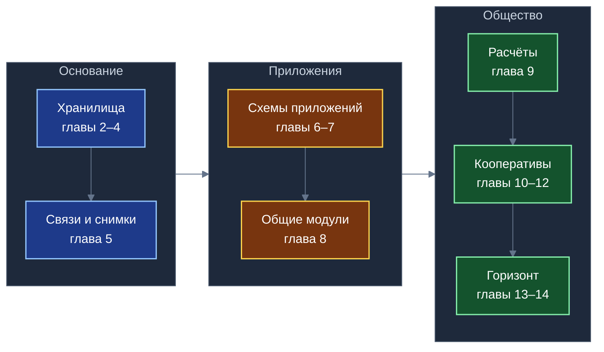
*Схема 1. Книга движется от основания (хранилища) через приложения к обществу (расчёты, кооперативы, горизонт).*

Настоящая Белая книга призвана дать целостный, академически строгий и доказательный ответ на четыре фундаментальные проблемы построения такой распределённой среды:
1. **Математическая и инженерная состоятельность хранилищ:** строгое доказательство того, что малые независимые хранилища на персональных устройствах масштабируются линейно, гарантируют сходимость данных и обеспечивают конфиденциальность и целостность при строго сформулированных криптографических допущениях (главы 2–4);
2. **Архитектура неограниченной экосистемы приложений:** формализация механизмов бесшовного соединения произвольного количества прикладных схем через внешние ключи, снимки транзитивного замыкания, оперативные виртуальные соединения и общие библиотеки платформы без изменения чужого исходного кода и схем (главы 5–8);
3. **Институционально-кооперативная модель:** разработка правовых и экономических механизмов объединения разработчиков программ, операторов инфраструктурных узлов и граждан в самоуправляемые артели и союзы с прозрачным алгоритмическим распределением выручки и защитой права голоса (главы 9–12);
4. **Долгосрочный прогностический анализ занятости:** исследование роли личной собственности граждан на средства цифрового производства и локальные хранилища как основы материальной автономии домохозяйств на горизонте 20–40 лет в условиях глубокой роботизации экономики (главы 13–14).

### 1.3. Начальные прикладные решения и статус зрелости компонентов платформы

Для верификации и практической отработки архитектурных принципов платформы был спроектирован комплект из четырёх начальных прикладных решений, каждое из которых валидирует свой спектр системных задач:
- **«КубГолос» (Белая книга № 08):** валидирует механизмы децентрализованного измерения общественного согласия, многофакторные опросы со 100 базисными пунктами, префиксную навигацию по деревьям тем и агрегацию сумм вверх по территориальной иерархии;
- **«Забота» (Белая книга № 09):** валидирует алгоритмы накопления жизненного опыта взаимопомощи, реляционную модель «Ситуация + Случай + Разговор», самозапечатывающиеся страницы коллекций и распределённое вычисление тематического социального рейтинга («Опыт»);
- **«Деловой» (Белая книга № 10):** восходящий к первому авторскому прототипу семейного органайзера 2015 года («Ганс Организатор»), сервис валидирует управление жизненными планами, координацию поручений, распределение прав доступа по правилу «Одно Дело — одно хранилище» и связывание прикладных задач с коммерческими смарт-контрактами второго уровня;
- **«УраТур» (Белая книга № 11):** воплощающий первоначальный концептуальный замысел путешествий 19-летней давности, сервис валидирует обработку физического пространства, защиту детей на уровне ядра СУБД Листа через эффективный возрастной допуск, открытые общественные теги на сбалансированных индексных деревьях и локальный статистический конвейер планирования маршрутов;
- **«Локальный реестр МСП и ЖКХ» (глава 7 настоящей книги):** выступает пятым, интеграционным сценарием, на котором проверяется композиция всех предыдущих сервисов при решении повседневных бытовых задач жильцов, мастеров шаговой доступности и обслуживающих организаций.

Для сохранения исследовательской строгости и исключения завышенных ожиданий платформа разделяет состояние готовности механизмов на то, что уже функционирует в работающем коде ядра, и то, что специфицировано в качестве целевой архитектуры.

| Механизм платформы | Статус реализации | Инженерная характеристика |
|---|---|---|
| Реляционное хранилище, участник, журнал истории (четыре уровня) | Реализовано в коде | Работает в открытом коде ядра; обеспечивает транзакционный учёт изменений |
| Базовая запись с составным ключом из трёх компонентов | Реализовано в коде | Работает в коде ядра; обеспечивает глобальную бесконфликтную адресацию |
| Копирование внешней записи и учёт локальных снимков | Реализовано в коде | Работает в коде ядра; устраняет каскадные сетевые блокировки |
| Песочница приложений и шлюз межпроцессных сообщений | Реализовано в коде | Работает в коде ядра; изолирует память приложений в браузере |
| Вызовы между приложениями через изолированные среды | Реализовано в прототипе | Работает в режиме браузера; валидация типов аргументов задана как заготовка |
| Колокация записей и связующие сущности в схемах данных | Реализовано в прототипе | Отработано на связках задач, целей и обсуждений в прототипе |
| Соединение таблиц нескольких приложений в едином запросе | Реализовано в прототипе | Подтверждено выполнением локальных реляционных выборок до пяти таблиц |
| Криптографический профиль ГОСТ («Кузнечик», «Стрибог», ГОСТ Р 34.10-2012, ML-DSA) | Задано спецификацией | Целевой криптографический профиль платформы; подлежит реализации и аттестации |
| Серверные протоколы узлов Ветки и Ствола (секвенсор, квоты) | Задано спецификацией | Целевая сетевая архитектура координационных узлов платформы |
| Механизм ветвления ключей при исключении и стирание через ключ | Задано спецификацией | Проектная модель управления доступом и соблюдения законодательства о данных |

Приведённая классификация демонстрирует: фундаментальное реляционное ядро данных, модель адресации, транзакционные дельты и локальные соединения проверены на уровне работающего программного прототипа. В свою очередь, криптографический профиль по государственным стандартам и протоколы вышестоящих серверных узлов строго специфицированы и подлежат реализации на последующих этапах развития экосистемы.

### 1.4. Принцип неограниченной экосистемы: математическая и системная сущность аддитивного масштабирования

Термин «неограниченная экосистема» в контексте платформы «Турбаза» не является метафорой или маркетинговой декларацией. Он фиксирует строгое архитектурное свойство системы: **отсутствие встроенного алгоритмического предела на количество подключаемых независимых приложений и схем данных**.

В традиционных реляционных базах данных добавление каждого нового функционального модуля сопровождается усложнением центральной схемы: расширением таблиц, добавлением внешних ключей, перестройкой индексов и увеличением графа блокировок при одновременной записи. Начиная с некоторого порога сложности, централизованная СУБД сталкивается с деградацией производительности и рисками транзакционного взаимного блокирования.

Архитектура «Турбазы» решает эту проблему посредством трёх математических и топологических свойств:
1. **Факторизация транзакционного пространства:** каждая сетевая транзакция ограничена рамками ровно одного малого хранилища; транзакции разных хранилищ взаимно независимы и не разделяют общих блокировок;
2. **Аддитивное расширение схем данных:** новое приложение подключается к экосистеме исключительно путём создания собственных таблиц, которые ссылаются на базовые записи предшествующих приложений по неизменяемым внешним ключам, не требуя модификации чужих структур данных;
3. **Локализация соединений на Листе:** сборка комплексного пользовательского интерфейса, агрегирующего поля десятков различных приложений, выполняется непосредственно в памяти персонального устройства участника локальным механизмом реляционного соединения.

Таким образом, подключение сотого или тысячного приложения к платформе «Турбаза» не вносит дополнительных накладных расходов в работу уже существующих сервисов. Практические пределы масштабирования экосистемы определяются не ограничениями архитектуры схем, а физической пропускной способностью связных узлов («Веток») и организационной эффективностью процедур стандартизации интерфейсов в ассоциациях разработчиков.

---

## Глава 2. Хранилище: единица данных, прав и ключа

### 2.1. Формальное математическое определение хранилища и адресация записей

Фундаментальной структурной и криптографической единицей платформы «Турбаза» выступает малое автономное реляционное хранилище. В отличие от традиционных централизованных СУБД, оперирующих единой глобальной базой данных для всех пользователей, «Турбаза» квантует информационное пространство на миллионы независимых замкнутых доменов.

Формально каждое хранилище $\mathcal{R}_k$ определяется как четвёрка:

$$\mathcal{R}_k = \big\langle \text{идентификатор}_k,\ \mathcal{M}_k,\ K_k,\ \mathcal{L}_k \big\rangle$$

где:
- $\text{идентификатор}_k$ — глобально уникальный неизменяемый дескриптор хранилища;
- $\mathcal{M}_k$ — актуальное множество авторизованных участников хранилища, наделённых криптографическими правами чтения или записи;
- $K_k \in \{0, 1\}^{256}$ — уникальный 256-битный симметричный ключ шифрования содержимого данного хранилища, известный исключительно участникам $\mathcal{M}_k$;
- $\mathcal{L}_k$ — строго упорядоченный локальный транзакционный журнал криптографически подписанных дельт изменений.

Ключевой принцип конструкции заключается в том, что ключ $K_k$, состав участников $\mathcal{M}_k$ и журнал $\mathcal{L}_k$ принадлежат исключительно хранилищу $\mathcal{R}_k$. Ни один внешний координационный узел (Ветка или Ствол) не входит в состав $\mathcal{M}_k$ и не имеет доступа к ключу $K_k$.

Каждая атомарная запись данных внутри любого приложения адресуется глобальной тройкой координат:

$$\mathcal{K} = \langle \text{хранилище},\ \text{автор},\ \text{номер записи} \rangle$$

где:
- $\text{хранилище}$ — глобальный идентификатор $\mathcal{R}_k$;
- $\text{автор}$ — составной идентификатор действующего лица, породившего запись; сам автор представляет собой тройку $\langle \text{учётная запись},\ \text{терминал},\ \text{приложение} \rangle$;
- $\text{номер записи}$ — строго монотонно возрастающий локальный целочисленный счётчик записей, поддерживаемый данным автором на данном терминале.

Использование тройки $\mathcal{K}$ исключает потребность в централизованном координаторе выделения первичных ключей. Идентификатор автора служит математическому устранению коллизий при одновременной работе нескольких участников и не предназначен для сокрытия авторства внутри доверенного круга хранилища.

### 2.2. Логическое разделение и единое физическое пространство Листа

Одной из центральных инженерных инноваций платформы «Турбаза» является преодоление дихотомии между автономностью независимых хранилищ и производительностью реляционных запросов.

Логически каждое хранилище $\mathcal{R}_k$ представляет собой полностью изолированный контейнер. Однако физически на пользовательском устройстве («Листе») все доступные пользователю хранилища размещаются в **едином файле встроенной реляционной базы данных**. Логическое разделение обеспечивается префиксацией первичных и внешних ключей идентификатором хранилища в составных индексах.

Такое проектное решение даёт платформе решающее преимущество: пользовательский Лист способен выполнять мгновенные реляционные выборки и соединения по любым доступным локальным хранилищам без сетевых обращений, без накладных расходов межпроцессного взаимодействия и с сохранением строгой транзакционной изоляции при записи.

### 2.3. Структура криптографического журнала и четырёхуровневая транзакция

Журнал хранилища $\mathcal{L}_k$ формируется как криптографически связанная цепочка версий:

$$T^{(i)} = \big\langle v^{(i)},\ \mathcal{H}\big(T^{(i-1)}\big),\ \Delta^{(i)},\ \text{автор},\ \sigma^{(i)} \big\rangle,\qquad v^{(i)} = v^{(i-1)}+1$$

где:
- $v^{(i)}$ — монотонный порядковый номер версии журнала;
- $\mathcal{H}\big(T^{(i-1)}\big)$ — криптографический хэш заголовка предшествующей транзакции (на базе алгоритма «Стрибог», ГОСТ Р 34.11-2012);
- $\Delta^{(i)}$ — материализованный набор изменённых и созданных строк реляционных таблиц, зафиксированных в данной транзакции;
- $\text{автор}$ — идентификатор участника, сформировавшего дельту;
- $\sigma^{(i)}$ — электронная цифровая подпись автора под заголовком и содержимым дельты (на базе ГОСТ Р 34.10-2012 и постквантового алгоритма ML-DSA).

На уровне программного ядра Листа транзакционное изменение структурируется по четырём уровням декомпозиции:
1. **Действие пользователя:** высокоуровневая операция в интерфейсе (например, подписание акта приёмки в органайзере «Деловой»);
2. **Дельта хранилища:** атомарный пакет модификаций одного конкретного хранилища $\mathcal{R}_k$;
3. **Операция над таблицей:** перечень реляционных манипуляций (вставка, обновление полей) в рамках схемы прикладного пакета;
4. **Строка данных:** конкретная запись со старыми и новыми значениями атрибутов для детерминированного слияния и аудита.

### 2.4. Путь записи и инвариант локальной атомарности

Прохождение пользовательской операции через ядро Листа подчиняется строгому детерминированному регламенту, гарантирующему локальную целостность и безопасность данных.

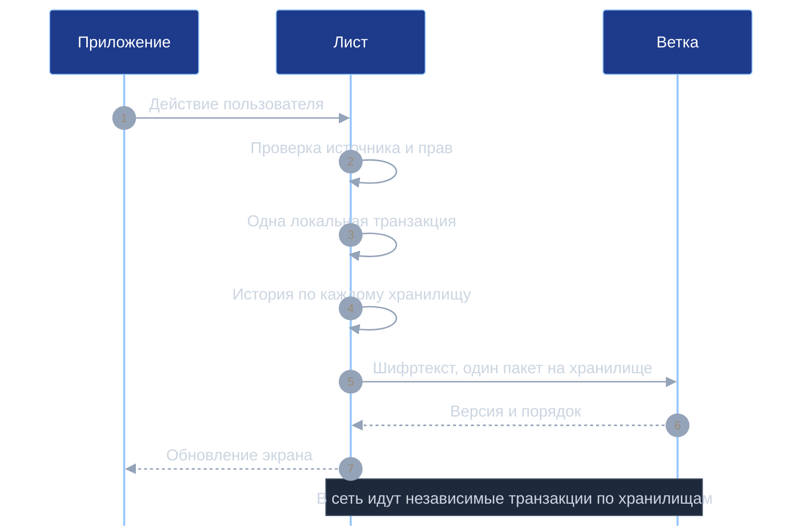
*Схема 2. Многохранилищное действие атомарно только на Листе; в сети оно распадается на независимые транзакции.*

Путь записи разворачивается по следующим этапам:
1. Прикладной интерфейс направляет действие пользователя через защищённый межпроцессный шлюз в ядро Листа;
2. Шлюз проверяет подлинность источника, отсутствие дубликатов и наличие прав записи у активного профиля;
3. Менеджер транзакций Листа открывает единую локальную реляционную транзакцию встроенной базы данных; если действие затрагивает несколько локальных хранилищ, создаются точки сохранения (savepoints), объединяющие все изменения в единый локальный снимок;
4. Формируются четырёхуровневые записи истории по каждому затронутому хранилищу в отдельности;
5. Для каждого хранилища формируется независимая подписанная дельта $\Delta^{(i)}$;
6. Каждая дельта зашифровывается симметричным ключом своего хранилища $K_k$ и упаковывается в отдельный защищённый пакет;
7. Зашифрованные пакеты направляются на узел Ветки в виде независимых сетевых транзакций — строго по одному пакету на каждое хранилище;
8. Локальная транзакция Листа фиксируется, реактивные запросы интерфейса пересчитываются, и экран мгновенно обновляется для пользователя.

Фундаментальный принцип, закреплённый формулой пункта 12 патента США 10 902 016 B2, гласит: **многохранилищное действие атомарно исключительно на Листе**. В распределённую сеть оно отправляется как семейство независимых сетевых транзакций. Это избавляет систему от необходимости выполнения дорогостоящих протоколов двухфазной фиксации (2PC) между удалёнными серверами. Возможная кратковременная асинхронная рассогласованность между независимыми хранилищами компенсируется прикладным слоем и порядком логических шагов.

Временные метки для юридически значимых операций формируются координационными узлами Ветки, синхронизированными с доверенными серверами точного времени Ствола. Для личных автономных записей допускается использование локальных гибридных логических часов устройства.

### 2.5. Исторический генезис концепции и фундаментальные утверждения о хранилищах

Концепция автономных взаимозависимых реляционных хранилищ формировалась на протяжении почти двух десятилетий целенаправленного инженерного поиска. Первоначальный концептуальный импульс возник у автора платформы А.В. Шамсутдинова — гражданина России, длительное время проживающего в США и являющегося патриотом своей Родины, — 19 лет назад в форме абстрактной на тот момент идеи создания сервиса путешествий «УраТур». В 2014 году практический опыт работы с локальными базами данных непосредственно в браузере был приобретён автором при создании клиентской части информационной системы проверки безопасности горнодобывающих шахт для государственного агентства MSHA (Mine Safety and Health Administration — Федеральная служба США по проверке безопасности горнодобывающей промышленности) на основе технологии IndexedDB, продемонстрировавшей исключительную ценность надёжной локальной работы в условиях прерывистой связи. В 2015 году при разработке семейного органайзера (носившего рабочее юмористическое название «Ганс Организатор» — роботизированного помощника, ставшего прообразом приложения «Деловой») автор осознал невозможность запуска приватного семейного сервиса без зависимости от центрального сервера. Первичной прорывной идеей стало использование существовавших тогда табличных листов в Google Документах с надстройкой над ними простой базы данных: первой целью было создание объектно-реляционного отображения (ORM) на базе листа данных, откуда и взяла начало вся архитектурная ветвь платформы. Присутствие в браузерах стандарта WebSQL естественным образом подтолкнуло к использованию реляционной базы данных, однако отсутствие надёжной транзакционности потребовало перехода к использованию библиотеки sql.js, а в последующем — полноценного стека SQLite WASM. Сама идея «листов» органично сохраняется в архитектуре платформы и поныне: любая файловая система может служить средой размещения хранилищ, журнал изменений каждого хранилища представляет собой по существу упорядоченный лист записей, а персональный клиентский узел платформы закономерно получил имя «Лист».

В 2017 году в исследовательской публикации «Small Repositories: Architectural Foundations of Distributed Relational Edge Storage» автором были впервые теоретически формализованы принципы микроквантования реляционных баз данных. В 2018 году была подана патентная заявка, завершившаяся выдачей приоритетного патента США 10 902 016 B2 («Autonomous interdependent repositories», 2021 г.). Архитектурная триада «дерево, очередь, сеть» объединила в законченную систему трёхзвенную топологию Лист $\to$ Ветка $\to$ Ствол, постоянные транзакционные очереди дельт и пиринговый обмен между терминалами. Будучи адресованной в первую очередь российским инженерам в расчёте на лидерство России в создании открытого эталонного ядра, платформа изначально проектируется как глобальная основа для международной сети суверенных деревьев данных: дальнейшая инженерная мысль во всех странах мира позволит сообществам создавать собственные версии «Турбазы» под особенности национальных законодательств при сохранении единого открытого стандарта работы с хранилищами.

Корректность функционирования распределённой модели хранилищ базируется на двух строгих теоремах.

**Утверждение 1 (Уникальность составных ключей без централизованного координатора).**  
*Если для каждого автора локальные номера записей формируются строго монотонно возрастающим счётчиком без повторений, любые две различные записи распределённой сети обладают различными глобальными ключами $\mathcal{K}$.*  
*Доказательство.* Рассмотрим две произвольные записи $e_1$ и $e_2$ с координатами $\mathcal{K}_1 = \langle R_1, A_1, N_1 \rangle$ и $\mathcal{K}_2 = \langle R_2, A_2, N_2 \rangle$. Предположим от противного, что $\mathcal{K}_1 = \mathcal{K}_2$. Из равенства троек следует: $R_1 = R_2$, $A_1 = A_2$ и $N_1 = N_2$. Поскольку $A_1 = A_2$, обе записи созданы одним и тем же автором на одном терминале. Однако по условию локальный счётчик автора строго монотонен и никогда не выдаёт одно и то же значение дважды: $N_1 \ne N_2$ при $e_1 \ne e_2$. Полученное противоречие доказывает, что $\mathcal{K}_1 \ne \mathcal{K}_2$. Уникальность ключей соблюдается математически без обращений к сети при условии корректной изоляции счётчика терминала.

**Утверждение 2 (Факторизация транзакционного пространства).**  
*Каждая сетевая транзакция несёт идентификатор ровно одного хранилища, вследствие чего всё множество сетевых транзакций $\mathbb{T}$ разбивается на непересекающиеся классы эквивалентности по хранилищам:*

$$\mathbb{T} = \bigsqcup_{\mathcal{R} \in \mathfrak{R}} \mathbb{T}_{\mathcal{R}}$$

*Доказательство.* Утверждение следует непосредственно из формата сообщений сетевой синхронизации платформы: заголовок каждого сетевого пакета строго содержит ровно одно поле идентификатора целевого хранилища. Транзакция не может физически содержать данные двух различных хранилищ в одном сетевом конверте, что математически обеспечивает взаимную ортогональность транзакционных потоков.

---

## Глава 3. Почему хранилища работают и масштабируются

### 3.1. Утверждение об отсутствии распределённых блокировок

Центральным препятствием масштабирования классических распределённых СУБД является наличие распределённых транзакционных блокировок. Если транзакция одного пользователя блокирует строки таблицы, необходимые транзакции другого пользователя на удалённом сервере, время отклика системы деградирует экспоненциально, а граф ожидания транзакций порождает взаимные блокировки (deadlocks).

В платформе «Турбаза» распределённые блокировки устранены на уровне математической топологии данных.

**Утверждение 3 (Отсутствие межхранилищных блокировок).**  
*Выполнение транзакции записи в хранилище $\mathcal{R}_i$ не требует захвата блокировок объектов любого другого хранилища $\mathcal{R}_j$ ($j \ne i$) ни на одном узле сети.*  
*Доказательство.* Путь записи в хранилище $\mathcal{R}_i$ оперирует исключительно записями, принадлежащими $\mathcal{R}_i$, а также локальными неизменяемыми копиями-снимками внешних данных, зафиксированными внутри $\mathcal{R}_i$. Ни чтение, ни модификация данных хранилища $\mathcal{R}_j$ в процессе фиксации транзакции $\mathcal{R}_i$ не выполняются. Следовательно, распределённый граф ожидания транзакций между различными хранилищами тождественно пуст. Блокировки встроенной СУБД существуют исключительно локально внутри оперативной памяти одного Листа и снимаются за доли миллисекунды.

### 3.2. Теорема о детерминированной сходимости состояний

В распределённой среде Листы участников могут получать транзакционные дельты с различными сетевыми задержками. Для гарантии математической согласованности платформа обеспечивает детерминированную сходимость.

**Утверждение 4 (Детерминированная сходимость реляционного состояния).**  
*Пусть для хранилища $\mathcal{R}_k$ задан журнал версий $1, 2, \dots, m$ без пропусков. Если каждый участник применяет дельты строго в порядке возрастания версий, игнорирует повторно доставленные дельты, а сами дельты содержат материализованные значения по единой версии схемы данных, то любые два Листа, применившие версии до $m$ включительно, приходят к абсолютно идентичному реляционному состоянию.*  
*Доказательство.* Доказательство проводится методом математической индукции по номеру версии $m$.  
*База индукции:* при $m = 0$ хранилище пусто на всех узлах, состояния эквивалентны ($S^{(0)}_A = S^{(0)}_B = \emptyset$).  
*Индукционный переход:* пусть утверждение верно для версии $m-1$: $S^{(m-1)}_A = S^{(m-1)}_B$. Применение дельты версии $m$ представляет собой детерминированную функцию $f(S, \Delta^{(m)})$. Поскольку дельта $\Delta^{(m)}$ содержит материализованные реляционные значения (новые строки и точные значения обновлённых полей), а функция применения $f$ строго детерминирована, результат вычисления на обоих узлах совпадает:

$$S^{(m)}_A = f\big(S^{(m-1)}_A, \Delta^{(m)}\big) = f\big(S^{(m-1)}_B, \Delta^{(m)}\big) = S^{(m)}_B$$

Идемпотентность функции $f\big(f(S, \Delta), \Delta\big) = f(S, \Delta)$ гарантирует устойчивость к повторным пакетам. В случае если на Лист поступает дельта с версией $v > m+1$, она помещается в буфер отложенного применения до получения пропущенных версий. При конкурентном создании двух дельт разными авторами окончательный порядок следования версий определяется координационным узлом Ветки, что исключает расхождение истории.

### 3.3. Линейная масштабируемость сети и формула совокупной пропускной способности

Благодаря факторизации транзакционного пространства общая вычислительная сеть платформы демонстрирует строгую линейную масштабируемость.

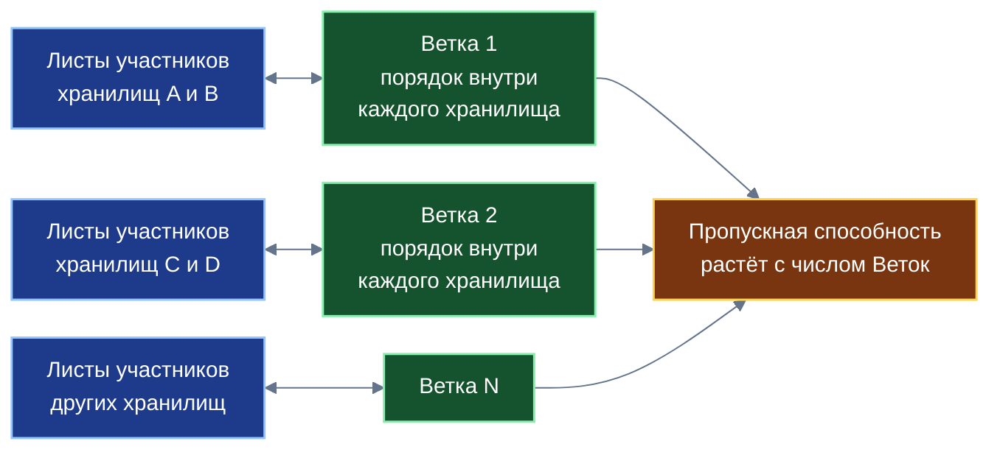
*Схема 3. Общей точки синхронизации и общей блокировки нет; предел задаёт нагрузка каждой Ветки.*

**Утверждение 5 (Линейное масштабирование сети Веток).**  
*Совокупная нагрузка на координационный узел Ветки $b$ выражается суммой:*

$$\Lambda_b = \sum_{R \in \mathfrak{R}_b} w_R\, m_R$$

*где $\mathfrak{R}_b$ — множество хранилищ, обслуживаемых данной Веткой, $w_R$ — средняя частота генерации транзакций в хранилище $R$, а $m_R$ — число активных участников хранилища. Если для каждого узла Ветки соблюдается условие $\Lambda_b \le \mu_b$ (где $\mu_b$ — предельная пропускная способность узла), то совокупная производительность платформы растёт строго линейно с добавлением новых независимых Веток:*

$$\Pi_{\text{сеть}} \le \sum_{b=1}^{B} \mu_b$$

*а доля последовательной работы, требующей глобальной синхронизации всех узлов сети, тождественно равна нулю.*

### 3.4. Пределы пропускной способности и защита от проблемы «горячего хранилища»

Математическая независимость хранилищ снимает глобальные ограничения масштабирования, однако выявляет локальное проектное ограничение: **производительность одного конкретного хранилища не может превышать пропускную способность обслуживающего его узла Ветки**.

Если хранилище становится «горячим» (например, общенациональное голосование или сбор подписей), нагрузка $w_R \cdot m_R$ может превысить лимит $\mu_b$. Платформа «Турбаза» категорически отвергает наивную модель рассылки индивидуальных транзакций миллионам участников. Для высоконагруженных задач применяются специализированные архитектурные механизмы:
1. **Самозапечатывающиеся страницы и блочная агрегация (Белые книги № 08 и № 09):** индивидуальные отклики аккумулируются в локальной оперативной памяти узлов и запечатываются укрупнёнными блоками по 1000 записей;
2. **Сложение сумм вверх по территориальному дереву:** узел района передаёт на вышестоящую Ветку только агрегированные промежуточные суммы и контрольные хэши, снижая поток сетевых транзакций на порядки;
3. **Хранение только подписанных данных:** Лист участника хранит исключительно те хранилища, к которым он имеет прямое отношение, удерживая объем локальной базы на уровне $\mathcal{O}(r_u)$ вместо размера глобальной сети.

### 3.5. Двухстадийный приём дельт и численный модельный расчёт

Приём внешних дельт на Листе выполняется двухстадийным конвейером:
1. **Стадия разрешения:** входящий пакет сопоставляет глобальные идентификаторы записей с локальными компактными числовыми идентификаторами встроенной базы и верифицирует непрерывность цепочки версий;
2. **Стадия пакетной фиксации:** проверенная дельта применяется к реляционным таблицам в рамках единой локальной транзакции с последующим уведомлением активных подписчиков. Дельты с уже применёнными версиями ($v \le v_{\text{тек}}$) отсекаются без модификации дискового состояния.

**Условный модельный расчёт масштабируемости:**  
Пусть типовой координационный узел Ветки обслуживает $|\mathfrak{R}_b| = 10^5$ малых хранилищ (семейные бюджеты, локальные задачи, микрогруппы). В каждом хранилище участвует в среднем $m = 4$ человека. Средняя интенсивность генерации транзакций составляет $w = 0{,}01$ транзакции в секунду на хранилище (одна запись в 100 секунд).  
Тогда входящий поток транзакций на узел Ветки составляет:

$$\Lambda_b = 10^5 \cdot 0{,}01 \cdot 4 = 4000\ \text{операций в секунду}$$

При проектной пропускной способности современного серверного узла $\mu_b = 20\,000$ операций в секунду обеспечивается пятикратный запас надёжности. Сеть из $B = 100$ таких Веток устойчиво обрабатывает:

$$\Pi_{\text{сеть}} = 100 \cdot 20\,000 = 2\cdot 10^6\ \text{операций в секунду}$$

что полностью покрывает потребности крупной национальной экосистемы без создания единого уязвимого суперкомпьютерного центра.

---

## Глава 4. Безопасность хранилищ

### 4.1. Топология доверия и модель противников

Безопасность платформы «Турбаза» базируется на бескомпромиссном разграничении доверенных и недоверенных контуров.

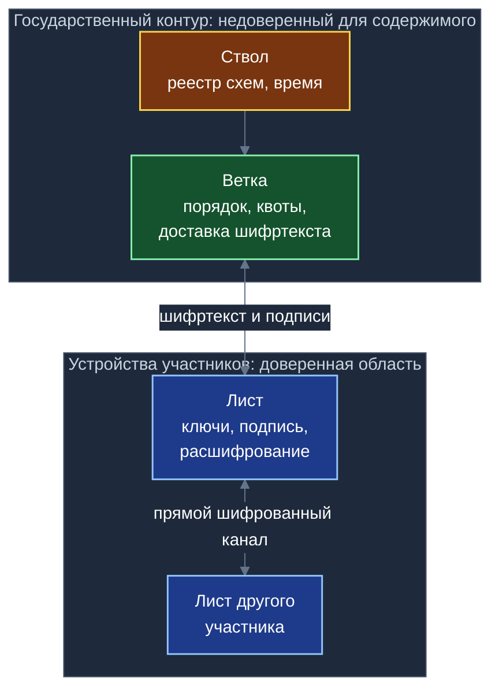
*Схема 4. Ключи и открытый текст есть только на Листе; Ветка и Ствол видят шифртекст, подписи и сведения для маршрутизации.*

Фундаментальный постулат доверия: **симметричные ключи хранилищ и открытый текст прикладных данных присутствуют исключительно на Листах авторизованных участников**. Координационные узлы Ветки и Ствола выполняют функции сетевого транспорта, упорядочивания версий и маршрутизации; с точки зрения конфиденциальности и подлинности прикладного содержимого они считаются **недоверенной средой**.

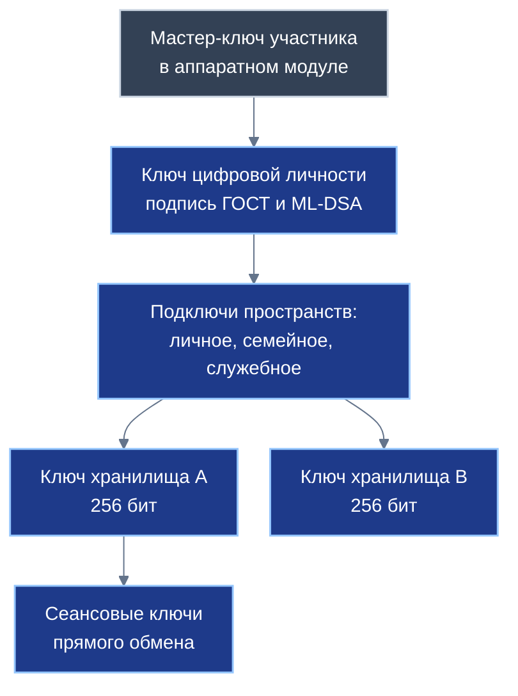
*Схема 5. У каждого хранилища свой ключ: раскрытие одного ключа не раскрывает другие хранилища.*

Модель угроз платформы систематизирует потенциальных нарушителей по классам P1–P7:

| Класс противника | Потенциальные возможности противника | Архитектурные требования безопасности |
|---|---|---|
| P1: Скомпрометированная Ветка или Ствол | Полный доступ к сетевой памяти и накопителям узла; попытки задержки, переупорядочивания или подмены пакетов | Абсолютная конфиденциальность содержимого; невозможность незаметной подделки реляционных записей |
| P2: Внешний сетевой наблюдатель | Перехват, анализ и попытки модификации сетевого трафика в каналах связи | Стойкое шифрование каналов и защита прямых пиринговых сессий участников |
| P3: Вредоносное приложение на Листе | Выполнение недоверенного кода в изолированной песочнице устройства, спам-запросы к шине | Запрет прямой записи в чужие схемы; изоляция памяти и криптографических ключей |
| P4: Исключённый участник хранилища | Владеет архивными ключами и историей изменений до момента исключения | Невозможность расшифрования любых данных, созданных после факта исключения |
| P5: Похититель физического устройства | Прямой физический доступ к Листу в выключенном или заблокированном состоянии | Хранение мастер-ключей в аппаратных модулях безопасности; оперативный отзыв устройства |
| P6: Фабрика массовых учётных записей | Попытки генерации миллионов ботов для искажения рейтингов и спама | Институциональные барьеры ЕСИА, подтверждённый Опыт и квотирование сетевых ресурсов |
| P7: Квантовый суперкомпьютер | Применение алгоритма Шора для атаки на асимметричные ключи; стратегия «сохрани сейчас — расшифруй потом» | Симметричные ключи 256 бит; гибридная постквантовая электронная подпись (ML-DSA) |

### 4.2. Криптографические допущения стойкости и формат защищённой дельты

Математические доказательства защищённости хранилищ опираются на семь явных допущений стойкости (A1–A7):
- **A1:** Симметричный блочный шифр «Кузнечик» (ГОСТ Р 34.12-2015) в режиме аутентифицированного шифрования MGM (ГОСТ Р 34.13-2015) вычислительно стоек: преимущество любого полиномиального алгоритма различения $\mathbf{Adv}^{\text{AEAD}}$ пренебрежимо мало;
- **A2:** Схема электронной цифровой подписи ГОСТ Р 34.10-2012 и постквантовая схема ML-DSA стойки к экзистенциальной подделке при адаптивно выбранных сообщениях;
- **A3:** Криптографическая функция хэширования «Стрибог» (ГОСТ Р 34.11-2012) устойчива к поиску коллизий и прообразов;
- **A4:** Аппаратный генератор случайных чисел устройства вырабатывает криптографически стойкие псевдослучайные последовательности с максимальной энтропией;
- **A5:** Закрытые ключи пользователей никогда не покидают доверенную среду исполнения Листа (аппаратный модуль безопасности устройства);
- **A6:** Изоляция источников браузерной среды исполнения и виртуальных машин WebAssembly строго гарантирует разделение адресных пространств;
- **A7:** Ядро Листа осуществляет строгое непрерывное посредничество при каждом обращении прикладных модулей к дисковой базе данных.

Формат защищённого пакета дельты строится по схеме аутентифицированного шифрования с присоединёнными открытыми данными (AEAD):

$$C = \mathbf{Enc}_{K_k}(\Delta^{(i)};\ N,\ \text{AAD}),\qquad \text{AAD} = \langle \text{хранилище},\ \text{автор},\ v^{(i)} \rangle$$
$$H = \mathbf{Hash}\big(\text{AAD} \parallel C \parallel \mathcal{H}(T^{(i-1)})\big),\qquad \sigma = \mathbf{Sign}_{\text{автор}}(H)$$

где $N$ — одноразовый вектор инициализации (nonce), формируемый детерминированно из координат автора и номера транзакции. Открытые данные AAD остаются доступными Ветке для выполнения маршрутизации и валидации версионного ряда, в то время как полезная реляционная нагрузка $\Delta^{(i)}$ остаётся полностью зашифрованной.

### 4.3. Теоремы о конфиденциальности, подлинности и изоляции приложений

**Утверждение 6 (Конфиденциальность перед недоверенным транспортным контуром).**  
*При соблюдении допущений A1, A4 и A5 преимущество любого полиномиального противника (включая скомпрометированную Ветку или Ствол) в извлечении сведений об открытом тексте дельты $\Delta$ из перехваченного шифртекста $C$ ограничено величиной:*

$$\mathbf{Adv} \le n_{\text{ключей}} \cdot \mathbf{Adv}^{\text{AEAD}}(q,\ t)$$

*где $q$ — количество перехваченных пакетов, $t$ — доступное время вычислений, а $n_{\text{ключей}}$ — число скомпрометированных симметричных ключей.*  
*Доказательство.* Поскольку ключи $K_k$ генерируются на Листе с использованием стойкого ГСЧ (A4), не покидают защищённый модуль (A5) и не передаются Ветке, противник не располагает ключом $K_k$. Любая попытка извлечь открытые реляционные поля из шифртекста $C$ эквивалентна прямой атаке на стойкость аутентифицированного шифрования «Кузнечик-MGM», что по допущению A1 пренебрежимо мало.

**Утверждение 7 (Подлинность и целостность реляционной истории).**  
*При соблюдении допущений A2 и A3 создание фиктивной транзакции или изменение существующей дельты от имени легитимного участника вычислительно невозможно.*  
*Доказательство.* Каждая дельта подписана личным закрытым ключом автора $\sigma = \mathbf{Sign}(H)$, где хэш $H$ агрегирует открытый заголовок, шифртекст и хэш предшествующей транзакции. Модификация хотя бы одного бита шифртекста или заголовка требует нахождения коллизии хэш-функции «Стрибог» (противоречит A3) либо создания поддельной подписи (противоречит A2). Попытка исключения транзакции из цепочки обнаруживается разрывом хэш-связности $H(T^{(i-1)})$ и нарушением монотонности версий $v^{(i)}$.

**Утверждение 9 (Изоляция прикладных сред на Листе).**  
*При соблюдении допущений A6 и A7 стороннее приложение $X$ физически не способно модифицировать реляционные таблицы приложения $Y$ иначе как через официально опубликованный открытый программный интерфейс приложения $Y$.*  
*Доказательство.* По допущению A6 приложения $X$ и $Y$ выполняются в изолированных песочницах памяти. По допущению A7 ядро Листа перехватывает все операции обращения к встроенной СУБД. Прямой файловый доступ для песочниц заблокирован. Механизм диспетчеризации Листа отклоняет любые операции прямой вставки или обновления строк в схеме $Y$, инициированные контекстом приложения $X$, разрешая исключительно вызовы зарегистрированных открытых методов.

### 4.4. Механизм отсечения исключённого участника и стирание данных через уничтожение ключа

Управление жизненным циклом прав доступа в децентрализованной среде требует решения задачи отзыва полномочий без перешифрования гигабайтов исторического архива.

**Утверждение 8 (Отсечение исключённого участника через ветвление ключей).**  
*При исключении участника из множества $\mathcal{M}$ создаётся новая логическая ветвь хранилища с новым симметричным ключом $K^{(2)}$, передаваемым исключительно оставшимся участникам. Исключённый участник математически теряет доступ ко всей информации, создаваемой после момента исключения.*  
*Доказательство.* Все последующие дельты $T^{(j)}$ ($j > \text{точка отсечения}$) зашифровываются на ключе $K^{(2)}$. Поскольку исключённый субъект не входит в обновлённый список рассылки ключа, его способность расшифровать новые дельты ограничена преимуществом взлома шифра $\mathbf{Adv}^{\text{AEAD}}$, что по допущению A1 пренебрежимо мало. При этом исторический архив до точки отсечения остаётся зашифрован ключом $K^{(1)}$ и не требует ресурсоёмкой массовой перезаписи.

**Утверждение 10 (Стирание данных через уничтожение криптографического ключа).**  
*Если все копии симметричного ключа $K_k$ гарантированно уничтожены на устройствах всех участников $\mathcal{M}_k$, реляционное содержимое хранилища становится вычислительно недоступным для любых субъектов.*  
*Доказательство.* Без наличия ключа $K_k$ задача восстановления открытого текста из оставшихся зашифрованных образов эквивалентна задаче взлома шифра при отсутствии ключа, что по допущению A1 вычислительно неразрешимо. Данный механизм («криптографическое уничтожение») рассматривается как фундаментальная технологическая основа реализации «права на забвение» в распределённых архитектурах.

### 4.5. Постквантовая защита, утечки метаданных и реестр остаточных рисков

Для сохранения абсолютной объективности платформа «Турбаза» открыто фиксирует границы доказанности и формирует исчерпывающий реестр остаточных рисков.

> [!WARNING]
> **Принцип честной границы зрелости платформы**  
> Все слабые места и научно-инженерные вопросы, отнесённые к категории «Открыто» (О), подлежат дальнейшей исследовательской проработке и экспериментальным стендовым испытаниям; они не подаются в настоящей книге как завершённые решения.

| Идентификатор | Описание остаточного риска | Потенциальное системное последствие | Направление нейтрализации | Статус |
|:-:|---|---|---|:-:|
| Р-1 | Доставка симметричных ключей хранилищ без постквантовой защиты | Риск перехвата ключей квантовым противником по схеме «сохрани сейчас — расшифруй потом» | Внедрение гибридного механизма инкапсуляции ключей (ML-KEM в сочетании с ГОСТ Р 34.10-2012) | О |
| Р-2 | Выдача скомпрометированной Веткой различных версий истории разным Листам | Риск расщепления согласованного представления данных между участниками | Прямой пиринговый обмен контрольными хэшами цепочки между Листами; цифровая подпись Ветки на версии | О |
| Р-3 | Кратковременная асинхронная рассогласованность между независимыми хранилищами | Временная неполнота картины данных на Листе до завершения сетевой синхронизации | Локальная фиксация шагов, применение компенсирующих операций, индикация синхронизации в интерфейсе | Д (принято) |
| Р-4 | Внешний снимок без исходной цифровой подписи стороннего автора | Риск отказа автора оригинальной записи от факта фиксации данных на определённую дату | Включение в состав снимка оригинальной цифровой подписи автора и версионного сертификата | О |
| Р-5 | Локальное исчерпание пропускной способности Ветки «горячим хранилищем» | Замедление обработки транзакций при проведении массовых общенациональных акций | Блочная группировка записей в страницы по 1000 элементов; территориальные деревья агрегации сумм | О |
| Р-6 | Уязвимости среды браузера, побочные каналы утечки и ошибки ядра Листа | Теоретический риск выхода недоверенного скрипта из песочницы браузера | Использование изолированных процессов ОС, регулярный аудит ядра, минимизация доверенной кодовой базы | О |
| Р-7 | Неопределённость правового статуса зашифрованных данных при уничтожении ключа | Правовые споры о признании шифртекста обезличенными данными по законодательству о данных | Подготовка комплексного правового заключения и согласование стандартов обезличивания с регуляторами | О |
| Р-8 | Анализ графа взаимодействий и метаданных активности сетевым наблюдателем | Возможность построения социального графа участников по частоте и размерам сетевых пакетов | Использование сетей переменной задержки, выравнивание размеров пакетов, пиринговая ретрансляция | О |
| Р-9 | Клонирование образа виртуальной машины устройства вместе со счётчиком записей | Риск коллизии первичных ключей и повторного использования одноразового вектора (nonce) | Обязательная генерация нового идентификатора терминала при каждом восстановлении из резервной копии | О |
| Р-10 | Отсутствие полной реализации криптопрофиля ГОСТ в открытом коде прототипа | Временное использование базовых криптопримитивов браузера в текущей исследовательской сборке | Поэтапная интеграция сертифицированных криптографических библиотек и стендовые тесты совместимости | О |

---

## Глава 5. Связи между хранилищами: внешние ключи и снимки

### 5.1. Проблема связанных данных в распределённых асинхронных средах

В классических реляционных СУБД связь между таблицами реализуется внешним ключом (foreign key), который указывает на первичный ключ строки в другой таблице. При выполнении запроса СУБД обращается к связанной таблице, считывая актуальные данные. 

В распределённой децентрализованной среде с миллионами независимых хранилищ прямой перенос этого механизма приводит к катастрофическим последствиям:
1. **Каскадные задержки отображения экрана:** чтобы отобразить карточку договора в органайзере, приложению потребовалось бы выполнить каскад сетевых запросов к хранилищам подрядчика, поставщика материалов и субподрядчика, расшифровать каждое из них и дождаться ответов. При отсутствии связи экран не отобразится вовсе;
2. **Каскадные конфликты и потеря правовой фиксации:** если подрядчик задним числом изменит расценку в своём хранилище сметы, смета внутри ранее подписанного договора заказчика автоматически мутирует, что разрушает юридическую силу электронного соглашения;
3. **Распределённые взаимные блокировки:** согласование изменений связанных записей потребовало бы одновременной блокировки десятков независимых хранилищ в сети.

### 5.2. Механизм снимка по транзитивному замыканию и оценка экспоненциального роста

Платформа «Турбаза» решает проблему связанных данных через фундаментальный архитектурный механизм: **создание неизменяемого снимка по транзитивному замыканию в момент фиксации внешней ссылки**.

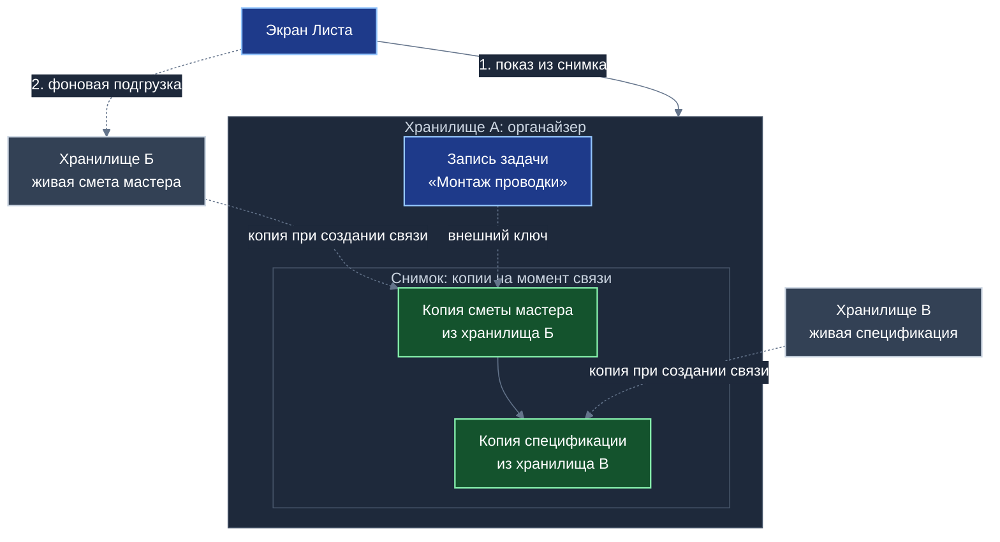
*Схема 6. Экран строится из локального снимка; изменение живых данных в других хранилищах не меняет записанное соглашение.*

Когда запись хранилища $\mathcal{R}_A$ ссылается внешним ключом $\mathcal{K}$ на запись хранилища $\mathcal{R}_B$, ядро Листа выполняет следующие действия:
1. Извлекает текущее материализованное состояние внешней записи из локальной базы;
2. Рекурсивно находит все внешние записи, на которые ссылается данная запись (вычисляет транзитивное замыкание графа зависимостей);
3. Формирует неизменяемую копию (снимок) всего транзитивно достижимого подграфа;
4. Встраивает полученный снимок непосредственно внутрь дельты транзакции хранилища $\mathcal{R}_A$.

С этого момента хранилище $\mathcal{R}_A$ становится полностью самодостаточным. Отображение записи больше не требует сетевых запросов к $\mathcal{R}_B$.

Размер снимка зависит от глубины вложенности ссылок $d$ и коэффициента ветвления $b$. В общем случае максимальное число записей в снимке выражается формулой суммы геометрической прогрессии:

$$S(b,\ d) = \sum_{j=0}^{d} b^{j} = \frac{b^{d+1}-1}{b-1}\qquad (b \ge 2)$$

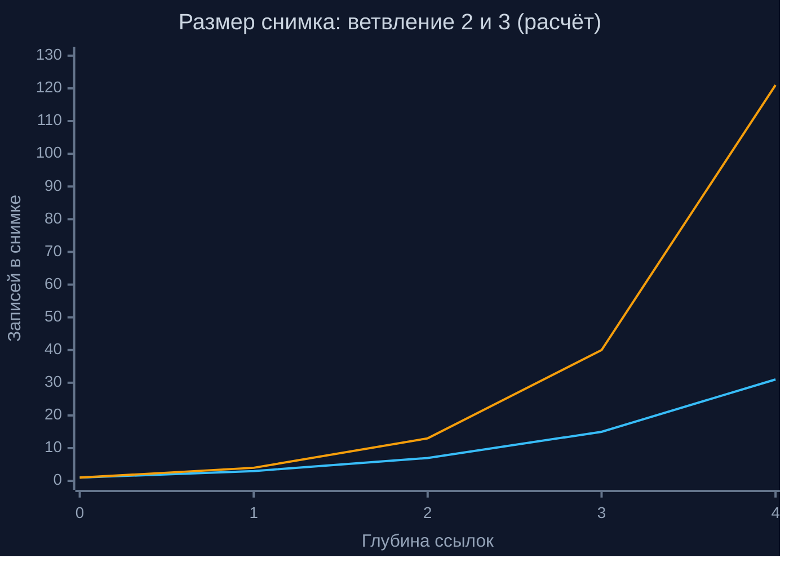
*Схема 7. Нижняя линия — ветвление 2, верхняя — ветвление 3; размер снимка растёт быстро, поэтому глубину ссылок выбирает проектировщик схемы.*

| Глубина связей $d$ | 0 | 1 | 2 | 3 | 4 |
|---|:---:|:---:|:---:|:---:|:---:|
| Ветвление $b = 2$ | 1 запись | 3 записи | 7 записей | 15 записей | 31 запись |
| Ветвление $b = 3$ | 1 запись | 4 записи | 13 записей | 40 записей | 121 запись |

Для линейных цепочек связей без разветвления ($b = 1$) размер снимка строго равен $S = d + 1$. Например, прикладная цепочка «Задача $\to$ Смета мастера $\to$ Спецификация материала» обладает глубиной $d = 2$ и требует включения ровно трёх записей. Экспоненциальный характер формулы при $b \ge 2$ накладывает строгое архитектурное правило: проектировщик прикладных схем обязан ограничивать глубину транзитивных внешних ссылок разумным пределом ($d \le 2..3$), заменяя глубокие графы слабыми связями через общественные теги.

### 5.3. Четыре системных эффекта архитектуры снимков

Использование снимков транзитивного замыкания порождает четыре важнейших системных эффекта:
1. **Мгновенный локальный показ:** интерфейс Листа отображает экранные формы непосредственно из локальной базы без ожидания сетевых ответов (проектный ориентир отклика — единицы миллисекунд);
2. **Фоновая асинхронная подгрузка «живых» данных:** после мгновенного отображения исторического снимка Лист в фоновом режиме опрашивает Ветку о наличии свежих версий связанного объекта и деликатно уведомляет пользователя о поступивших обновлениях;
3. **Историческая и юридическая неизменяемость:** зафиксированное соглашение (акт приёмки, договор подряда, утверждённый план похода) навсегда сохраняет точные формулировки и параметры, действовавшие в момент подписания, исключая возможность ретроспективных манипуляций;
4. **Абсолютная изоляция от каскадных сбоев:** авария, сетевая недоступность или удаление исходного хранилища $\mathcal{R}_B$ никак не влияют на целостность и читаемость данных хранилища $\mathcal{R}_A$.

### 5.4. Самозапечатывающиеся страницы коллекций и теоретические основания локальных моделей

Для коллекций типа «один ко многим» с большим числом записей (например, сотни отзывов жильцов или тысячи отметок о помощи) платформа применяет структуру **самозапечатывающихся страниц** (подробно специфицированную в Белой книге № 09).

Вместо создания индивидуального снимка на каждую мелкую запись Лист группирует лёгкие проекции связей в страницы фиксированной ёмкости (порядка 1000 записей). По достижении лимита страница запечатывается криптографическим хэшем, подписывается создателем и кэшируется на Листах участников бессрочно. Дальнейшие запросы к архивной странице требуют нулевых сетевых затрат.

Теоретические основания архитектуры автономных снимков опираются на фундаментальные труды в области распределённых вычислительных систем:
- **Концепция агрегатов в проблемно-ориентированном проектировании (Э. Эванс, В. Вернон):** хранилище «Турбазы» выступает строгой границей транзакционной согласованности, за пределами которой ссылки заменяются неизменяемыми объектами-значениями;
- **Манифест локально-ориентированного программного обеспечения (М. Клеппман и др., 2019):** постулирующий примат владения локальными данными на устройствах пользователей и трактующий облачные серверы исключительно как вспомогательные каналы ретрансляции;
- **Материализованные читающие модели (М. Фаулер, Г. Янг):** разделение ответственности команд и запросов (CQRS), при котором локальный снимок служит предварительно материализованным представлением для чтения, свободным от блокировок пишущего контура.

---

## Глава 6. Неограниченное число приложений: схемы, чтение, вызовы и связки

### 6.1. Сравнительный анализ подходов к расширению схем данных

Масштабирование экосистемы до произвольного числа прикладных решений требует ответа на фундаментальный вопрос: каким образом новые приложения могут расширять структуры данных существующих приложений без разрушения их стабильности?

В мировой практике проектирования информационных систем известны три основных подхода к решению этой задачи:
1. **Подход единой универсальной таблицы:** базовая сущность наделяется десятками необязательных атрибутов для всех возможных расширений. Такой подход быстро приводит к сильной разреженности данных, деградации индексов и крайней хрупкости миграций схем при обновлении отдельных модулей;
2. **Модель «сущность — атрибут — значение» (EAV):** прикладные свойства сохраняются в виде динамических пар ключ-значение. Это обеспечивает гибкость, однако полностью лишает СУБД возможностей строгой статической типизации, делает реляционные соединения крайне медленными и непредсказуемыми по ресурсам;
3. **Изолированные микросервисные базы данных:** каждое приложение ведёт собственную закрытую базу данных и предоставляет внешнее сетевое API. В этом случае сборка комплексного интерфейса требует десятков сетевых вызовов, порождает дублирование сущностей и делает экран неработоспособным при отключении сети.

Платформа «Турбаза» отвергает указанные компромиссы и реализует строгий реляционный подход: **создание независимых таблиц расширений**.

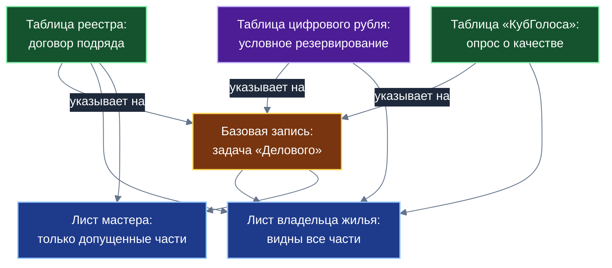
*Схема 8. Каждое приложение добавляет свою таблицу; состав видимых частей на Листе определяют ключи хранилищ участника.*

Базовое правило экосистемы гласит: **приложения никогда не вторгаются в схемы существующих сервисов и не модифицируют чужие таблицы**. Новое приложение декларирует собственные таблицы, которые связываются с базовыми записями внешними ключами. Это обеспечивает чисто аддитивную эволюцию данных: появление нового приложения не требует миграции существующих баз и гарантирует обратную совместимость всех предшествующих версий.

### 6.2. Режим единого чтения локальной базы и виртуальные реляционные объекты

Поскольку таблицы всех установленных приложений физически размещаются в единой локальной базе Листа, ядро предоставляет механику **виртуальных реляционных объектов**. 

Виртуальный объект не хранится на диске как монолитная структура, а оперативно конструируется ядром Листа в оперативной памяти в момент выполнения запроса интерфейса. Для участника $u$ доступный виртуальный объект $V_u$ формализуется математически через множество доступных ключей хранилищ:

$$A_u = \big\{\,i : K_{\mathcal{R}(E_i)} \in \text{Ключи}(u)\,\big\}$$

В зависимости от требований прикладного интерфейса ядро поддерживает два режима сборки:
1. **Строгий режим (внутреннее реляционное соединение):** объект возвращается только при наличии всех компонентов расширения:

$$V_u = B \bowtie \Big( \bowtie_{i \in A_u} E_i \Big)$$

2. **Мягкий режим (внешнее реляционное соединение):** объект отображается всегда, а недоступные или незаполненные поля расширений возвращаются пустыми значениями:

$$V_u = B \mathbin{\overset{\circ}{\bowtie}} \Big( \overset{\circ}{\bowtie}_{i \in A_u} E_i \Big)$$

где $B$ — базовая строка, $E_i$ — строки таблиц расширений, а $\overset{\circ}{\bowtie}$ обозначает левое внешнее соединение.

Такая конструкция автоматически реализует **ролевую изоляцию данных по ключам**: на Листе владельца жилья отображается полный объект задачи (включая смету, условия оплаты и семейные заметки), в то время как на Листе наёмного мастера отображаются лишь допущенные поля договора подряда. Запросы Листа являются реактивными: интерфейс подписывается на поток значений и мгновенно перерисовывается при появлении локальных изменений без периодического опроса.

### 6.3. Регламентированная запись через открытые вызовы и диспетчеризацию ядра

В отличие от чтения, объединяющего таблицы локальной базы, операция модификации данных строго регламентирована. Прикладные компоненты исполняются в изолированных средах (в проверенном прототипе — независимые документы браузера), не имея прямого доступа к файлу базы данных или памяти соседних модулей.

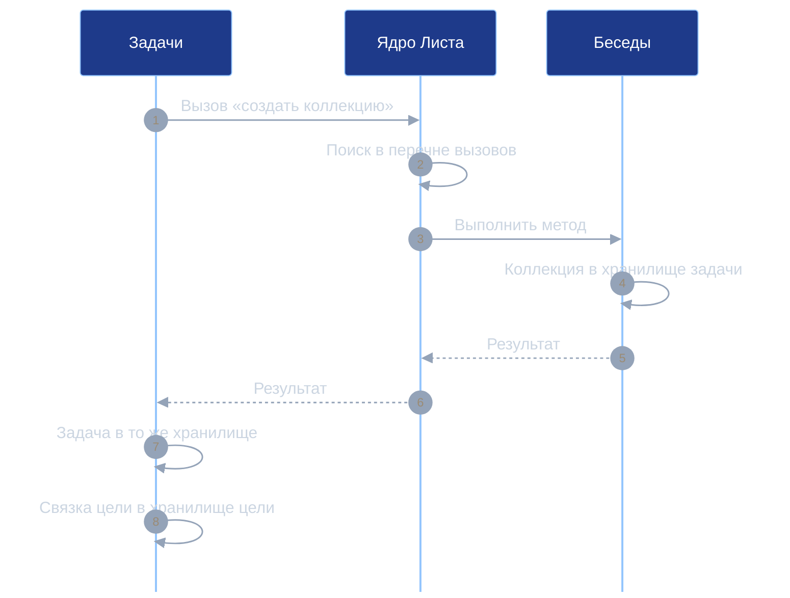
*Схема 17. Приложение бесед остаётся автором своих записей, а хранилище ему передаёт вызывающая сторона; проверка типов аргументов в ядре пока заготовка.*

Единственным путём модификации состояния стороннего приложения выступает обращение к его **открытому вызову**:
1. Разработчик приложения-владельца объявляет открытый метод; кодогенератор платформы автоматически формирует клиентскую заглушку вызова;
2. Вызывающее приложение обращается к методу локальной заглушки, которая сериализует вызов в стандартизированное сообщение ядру Листа;
3. Диспетчер ядра верифицирует контекст действующего лица, находит метод в системном реестре открытых вызовов получателя, проверяет соответствие количества параметров и передаёт исполнение в целевую среду;
4. Целевое приложение выполняет внутреннюю валидацию бизнес-правил, формирует дельту изменений в собственном журнале и возвращает ответ вызывающей стороне.

Строгий аудит кодовой базы прототипа выявил важное различие: диспетчер ядра в настоящее время проверяет соответствие количества аргументов, в то время как полноценная валидация сложных типов данных и списки взаимных разрешений между приложениями оформлены как архитектурные заготовки и подлежат реализации на следующих этапах.

### 6.4. Паттерны колокации и связующих сущностей

Соблюдение базового инварианта «одна сетевая транзакция — одно хранилище» требует строгого выбора между двумя проектными паттернами организации связей.

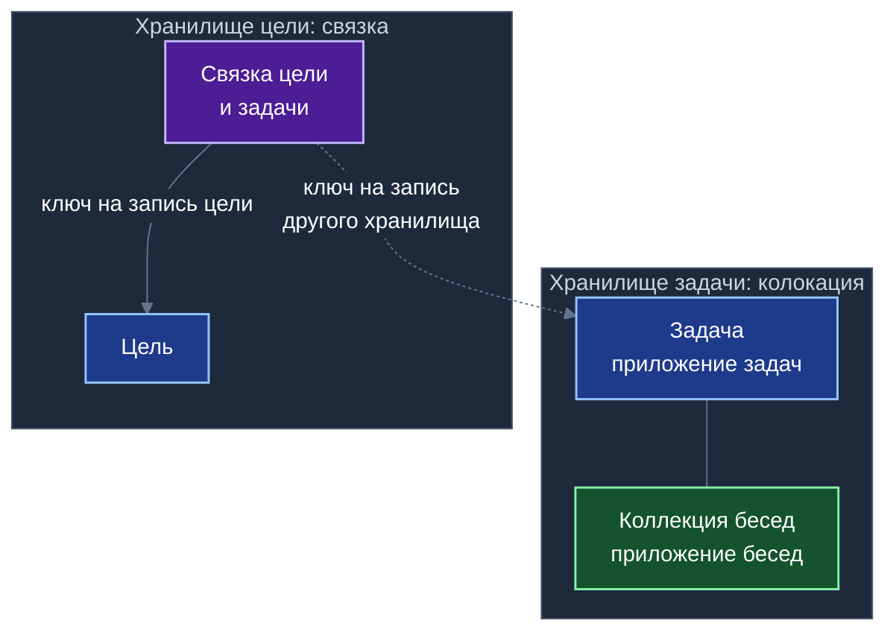
*Схема 18. Записи с общим жизненным циклом лежат в одном хранилище; запись-связка лежит у ссылающейся стороны, и чужой журнал не меняется.*

| Характеристика паттерна | Паттерн колокации записей | Паттерн связующей сущности (связки) |
|---|---|---|
| Область применения | Данные обладают общим жизненным циклом и единым кругом участников | Записи принадлежат разным хранилищам, разным владельцам или разным циклам жизни |
| Физическое размещение | Все связанные записи сохраняются в едином хранилище основной сущности | Связующая запись сохраняется в хранилище ссылающейся стороны |
| Характер транзакции | Единая атомарная транзакция как на Листе, так и в сетевом пакете | Единая транзакция на Листе; независимые транзакции в сети по каждому хранилищу |
| Модификация чужого журнала | Не требуется | Исключена: чужой журнал изменений остаётся неизменным |
| Пример в прототипе | Задача и привязанная коллекция обсуждений | Связка цели и задачи (в хранилище цели); связка коллекции и беседы |
| Подтверждение в кодовой базе | Полностью реализовано и функционирует | Связки цели и коллекции работают; две связки объявлены в схемах |

Каждая связь типа «многие к одному» автоматически декомпозируется генератором схем в три реляционные колонки (хранилище, автор, номер записи). Для сущности с $r$ внешними связями число генерируемых колонок внешних ключей выражается формулой:

$$n_{\text{ключей}} = 3\,r$$

Например, запись задачи в прототипе органайзера, ссылающаяся на тему, цель и коллекцию ($r = 3$), получает $n = 9$ реляционных колонок внешних ключей в дополнение к трём колонкам собственного первичного ключа. Разработчик прикладного сервиса объявляет связь одной декларативной строкой, а физическая структура формируется автоматически.

| Вид операции приложения | Механизм выполнения на Листе | Контролирующий компонент ядра | Текущий статус в прототипе |
|---|---|---|---|
| Чтение собственных данных | Прямой локальный реляционный SQL-запрос | Ядро: проверка ключей и возрастного допуска | Работает в кодовой базе |
| Чтение данных другого приложения | Локальное реляционное соединение таблиц | Ядро: фильтрация нерасшифрованных полей | Работает; проверено на выборках до пяти таблиц |
| Запись в собственную схему | Формирование дельты локального хранилища | Приложение и менеджер транзакций Листа | Работает в кодовой базе |
| Прямая запись в чужую таблицу | Физически заблокирована архитектурой | Ядро Листа (отклонение неавторизованной записи) | Заблокировано архитектурно |
| Изменение данных другого сервиса | Обращение к открытому вызову владельца | Владелец: исполнение прикладных проверок | Работает; проверка типов аргументов — заготовка |
| Создание записей в целевом хранилище | Открытый вызов с передачей контекста хранилища | Владелец вызываемого сервиса | Работает (колокация коллекции задачи) |

### 6.5. Декларативные зависимости схем и аддитивная эволюция платформы

Схемы приложений платформы связываются ориентированным ациклическим графом зависимостей. В манифесте прикладного пакета объявляются ссылки на базовые схемы:
- Схема тем (независимый базовый рубрикатор);
- Схема бесед (зависит от схемы тем);
- Схема задач (зависит от схем тем и бесед).

Ядро Листа ведёт компактный реестр версий установленных приложений. Внутри реляционных таблиц межпакетные ссылки адресуются не длинными строковыми именами, а компактными целочисленными индексами реестра, что минимизирует накладные расходы на хранение и сетевую передачу транзакционных дельт.

Для объективного отражения инженерного статуса платформы сопоставим выводы аналитического исследования с реальным кодом:

| Положение исследования кода | Статус верификации | Корректная формулировка для монографии |
|---|---|---|
| Цепочка зависимостей схем прототипа | Подтверждено манифестами пакетов | Базовые схемы прототипа образуют строгую иерархию зависимостей |
| Автоматическая генерация трёх колонок на связь | Подтверждено кодом генератора | Каждая внешняя связь декомпозируется генератором в тройку атрибутов |
| Колокация задачи и коллекции в одном хранилище | Подтверждено кодом API | Задача и её коллекция создаются и синхронизируются в общем хранилище |
| Хранение связок в хранилище ссылающейся стороны | Подтверждено кодом связок | Связка цели и задачи хранится в хранилище цели, не затрагивая журнал задачи |
| Соединение таблиц трёх приложений в одном запросе | Подтверждено прикладными выборками | Лист свободно выполняет многотабличные реляционные соединения разных схем |
| Строгая валидация типов аргументов вызовов | Не подтверждено (заготовка в коде) | Проверка сложных типов аргументов специфицирована и подлежит реализации |
| Контроль прав одного приложения вызывать другое | Не подтверждено (проверяется лишь наличие метода) | Перечень межприложенческих разрешений находится в стадии проектирования |
| Неуязвимость одного приложения перед сбоем другого | Не подтверждено (формулировка некорректна) | Доступ разграничен при допущениях A6–A7; остаточный риск Р-6 остаётся открытым |
| Изоляция сред исполнения в потоках Web Worker | Не подтверждено (найдены только iframe) | В проверенном прототипе изоляция реализована на базе документов браузера |
| Скоростные замеры соединения («менее 0,1 мс») | Не подтверждено (замеры отсутствуют) | Проектная оценка высокой скорости локального SQL; замеры предстоят |

---

## Глава 7. Локальный реестр МСП и ЖКХ и сквозной сценарий

### 7.1. Назначение локального каталога мастеров и районных сервисов

Приложение «Локальный реестр МСП и ЖКХ» спроектировано как интеграционное решение, наглядно демонстрирующее синергетический эффект композиции всех возможностей платформы «Турбаза» в повседневной жизни микрорайона. Назначение реестра — предоставить жителям надёжный, открытый и независимый инструмент прямого взаимодействия с мастерами шаговой доступности, самозанятыми специалистами, локальными предприятиями и управляющими организациями без посреднических наценок корпоративных агрегаторов.

Сведения о профессиональных компетенциях мастера, графике его доступности и примерных расценках хранятся в открытых индексных хранилищах районного узла Ветки. Жители находят проверенных специалистов посредством мгновенного локального поиска, при этом история взаимоотношений, переписка и условия договоров изолируются в совместных закрытых хранилищах участников.

### 7.2. Сквозной жизненный сценарий взаимодействия пяти приложений

Полнота архитектурного взаимодействия раскрывается в сквозном сценарии организации бытового ремонта в жилом доме:

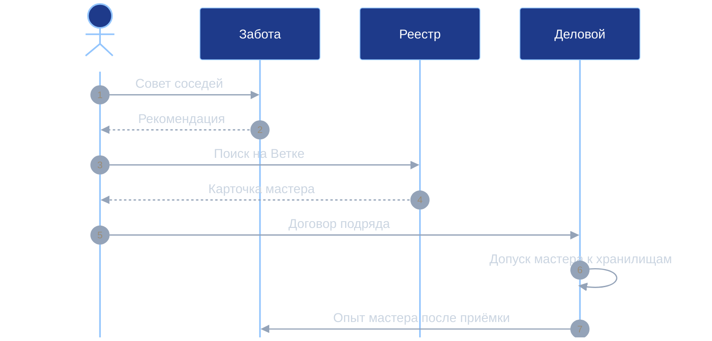
*Схема 9. Сценарий условный: приложения передают друг другу записи и ссылки, но не изменяют чужие схемы; опрос о качестве в «КубГолосе» проводится после подтверждения оплаты.*

Сквозной процесс объединяет функционал пяти базовых прикладных решений:
1. **Рекомендация соседей («Забота»):** жилец обращается к локальной ленте взаимопомощи своего дома; сервис «Забота» на основе накопленного социального рейтинга рекомендует электрика, заслужившего авторитет добросовестным трудом в данном микрорайоне;
2. **Карточка мастера («Реестр МСП»):** жилец открывает карточку мастера в локальном каталоге, загружаемую с районного узла Ветки; карточка содержит проверенные квалификационные отметки без раскрытия личного номера телефона специалиста;
3. **Договор подряда и поручение («Деловой»):** стороны формируют совместное Дело; «Реестр МСП» добавляет таблицу договора подряда со сметой и сроками, ссылаясь на базовую задачу органайзера;
4. **Условное депонирование средств (Коммерческие контракты платформы):** в контуре цифрового рубля формируется контракт второго уровня с условным резервированием оплаты до момента двустороннего подписания акта выполненных работ;
5. **Оценка качества и подтверждённый отзыв («КубГолос»):** после закрытия наряда и фактического перечисления средств система формирует целевую группу многофакторного опроса в «КубГолосе»; отзыв жильца принимается только при наличии подтверждённого факта оплаты, что математически исключает заказные накрутки и спам;
6. **Рост общественной репутации («Забота»):** подтверждённая успешная работа пополняет тематический «Опыт» мастера в «Заботе», автоматически повышая его позицию в рекомендациях для соседей.

### 7.3. Автономное ведение дел самозанятого и децентрализованный учёт в сфере ЖКХ

Для самозанятого мастера платформа «Турбаза» обеспечивает независимость от внешних агрегаторов. Вся клиентская база, история заказов, архив смет и финансовые взаиморасчёты хранятся непосредственно на персональном устройстве мастера. Никакая сторонняя корпорация не способна в одностороннем порядке заблокировать доступ специалиста к его наработанным клиентам или навязать кабальные тарифы.

В сфере жилищно-коммунального хозяйства архитектура реестра открывает принципиально новые возможности:
- **Прозрачный журнал заявок подъезда:** жильцы дома формируют коллективные заявки на текущий ремонт в общем хранилище дома, отслеживая фактические сроки и сметы работ управляющей организации;
- **Анализ аварийных инцидентов:** общесистемный модуль статистики агрегирует обезличенную пространственно-временную плотность аварийных вызовов (прорывы теплотрасс, отключения электроэнергии), выявляя изношенные участки инфраструктуры;
- **Автономная навигация аварийных бригад:** планшеты дежурных бригад ЖКХ используют модуль пространственного кэша, сохраняя детальные схемы подземных инженерных коммуникаций района для работы в подвалах и на объектах при полном отсутствии мобильной связи.

---

## Глава 8. Общие модули платформы и среда их исполнения

### 8.1. Принцип вывода зрелых алгоритмов в общесистемные библиотеки

Развитие экосистемы «Турбазы» подчиняется принципу органической инкубации: платформа не навязывает приложениям умозрительные абстракции сверху. Напротив, прикладные алгоритмические конструкции, доказавшие свою надёжность и практическую ценность в конкретных решениях, последовательно обобщаются и выводятся на уровень общеплатформенных модулей.

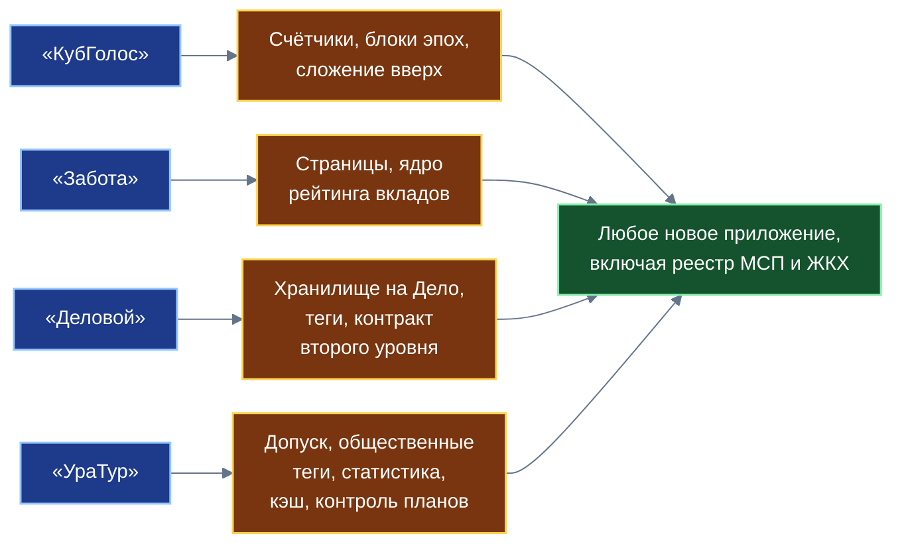
*Схема 10. Каждое начальное приложение отрабатывает свой набор конструкций; вместе они дают основу для любого нового приложения.*

Жизненный цикл вывода модуля включает четыре этапа (без директивной календарной привязки):
1. **Инкубация в приложении:** алгоритм реализуется и оптимизируется под специфические требования прикладной предметной области;
2. **Выделение универсального интерфейса:** математическое ядро алгоритма очищается от предметных деталей и оформляется в виде понятийной спецификации;
3. **Включение в общесистемную поставку:** модуль включается в базовую библиотеку ядра Листа и становится доступным любому новому приложению «из коробки»;
4. **Стандартизация и аудит:** интерфейсы модуля фиксируются в реестре стандартов платформы, а его код проходит независимый математический аудит.

### 8.2. Сводный каталог модулей платформы

Анализ четырёх базовых прикладных решений позволяет сформировать полный сводный реестр алгоритмических подсистем, готовых к общесистемной стандартизации:

| Инкубировано в приложении | Общесистемный платформенный модуль | Монография-источник |
|---|---|---|
| Многофакторная форма со 100 базисными пунктами | Универсальный модуль многомерной оценки сложных объектов | Белая книга № 08 |
| Счётчики в памяти Ветки и блоки эпох | Потоковая высоконагруженная аналитика и фиксация согласий | Белая книга № 08 |
| Сложение сумм вверх по территориальному дереву | Масштабирование статистических показателей без централизации | Белая книга № 08 |
| Дерево тем и префиксный поиск | Единый тематический рубрикатор и локальная префиксная фильтрация | Белая книга № 08 |
| Локальное выявление дубликатов на Листе | Встраиваемый модуль дедупликации обращений без передачи текста | Белая книга № 08 |
| Три режима регистрации профилей | Подсистема дифференцированного доверия участников на узлах Ветки | Белая книга № 08 |
| Слепой ретранслятор частного контура | Протокол защищённой сквозной ретрансляции пакетов | Белая книга № 08 |
| Подписанный блок отсечки по ГОСТ | Формирование юридически значимых протоколов согласования | Белая книга № 08 |
| Деление списков на запечатываемые страницы | Платформенные страницы архивных коллекций данных | Белая книга № 09 |
| Архитектура «Ситуация + Случай + Разговор» | Протокол составной модульной сборки прикладных контекстов | Белая книга № 09 |
| Опыт по категориям «Голос» и «Показ» | Фиксация свидетельств подтверждённой практической деятельности | Белая книга № 09 |
| Узлы репутации, эпохи и затухание вкладов | Распределённое ядро агрегации тематического социального рейтинга | Белая книга № 09 |
| Штрафы за кластеризацию и барьеры сговора | Математическая защита децентрализованных оценок от манипуляций | Белая книга № 09 |
| Правила разделения прав и запрет анонимной конвертации | Общесистемный регламент прав доступа учетных записей | Белая книга № 09 |
| Мотивированный ответ и проверка первоисточника | Стандарт обеспечения достоверности и доказательности данных | Белая книга № 09 |
| Принцип «Одно Дело — одно хранилище» | Подсистема изоляции контекстов совместной деятельности на Листе | Белая книга № 10 |
| Префиксные деревья тегов и срезов | Служба многомерного тегирования и локальной фильтрации списков | Белая книга № 10 |
| Межприложенческие группы опросов | Модуль делегирования задач в контур коллективного принятия решений | Белая книга № 10 |
| Мандатный интерфейс поручений | Шлюз гарантированной контролируемой доставки входящих заданий | Белая книга № 10 |
| Межхранилищные ссылки из трёх компонентов | Стандарт распределённых реляционных связей с историческим снимком | Белая книга № 10 |
| Трёхзвенная изоляция стороннего интерфейса | Протокол безопасной композиции визуальных микрооболочек | Белая книга № 10 |
| Адаптер контрактов первого и второго уровней | Модуль сопряжения с расчётными смарт-контрактами Банка России | Белая книга № 10 |
| Связка социального и закрытого рейтингов | Протокол порогового подтверждения надёжности без раскрытия счетов | Белая книга № 10 |
| Возрастной допуск ядра Листа | Децентрализованный модуль родительского контроля и защиты детей | Белая книга № 11 |
| Общественные теги и индексная сеть | Открытый децентрализованный каталог без монопольной витрины | Белая книга № 11 |
| Оптимизатор многотеговых запросов | Локальный алгоритм быстрого пересечения списков на Листе | Белая книга № 11 |
| Пространственно-временная статистика | Модуль локального анализа плотностей, трендов и отсева выбросов | Белая книга № 11 |
| Контроллер исполнения планов | Адаптивный автомат сопровождения планов с запасными ветвями | Белая книга № 11 |
| Менеджер пространственного кэша | Подсистема автономного хранения картографических буферных слоёв | Белая книга № 11 |

### 8.3. Понятийные спецификации шести базовых алгоритмических модулей

В соответствии со стандартами белых книг платформы приведём понятийные спецификации шести ключевых общесистемных модулей, инкубированных в приложениях «УраТур», «Деловой» и «Забота»:

#### Модуль 1. Пространственно-временная статистика
| Параметр спецификации | Инженерное описание свойства |
|---|---|
| Назначение | Локальный расчёт скользящих средних, квантилей распределения, пространственной плотности событий и отсев аномальных выбросов |
| Входные данные | Потоки локальных записей с временными отметками и пространственными координатами |
| Выходные данные | Сводные статистические агрегаты, скользящие медианы, флаги пространственно-временных аномалий |
| Системные инварианты | Строгая алгоритмическая детерминированность; исполнение исключительно на процессоре Листа; личные треки не передаются наружу |
| Вычислительная сложность | Постоянное время $O(1)$ на отсчёт для скользящих средних; $O(n \log n)$ для расчёта квантилей в скользящем окне длины $n$ |
| Потребители модуля | «УраТур» (анализ темпа движения), «Локальный реестр МСП и ЖКХ» (плотность аварий), «Деловой» |

#### Модуль 2. Контроллер исполнения планов
| Параметр спецификации | Инженерное описание свойства |
|---|---|
| Назначение | Автоматизированный контроль графа плановых событий, выявление задержек и предложение детерминированных запасных ветвей |
| Входные данные | Сеть плановых контрольных точек с временными интервалами; фактический темп наступления событий |
| Выходные данные | Состояние процесса (по плану, допустимое замедление, критическое отставание); перечень доступных корректирующих сценариев |
| Системные инварианты | Окончательное решение о смене ветви плана остаётся за человеком; полная работоспособность без сетевого подключения |
| Вычислительная сложность | Линейная сложность $O(k)$ от количества оставшихся невыполненными вершин графа плана |
| Потребители модуля | «Деловой» (сопровождение проектов), «УраТур» (запас светлого времени), «Локальный реестр МСП и ЖКХ» (выезд бригады) |

#### Модуль 3. Менеджер пространственного кэша
| Параметр спецификации | Инженерное описание свойства |
|---|---|
| Назначение | Управление локальным хранением картографических подложек, векторных слоёв и графов инфраструктуры в заданном географическом радиусе |
| Входные данные | Географический ограничивающий прямоугольник района интереса; правила вытеснения устаревших данных |
| Выходные данные | Локальные пространственные слои, готовые к мгновенной отрисовке встроенным рендерером |
| Системные инварианты | Безусловное сохранение критического радиуса автономной безопасности; строгое соблюдение лицензионных условий картографических провайдеров |
| Вычислительная сложность | Алгоритмы адаптивного вытеснения кэша (ARC/LRU) с константным временем доступа $O(1)$ к индексным тайлам |
| Потребители модуля | «УраТур» (походы без связи), «Локальный реестр МСП и ЖКХ» (планшеты дежурных бригад ЖКХ в подвалах), курьерские службы |

#### Модуль 4. Оптимизатор многотеговых запросов
| Параметр спецификации | Инженерное описание свойства |
|---|---|
| Назначение | Оптимальное вычисление пересечения множества списков записей по набору смысловых меток от наименее многочисленного к наиболее массовому |
| Входные данные | Произвольный набор идентификаторов тегов, запрошенных пользователем |
| Выходные данные | Отфильтрованный результирующий список записей, удовлетворяющих конъюнкции условий |
| Системные инварианты | Минимальное потребление оперативной памяти Листа; отсутствие загрузки избыточных страниц данных |
| Вычислительная сложность | Прыжковое пересечение списков (Leapfrog Triejoin) со сложностью $O\big(N_{\min} \log(N_{\max}/N_{\min})\big)$ в худшем случае |
| Потребители модуля | «КубГолос» (фильтрация опросов), «Забота» (поиск случаев), «УраТур» (поиск маршрутов), «Локальный реестр МСП и ЖКХ» |

#### Модуль 5. Возрастной допуск
| Параметр спецификации | Инженерное описание свойства |
|---|---|
| Назначение | Децентрализованная фильтрация чувствительных материалов на уровне ядра СУБД Листа на основе локального возраста профиля |
| Входные данные | Возрастные маркировки темы, тега и хранилища; локальный подтверждённый возраст профиля на Листе |
| Выходные данные | Бинарное решение: допуск к отображению, скрытие либо запрос родительского подтверждения |
| Системные инварианты | Возраст гражданина никогда не передаётся во внешнюю сеть; эффективный порог рассчитывается как максимум маркировок |
| Вычислительная сложность | Константное время $O(1)$ проверки числового неравенства при реляционной выборке |
| Потребители модуля | Все прикладные приложения экосистемы; рекламный контур (полный запрет коммерческой рекламы несовершеннолетним) |

#### Модуль 6. Общественные теги и индексная сеть
| Параметр спецификации | Инженерное описание свойства |
|---|---|
| Назначение | Ведение открытых каталогов и поисковых индексов децентрализованной сетью независимых узлов участников |
| Входные данные | Текстовые метки, поисковые префиксы, запросы выборки по временным срезам |
| Выходные данные | Хронологические упорядоченные срезы записей связи с постраничной курсорной навигацией |
| Системные инварианты | Индекс строится на базе 256-арного хронологического сбалансированного дерева; состояние узла проверяется криптографическим хэшем |
| Вычислительная сложность | Логарифмическая глубина поиска $\lceil\log_{256} N\rceil$, не превышающая 3–4 дисковых обращений при миллионах записей |
| Потребители модуля | Все приложения платформы с открытыми публичными витринами и каталогами |

### 8.4. Роль ассоциации стандартов и технический комитет

Превращение алгоритмов в платформенные стандарты требует независимого институционального арбитража. В архитектурной модели «Турбазы» эту функцию выполняет **Ассоциация стандартов** — некоммерческая корпорация, учреждаемая разработчиками по статье 123.8 Гражданского кодекса Российской Федерации.

При ассоциации формируется меритократический Технический комитет, состоящий из признанных авторов базовых модулей и специалистов по криптографии. Технический комитет:
1. Проводит математическую экспертизу и аудит безопасности кандидатных модулей;
2. Утверждает спецификации межмодульных интерфейсов и форматы внешних ключей;
3. Контролирует соблюдение обратной совместимости при обновлении схем данных ядра.

Ассоциация не ведёт коммерческой деятельности и не распоряжается выручкой, выступая гарантом технологической независимости стандартов платформы.

### 8.5. Среда исполнения: прототип на TypeScript и стратегия перехода к AssemblyScript

Исследование среды исполнения платформы выявляет стратегическую взаимосвязь между текущей программной реализацией и перспективными целями масштабирования.

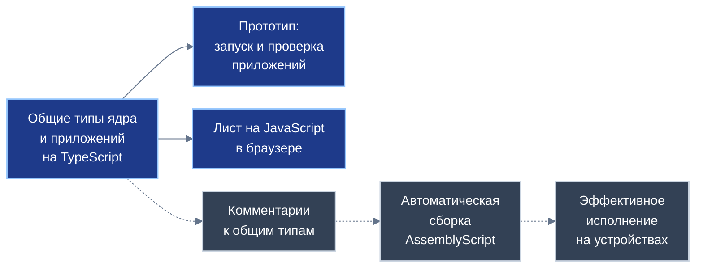
*Схема 16. Сплошные линии — есть сейчас; пунктир — намерение автора, ещё не реализовано.*

Действующая кодовая база ядра платформы написана на строго типизированном языке TypeScript и решает одновременно три принципиальные системные задачи:
1. **Полнофункциональный прототип:** код на практике доказывает реализуемость концепции малых хранилищ, четырёхуровневых транзакций, адресации тройками, изоляции схем и локальных реляционных соединений;
2. **Среда верификации в исполнении:** разработчики прикладных сервисов и независимые аудиторы запускают новые приложения на работающем ядре Листа, выполняя сквозную проверку бизнес-логики, транзакционных дельт и реактивных экранов до публикации в экосистеме;
3. **Основа Листа на платформе JavaScript:** код обеспечивает прямое исполнение ядра в современных веб-браузерах на персональных компьютерах и мобильных устройствах без необходимости установки дополнительного системного окружения.

**Перспективное намерение автора:** в дальнейшем планируется снабдить все декларации общих типов ядра и прикладных сущностей специальными комментариями-аннотациями, позволяющими автоматически компилировать реляционное ядро и прикладные модули в **AssemblyScript** — строго типизированный диалект, транслируемый в бинарный код WebAssembly. Это обеспечит нативную скорость исполнения алгоритмов, минимальный расход оперативной памяти и аппаратно изолированную среду безопасности на широком спектре мобильных и встроенных устройств.

Анализ технической совместимости текущего TypeScript-прототипа и спецификаций AssemblyScript указывает на круг проектных задач при предстоящей миграции:

| Конструкция текущего прототипа на TypeScript | Требования и ограничения среды AssemblyScript | Вывод для проектирования будущей компиляции |
|---|---|---|
| Асинхронные открытые вызовы, конструкции обещаний | Отсутствие встроенного цикла событий и асинхронности в базовом ядре | Переход на событийные очереди либо использование будущих расширений WebAssembly |
| Реактивные потоки значений и функции обратного вызова | Замыкания с захватом локальных контекстных переменных не поддерживаются | Перепроектирование реактивных подписок на статические структуры диспетчеризации |
| Динамические объекты без статической схемы | Отсутствие неопределённых и универсальных динамических типов данных | Строгое описание всех структур данных в виде статических классов |
| Объединённые типы данных (union types) | Поддержка строго ограничена классами с нулевым указателем | Замена объединений строгими обобщёнными шаблонами, раскрываемыми при компиляции |
| Исключения в бизнес-логике (throw / catch) | Механизм исключений прерывает исполнение программы | Возврат ошибок через стандартизированные результирующие структуры |
| Пользовательские декораторы сущностей | Декораторы требуют специальной трансформации компилятора | Разработка специализированного плагина компилятора, считывающего аннотации типов |
| Межпроцессные сообщения через документы | Изоляция модуля WebAssembly требует явного импорта системных функций | Реализация нативных системных адаптеров для взаимодействия с платформой хоста |
| Статические классы моделей данных | Классы полностью поддержаны компилятором WebAssembly | Опора на строгую классовую модель данных при проектировании прикладных сущностей |

Данный сравнительный анализ доказывает: приложения, ориентированные на высокопроизводительную компиляцию в WebAssembly, должны изначально проектироваться в рамках строгого статического подмножества типов, в то время как прототип на TypeScript сохраняет критическую ценность в качестве универсальной среды тестирования и интерактивной валидации решений.

---

## Глава 9. Экономика: распределение выручки и расчёты

### 9.1. Детерминированная функция распределения выручки программных деревьев

Экономическая модель платформы «Турбаза» базируется на отказе от непрозрачных рекламных аукционов и произвольных комиссий корпоративных монополий. Любая монетизация сервисов — будь то заказ бытовой услуги в локальном реестре, приобретение краеведческого гида или размещение коммерческой информации — подчиняется **алгоритмически детерминированной функции распределения выручки**.

Математические основы функции распределения заложены в Белой книге № 06. Когда пользователь или рекламодатель совершает платёж, система автоматически декомпозирует целевой экран на дерево задействованных программных компонентов: базовую операционную среду Листа, схему приложения, специализированные библиотеки расширений и локальные модули. Каждому программному компоненту в дереве сопоставляется нормативный весовой коэффициент участия.

Платежный шлюз рассчитывает доли участников математически строго и детерминированно: выручка делится пропорционально вкладу каждого модуля в формирование полезного результата. Это исключает произвол платформенных операторов и гарантирует разработчикам микробиблиотек прямое получение вознаграждения за каждый фактический вызов их кода.

### 9.2. Архитектура трёхуровневых расчётов и преодоление проблемы высокой арности контрактов

Попытка реализовать алгоритмическое расщепление платежей непосредственно в едином смарт-контракте центрального расчётного контура неизбежно сталкивается с проблемой **критической арности контракта**. Если в финансовой операции участвуют сотни тысяч или миллионы конечных получателей (граждане, разработчики, операторы узлов), прямой смарт-контракт потребовал бы выполнения сотен тысяч одновременных банковских транзакций в секунду, что перегружает любой национальный расчётный узел.

Платформа «Турбаза» преодолевает это ограничение посредством архитектуры трёхуровневых расчётов.

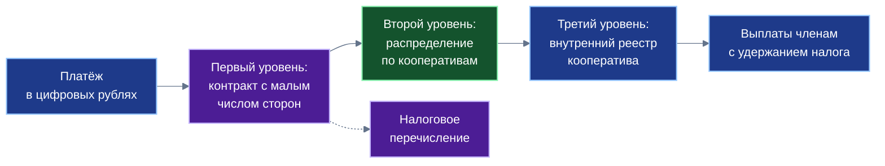
*Схема 11. Контракт первого уровня остаётся малым; массовые выплаты выполняются во внутренних реестрах. Общее число конечных выплат не меняется.*

Иерархическая структура выстраивается по трём ступеням:
1. **Первый уровень (Публичный контур платформы Банка России):** исполняется публичный контракт конечного автомата со строго ограниченной арностью $K \le 8$ (в проектной модели — ровно 4 участника: расчётный агрегатор, Федерация кооперативов, государственный налоговый контур и страховой резерв). Контракт первого уровня мгновенно расщепляет входящий валовый поток в цифровых рублях между крупными агрегированными фондами;
2. **Второй уровень (Координационный уровень Федерации):** полученные средства распределяются между уполномоченными отраслевыми кооперативами ($M = 12$ кооперативов разработчиков, инфраструктурных обществ и потребительских союзов);
3. **Третий уровень (Внутренние реестры кооперативов):** каждый отдельный кооператив на основе собственных подписанных журналов трудового вклада и подтверждённых показов выполняет выплаты своим конечным членам-пайщикам ($n_c \approx 83\,333$ человека в каждом кооперативе при миллионной аудитории) с одновременным исполнением функций налогового агента.

Важнейшее аналитическое уточнение: **иерархическая схема не уменьшает общее число конечных выплат**, однако она надёжно изолирует высоконагруженную государственную платформу цифрового рубля от микротранзакционного шума, локализуя массовые операции во внутренних бухгалтерских реестрах юридических лиц.

### 9.3. Экономика индексных узлов: себестоимость, энергопотребление и точка окупаемости

Децентрализация поисковых индексов общественных тегов опирается на сеть персональных узлов, поддерживаемых энтузиастами и предпринимателями. Для обеспечения устойчивости инфраструктуры узел должен обладать ясной экономической моделью самоокупаемости.

Рассчитаем проектную себестоимость круглосуточной эксплуатации типового маломощного индексного узла (энергоэффективный микросервер или персональный компьютер):
- **Электропотребление:** при мощности процессора $P = 25..65$ Вт месячный расход энергии составляет:

$$E = \frac{P \cdot 24 \cdot 30{,}5}{1000} \approx 18{,}3..47{,}6\ \text{кВт}\cdot\text{ч}$$

При средних тарифах 3,5–5,5 руб./кВт·ч затраты на электроэнергию составляют **64–262 рубля в месяц**;
- **Статический сетевой адрес:** выделенный адрес у интернет-провайдера обходится в **100–200 рублей в месяц**;
- **Амортизация твердотельного накопителя (SSD):** при ресурсе записи 600 TBW и стоимости накопителя 9000 рублей удельный износ составляет около 15 рублей за терабайт. При интенсивной перезаписи 50 ГБ в сутки месячный износ равен **22,5 рубля**.

С учётом резерва на техническое обслуживание совокупная себестоимость содержания узла оценивается проектной величиной **порядка 250–550 рублей в месяц**.

Окупаемость узла достигается за счёт микроплатежей за коммерческие поисковые запросы:

$$N^{*} = \frac{C}{p\,s}$$

где $C$ — месячная себестоимость (250–550 руб.), $p$ — базовая ставка коммерческого запроса ($p = 0{,}05$ руб.), а $s = 0{,}4$ — нормативная доля узла в комиссии за запрос при совместном участии двух узлов. Эффективная ставка узла равна $p \cdot s = 0{,}02$ рубля за обработанный запрос.

| Месячные затраты узла $C$ | Требуемый объём запросов в месяц $N^*$ | Среднесуточный поток запросов |
|:---:|:---:|:---:|
| 250 рублей | 12 500 запросов | около 417 запросов в сутки |
| 550 рублей | 27 500 запросов | около 917 запросов в сутки |

При этом действует базовый социальный инвариант: **все поисковые запросы рядовых граждан в объёме до 100 обращений в сутки на устройство являются абсолютно бесплатными** и субсидируются из общего инфраструктурного фонда кооператива. Платными выступают исключительно массовые коммерческие запросы корпоративных служб, благодаря чему узел окупает свои затраты без финансовой нагрузки на население.

---

## Глава 10. Кооперативные институты

### 10.1. Преодоление институциональных барьеров через артельные объединения

Переход от корпоративных монополий к распределённой экономике невозможен чисто техническими средствами: он требует адекватной институционально-правовой конструкции. Одиночный независимый разработчик или владелец микросервера сталкивается с тремя непреодолимыми барьерами:
1. **Налогово-административный барьер:** ведение бухгалтерского учёта, сдача отчётности и администрирование микроплатежей в несколько копеек экономически разоряют одиночного самозанятого;
2. **Правовой барьер субъектности:** отдельное физическое лицо не может выступать стороной крупных институциональных соглашений с регуляторами и банками;
3. **Барьер экономической устойчивости:** колебания спроса создают риск внезапной потери дохода при отсутствии касс взаимопомощи и неделимых резервов.

Платформа «Турбаза» находит естественный ответ на эти вызовы в традиционных институтах **кооперации и артельного самоуправления**.

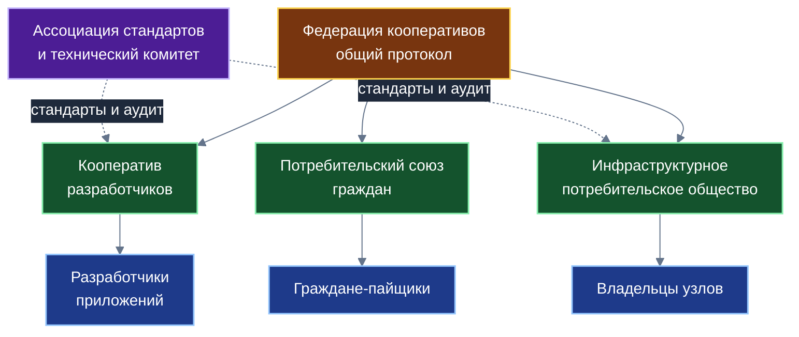
*Схема 12. Предлагаемая конструкция: первичные участники объединяются в кооперативы, кооперативы — в федерацию; стандарты ведёт ассоциация.*

### 10.2. Институциональная триада разработчиков программного обеспечения

Для разработчиков программного обеспечения экосистемы предлагается институциональная триада, разграничивающая функции коммерческого труда, стандартизации и материальной базы:

| Институциональная форма | Законодательная основа | Основная системная функция | Правовые и налоговые особенности |
|---|---|---|---|
| Производственный кооператив разработчиков (артель) | Федеральный закон от 08.05.1996 № 41-ФЗ «О производственных кооперативах» | Аккумулирует выручку от использования модулей, распределяет доход по личному трудовому вкладу, формирует неделимый фонд эталонного кода | Члены участвуют личным трудом; распределение прибыли по паям ограничено законом до 50%; кооператив выступает налоговым агентом |
| Ассоциация (союз) стандартов | Статья 123.8 Гражданского кодекса РФ (некоммерческая корпорация) | Утверждает единые форматы схем данных, спецификации открытых вызовов, проводит математический аудит | Некоммерческая организация; не ведёт предпринимательской деятельности и не распределяет прибыль |
| Инфраструктурное потребительское общество | Закон РФ от 19.06.1992 № 3085-1 «О потребительской кооперации» | Коллективное приобретение серверов, тестовых стендов и каналов связи за счёт паевых взносов | Паевые взносы членов не признаются реализацией и не облагаются налогами; услуги предоставляются по себестоимости |

### 10.3. Инфраструктурные потребительские общества владельцев узлов

Операторы индексных узлов объединяются в специализированные потребительские общества. Взаимоотношения между гражданином-оператором и обществом оформляются **договором аренды оборудования** (глава 34 ГК РФ):
- Гражданин предоставляет вычислительную мощность своего устройства потребительскому обществу для выполнения уставных задач;
- Общество компенсирует гражданину расходы на электроэнергию, трафик и амортизацию оборудования;
- В соответствии с пунктом 4 статьи 420 Налогового кодекса РФ выплаты по договорам аренды имущества не облагаются страховыми взносами, а кооператив исполняет обязанности налогового агента по НДФЛ по ставке 13% (в пределах базового порога доходов).

Это снимает с граждан бремя самостоятельной сдачи бухгалтерской отчётности и защищает от рисков неправомерной квалификации деятельности как незаконного предпринимательства.

| Группа участников экосистемы | Оптимальная организационная форма | Нормативная база и налогообложение | Экономический результат для участника |
|---|---|---|---|
| Разработчики модулей | Производственный кооператив (артель) | Закон № 41-ФЗ, НК РФ (налоговый агент) | Доход по трудовому вкладу, равный голос в управлении |
| Владельцы индексных узлов | Аренда оборудования + потребительское общество | Глава 34 ГК РФ, п. 4 ст. 420 НК РФ | Компенсация затрат, окупаемость оборудования |
| Граждане-пользователи | Потребительский союз граждан | Закон РФ № 3085-1, ст. 217 НК РФ | Получение платформенной десятины (10%), защита данных |

### 10.4. Потребительский союз граждан и защита от недобросовестных узлов

Потребители платформенных сервисов объединяются в **Потребительский союз граждан**. В силу масштабности союза (миллионы участников) высшим органом управления выступает **Собрание уполномоченных** — представительный орган, избираемый гражданами по территориальным и профессиональным округам.

Для предотвращения паразитического поведения и недобросовестных манипуляций со стороны операторов узлов кооперативная инфраструктура внедряет комплексные алгоритмические меры:

| Вид потенциального злоупотребления | Архитектурная мера противодействия | Технический механизм реализации |
|---|---|---|
| Узел заявляет о хранении индекса, но не хранит данные | Криптографическое доказательство хранения (Proof of Storage) | Периодические проверочные запросы к случайным ветвям дерева хэшей с контролем времени ответа |
| Возврат устаревших или случайных ответов | Непрерывный мониторинг показателей качества обслуживания | Замер доступности, задержки отклика и процента ошибок; понижение недобросовестных узлов |
| Концентрация нагрузки на небольшом числе «любимых» узлов | Алгоритм выбора наименее загруженного из двух случайных узлов | Обеспечение равномерной утилизации сети без единого диспетчера балансировки |
| Создание фиктивных узлов ради арендных выплат | Требование внесения паевого депозита либо подтверждённый Опыт | Блокировка и удержание депозита в фонд компенсации при математически доказанной фальсификации |

### 10.5. Кооператив кооперативов как федеративная модель управления

На общенациональном уровне первичные артели разработчиков, инфраструктурные общества и потребительские союзы формируют **Кооператив кооперативов** (многоуровневую федерацию союзов). 

Федерация обеспечивает высший институциональный баланс сил: разработчики не могут в одностороннем порядке повысить тарифы вопреки интересам граждан; граждане не могут обнулить вознаграждение программистов; а операторы узлов защищены от произвола разработчиков едиными правилами стандартизации. Решения по модификации базовых протоколов принимаются квалифицированным большинством с обязательным согласованием Технического комитета Ассоциации стандартов.

---

## Глава 11. Рекламный дивиденд и граждане

### 11.1. Экономическая природа платформенной десятины

В классической рекламной индустрии пользователь низведён до положения пассивного объекта монетизации. Корпоративные платформы продают внимание людей рекламодателям, аккумулируя колоссальные доходы в руках узкого круга акционеров.

Платформа «Турбаза» восстанавливает базовую экономическую справедливость, утверждая принцип **платформенной десятины**: **гражданин, подтвердивший внимание к материалу, является полноправным участником создания ценности и имеет законное право на прямую долю рекламного дохода**.

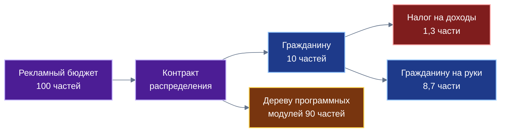
*Схема 13. Налоговая часть показана по ставке 13% (действующее право, сверить); гарантируется правило распределения, а не размер выплаты.*

Из каждого рекламного бюджета объёмом 100 частей:
- **10 частей (10%)** направляются гражданину в качестве дивиденда за внимание;
- **90 частей (90%)** распределяются функцией распределения выручки между создателями программных деревьев интерфейса и операторами инфраструктуры.

Кооператив выступает налоговым агентом гражданина: удерживает налог на доходы физических лиц по базовой ставке 13% (1,3 части) и перечисляет в бюджет государства, в результате чего гражданин получает на руки чистыми **8,7 части** из каждых 100 частей валового рекламного бюджета.

### 11.2. Локальное вычисление внимания и защита от фальсификаций через ЕСИА

Принципиальным отличием платформы «Турбаза» является отказ от слежки за пользователем. Никакие персональные профили, истории просмотров или личные предпочтения не передаются рекламодателю.

Вычисление факта восприятия выполняется локально на Листе:
1. Модуль внимания фиксирует параметры взаимодействия пользователя с материалом (время нахождения на экране, скроллинг, осмысленные переходы) непосредственно в оперативной памяти устройства;
2. На Листе формируется криптографическое доказательство внимания;
3. Для защиты от бот-ферм используется механизм **слепого маркера**: Лист подтверждает статус реального уникального гражданина через защищённый шлюз Единой системы идентификации и аутентификации (ЕСИА) без передачи рекламодателю фамилии, имени или паспортных данных;
4. Вводится жёсткий суточный лимит: алгоритм оплачивает не более 15–20 показов в сутки на одного гражданина, что полностью обессмысливает автоматизированную накрутку показов скриптами.

### 11.3. Формула расчёта дивиденда и сценарный численный анализ

Индивидуальный дивиденд участника $D_i$ рассчитывается по строгому детерминированному правилу:

$$D_i = 0{,}1\,B\,\frac{\min(a_i,\ a_{\max})}{\sum_{j=1}^N \min(a_j,\ a_{\max})},\qquad \bar D = \frac{0{,}1\,B}{N},\qquad \bar D_{\text{после налога}} = 0{,}87\,\bar D$$

где $B$ — совокупный рекламный бюджет платформы за расчётный период, $N$ — число активных пайщиков союза, $a_i$ — подтверждённый коэффициент внимания участника, а $a_{\max}$ — верхний предел вознаграждаемого внимания.

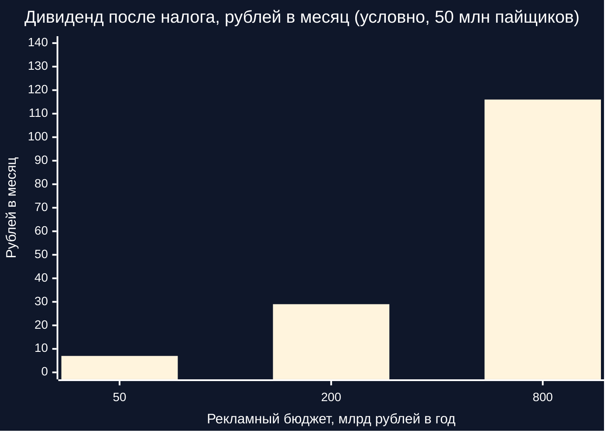
*Схема 14. Даже при смелых допущениях дивиденд — микродоход: от единиц до немногих сотен рублей в месяц. Значения условные.*

Проведём строгий сценарный расчёт для национального масштаба аудитории ($N = 50\cdot 10^6$ пайщиков):

| Совокупный рекламный бюджет $B$ | Средний дивиденд $\bar D$ в год | Дивиденд после налога в год | Средний дивиденд в месяц (чистыми) |
|:---:|:---:|:---:|:---:|
| 50 млрд рублей в год | 100 рублей | 87 рублей | около 7 рублей в месяц |
| 200 млрд рублей в год | 400 рублей | 348 рублей | около 29 рублей в месяц |
| 800 млрд рублей в год | 1 600 рублей | 1 392 рублей | около 116 рублей в месяц |

Приведённый численный анализ даёт критически важный вывод: **рекламный дивиденд является скромным микродоходом, а не безусловным базовым доходом**. Платформа «Турбаза» категорически не обещает гражданам богатства или пассивного заработка: система гарантирует прозрачное математическое правило честного раздела выручки, защищающее человека от бесправной эксплуатации его внимания.

---

## Глава 12. Исторический опыт и адаптация форм

### 12.1. Российские традиции артельного самоуправления и потребительской кооперации

Предлагаемая институциональная архитектура опирается на богатейший российский исторический опыт артельного и кооперативного движения. В дореволюционной России артель выступала естественной формой добровольного объединения свободных мастеров для выполнения совместных задач с круговой порукой, выборным старостой и распределением дохода строго по трудовому вкладу.

В трудах выдающихся русских экономистов А.В. Чаянова и М.И. Туган-Барановского была научно доказана уникальная природа трудового кооператива: кооператив объединяет не капиталы ради извлечения максимальной спекулятивной прибыли, а живых людей ради удовлетворения потребностей и защиты своего трудового дохода. В советский период промысловая кооперация до конца 1950-х годов обеспечивала производство значительной доли сложной радиоэлектроники, посуды и предметов быта, опираясь на институты неделимых фондов. Платформа «Турбаза» возрождает этот созидательный уклад на цифровом уровне: персональное хранилище данных выступает современным аналогом личного инструмента артельщика.

### 12.2. Мировой опыт автономных экономических объединений

Мировая практика накопила обширный опыт успешных крупномасштабных кооперативных объединений, сохраняющих экономическую устойчивость на протяжении десятилетий:
- **Корпорация Мондрагон (Страна Басков, Испания):** федерация более сотни промышленных кооперативов, объединяющая десятки тысяч работников. Ключевые механизмы: личные внутренние счета капитала пайщиков, строгое нормативное ограничение разрыва между минимальной и максимальной оплатой труда (не более 1 к 6), а также мощная собственная касса взаимопомощи (Caja Laboral);
- **Кооперативная система Райффайзена (Германия):** децентрализованная сеть местных кредитных и инфраструктурных товариществ, основанная на строгой территориальной локальности, неделимых резервах и бесплатном исполнении выборных должностей в правлении;
- **Сельскохозяйственная кооперация JA Group (Япония):** трёхзвенная федеративная структура, объединяющая практически всех фермеров страны через общие кооперативные банки и страховые союзы;
- **Кооперативный молочный союз Amul (Индия):** объединение миллионов мелких производителей, доказавшее эффективность массового децентрализованного учёта сырья на местах с мгновенными прозрачными выплатами;
- **Постоянный фонд Аляски (США):** исторический прецедент прямого начисления дивидендов всем гражданам региона от использования общенародных природных ресурсов (нефтяной ренты), сопоставимый по идеологии с платформенной десятиной за внимание.

### 12.3. Синтез уроков прошлого и региональная адаптация институтов

Систематизация мирового и российского опыта позволяет выявить применимость конкретных кооперативных механизмов в различных звеньях платформы «Турбаза»:

| Исторический и региональный опыт | Заимствуемый кооперативный механизм | Целевое звено платформы «Турбаза» | Границы применимости и адаптация |
|---|---|---|---|
| Россия: артели и потребительские общества | Круговая порука, выборный староста, неделимый фонд эталонного кода | Производственные кооперативы разработчиков модулей | Требуется развитие правоприменения по признанию записей в хранилищах юридическими фактами |
| Германия: общества Райффайзена | Строгая локальность узла, неделимые фонды, местное самоуправление | Районные и муниципальные инфраструктурные узлы Веток | Опирается на плотные соседские связи; требует интеграции с местными сообществами |
| Испания: Федерация Мондрагон | Внутренние счета капитала, фонд солидарности, ограничение разрыва оплаты | Финансовые регламенты артелей разработчиков платформы | Урок Fagor: необходимость вовлечения в совет ассоциированных членов и внешних партнёров |
| Израиль: мошавы и кибуцы | Сочетание личного семейного хозяйства с общим сбытом и инфраструктурой | Личное автономное хранилище Листа в сочетании с общим протоколом | Полное обобществление быта исключено; обобществляются только протоколы и стандарты |
| Индия: Федерация Amul | Низкий порог входа, точный учёт микросдачи продукции на местах | Присоединение граждан-пайщиков с символическим паем к союзу | Требует простого мобильного интерфейса и надёжного офлайн-учёта на Листе |
| Великобритания и Новая Зеландия: Co-Tech, Enspiral | Совместное бюджетирование, согласительное принятие решений (консент) | Рабочие круги разработчиков внутри Технического комитета | Эффективно для малых команд; на миллионных масштабах дополняется представительством |

Практическое развитие и развёртывание экосистемы «Турбазы» может существенно различаться в разных уголках мира, адаптируясь под специфику национальных правовых систем, локальных рынков и культурных традиций кооперации конкретных стран. Незыблемым общим фундаментом остаётся стандартизированный открытый протокол работы с автономными реляционными хранилищами данных. Иностранным разработчикам и исследовательским группам предлагается переводить материалы и презентации платформы на свои родные языки, дополнять и расширять оставшиеся презентационные и прикладные сценарии с учётом потребностей своих государств. Везде в мире дальнейшая инженерная мысль позволит создать национальные версии «Турбазы», при этом Россия имеет все предпосылки для того, чтобы стать лидером и первопроходцем открытого кода, на котором будет базироваться международная сеть суверенных деревьев данных.

---

## Глава 13. Горизонт через 20–40 лет: кооперативная занятость в эпоху роботизации

### 13.1. Технологические вызовы тотальной автоматизации и роботизации

В перспективе 20–40 лет человечество неизбежно столкнётся с вызовом глубокой автоматизации физического и интеллектуального труда. Развитие робототехники, автономного транспорта и систем искусственного интеллекта приведёт к радикальному сокращению традиционных рабочих мест в промышленности, логистике, делопроизводстве и сфере услуг.

В рамках централизованной корпоративной модели тотальная роботизация несёт колоссальный риск социальной поляризации: владельцы монопольных вычислительных платформ и роботизированных заводов концентрируют в своих руках весь общественный доход, в то время как подавляющее большинство населения вытесняется в состояние технологической безработицы и зависимого потребления минимальных государственных пособий.

### 13.2. Частная собственность граждан на средства цифрового производства

Платформа «Турбаза» предлагает принципиально иной сценарий будущего, в основе которого лежит **широкое распределение частной собственности граждан на средства цифрового производства**.

В эпоху роботизации ключевыми средствами производства становятся:
1. Вычислительные мощности персональных устройств и локальных серверов;
2. Накопители данных и автономные хранилища персональной и профессиональной истории;
3. Локальные математические модели и проверенные алгоритмы прикладной деятельности.

Если эти средства производства принадлежат гражданам на правах частной собственности, а сами граждане объединены в самоуправляемые артели и кооперативы, роботизация превращается из угрозы обнищания в источник освобождения человека для творческого, созидательного и общественно полезного труда.

### 13.3. Модель сбалансированного портфеля доходов домохозяйства

Материальная устойчивость семьи будущего не может опираться на единственный источник заработка. Концепция платформы «Турбаза» формализует модель **сбалансированного портфеля доходов домохозяйства**, формируемого из пяти независимых источников:

$$Y_i = W_i + P_i + R_i + D_i + T_i$$

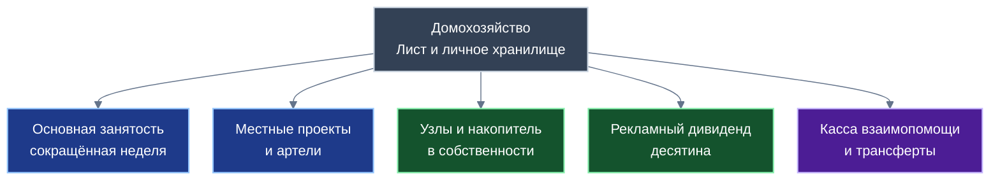
*Схема 15. Устойчивость домохозяйства определяется разнообразием и независимостью пяти компонентов, а не величиной одного из них.*

Структура портфеля дохода включает:
- $W_i$ — доход от основной занятости (высококвалифицированный творческий или наставнический труд в условиях сокращённой рабочей недели);
- $P_i$ — вознаграждение за участие в локальных проектах и артелях (ремонт, обустройство территорий, краеведение, микроуслуги);
- $R_i$ — доход от сдачи в аренду вычислительных мощностей и накопителей персональных индексных узлов;
- $D_i$ — дивиденд от платформенной десятины за подтверждённое внимание;
- $T_i$ — выплаты из касс взаимопомощи кооперативов и социальные трансферты государства.

| Компонент портфеля дохода | Практическая деятельность гражданина | Механизм учёта вклада на Листе | Форма выплаты дохода |
|---|---|---|---|
| Основная занятость $W_i$ | Инженерный, педагогический, научный труд | Внешние трудовые соглашения | Заработная плата с удержанием налогов |
| Локальные артели $P_i$ | Бытовые услуги, ремонт, реестр МСП и ЖКХ | Подписанный акт приёмки в хранилище Дела | Трудовое вознаграждение пайщика артели |
| Инфраструктура узлов $R_i$ | Предоставление вычислительных ресурсов | Журнал подтверждений Proof of Storage | Арендная компенсация от кооператива |
| Рекламная десятина $D_i$ | Подтверждённое восприятие информации | Локальное доказательство внимания через ЕСИА | Прямое начисление дивиденда на счёт |
| Взаимопомощь $T_i$ | Наставничество, общественная помощь | Подтверждённый «Опыт» в сервисе «Забота» | Целевая поддержка из фонда солидарности |

В условиях сокращённой рабочей недели условный сбалансированный бюджет времени активного гражданина (в объёме **32–45 часов в неделю**) гармонично распределяется между направлениями: основная занятость — 20–24 часа; прикладные артельные проекты — 6–10 часов; общественные инициативы и взаимопомощь — 2–4 часа; обслуживание персонального узла — 1–2 часа; непрерывное образование и наставничество — 3–5 часов в неделю.

### 13.4. Три сценария социально-экономической динамики и границы защитной роли хранилищ

Развитие кооперативной экосистемы на горизонте 20–40 лет прогнозируется по трём базовым сценариям:
1. **Сценарий А (Сбалансированная кооперативная синергия):** государство нормативно закрепляет статус децентрализованных хранилищ как юридически значимых доказательств прав; миллионы граждан владеют персональными узлами и объединены в союзы; портфель дохода обеспечивает материальную независимость и устойчивость семей;
2. **Сценарий Б (Инерционный корпоративный нажим):** монопольные экосистемы пытаются ограничить автономность персональных устройств; платформа «Турбаза» развивается как мощный параллельный сектор малого предпринимательства, локальных артелей и добровольческих сообществ;
3. **Сценарий В (Критическая фрагментация и стресс инфраструктуры):** глубокие внешние санкционные и технологические шоки приводят к изоляции региональных сетей; благодаря автономности хранилищ и пиринговой связи «Лист — Ветка» платформа сохраняет локальную жизнедеятельность муниципалитетов и домохозяйств даже при падении глобальных каналов связи.

**Важнейшее предостережение о границах защитной роли хранилищ:** персональное хранилище данных делает математически независимыми и нефальсифицируемыми **доказательства права и историю трудового вклада**. Однако хранилище не способно физически защитить материальное имущество кооператива от внешних потрясений: недвижимость, оборудование и инфраструктурные фонды подчиняются законам материального мира и правопорядку государства. Надежность институтов опирается на социальную солидарность граждан, уважение к законам Отечества и силу выборных органов самоуправления.

---

## Глава 14. Доказано, принято, открыто; границы роли

### 14.1. Сводный реестр утверждений платформы

Для обеспечения безупречной академической честности все фундаментальные положения платформы «Турбаза», изложенные в настоящей монографии, классифицируются по трём строгим категориям истинности:
- **Категория Д (Доказано):** строго доказано математически или подтверждено инженерным прототипом при заданных явных допущениях;
- **Категория С (Сводится к допущениям):** безопасность доказательно сводится к базовым криптографическим допущениям стойкости шифров и подписей;
- **Категория О (Открыто):** научно-инженерный или правовой вопрос, требующий дальнейшей исследовательской проработки, стандартизации или решений законодателя.

| № | Научно-инженерное или экономическое положение платформы | Категория | Границы применимости и ключевые условия |
|:---:|---|:---:|---|
| 1 | Уникальность составных ключей без центрального координатора | Д | Счётчик автора строго монотонен; клонирование требует нового терминала (Р-9) |
| 2 | Факторизация транзакционного пространства по хранилищам | Д | Свойство формата сетевого сообщения (одно хранилище на пакет) |
| 3 | Отсутствие распределённых блокировок между независимыми хранилищами | Д | Путь записи оперирует только своим хранилищем и локальными снимками |
| 4 | Детерминированная сходимость реляционного состояния внутри хранилища | Д | Единый порядок Ветки, детерминированные дельты с материализованными значениями |
| 5 | Линейная масштабируемость сети узлов Веток | Д | Нагрузка каждого узла не превышает его предела; отсутствие глобальной синхронизации |
| 6 | Конфиденциальность содержимого перед недоверенным транспортом | С | Допущения A1 («Кузнечик-MGM»), A4 (энтропия ГСЧ) и A5 (изоляция ключей на Листе) |
| 7 | Подлинность и неизменяемость реляционной истории транзакций | С | Допущения A2 (подпись ГОСТ / ML-DSA) и A3 (хэш «Стрибог»); защита от расщепления — Р-2 |
| 8 | Отсечение исключённого участника через ветвление ключей | С | Допущение A1; исторический архив до момента исключения остаётся доступным |
| 9 | Защищённая изоляция прикладных схем и памяти на Листе | С | Допущения A6 (песочницы среды) и A7 (посредничество ядра); уязвимости среды — Р-6 |
| 10 | Криптографическое уничтожение данных через стирание ключа | С | Допущение A1; требует гарантированного уничтожения всех копий ключа |
| 11 | Кратковременная асинхронная рассогласованность между хранилищами | Д (принято) | Проектный компромисс ради автономности; компенсируется прикладным слоем |
| 12 | Постквантовая защита сеансов доставки симметричных ключей | О | Требуется внедрение гибридных схем инкапсуляции ключей ML-KEM (Р-1) |
| 13 | Наличие оригинальной цифровой подписи внешнего автора в снимке | О | Требуется расширение формата снимка для защиты от отказа автора (Р-4) |
| 14 | Полная интеграция криптопрофиля ГОСТ в открытую кодовую базу | О | В прототипе задействованы базовые криптопримитивы; интеграция ГОСТ предстоит (Р-10) |
| 15 | Предотвращение анализа графа метаданных внешним наблюдателем | О | Защита от корреляционного анализа сетевого трафика требует дальнейших тестов (Р-8) |
| 16 | Алгоритмическая защита от массовой фабрикации поддельных аккаунтов | О | Математического доказательства нет; опирается на ЕСИА и залоговые фильтры |
| 17 | Ограничение арности контракта через трёхуровневую иерархию расчётов | Д (по построению) | Разгружает контракт первого уровня, не сокращая общее число конечных выплат |
| 18 | Экономическая самоокупаемость персонального индексного узла | О | Зависит от фактического объёма коммерческих запросов, который пока неизвестен |
| 19 | Правовой статус записей в хранилищах как юридических доказательств | О | Требуется совершенствование законодательства и формирование судебной практики |

### 14.2. Реестр открытых научно-инженерных и институциональных вопросов

В развитие положений таблицы истинности платформа фиксирует комплекс задач, подлежащих решению в последующих исследовательских циклах:
1. **Программа математической и стендовой верификации:** разработка строгой формальной модели протокола синхронизации на языке спецификаций TLA+, проведение независимого аудита безопасности кодовой базы ядра и натурные нагрузочные испытания кластера из 1000 узлов Веток;
2. **Институционально-налоговое регулирование микроплатежей:** законодательное закрепление необлагаемого минимума или патентного режима для автоматических микровыплат физическим лицам за участие в децентрализованной инфраструктуре;
3. **Механизмы предотвращения олигополии узлов:** формулирование антимонопольных коэффициентов, ограничивающих долю вычислительных мощностей, находящихся под контролем одной группы лиц в рамках одного региона;
4. **Спецификация компиляции в AssemblyScript:** стандартизация подмножества типов и разработка преобразователей компилятора для автоматической трансляции TypeScript-декораторов в код WebAssembly без потери производительности.

### 14.3. Границы ответственности и роли платформы «Турбаза» в обществе

Для исключения ложных ожиданий зафиксируем строгие границы системной роли платформы:
- **Платформа не заменяет государственные институты:** «Турбаза» не подменяет собой государственные реестры прав, органы правосудия или банковскую систему; платформа предоставляет доверенный математический инструмент учёта данных и взаимодействия граждан;
- **Платформа не определяет налоги и тарифы:** финансовые отчисления строго следуют законам Российской Федерации;
- **Платформа не гарантирует фиксированный доход:** рекламная десятина и компенсации узлов представляют собой алгоритмический раздел фактически сформированной выручки;
- **Платформа не принимает решений за человека:** алгоритмические модули рассчитывают статистику и предлагают варианты, но окончательный нравственный, хозяйственный и правовой выбор всегда остаётся за человеком;
- **Платформа не утверждает о наличии согласований:** предлагаемые решения являются проектной концепцией и не заявляются как утверждённые ведомствами до прохождения официальных процедур аттестации.

---

## Глава 15. Заключение и связь с комплектом

Настоящая Белая книга № 12 завершает фундаментальный цикл монографий платформы «Турбаза». В двенадцати книгах серии был последовательно развёрнут детальный научно-инженерный чертёж нового технологического и общественного уклада:
- В книгах № 01–07 были заложены основы трёхзвенной архитектуры, игра-теоретическая модель API-экономики интерфейсов и математический аппарат реляционных микрочейновых преобразований;
- В книгах № 08 («КубГолос»), № 09 («Забота»), № 10 («Деловой») и № 11 («УраТур») были досконально исследованы и алгоритмически специфицированы четыре фундаментальных прикладных измерения человеческой жизни: общественное согласие, опыт взаимопомощи, координация планов и движение в физическом пространстве с абсолютной защитой подрастающего поколения;
- Настоящая завершающая книга соединила эти элементы в целостную неограниченную экосистему, строго доказав математическую масштабируемость хранилищ, открыв дорогу кооперативному строю разработчиков и граждан и начертав контуры технологически независимого будущего на десятилетия вперёд.

Платформа «Турбаза» возвращает человеку право на тайну частной жизни, разработчику — плоды его честного созидательного труда, Отечеству — историческое лидерство первого создателя открытого эталонного ядра и нерушимый цифровой суверенитет, а мировому сообществу — всеобщую международную сеть суверенных деревьев данных на основе стандартизированного протокола автономных хранилищ.

---

## Библиография

1. *Шамсутдинов А. В.* Патент США US 10,902,016 B2. Autonomous interdependent repositories. Заявка от 12.02.2018; опубликован 26.01.2021.
2. *Шамсутдинов А. В.* Small Repositories: Architectural Foundations of Distributed Relational Edge Storage. Исследовательская публикация, 19 февраля 2017 г.
3. *Клеппман М., Уиггинс А., ван Харденберг М., Макгахи М.* Локально-ориентированное программное обеспечение: возвращение контроля над данными пользователю (Local-First Software: You Own Your Data, in spite of the Cloud) // Onward! 2019: Proceedings of the 2019 ACM SIGPLAN International Symposium on New Ideas, New Paradigms, and Reflections on Programming and Software. 2019. С. 154–178.
4. *Эванс Э.* Предметно-ориентированное проектирование (DDD): структуризация сложных программных систем. М.: Диалектика-Вильямс, 2020. 448 с.
5. *Вернон В.* Реализация методов предметно-ориентированного проектирования. М.: Вильямс, 2016. 688 с.
6. *Фаулер М.* Шаблоны корпоративных приложений. М.: Вильямс, 2018. 544 с.
7. *Вельдхёйзен Т.* Прыжковое пересечение списков (Leapfrog Triejoin: A Simple, Worst-Case Optimal Join Algorithm) // Proceedings of the 17th International Conference on Database Theory (ICDT). 2014. С. 214–224.
8. *Чаянов А. В.* Основные идеи и формы организации сельскохозяйственной кооперации. М.: Наука, 1991. 456 с.
9. *Туган-Барановский М. И.* Социальные основы кооперации. М.: Экономика, 1989. 496 с.
10. *Федеральный закон от 08.05.1996 № 41-ФЗ* «О производственных кооперативах».
11. *Закон РФ от 19.06.1992 № 3085-1* «О потребительской кооперации (потребительских обществах, их союзах) в Российской Федерации».
12. *Гражданский кодекс Российской Федерации (часть первая)* от 30.11.1994 № 51-ФЗ (статья 123.8 «Основные положения об ассоциации (союзе)»).
13. *Налоговый кодекс Российской Федерации (часть вторая)* от 05.08.2000 № 117-ФЗ (статьи 217, 226, 420).
14. *ГОСТ Р 34.12-2015.* Информационная технология. Криптографическая защита информации. Блочные шифры (шифр «Кузнечик»).
15. *ГОСТ Р 34.13-2015.* Информационная технология. Криптографическая защита информации. Режимы работы блочных шифров (режим MGM).
16. *ГОСТ Р 34.11-2012.* Информационная технология. Криптографическая защита информации. Функция хэширования (хэш «Стрибог»).
17. *ГОСТ Р 34.10-2012.* Информационная технология. Криптографическая защита информации. Процессы формирования и проверки электронной цифровой подписи.
18. *NIST FIPS 204.* Module-Lattice-Based Digital Signature Standard (ML-DSA). National Institute of Standards and Technology, 2024.
19. *NIST FIPS 203.* Module-Lattice-Based Key-Encapsulation Mechanism Standard (ML-KEM). National Institute of Standards and Technology, 2024.
20. *Белые книги платформы «Турбаза» № 01–11.* Общесистемные и прикладные монографии серии. 2026 г.
