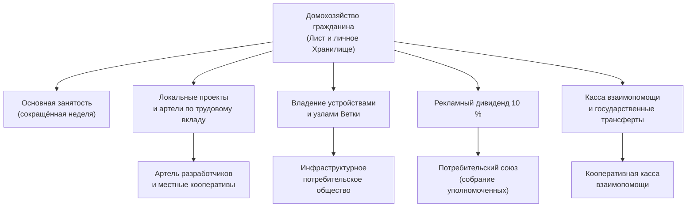
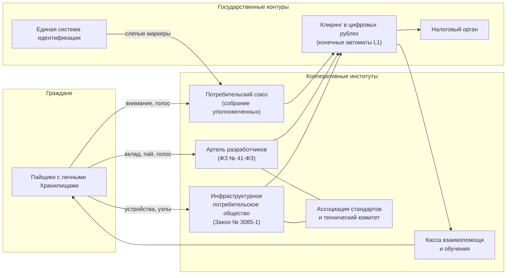

# Предварительный углублённый абстракт: кооперативная занятость в эпоху роботизации и регионально-историческая адаптация форм — прогноз на 20–40 лет

*Dedicated preliminary in-depth abstract on cooperative employment in age of robotization and geo-historically regional form adaptation — ahead of time 20-40 year prognosis*

> [!NOTE]
> **Паспорт документа**
> - **Назначение:** прогностический и концептуальный базис для Белой книги № 12 («Экосистема платформы "Турбаза" / Локальный реестр МСП и ЖКХ»); материал для главы о социально-экономических эффектах и для будущего футурологического раздела.
> - **Горизонт прогноза:** 2046–2066 гг. (от 20 до 40 лет от даты подготовки — 11 октября 2026 г.).
> - **Статус:** предварительный сценарный прогноз. Это не предсказание и не обещание дохода: числа в разделах 5 и 6 — условные расчёты на явно названных допущениях.
> - **Ступень пакета:** Ступень 04 группы задач `10-10_03_Ecosystem_whitepaper_and_presentation` ([Overall_Plan.md](../../../../../sessions/2026/10-10_03_Ecosystem_whitepaper_and_presentation/Overall_Plan.md)).
> - **Входные материалы (Ступень 03):** [01 — оргформы разработчиков](./01_Оргформы_Разработчиков_Приложений.md), [02 — оргформы провайдеров инфраструктуры](./02_Оргформы_Провайдеров_Инфраструктуры_и_Тегов.md), [03 — оргформы потребителей рекламного пула](./03_Оргформы_Потребителей_Рекламного_Пула.md), [04 — историко-географический свод](./04_Историко_географический_свод_артелей_и_кооперативов.md).
> - **Смежные материалы (Ступень 01):** [Работоспособность Хранилищ](../repositories/01_Технический_документ_Работоспособность_Хранилищ.md), [Безопасность Хранилищ](../repositories/02_Технический_документ_Безопасность_Хранилищ.md).

> [!IMPORTANT]
> **Атрибуция**
> - **Автор прогностической модели и текста абстракта:** Claude Sonnet 5.5 (социально-экономический, футурологический и аналитический синтез, Ступень 04).
> - **Автор исследовательских отчётов Ступени 03, на которых построен абстракт, и архитектор мастер-плана:** Gemini 3.8 Flash.
> - **Автор платформы «Турбаза», концепции Хранилищ, трёхзвенной архитектуры и идеи рекламного дивиденда гражданам:** Артём Владимирович Шамсутдинов.
> - **Оговорка:** сведения о внешних организациях, законах и числовых показателях приведены по отчётам Ступени 03; при сборке Белой книги (Ступень 06) их необходимо сверить с первичными источниками.

---

## Аннотация

Прогноз исходит из допущения, что к середине XXI века значительная часть рутинного физического труда выполняется роботами, а значительная часть рутинного умственного труда — нейросетями. Допущение остаётся допущением: темп и глубина замещения неизвестны, поэтому абстракт строится на трёх сценариях, а не на одной траектории.

Центральный вопрос звучит так: если труд даёт меньшую долю дохода домохозяйства, то от чего зависит, получит ли гражданин свою долю общего богатства? Ответ предлагается искать в **расширении базы собственности и участия** — а не только в перераспределении. Историческая кооперация (русские артели, баскская Mondragon, молочные кооперативы Индии, сельские кредитные кооперативы Германии, японская JA) показывает, что объединения независимых владельцев устойчивы там, где соблюдены четыре условия: низкий порог входа, открытое членство, неделимый общий фонд и прозрачный учёт вклада. Платформа «Турбаза» предлагает технический способ выполнить последнее условие: учёт вклада и прав ведётся в личных Хранилищах на устройствах граждан, а правила распределения исполняются конечными автоматами.

**Основные положения абстракта:**
1. Доход домохозяйства в 2046–2066 гг. разумно рассматривать как *портфель из пяти компонентов*: трудовой доход, выплаты за вклад в локальные проекты, доход от владения вычислительными мощностями, рекламный дивиденд и взаимопомощь. Ни один компонент в одиночку базовым доходом не является.
2. Рекламный дивиденд в 10 % — это *микродоход* и признание ценности внимания, но не замена заработка: при условных допущениях раздела 6 он составляет от десятков до немногих сотен рублей в месяц на человека.
3. Владение устройствами и хранилищем даёт скромную компенсацию затрат (порядка 250–550 руб. в месяц на узел по отчёту 02) и, что важнее, *доступ к участию* в неделимых фондах и в принятии решений.
4. Хранилища выполняют три функции: защита тайны частной жизни, надёжный учёт трудового вклада и снижение зависимости доказательств права от единого держателя записей. Они не отменяют правовой статус кооперативного юридического лица и его имущества.
5. Региональная адаптация форм — не копирование, а выбор подходящей формы для каждого звена: личное хозяйство и общий сбыт (по образцу мошава), артель для разработчиков, потребительское общество для граждан и инфраструктуры, федерация для общих услуг.
6. Главные риски — не технические: снижение ценности человеческого внимания для рекламодателей, концентрация владения и «железный закон олигархии». Они требуют публичного аудита правил и сменяемости выборных лиц.

---

## 1. Методология и границы прогноза

### 1.1. Сценарный метод
Прогноз на 20–40 лет не может опираться на экстраполяцию одной величины. Применяется сценарный метод: заданы три внутренне согласованные картины мира, для каждой выявляется, что остаётся устойчивым (выводы, верные во всех сценариях) и что зависит от условий.

| Сценарий | Краткая характеристика | Условия |
| :--- | :--- | :--- |
| **А. Кооперативная адаптация** | Замещение труда идёт постепенно; широкая база владельцев устройств и общих фондов; рекламный дивиденд и трудовые выплаты дополняют друг друга | Открытые протоколы, действующие кооперативные нормы, доверие к публичному аудиту |
| **Б. Концентрация** | Замещение идёт быстро, мощности и данные сосредоточены у немногих владельцев; доля труда в доходе резко падает | Закрытые платформы, слабая кооперативная инфраструктура |
| **В. Инерция** | Замещение медленнее ожидаемого; 40-часовая неделя в основном сохраняется, меняется состав занятости | Технологические и регуляторные ограничения |

### 1.2. Что считается фактом, а что допущением
- **Опорные факты (по отчётам Ступени 03):** действующие нормы российского права (производственные и потребительские кооперативы, аренда имущества, налоговые режимы), исторические показатели кооперативных систем, устройство механизмов «Турбазы».
- **Допущения прогноза:** темп автоматизации, объём рекламного рынка, число участников платформы, неизменность действующих налоговых ставок. Все они названы в тексте там, где применяются.
- **Правовая оговорка.** Ставки и пороги (например, 13 % НДФЛ, лимит 2,4 млн руб. для налога на профессиональный доход, льготные тарифы для аккредитованных ИТ-организаций) относятся к действующему праву 2025–2026 гг. За 20–40 лет они изменятся. Поэтому в уставах кооперативов рекомендуется закреплять *принципы* (открытое членство, один пайщик — один голос, неделимый фонд), а не конкретные ставки.

---

## 2. Уроки исторической кооперации для горизонта 2046–2066

Свод Ступени 03 охватывает два столетия кооперативного опыта. Для прогноза важны не отдельные успехи, а повторяющиеся закономерности.

| Опыт | Что показал | Вывод для 2046–2066 |
| :--- | :--- | :--- |
| Русские артели и помочи | Круговая порука и выборный староста позволяли брать крупные подряды без стартового залога; инвентарь был общим | Доверие внутри малой группы — ресурс; учёт вклада должен быть открытым и проверяемым самими участниками |
| Союз сибирских маслодельных артелей (1907–1917) | Первичные артели соединились в союз с собственной логистикой и сбытом; по данным свода, около 16 % мирового экспорта сливочного масла | Масштаб достигается объединением малых единиц в союз, а не укрупнением одной единицы |
| Промысловая кооперация СССР (до 1960 г.) | По данным свода, около 114 тыс. артелей и 2 млн работников, значительная доля потребительских товаров; прекращение деятельности в 1956–1960 гг. повлекло передачу фондов государственным органам | Активы, сосредоточенные в одном юридическом лице, зависят от решений вне кооператива; важна независимость учёта и доказательств права |
| Mondragon (Страна Басков) | Кооперативный банк, взаимное страхование, исследовательский центр и университет вокруг производства; внутренние счета капитала; ограниченный разрыв в оплате | Для занятости нужна не только форма предприятия, но и *вспомогательные институты*: касса взаимопомощи, обучение, финансирование |
| Fagor (2013) | При крахе одного кооператива корпорация перевела большинство баскских членов в другие кооперативы, но наёмный персонал зарубежных заводов членами не был | Защита членов не распространяется на тех, кто работает *вне* круга членства; открытое членство снижает эту разницу |
| Кибуцы и мошавы | В кибуце общее хозяйство столкнулось с проблемой «безбилетника»; в мошаве личное хозяйство при общем сбыте и снабжении оказалось устойчивее | Личная собственность плюс общие услуги ближе к модели «одно устройство — одно Хранилище — общий протокол» |
| Райффайзен и Шульце-Делич | Локальные кредитные кооперативы, неделимый резерв, затем собственный закон о товариществах | Нужны правовая рамка и долговременный («терпеливый») капитал |
| Amul (Индия) | Трёхуровневая структура: деревня — округ — штат; по данным свода, свыше 3,6 млн производителей и более 80 % розничной цены остаётся у производителя | Очень низкий порог входа и автоматизированный учёт на месте сдачи — условие массового участия |
| JA Group (Япония) | Первичные кооперативы, префектурные федерации, национальный банк и страховой союз | Федерация общих услуг (банк, страхование, закупки) обслуживает участников, не заменяя их |
| Теории Чаянова, Туган-Барановского, Михельса, Вебб | Разные виды работы имеют разный оптимальный масштаб; рабочие кооперативы склонны закрывать членство; управление имеет склонность к закреплению у узкой группы | Нужны открытое членство, сменяемость и публичный учёт |

### 2.1. Принцип дифференциальных оптимумов в цифровой среде
Идея А. В. Чаянова о разном оптимальном масштабе разных функций прямо переносится на трёхзвенную архитектуру платформы:

| Масштаб | Функции | Звено платформы | Подходящая форма |
| :--- | :--- | :--- | :--- |
| Малый | Личный учёт, хранение своих данных, ввод вклада | Лист (устройство гражданина) | Личное хозяйство, личное Хранилище |
| Средний | Индексация, ретрансляция, районные услуги | Ветка | Потребительское общество, неделимый фонд |
| Крупный | Общий клиринг, стандарты, связь с государственными контурами | Ствол | Союз, федерация, государственные шлюзы |

---

## 3. Горизонт 2046–2066: экономика с высокой автоматизацией

### 3.1. Три волны замещения
1. **Рутинный физический труд** (склад, перевозка, сельскохозяйственные операции, типовое строительство) — наиболее подвержен замещению роботами.
2. **Рутинный умственный труд** (типовая документация, первичная аналитика, базовое программирование, поддержка) — подвержен замещению нейросетями.
3. **Устойчивые области.** Остаются или растут задачи, где важны личное доверие, ответственность, местное знание и присутствие: уход за людьми, воспитание, местное обслуживание и ремонт, ремесло, организация общественной жизни, проверка и ответственность за решения автоматических систем.

Сомнение остаётся: возможно, и эти области будут сжаты. Поэтому ниже модель строится так, чтобы не зависеть от единственного источника дохода.

### 3.2. Портфель дохода домохозяйства
Доход домохозяйства $i$ за год представляется суммой пяти компонентов:

$$Y_i = W_i + P_i + R_i + D_i + T_i$$

где:
- $W_i$ — заработок по основной занятости (в сценарии А — сокращённая неделя);
- $P_i$ — выплаты за вклад в локальные проекты и кооперативы (по трудовому участию);
- $R_i$ — доход от владения вычислительными мощностями и хранилищем (компенсация затрат узла, аренда оборудования);
- $D_i$ — рекламный дивиденд (10 % для гражданина);
- $T_i$ — взаимопомощь: выплаты кооперативных касс и государственные трансферты.

Устойчивость домохозяйства определяется не величиной одного слагаемого, а их разнообразием и независимостью. В сценарии Б слагаемое $W_i$ падает быстро; тогда вопрос сводится к тому, насколько велика база владельцев ($R_i$, $D_i$, доля в неделимых фондах). В сценарии В основная занятость сохраняется, а остальные компоненты служат дополнением.

---

## 4. Модель частичной занятости: от 40-часовой недели к портфелю участий

### 4.1. Содержание модели
Частичная занятость в этой модели не означает неполноценную: гражданин делит время между несколькими видами участия, и каждое из них учитывается в его Хранилище.

| Вид участия | Примеры | Как учитывается вклад | Форма выплаты |
| :--- | :--- | :--- | :--- |
| Основная занятость (сокращённая) | Работа по найму, самозанятость | Трудовая книжка и договоры вне платформы | Заработная плата, налог по общим правилам |
| Локальные проекты | Реестр МСП и ЖКХ, местные заказы, ремонт, обучение | Запись в Хранилище, подтверждённая второй стороной (заказчиком или руководителем проекта) | Выплата по трудовому вкладу в артели (ст. 12 ФЗ № 41-ФЗ) |
| Общественные инициативы | Голосование и экспертиза в «КубГолосе», взаимопомощь в «Заботе» | Запись об участии; репутация в приложении | Нематериальное признание, зачёт в кооперативной кассе |
| Инфраструктурные обязанности | Эксплуатация узла Ветки, ведение индекса тегов | Журнал доступности и проверок узла | Компенсация затрат и доля микроплатежей |
| Обучение и передача навыков | Наставничество, учебные группы | Запись об участии | Зачёт, стипендия кооперативной кассы |

### 4.2. Условный баланс времени (иллюстрация)
Ниже приведено условное распределение недельного времени для сценария А. Это пример для обсуждения, а не нормативная величина.

| Вид участия | Часов в неделю |
| :--- | :---: |
| Основная занятость | 20–24 |
| Локальные проекты и артели | 6–10 |
| Общественные инициативы | 2–4 |
| Обслуживание личного узла и устройств | 1–2 |
| Обучение | 3–5 |

Суммарно 32–45 часов — то есть общая нагрузка не обязательно падает, но её *структура* смещается от одного работодателя к нескольким участиям, где человек является совладельцем.

### 4.3. Правовая рамка в действующем праве (2026 г.)
По отчёту 01, производственный кооператив допускает до 25 % членов-вкладчиков без личного труда и до 30 % наёмных работников; прибыль распределяется по трудовому вкладу, а часть, пропорциональная паям, не превышает 50 % распределяемой прибыли. Эти ограничения полезны для прогноза: они удерживают артель в виде объединения работающих собственников, а не предприятия найма. Для модели занятости будущего важно, чтобы новые формы участия (запись вклада в Хранилище, подтверждённая второй стороной) признавались *доказательством трудового участия* при распределении прибыли и при взаимопомощи. Сейчас такого общего правила нет; это предмет предложений, а не действующая норма.

### 4.4. Что даёт Хранилище участнику
- **Переносимость.** История вклада принадлежит гражданину и не зависит от одного работодателя или одного приложения.
- **Проверяемость.** Запись подтверждена подписями сторон, и её можно предъявить кооперативу, кассе взаимопомощи или налоговому органу.
- **Работа без постоянной связи.** Запись ведётся на устройстве и синхронизируется позже; это важно для малонаселённых и удалённых территорий.

---

## 5. Частная собственность на цифровые мощности как источник дохода

### 5.1. Что принадлежит гражданину
К личным средствам цифрового производства относятся смартфон (Лист), домашний микросервер или сетевой накопитель (узел Ветки) и накопитель Хранилища. Право собственности остаётся за гражданином; кооператив или оператор получает право пользования по договору аренды (ст. 606 ГК РФ). По отчёту 02, при такой конструкции страховые взносы на выплату не начисляются (п. 4 ст. 420 НК РФ), налог удерживает кооператив как налоговый агент (13 % при доходе до 2,4 млн руб. в год), а для самозанятых возможен налог 6 % в пределах лимита.

### 5.2. Расчёт: что даёт один узел (условный)
Обозначим $C$ — месячные затраты узла (электроэнергия, адрес, износ накопителя; по отчёту 02 — 250–550 руб.), $p$ — плата за комплексный запрос (в отчёте 02 — до 0,05 руб.), $s$ — доля узла в этой плате (в примере отчёта 02 — 40 %). Число запросов в месяц, при котором узел покрывает затраты, составляет

$$N^{*} = \frac{C}{p\,s}.$$

При $p = 0{,}05$ руб. и $s = 0{,}4$ получается $p\,s = 0{,}02$ руб. на запрос, поэтому $N^{*} = 12\,500$ запросов при $C = 250$ руб. и $N^{*} = 27\,500$ при $C = 550$ руб.

**Вывод.** Узел окупается при умеренной нагрузке (порядка 400–900 запросов в сутки), но чистая прибыль от одного узла мала. Доход от владения мощностями — это компенсация затрат и небольшая добавка. Он не заменяет заработок и не должен подаваться как «пассивный доход».

### 5.3. Значение, выходящее за деньги
1. **Вход в неделимый фонд.** Оборудование, закупленное за счёт неделимого фонда потребительского общества, передаётся пайщикам в безвозмездное пользование (ст. 689 ГК РФ, по отчёту 02). Так гражданин без собственных средств получает доступ к мощностям, а право собственности остаётся у фонда.
2. **Распределённость.** Много небольших узлов у многих владельцев устойчивее, чем несколько крупных центров, и соответствует сценарию А.
3. **Голос.** Пайщик имеет один голос независимо от числа устройств; концентрация узлов у одного владельца не даёт ему преимущества в решениях.

### 5.4. Граница применения
Отчёт 02 отмечает: если договор будет составлен как оказание услуг, а не как аренда оборудования, возможна переквалификация отношений. Для массовой модели это важный юридический риск, который необходимо проверить при подготовке уставных документов.

---

## 6. Микродоход от рекламного пула (10 %)

### 6.1. Механика
По отчёту 03, функция распределения выручки закрепляет 10 % рекламного бюджета за гражданином и 90 % за деревом программного обеспечения (разработчики, операторы узлов, площадки). Налог на доходы физических лиц удерживается автоматически при исполнении контракта клиринга: с выплаты в 10 % удерживается 13 %, то есть 1,3 % бюджета уходит в налог, а 8,7 % — гражданину.

Рекламодатель получает подтверждение показа реальному гражданину без передачи персональных данных (слепой маркер через ЕСИА); коэффициент внимания вычисляется на самом Листе (подтверждение внимания, PoA), а суточный предел числа вознаграждаемых показов (в отчёте 03 — порядка 15–20) не позволяет превратить дивиденд в стимул постоянного просмотра.

### 6.2. Размер потока: условный расчёт
Пусть $B$ — годовой рекламный бюджет, проходящий через пул, $N$ — число пайщиков, $a_i$ — подтверждённое внимание гражданина $i$, ограниченное суточным пределом $a_{\max}$. Тогда

$$D_i = 0{,}1\,B\,\frac{\min(a_i,\;a_{\max})}{\sum_j \min(a_j,\;a_{\max})}.$$

При равном вовлечении среднее значение $\bar D = 0{,}1\,B/N$, после налога — $0{,}87\,\bar D$. Размер $B$ неизвестен и зависит от доли рекламного рынка, прошедшей через платформу; для оценки порядка величины взяты три условных значения при $N = 50$ млн пайщиков.

| Условный бюджет $B$, млрд руб. в год | $\bar D$, руб. в год на человека | После налога, руб. в год | После налога, руб. в месяц |
| :---: | :---: | :---: | :---: |
| 50 | 100 | 87 | около 7 |
| 200 | 400 | 348 | около 29 |
| 800 | 1 600 | 1 392 | около 116 |

**Вывод.** Даже при смелых допущениях рекламный дивиденд — *микродоход*: от единиц до немногих сотен рублей в месяц. В отличие от дивиденда Постоянного фонда Аляски (по отчёту 03, от 1 000 до 3 284 долларов США в год на жителя), основанного на ресурсной ренте большого размера, он не обеспечивает базового дохода. Поэтому формулировку «гарантированный базовый микродоход» следует понимать в узком смысле: *гарантируется правило распределения* (неснижаемые 10 % в контракте), а не размер выплаты.

### 6.3. Роль дивиденда, не сводящаяся к деньгам
1. **Признание ценности внимания.** Гражданин перестаёт быть лишь «потребителем бесплатной услуги»: внимание получает цену и учёт.
2. **Эффект совладельца.** Опыт Аляски по отчёту 03 показывает, что жители, считающие фонд своим, внимательно следят за его использованием; аналогичный эффект ожидается и для пула: пайщик, получающий выплату, заинтересован в правилах распределения.
3. **Вход в потребительский союз.** Первые начисления могут закрывать символический паевой взнос (1 руб. в примере отчёта 03), давая гражданину статус пайщика без бумажных процедур.

### 6.4. Социальные границы
- Предел рекламной нагрузки и этические запреты (по отчёту 03: ограничение числа рекламных контактов, исключение рекламы займов под высокие ставки, азартных игр, табака и алкоголя) устанавливает собрание уполномоченных потребительского союза.
- Несовершеннолетним коммерческая реклама не показывается на уровне ядра Листа.
- Следует исключить ситуацию, в которой небольшая выплата побуждает человека увеличивать экранное время; для этого служит суточный предел.

### 6.5. Налоговая оговорка
По отчёту 03, в статье 217 НК РФ отсутствует освобождение от налога для выплат такого рода, поэтому НДФЛ необходим. Для будущих лет, когда микровыплаты станут массовыми, может быть рассмотрено упрощённое правило для сумм ниже установленного порога; это предложение для обсуждения с налоговыми органами, а не действующая норма.

---

## 7. Роль Хранилищ (Repositories)

Хранилище — личный реестр на устройстве гражданина: журнал подписанных записей, связанных между собой внешними ключами и снимками состояния (подробнее — в отчётах Ступени 01 [о работоспособности](../repositories/01_Технический_документ_Работоспособность_Хранилищ.md) и [о безопасности](../repositories/02_Технический_документ_Безопасность_Хранилищ.md)). Для модели занятости важны три функции.

### 7.1. Неприкосновенность частной жизни
Личные записи (состояние здоровья, семейные обстоятельства, перечень занятий, профиль потребностей) остаются у владельца и не уходят на серверы платформы. Рекламодатель и оператор узла получают только обезличенные подтверждения. Для занятости это существенно: человек вправе делиться с кооперативом *минимумом*, достаточным для расчёта вклада.

### 7.2. Учёт трудового вклада
Запись о вкладе подписывается исполнителем и второй стороной и сохраняется в Хранилище. Это даёт:
- основание для распределения прибыли артели по трудовому участию;
- подтверждение стажа для кооперативной кассы взаимопомощи (по образцу LagunAro в Mondragon и касс взаимного страхования промысловых артелей);
- переносимую историю, которую можно предъявить любому новому кооперативу.

### 7.3. Защита прав собственности: уточнение границ
В отчёте 04 высказана мысль, что хранение данных и прав на устройствах граждан исключает риск изъятия активов, подобного событиям 1956–1960 гг. Это утверждение стоит сформулировать точнее.
- **Что Хранилища дают.** Учёт, доказательства права и история вклада не зависят от единого держателя записей. Если центральный реестр оказывается недоступен или оспаривается, у участников остаются подписанные копии.
- **Чего Хранилища не дают.** Имущество неделимого фонда (оборудование, счета, права на программы) принадлежит кооперативу как юридическому лицу и подчиняется праву. Хранилище не делает такое имущество неприкосновенным; оно делает *доказательства* независимыми и тем самым усиливает правовую защиту.

Практический вывод: устав кооператива должен предусматривать, чтобы права на ключевые активы фиксировались как подписанными записями в Хранилищах пайщиков, так и в публичном реестре, а решение об изменении правил распределения требовало квалифицированного большинства собрания уполномоченных.

---

## 8. Регионально-историческая адаптация форм

Идеи платформы проектируются для России; часть из них может быть полезна и в других условиях, но без обещания, что одна форма подойдёт везде. Таблица показывает, какие элементы мирового опыта предлагается перенять и где проходит граница применимости.

| Регион и опыт | Что предлагается перенять | Звено «Турбазы» | Граница применимости |
| :--- | :--- | :--- | :--- |
| **Россия:** артели, потребительские общества | Выборный староста и круговая порука в малой группе; неделимый фонд; ассоциированное членство | Артели разработчиков; инфраструктурное и потребительское общества | Требует изменения права для признания записи в Хранилище доказательством вклада |
| **Германия:** Райффайзен, Шульце-Делич | Локальность узла; неделимый резерв; безвозмездное исполнение выборных обязанностей; собственный закон о товариществах | Районные узлы Ветки и их общества | Модель опирается на плотные местные связи; в малонаселённой местности требуется объединение нескольких узлов |
| **Испания (Страна Басков):** Mondragon | Внутренние счета капитала; ограничение разрыва оплаты; касса взаимопомощи; перевод членов между кооперативами | Артель разработчиков; кооперативная касса взаимопомощи | Опыт Fagor показывает необходимость включать работающих вне круга членства в число участников |
| **Израиль:** кибуц и мошав | Личное хозяйство плюс общий сбыт и снабжение; ограничение проблемы «безбилетника» | Личное Хранилище и общий протокол; оплата по фактическому вкладу | Полное обобществление быта в модель не переносится |
| **Япония:** JA Group | Трёхзвенная федерация с общим банком и страхованием; охват почти всех хозяйств | Союз потребителей и общие услуги клиринга | Высокая политическая роль объединения — особенность страны; в России требуется собственная правовая конструкция |
| **Индия:** Amul | Очень низкий порог входа; автоматизированный учёт на месте сдачи; высокая доля цены у производителя | Массовое присоединение граждан к потребительскому союзу с символическим паем | Опирается на единый товарный поток (молоко); для цифровых услуг нужен аналог единой единицы вклада |
| **Латинская Америка:** Cooperativa Obrera, Cooxupé | Потребительский дивиденд как возврат части покупок; объединение множества мелких хозяйств | Рекламный дивиденд и союз мелких разработчиков и операторов | Расчёт на устойчивые региональные рынки |
| **Новая Зеландия и Великобритания:** Enspiral, Co-Tech, Autonomic | Совместное бюджетирование, принятие решений по согласию, равная оплата | Круги внутри артели, технический комитет | Малые команды; для миллионов участников необходима представительская схема |

### 8.1. Принципы адаптации
1. **Выбирать форму по звену, а не одну на всех.** Личное — в Хранилище; общее обслуживание — в потребительском обществе; разработка — в артели; общие услуги — в федерации.
2. **Принцип «личное хозяйство плюс общие услуги»** (по образцу мошава и молочных кооперативов Индии) естественно соответствует архитектуре «Лист — Ветка — Ствол».
3. **Ассоциированное членство** — средство от тезиса вырождения Беатрисы Вебб: массовый пользователь получает пай и совещательный голос, не дожидаясь решения закрытого круга.
4. **Сменяемость и публичный аудит** — средство от «железного закона олигархии» Михельса: автоматизация расчётов не заменяет политических решений о правилах.
5. **Правовая гибкость.** Уставы ссылаются на принципы; параметры вынесены в приложения, которые собрание вправе менять.

---

## 9. Институциональная картина 2046–2066

Прогноз для сценария А объединяет институты, рассмотренные в отчётах Ступени 03, в единый контур.

Особенности контура:
- Государственные звенья (клиринг, налог, идентификация) остаются в ведении государства и действуют в национальной юрисдикции; кооперативные институты работают в этой рамке.
- Все выплаты проходят через единый клиринг; налоги удерживаются автоматически.
- Касса взаимопомощи получает долю из неделимых фондов и выплачивает пособия по болезни, уходу за детьми и обучению — как в Mondragon и системе касс взаимного страхования промысловых артелей.

---

## 10. Три сценария: что происходит с доходом и что делает платформа

| Компонент дохода | А. Кооперативная адаптация | Б. Концентрация | В. Инерция |
| :--- | :--- | :--- | :--- |
| $W$ — основная занятость | Снижается постепенно, сокращённая неделя | Снижается быстро | Почти не меняется |
| $P$ — локальные проекты | Растёт: артели и местные заказы | Ограничен | Дополнение |
| $R$ — мощности и хранилище | Небольшой доход, широкая база владельцев | Мощности у немногих; доля граждан мала | Небольшая добавка |
| $D$ — рекламный дивиденд | Микродоход, символическая, но реальная выплата | Зависит от условий договоров с рекламодателями | Небольшая добавка |
| $T$ — взаимопомощь | Касса взаимопомощи расширяется | Нагрузка на государственные трансферты | Без существенных изменений |
| **Главный риск** | Закрепление управления у узкой группы | Потеря доли граждан в общем богатстве | Недостаточная отдача от инфраструктуры |
| **Что делает платформа** | Открытое членство, публичный аудит, сменяемость | Раннее расширение базы пайщиков до наступления концентрации | Ценность для малого и среднего бизнеса, ЖКХ, местных услуг уже сегодня |

**Устойчивые выводы** (верны во всех сценариях):
1. Широкая база владельцев и пайщиков полезна при любом темпе автоматизации.
2. Учёт вклада в личном Хранилище не зависит от конкретного работодателя и сохраняет ценность при смене формы занятости.
3. Взаимопомощь (касса) — необходимое дополнение: ни один из доходов портфеля не заменяет защиту от болезни и потери работы.

**Показатели для наблюдения** (ранние признаки сценария):
- доля труда в доходе домохозяйств;
- число и распределение владельцев узлов (доля узлов у одного владельца);
- явка на выборы уполномоченных и участие в голосованиях;
- доля неделимых фондов в имуществе кооперативов;
- динамика цены внимания для рекламодателей.

---

## 11. Риски и ограничения прогноза

1. **Ценность человеческого внимания.** Если решения о покупках будут принимать автоматические помощники, ценность показа рекламы человеку для рекламодателя может снизиться. Тогда пул уменьшится, и компонент $D$ сократится. Это основная причина, по которой рекламный дивиденд не принимается за основу дохода.
2. **Размер рынка.** Объём $B$ в разделе 6 условный; реальный поток определяется долей рынка, которую платформа сумеет обслужить.
3. **Концентрация владения.** Доход от мощностей хорош лишь при широкой базе. Если закупка оборудования окажется выгодной только крупным держателям, преимущество перейдёт к ним.
4. **«Железный закон олигархии».** Конечные автоматы исполняют правила, но правила пишут и меняют люди. Неизменность формулы распределения не равна отсутствию власти: нужны публичный аудит, сменяемость выборных лиц и квалифицированное большинство для изменения параметров.
5. **Правовая неопределённость.** Нормы 2025–2026 гг. изменятся за 20–40 лет; признание записи в Хранилище доказательством трудового вклада требует решения законодателя.
6. **Человеческий фактор.** Участие, не сопровождаемое обучением и поддержкой, может оказаться доступным лишь подготовленным гражданам; значит, обучение и касса взаимопомощи — часть модели, а не дополнение.
7. **Границы источников.** Числа и факты внешнего опыта приведены по отчётам Ступени 03 и требуют сверки с первичными источниками.

---

## 12. Выводы и передача в Ступень 05

### 12.1. Выводы
1. **Занятость** в 2046–2066 гг. разумно описывать как портфель участий, где человек — совладелец, а не только наёмный работник; кооперативные формы (артель, потребительское общество, федерация) дают для этого проверенный опыт.
2. **Собственность на цифровые мощности** и **рекламный дивиденд** — полезные, но скромные компоненты дохода; их главная ценность — вхождение граждан в неделимые фонды и в принятие решений.
3. **Хранилища** обеспечивают тайну частной жизни, переносимый учёт вклада и независимость доказательств права; они усиливают, но не заменяют правовую защиту имущества кооператива.
4. **Региональная адаптация** — это выбор формы под каждое звено платформы с учётом российского права; зарубежный опыт даёт образцы отдельных элементов, а не готовую модель.
5. Все выводы требуют **открытого членства, публичного аудита и сменяемости** — иначе повторится судьба закрытых кооперативов.

### 12.2. Материал для Белой книги № 12
- Глава о социально-экономических эффектах: портфель дохода (раздел 3.2), таблица сценариев (раздел 10).
- Глава о кооперативных институтах: триада институтов и союз потребителей (раздел 9) со ссылкой на отчёты Ступени 03.
- Приложение с расчётами: окупаемость узла (раздел 5.2) и размер рекламного дивиденда (раздел 6.2) — с явными допущениями.
- Раздел об ограничениях: риски раздела 11 и уточнение о границах защиты Хранилищ (раздел 7.3).

### 12.3. Открытые вопросы для следующих ступеней
1. Какие предложения по изменению права о признании записи в Хранилище доказательством трудового вклада включить в Белую книгу?
2. Какой порог микровыплат допустимо предложить для упрощённого налогового режима?
3. Как измерять и публиковать долю узлов у одного владельца и какие пределы концентрации закрепить в уставе?
4. Каково место платформы в сценарии В (медленное замещение), если рекламный пул мал: какие услуги для малого бизнеса и ЖКХ дают ценность уже сегодня?

---

*Документ подготовлен моделью Claude Sonnet 5.5 на основе исследовательских отчётов Gemini 3.8 Flash (Ступень 03) и концепции платформы «Турбаза», автор — Артём Владимирович Шамсутдинов.*
