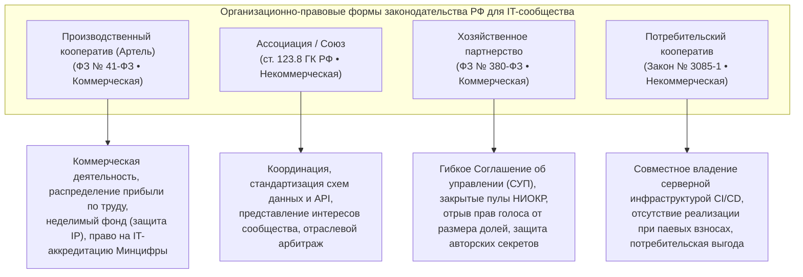
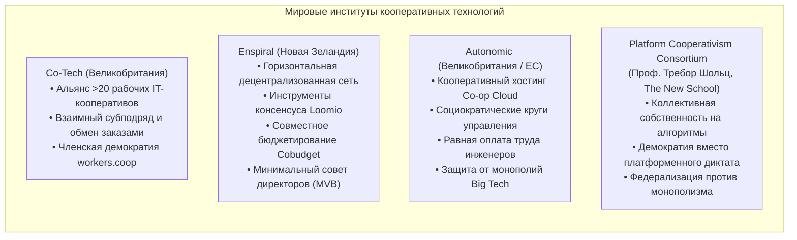
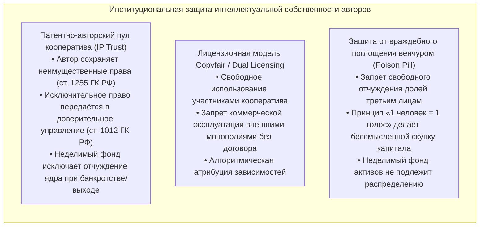
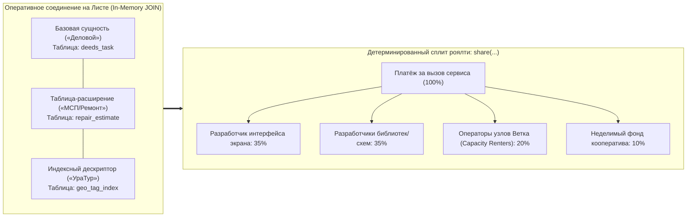
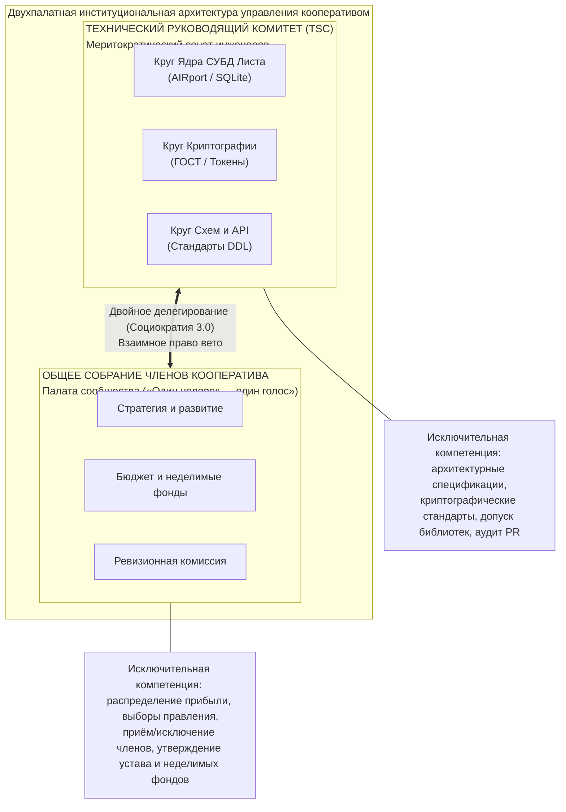
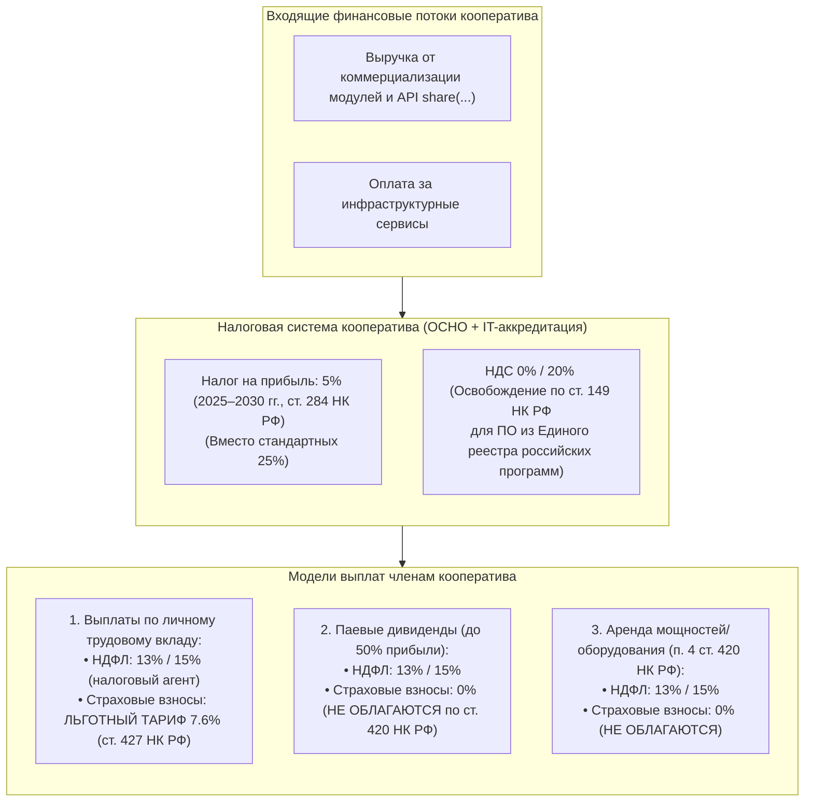
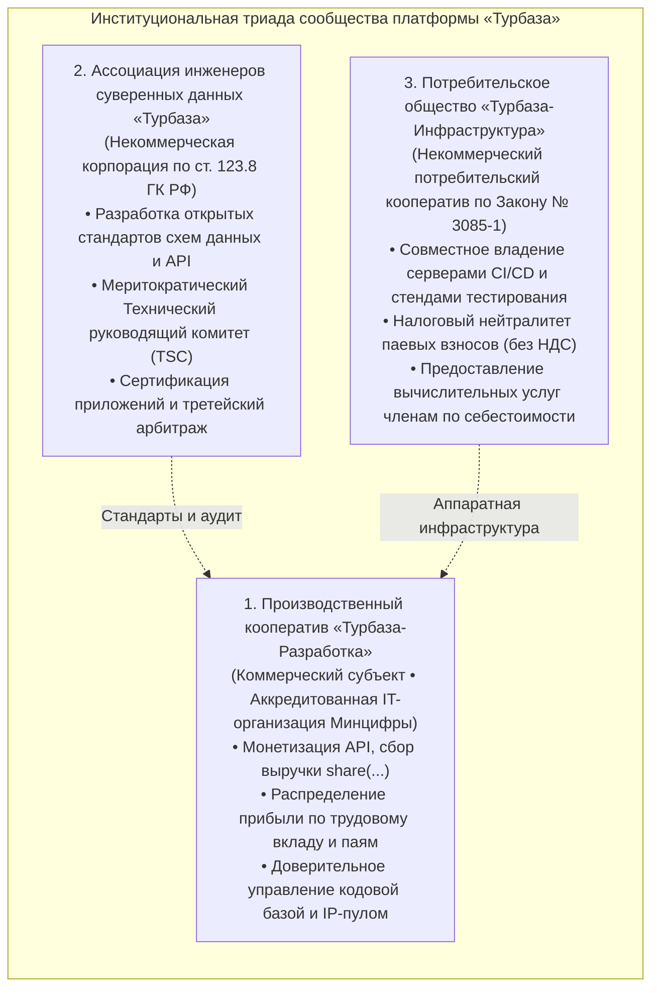
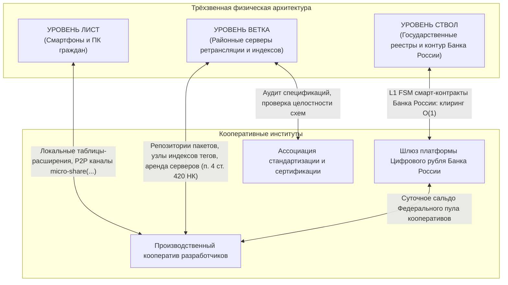

# ИССЛЕДОВАТЕЛЬСКИЙ АНАЛИТИЧЕСКИЙ ОТЧЁТ: ИНСТИТУЦИОНАЛЬНЫЕ, ПРАВОВЫЕ И ЭКОНОМИЧЕСКИЕ ФОРМЫ ОБЪЕДИНЕНИЯ IT-РАЗРАБОТЧИКОВ ПЛАТФОРМЫ «ТУРБАЗА»

**Тема исследования:** Комплексный анализ мировых и российских организационно-правовых форм для институционализации сообщества независимых разработчиков прикладных и системных приложений распределённой платформы «Турбаза»  
**Назначение:** Научно-правовой и институциональный базис для Белой книги № 12 («Экосистема платформы "Турбаза" / Локальный реестр МСП и ЖКХ»)  
**Исследовательская подсессия:** Под-агент 3.а (ID: `657cc76e-124a-4c30-b8b2-a1354a4496ef`)  
**Получатель:** Модель-координатор автономной сессии (ID: `eac6865b-0c57-44e0-8983-0b4d381f8134`)  
**Методологические инварианты:** Академическая строгость, точные ссылки на статьи нормативно-правовых актов РФ и международные прецеденты, исключение местоимений первого лица множественного числа («мы/наш»), государственный суверенитет как основополагающий правовой атрибут.

---

## ВВЕДЕНИЕ И ПОСТАНОВКА ПРОБЛЕМЫ

Трёхзвенная архитектура платформы «Турбаза» (клиентские устройства пользователей **Лист** $\to$ районные серверы ретрансляции и индексации **Ветка** $\to$ суверенные реестры государства **Ствол**) переносит вычисления и хранение реляционных данных непосредственно на периферийные устройства граждан. На прикладном уровне (флагманские модули «КубГолос», «Забота», «Деловой», «УраТур», «Локальный реестр МСП и ЖКХ») ключевой движущей силой экосистемы выступают независимые разработчики программного обеспечения, создатели открытых схем данных, авторы предметных библиотек и поставщики микросервисов.

В условиях монополизации глобального цифрового рынка транснациональными корпорациями (Apple, Google, Microsoft, Amazon) независимые разработчики сталкиваются с системной уязвимостью:
1. **Платформенная рента:** Централизованные магазины приложений взимают 15–30% комиссии с каждого платежа, произвольно блокируют учётные записи и в одностороннем порядке переписывают правила доступа к API.
2. **Отчуждение интеллектуальной собственности:** Инженерные наработки независимых команд подвергаются принудительному поглощению («sherlocking»), когда платформа встраивает чужие инновации в собственную монопольную среду без компенсации авторам.
3. **Правовая фрагментация и прекаризация труда:** Разработчики-одиночки и распределённые инженерные артели лишены механизмов коллективной защиты интересов, несут чрезмерные транзакционные издержки по налоговому и бухгалтерскому администрированию и не обладают переговорной силой в отношениях с государственными регуляторами и крупными институциональными заказчиками.

Решение указанных противоречий требует учреждения в суверенной юрисдикции устойчивых институциональных форм коллективной самоорганизации программистов. Настоящий отчёт содержит исчерпывающее правовое, экономическое и институциональное исследование соответствующих организационно-правовых механизмов.

---

## РАЗДЕЛ 1. РОССИЙСКОЕ ЗАКОНОДАТЕЛЬСТВО: СРАВНИТЕЛЬНО-ПРАВОВОЙ АНАЛИЗ ОРГАНИЗАЦИОННЫХ ФОРМ

Гражданский кодекс Российской Федерации (ГК РФ) и специальное федеральное законодательство предлагают четыре ключевые юридические конструкции, потенциально применимые для объединения разработчиков программного обеспечения.



---

### 1.1. Производственный кооператив (артель) по ФЗ № 41-ФЗ

Производственный кооператив (артель) регулируется статьями 106.1–106.6 ГК РФ и Федеральным законом от 08.05.1996 № 41-ФЗ «О производственных кооперативах». В силу **пункта 2 статьи 50 ГК РФ** производственный кооператив относится к **коммерческим корпоративным организациям**, имеющим извлечение прибыли в качестве основной цели своей деятельности.

#### 1.1.1. Условия учреждения и состав членов
- **Минимальный состав учредителей (ст. 4 ФЗ № 41-ФЗ):** Число членов кооператива не может быть менее 5 человек. Членами кооператива могут быть граждане РФ, иностранные граждане и лица без гражданства, достигшие возраста 16 лет.
- **Юридические лица:** Могут участвовать в деятельности кооператива через своего полномочного представителя в соответствии с уставом кооператива (п. 1 ст. 7 ФЗ № 41-ФЗ).

#### 1.1.2. Баланс трудового и финансового участия
Законодательство разделяет членов кооператива на две категории:
1. **Члены кооператива, принимающие личное трудовое участие:** Составляют базовую основу артели.
2. **Члены кооператива, внесшие паевой взнос, но не принимающие личного трудового участия (члены-инвесторы):** В силу **пункта 2 статьи 7 ФЗ № 41-ФЗ** число таких членов **не может превышать 25%** от числа членов кооператива, принимающих личное трудовое участие. Данный императив служит барьером против захвата артели внешними финансовыми спекулянтами.
3. **Регулирование наёмного персонала (п. 1 ст. 21 ФЗ № 41-ФЗ):** Средняя численность наёмных работников, работающих по трудовому договору, не должна превышать 30% от общей численности членов кооператива. Данная норма гарантирует, что производственный кооператив остаётся объединением трудящихся собственников, а не классическим предприятием найма.

#### 1.1.3. Паевой фонд и паевые взносы (ст. 10 ФЗ № 41-ФЗ)
- Размер паевого фонда определяется уставом кооператива.
- Член кооператива обязан внести к моменту государственной регистрации не менее 10% паевого взноса. Остальная часть вносится в течение года со дня регистрации.
- Паевой взнос может быть сформирован деньгами, ценными бумагами, иным имуществом, а также **имущественными правами и иными правами, имеющими денежную оценку** (включая исключительные или неисключительные права на программное обеспечение, базы данных и алгоритмические модули). Оценка вклада свыше 25 000 рублей подлежит независимой экспертной оценке.

#### 1.1.4. Неделимый фонд как правовой инструмент защиты платформы (ст. 11 ФЗ № 41-ФЗ)
Уставом кооператива может быть предусмотрено, что определённая часть принадлежащего кооперативу имущества составляет **неделимый фонд**.
- **Порядок создания:** Решение об образовании неделимого фонда принимается по единогласному решению членов кооператива, если иное не закреплено уставом.
- **Правовой режим:** Имущество неделимого фонда не включается в паи членов кооператива. На него **не может быть обращено взыскание по личным долгам члена кооператива** (п. 3 ст. 11 ФЗ № 41-ФЗ).
- **Значение для IT-экосистемы «Турбаза»:** Неделимый фонд кооператива выступает фундаментальным хранилищем неотчуждаемых цифровых активов: базового ядра библиотек `@turbase/core`, протоколов схем данных, общесистемных эталонных репозиториев и ключевых серверов верификации. Даже при банкротстве или выходе отдельных членов-разработчиков целостность критической инфраструктуры остаётся неприкосновенной.

#### 1.1.5. Субсидиарная ответственность членов кооператива (ст. 13 ФЗ № 41-ФЗ)
- Члены производственного кооператива несут субсидиарную ответственность по обязательствам кооператива в размерах и в порядке, предусмотренных уставом.
- Законодательство не требует неограниченной солидарной ответственности: устав кооператива может зафиксировать минимальный предел субсидиарной ответственности (например, в размере, кратном паевому взносу участника — 0.5 пая, 1 пай или фиксированная сумма в 10 000 рублей). Это исключает риск обращения взыскания на личное жилье или основное имущество инженера-разработчика при возникновении хозяйственных споров кооператива.

#### 1.1.6. Распределение чистой прибыли по трудовому вкладу (ст. 12 ФЗ № 41-ФЗ)
Статья 12 ФЗ № 41-ФЗ формулирует уникальное правило, отличающее производственный кооператив от ООО и АО:
- Прибыль кооператива распределяется между его членами в соответствии с их **личным трудовым и (или) иным участием**, а также размером паевого взноса.
- **Императивное ограничение паевых выплат:** Часть прибыли, распределяемая между членами кооператива пропорционально размерам их паевых взносов, **не должна превышать 50% прибыли кооператива, подлежащей распределению**.
- Это означает, что не менее половины (а по уставу — вплоть до 80–90%) всей распределяемой чистой прибыли направляется разработчикам за фактический объём выполненного инженерного труда (написание кода, аудит схем, закрытие дефектов, дежурство на узлах Ветки), исключая рентное паразитирование держателей капитала.

---

### 1.2. Ассоциация (союз) по ст. 123.8–123.11 ГК РФ

Ассоциация (союз) является **некоммерческой корпоративной организацией**, объединяющей граждан и (или) юридических лиц на основе членства.

#### 1.2.1. Уставные цели и функции
- В силу **пункта 1 статьи 123.8 ГК РФ** ассоциация создаётся для представления и защиты общих, в том числе профессиональных и имущественных интересов, для достижения общественно полезных целей, а также координации деятельности членов.
- Число учредителей ассоциации не может быть менее двух.

#### 1.2.2. Запрет на непосредственную коммерческую деятельность
Ассоциация не вправе распределять полученную прибыль между своими членами (п. 1 ст. 2 Федерального закона от 12.01.1996 № 7-ФЗ «О некоммерческих организациях»). Предпринимательскую деятельность ассоциация вправе осуществлять лишь постольку, поскольку это служит достижению уставных целей, и лишь через учреждение хозяйственных обществ или участие в них.

#### 1.2.3. Роль Ассоциации в экосистеме «Турбаза»
Ассоциация независимых разработчиков выступает идеальным институтом верхнего уровня для:
1. **Стандартизации схем данных и протоколов:** Утверждение общесистемных стандартов открытых интерфейсов, DDL-манифестов и расширений библиотек `@turbase/*`.
2. **Ведения Единого открытого каталога доверенных модулей:** Проведение независимого аудита безопасности сторонних расширений перед их публикацией в глобальном дереве поиска Ствола.
3. **Третейского урегулирования технических споров:** Рассмотрение конфликтов коллизий именования сущностей, нарушений обратной совместимости API и жалоб пользователей.
4. **Взаимодействия с институтами государственной власти:** Представление консолидированной позиции сообщества разработчиков в Министерстве цифрового развития, связи и массовых коммуникаций РФ, Федеральной антимонопольной службе и Банке России.

---

### 1.3. Хозяйственное партнерство по ФЗ № 380-ФЗ

Федеральный закон от 03.12.2011 № 380-ФЗ «О хозяйственных партнерствах» ввёл в российское право высокоэластичную коммерческую форму, изначально задуманную для реализации венчурных, научно-исследовательских и технологических проектов.

#### 1.3.1. Учредительные параметры
- Число участников: от 2 до 50 (граждане и юридические лица).
- Партнерство не может быть учреждено одним лицом.

#### 1.3.2. Соглашение об управлении партнерством (СУП)
Ключевым инструментом выступает Соглашение об управлении партнерством (статья 6 ФЗ № 380-ФЗ):
- Соглашение подлежит обязательному нотариальному удостоверению, при этом его текст **не вносится в Единый государственный реестр юридических лиц (ЕГРЮЛ)** и остаётся строго конфиденциальным для третьих лиц.
- **Полный отрыв прав от размера вклада:** СУП позволяет установить порядок осуществления прав участников, совершенно не зависящий от размера их долей в складочном капитале. В частности:
  - Предоставление права решающего голоса (вето) ведущим системным архитекторам вне зависимости от внесенных ими финансовых средств;
  - Непропорциональное распределение прибыли от коммерциализации конкретных прикладных подсистем;
  - Порядок голосования по принципу единогласия или квалифицированного большинства по вопросам изменения исходного кода критических систем;
  - Особые условия выхода и выкупа долей с передачей прав на созданные модули в общую собственность партнерства.

#### 1.3.3. Системные ограничения формы
- Хозяйственное партнерство **не вправе осуществлять эмиссию облигаций и иных эмиссионных ценных бумаг** (п. 4 ст. 2 ФЗ № 380-ФЗ).
- Партнерство **не вправе размещать рекламу своей деятельности** (п. 5 ст. 2 ФЗ № 380-ФЗ).
- Партнерство не может быть реорганизовано ни в какую иную форму, кроме акционерного общества (ст. 23 ФЗ № 380-ФЗ).
- **Сфера применения в «Турбазе»:** Хозяйственное партнерство оптимально для закрытых инженерных лабораторий и специализированных научно-производственных синдикатов разработчиков криптографического ядра платформы, но непригодно для массового открытого объединения сотен независимых авторов прикладных модулей из-за законодательного запрета на рекламу и ограничения численности в 50 участников.

---

### 1.4. Потребительский кооператив по Закону РФ № 3085-1

Потребительский кооператив регулируется статьями 123.2–123.3 ГК РФ и Законом РФ от 19.06.1992 № 3085-1 «О потребительской кооперации (потребительских обществах, их союзах) в Российской Федерации». Является **некоммерческой организацией**.

#### 1.4.1. Условия создания и членство
- Учредителями могут выступать граждане, достигшие 16-летнего возраста (не менее 5 человек), и (или) юридические лица (не менее 3).
- Цель — удовлетворение материальных и иных потребностей пайщиков.

#### 1.4.2. Налоговый нейтралитет и имущественный режим
- Вступительные и паевые взносы членов потребительского общества **не признаются объектом налогообложения налогом на прибыль и налогом на добавленную стоимость** (подп. 1 п. 2 ст. 146, подп. 1 п. 1 ст. 251 НК РФ), так как они не являются реализацией товаров, работ или услуг.
- Возврат паевого взноса при выходе пайщика из потребительского общества также освобождён от налогообложения.
- **Кооперативные выплаты (ст. 24 Закона № 3085-1):** Часть доходов кооператива от хозяйственной деятельности может распределяться между пайщиками пропорционально их участию в хозяйственной деятельности кооператива (то есть объёму потребления услуг кооператива).

#### 1.4.3. Применение разработчиками «Турбазы»
Потребительский кооператив формирует институциональный каркас **совместного пользования инфраструктурой (Инфраструктурный пул)**:
- Разработчики объединяются в потребительское общество для совместной аренды или закупки высокопроизводительных серверов сборки и тестирования (CI/CD pipelines), оборудования долговременного резервного копирования, пулов выделенных IP-адресов, аппаратных стендов нагрузочного тестирования и лицензий на системное проприетарное ПО;
- За счёт некоммерческого статуса и освобождения паевых взносов от НДС стоимость коллективного владения инфраструктурой снижается на 20–30% по сравнению с индивидуальной арендой мощностей у коммерческих хостинг-провайдеров.

---

### 1.5. Сравнительная матрица организационно-правовых форм РФ

| Критерий сравнения | Производственный кооператив (ФЗ № 41-ФЗ) | Ассоциация (союз) (ст. 123.8 ГК РФ) | Хозяйственное партнерство (ФЗ № 380-ФЗ) | Потребительский кооператив (Закон № 3085-1) |
| :--- | :--- | :--- | :--- | :--- |
| **Характер организации** | Коммерческая корпорация | Некоммерческая корпорация | Коммерческая организация | Некоммерческая корпорация |
| **Минимальное число участников** | 5 граждан | 2 лица | 2 лица (макс. 50) | 5 граждан или 3 юрлица |
| **Базис управления** | 1 человек = 1 голос | 1 член = 1 голос | По Соглашению об управлении (любой) | 1 пайщик = 1 голос |
| **Распределение прибыли** | По трудовому вкладу ($\ge 50\%$) и паям ($\le 50\%$) | Запрещено между членами | По соглашению (любая гибкость) | Кооперативные выплаты по объёму потребления |
| **Защита неделимого пула** | Предусмотрена (ст. 11 ФЗ № 41-ФЗ) | Все имущество не распределяется | Через условия СУП | Предусмотрен неделимый фонд |
| **IT-аккредитация Минцифры** | **Да (полное соответствие)** | Нет (некоммерческая) | Да (коммерческая) | Нет (некоммерческая) |
| **Оптимальное назначение** | **Основной коммерческий кооператив разработчиков** | **Координация, стандарты, арбитраж** | **Инженерные R&D пулы ядра платформы** | **Совместное владение серверами и CI/CD** |

---

## РАЗДЕЛ 2. МЕЖДУНАРОДНЫЙ ОПЫТ IT-КООПЕРАТИВОВ И ПЛАТФОРМЕННЫЙ КООПЕРАТИВИЗМ

Мировая индустрия программного обеспечения демонстрирует успешное развитие рабочих технологических кооперативов (Worker Tech Co-ops), доказывающих высокую жизнеспособность горизонтальных моделей инженерного взаимодействия.



---

### 2.1. Альянс рабочих технологических кооперативов Co-Tech (Великобритания)

Сеть **Co-Tech** (Cooperative Technologists) учреждена в 2016 году в Вортли-Холле и объединяет более 20 независимых рабочих кооперативов цифрового профиля (включая Outlandish, Agile Collective, Go Free Range, Aptivate, Software Cooperative).

#### Ключевые принципы и механизмы:
1. **Рабочая собственность (Worker Ownership):** 100% долей каждого входящего кооператива принадлежит его непосредственным сотрудникам. Внешние институциональные инвесторы исключены из структуры капитала.
2. **Межкооперативная взаимопомощь и шеринг заказов:** При поступлении крупного институционального заказа, превосходящего мощности одного кооператива, контракт исполняется консорциумом участников через механизм прозрачного субподряда без корпоративных посредников.
3. **Федерализация в структуре workers.coop:** С сентября 2024 года Co-Tech функционирует как отраслевая секция общенациональной федерации рабочих кооперативов Великобритании, формируя единый фонд правовой защиты, взаимопомощи и лоббирования интересов кооперативных предприятий.

---

### 2.2. Децентрализованная сеть Enspiral (Новая Зеландия)

Сеть **Enspiral**, зародившаяся в Веллингтоне, представляет собой признанный мировой образец горизонтальной координации независимых инженеров, предпринимателей и создателей программного обеспечения без традиционной административной иерархии.

#### Инструментальные решения и институциональные инновации:
1. **Loomio (Инструмент открытого консенсуса):** Программная среда коллективного принятия решений, исключающая бесконечные совещания. Члены сообщества инициируют предложения, аргументируют позиции и голосуют по шкале согласия («согласен», «воздерживаюсь», «не согласен», «блокирую»). Несогласие рассматривается не как конфликт, а как стимул к доработке архитектурного решения.
2. **Cobudget (Коллективное бюджетирование):** Финансовый инструмент, позволяющий участникам сети распределять консолидированные ресурсы (фонды развития) через открытые «корзины финансирования» (funding buckets). Каждый инженер самостоятельно решает, какую долю общих средств направить на разработку конкретной библиотеки или инфраструктурного модуля.
3. **Минимальный жизнеспособный совет директоров (Minimum Viable Board, MVB):** Формальное юридическое лицо (Enspiral Foundation Ltd) управляется узким советом, наделённым исключительно функциями формального юридического и налогового соответствия (compliance), не имеющим права вмешиваться в оперативные и технические решения проектных кругов сети.

---

### 2.3. Кооператив Autonomic и экосистема Co-op Cloud (Великобритания / ЕС)

Рабочий кооператив **Autonomic** специализируется на системной архитектуре, свободном программном обеспечении (FLOSS) и независимой облачной инфраструктуре.

#### Инженерно-организационная специфика:
1. **Внутреннее устройство:** Функционирует на основе равной почасовой оплаты труда всех специалистов, консенсусного принятия решений и организации рабочих процессов через самоуправляемые круги ответственности.
2. **Проект Co-op Cloud:** Разработанная кооперативом открытая система оркестрации распределённой инфраструктуры на базе Docker Swarm. Проект формирует **«конфигурационный фонд общего пользования» (configuration commons)**, позволяющий сотням независимых кооперативов, общественных организаций и артелей развёртывать суверенные сервисы (Matrix, Nextcloud, Discourse) на собственном оборудовании, полностью устраняя зависимость от американских гиперскейлеров (AWS, Google Cloud, Microsoft Azure).

---

### 2.4. Движение платформенного кооперативизма (Platform Cooperativism Consortium, Требор Шольц)

Теоретический и институциональный манифест движения платформенного кооперативизма сформулирован профессором Новой школы (The New School, Нью-Йорк) **Требором Шольцем** (*Trebor Scholz, «Platform Cooperativism: Challenging the Corporate Sharing Economy», 2016; «Own This», 2023*) и развивается консорциумом **Platform Cooperativism Consortium (PCC)**.

#### Противопоставление «эксплуатационной гиг-экономике»:
Традиционные цифровые платформы (Uber, Upwork, Airbnb) классифицируются как институты «платформенного капитализма слежки», где монополист единолично владеет кодовой базой, собирает данные пользователей, произвольно изменяет алгоритмы распределения заказов и извлекает монопольную ренту.

#### Фундаментальные принципы платформенного кооперативизма:
1. **Коллективная собственность на платформу:** Исходный код, алгоритмы, технологическая инфраструктура и накопленные агрегированные данные находятся в неделимой совместной собственности тех, кто создаёт ценность платформы (разработчиков, поставщиков услуг и пользователей).
2. **Демократическое корпоративное управление:** Стратегические решения о развитии платформы принимаются участниками на демократических началах, гарантируя подотчётность алгоритмов обществу.
3. **Открытый код и открытые данные:** Устранение закрытых коммерческих монополий («огороженных садов» / walled gardens) за счёт опоры на свободные стандарты и децентрализованные протоколы.
4. **Справедливое распределение стоимости:** Ликвидация спекулятивной маржи венчурных фондов; весь создаваемый экономический доход реинвестируется в развитие инфраструктуры и распределяется между непосредственными трудящимися.

---

## РАЗДЕЛ 3. УПРАВЛЕНИЕ ИНТЕЛЛЕКТУАЛЬНОЙ СОБСТВЕННОСТЬЮ (IP POOLING) И ЗАЩИТА АВТОРОВ

В распределённой реляционной среде «Турбазы» прикладные сервисы не изолированы в виде отдельных закрытых монолитов, а строятся через **межприложенческие схемы данных, таблицы-расширения и виртуальные объединения на Листе**. Это требует принципиально новой модели лицензирования и защиты авторских прав.



---

### 3.1. Механизмы коллективного пула авторских прав (IP Pooling) и лицензирования

#### 3.1.1. Доверительное управление интеллектуальными правами (ст. 1012–1026 ГК РФ)
- В соответствии со **статьёй 1255 ГК РФ** автору произведения науки, литературы или искусства (программы для ЭВМ) принадлежат неотчуждаемые личные неимущественные права: право авторства, право автора на имя, право на неприкосновенность произведения. Эти права не могут быть переданы или отобраны ни при каких условиях.
- **Исключительное право (ст. 1270 ГК РФ)** на созданный программный модуль автор передаёт в **доверительное управление кооперативу** (ст. 1012 ГК РФ) либо вносит право использования в качестве паевого взноса (ст. 10 ФЗ № 41-ФЗ).
- Кооператив выступает коллективным лицензиаром, управляющим коммерциализацией программных библиотек, защищающим авторов от несанкционированного заимствования и ведущим претензионную работу в судах.

#### 3.1.2. Модель лицензий справедливого участия (Copyfair / Peer Production License)
Традиционные открытые лицензии (MIT, Apache 2.0, BSD) уязвимы перед феноменом коммерческого паразитирования: транснациональные корпорации свободно забирают открытый код независимых инженеров, закрывают его в своих облачных средах (AWS, Azure) и извлекают миллиардные сверхприбыли, ничего не возвращая авторам.

Для кооператива разработчиков платформы «Турбаза» внедряется модель **двойного лицензирования (Dual Licensing)** и лицензий справедливого доступа (**Copyfair Licensing**):
1. **Для участников кооператива и независимых граждан:** Лицензия является полностью свободной (Copyleft / AGPLv3-подобной), позволяющей модифицировать код, создавать таблицы-расширения и выполнять локальные соединения данных на Листе без лицензионных отчислений.
2. **Для внешних коммерческих корпораций и закрытых монополий:** Использование прикладных модулей платформы допускается исключительно на условиях возмездной коммерческой лицензии с перечислением отчислений в консолидированный роялти-пул кооператива.

---

### 3.2. Роялти от межприложенческих вызовов share(...) и кросс-табличных JOIN

Архитектура «Турбазы» решает историческую проблему монетизации модульного программного обеспечения. В традиционных системах разработчик фундаментальной библиотеки (например, математического алгоритма или специализированной схемы БД) ничего не получает от выручки конечного пользовательского приложения. В «Турбазе» взаимосвязь модулей математически фиксируется на уровне реляционных связей.



#### 3.2.1. Межприложенческие схемы и композитные внешние ключи
При интеграции сервисов (например, добавление строительной сметы ремонта из модуля МСП к задаче в «Деловом» с геопривязкой объекта через открытые теги «УраТура») приложения связываются стандартизированными композитными внешними ключами:
$$\text{FK} = (\text{RepositoryId}, \text{ActorId}, \text{ActorRecordId})$$
Соединение таблиц (`JOIN`) выполняется в оперативной памяти мобильного устройства гражданина (Листа) за доли миллисекунды ($< 0.1$ мс).

#### 3.2.2. Алгоритмический след исполнения и детерминированная функция share(...)
В момент совершения транзакции (оплата услуг мастера, покупка путеводителя, исполнение смарт-контракта) среда исполнения Листа фиксирует точный граф задействованных таблиц-расширений и библиотек ядра. Функция `share(...)` автоматически расщепляет платёж:
- **35% — разработчику прикладного интерфейса** (создателю экрана и бизнес-сценария);
- **35% — пулу разработчиков задействованных схем данных и аналитических модулей** (пропорционально частоте обращения к таблицам-расширениям);
- **20% — операторам периферийных серверов Ветка (Capacity Renters)** за транзит данных, репликацию и хранение индексов тегов;
- **10% — в неделимый фонд развития кооператива** на аудит безопасности и модернизацию общесистемного ядра.

#### 3.2.3. Двухуровневый клиринг: Офчейн-каналы и Цифровой рубль L1
Вместо перегрузки блокчейна миллионами микротранзакций расчеты осуществляются в одноранговых каналах состояний (State Channels). Раз в сутки встречные требования участников взаимно сальдируются, а итоговое чистое сальдо закрывается одной транзакцией через смарт-контракт L1 на платформе цифрового рубля Банка России со сложностью строго $O(1)$.

---

### 3.3. Защита независимых авторов от враждебного поглощения

Традиционные стартапы в форме ООО и АО подвержены риску враждебного поглощения: венчурные фонды выкупают контрольный пакет у сомневающихся учредителей, после чего вытесняют создателей, закрывают проект или продают патенты монополиям. Форма производственного кооператива блокирует эти сценарии за счёт системных правовых фильтров:
1. **Запрет на свободную переуступку прав:** В силу ст. 9 ФЗ № 41-ФЗ передача пая (его части) гражданину, не являющемуся членом кооператива, допускается **только с согласия кооператива**. При этом другие члены кооператива пользуются преимущественным правом покупки такого пая.
2. **Ликвидация власти крупного капитала:** В кооперативе действует незыблемый принцип: **один член кооператива имеет один голос** на общем собрании (п. 2 ст. 15 ФЗ № 41-ФЗ). Покупка крупного паевого взноса не увеличивает количество голосов инвестора. Скупка 51% долей не даёт контроля над организацией.
3. **Неделимый фонд как «ядовитая пилюля» (Poison Pill):** Критическое ядро платформы, внесённое в неделимый фонд, не может быть продано или выделено из состава имущества кооператива даже при выходе или банкротстве инициаторов.

---

## РАЗДЕЛ 4. ПРИНЯТИЕ РЕШЕНИЙ И КОРПОРАТИВНОЕ УПРАВЛЕНИЕ: ДЕМОКРАТИЯ VS МЕРИТОКРАТИЯ

Фундаментальный вызов инженерного самоуправления заключается в противоречии между двумя крайностями:
- **Охлократия чистой эгалитарной демократии («один человек — один голос»):** Если решения по сложнейшим аспектам проектирования реляционного ядра СУБД, криптографических примитивов ГОСТ Р 34.10-2012 или формальной верификации конечных автоматов принимаются простым большинством голосов сотен непрофильных участников или начинающих верстальщиков, качество архитектуры неизбежно деградирует.
- **Плутократия токенократии:** В традиционных блокчейн-проектах (DAO) голосование токенами приводит к захвату управления крупными «китами» и финансовыми спекулянтами, далёкими от инженерных задач.



---

### 4.1. Двухпалатная (бикамеральная) модель управления кооперативом

Для экосистемы «Турбаза» разрабатывается сбалансированная двухпалатная модель, разделяющая хозяйственно-стратегическую власть и техническую власть.

#### 1. Палата сообщества (Общее собрание кооператива)
- Действует на классическом кооперативном принципе: **один человек — один голос**.
- **Компетенция:**
  - Утверждение устава кооператива и изменений в него;
  - Определение направлений расходования неделимых фондов и фондов развития;
  - Утверждение годовых отчётов и порядка распределения прибыли между трудом и паями;
  - Избрание Председателя кооператива, Правления и Ревизионной комиссии;
  - Приём новых членов и исключение нарушителей устава.

#### 2. Технический руководящий комитет (Technical Steering Committee, TSC) / Меритократический сенат
- Формируется на основе **доказанного профессионального вклада (Proof of Merit)** в развитие кодовой базы платформы.
- **Метрики допуска в состав комитета:**
  - Объём принятого и верифицированного кода (merged pull requests) в репозитории ядра `@turbase/*`;
  - Проведение результативных аудитов информационной безопасности;
  - Высокий авторский рейтинг Topical Score в репутационной сети прикладных систем («Забота» / «КубГолос»);
  - Инженерный стаж в экосистеме.
- **Исключительная компетенция комитета:**
  - Утверждение технических стандартов архитектуры Лист-Ветка-Ствол;
  - Допуск сторонних библиотек и схем данных в статус «Официально рекомендованные платформой»;
  - **Право технического вето:** Технический комитет обладает правом блокирования любых решений Общего собрания, способных нарушить стабильность, криптографическую стойкость или обратную совместимость реляционного ядра платформы.

---

### 4.2. Механизмы Социократии 3.0 (Sociocracy 3.0, S3)

Для оперативного управления рабочими группами внутри кооператива задействуются проверенные методы Социократии 3.0:
1. **Принцип консента (Consent Decision Making):** Решение считается принятым не тогда, когда «все согласны» (недостижимый идеалистический консенсус), а тогда, когда **отсутствуют обоснованные возражения** (парадигма: *«достаточно хорошо на данный момент, достаточно безопасно, чтобы испытать»*). Возражением признаётся аргументированное указание на то, что предлагаемое решение нарушает безопасность системы или мешает достижению целей круга.
2. **Круговая организация с двойным делегированием (Double Linking):** Кооператив структурируется на автономные доменные круги (Круг мобильного клиента Листа, Круг сетевых шлюзов Ветки, Круг смарт-контрактов ЦВЦБ, Круг пользовательского опыта). Связь между кругами обеспечивается двумя представителями: руководителем круга (делегированным сверху вниз) и представителем круга (выбранным кругом снизу вверх для участия в вышестоящем круге). Это исключает возникновение авторитарных информационных барьеров.

---

## РАЗДЕЛ 5. НАЛОГООБЛОЖЕНИЕ И ФИНАНСОВАЯ МОДЕЛЬ В РОССИЙСКОЙ ФЕДЕРАЦИИ

Экономическая устойчивость кооператива разработчиков опирается на выверенное применение преференциальных фискальных режимов, установленных законодательством Российской Федерации для высокотехнологичного сектора.



---

### 5.1. Режимы налогообложения производственного кооператива (УСН vs ОСНО)

Производственный кооператив вправе самостоятельно выбирать фискальный режим в соответствии с главой 26.2 Налогового кодекса РФ (НК РФ):
1. **Упрощенная система налогообложения (УСН):**
   - Допускается при численности работников до 130 человек и годовом доходе в пределах установленных лимитов (с учётом индексации коэффициентом-дефлятором в 2025–2026 гг. — до 450 млн руб.).
   - Применяется объект «Доходы» (базовая ставка 6%) либо «Доходы, уменьшенные на величину расходов» (базовая ставка 15%). Освобождает от налога на имущество и налога на прибыль.
2. **Общая система налогообложения (ОСНО):**
   - Традиционно считается высоконагруженной, однако **для аккредитованной IT-организации ОСНО является наиболее экономически выгодной**.

---

### 5.2. Государственная аккредитация ИТ-организаций и производственный кооператив

В соответствии с **Положением о государственной аккредитации российских организаций, осуществляющих деятельность в области информационных технологий**, утверждённым Постановлением Правительства РФ от 30.09.2022 № 1729:
- Государственная аккредитация предоставляется **российским коммерческим организациям (юридическим лицам)** независимо от их организационно-правовой формы.
- Поскольку производственный кооператив признаётся коммерческим юридическим лицом (п. 2 ст. 50 ГК РФ), он **в полном объёме обладает правом на получение государственной IT-аккредитации Минцифры РФ**.

#### Обязательные условия соответствия критериям Минцифры:
1. **Профильный вид деятельности (ОКВЭД):** В качестве основного вида деятельности в ЕГРЮЛ должен быть заявлен один из профильных кодов (например, **62.01** — «Разработка компьютерного программного обеспечения», **62.02** — «Деятельность консультативная и работы в области компьютерных технологий», **63.11** — «Деятельность по обработке данных, предоставление услуг по размещению информации и связанная с этим деятельность»).
2. **Критерий профильной выручки:** Доля доходов от деятельности в сфере информационных технологий должна составлять **не менее 30%** от общего объёма доходов кооператива по итогам отчётного (расчётного) периода.
3. **Критерий средней заработной платы:** Среднемесячный размер выплат и иных вознаграждений, начисленных в пользу физических лиц, должен быть не ниже размера среднемесячной начисленной заработной платы в субъекте РФ либо по РФ в целом (требование не применяется к организациям, продукты которых включены в Единый реестр российских программ для ЭВМ и баз данных).
4. **Сайт организации:** Наличие официального общедоступного сайта в сети «Интернет» с раскрытием направлений IT-деятельности.

#### Преференции аккредитованного IT-кооператива:
- **Пониженные тарифы страховых взносов (ст. 427 НК РФ):** Совокупный льготный тариф составляет **7.6%** в пределах единой предельной величины базы для исчисления страховых взносов (вместо стандартных 30%) и **0%** свыше предельной величины базы.
- **Льготная ставка налога на прибыль (п. 1.15 ст. 284 НК РФ):** В период 2025–2030 гг. ставка налога на прибыль для аккредитованных IT-компаний зафиксирована на уровне **5%** (федеральный бюджет), при этом региональная часть налога обнулена.
- **Освобождение от государственного контроля:** Мораторий на проведение плановых неналоговых проверок, а также выездных налоговых проверок.
- **Социальные гарантии членов кооператива:** Члены кооператива, состоящие в трудовых отношениях и имеющие профильное образование, получают право на льготную IT-ипотеку и отсрочку от призыва на военную службу.

---

### 5.3. Финансовая модель: разграничение трудовых, дивидендных и арендных выплат

Налоговый кодекс РФ устанавливает чёткую дифференциацию фискальной нагрузки в зависимости от правовой природы выплат членам кооператива:

```
┌────────────────────────────────────────────────────────────────────────────────────────┐
│                      ФИНАНСОВЫЕ ВЫПЛАТЫ ЧЛЕНАМ КООПЕРАТИВА                             │
├─────────────────────────┬──────────────────────────────┬───────────────────────────────┤
│    Категория выплаты    │      Налогообложение НДФЛ    │       Страховые взносы        │
├─────────────────────────┼──────────────────────────────┼───────────────────────────────┤
│ 1. Личный трудовой вклад│ 13% (до 2.4 млн руб.) /      │ 7.6% (льготный тариф IT)      │
│    (ст. 12 ФЗ № 41-ФЗ)  │ 15% - 22% (прогрессия)       │ Свыше базы: 0%                │
├─────────────────────────┼──────────────────────────────┼───────────────────────────────┤
│ 2. Паевые дивиденды     │ 13% (до 2.4 млн руб.) /      │ 0% (НЕ ОБЛАГАЮТСЯ             │
│    (до 50% прибыли)     │ 15% (свыше порога)           │ в силу п. 1 ст. 420 НК РФ)    │
├─────────────────────────┼──────────────────────────────┼───────────────────────────────┤
│ 3. Аренда оборудования  │ 13% (до 2.4 млн руб.) /      │ 0% (НЕ ОБЛАГАЮТСЯ             │
│    граждан (серверы)    │ 15% (свыше порога)           │ в силу п. 4 ст. 420 НК РФ)    │
└─────────────────────────┴──────────────────────────────┴───────────────────────────────┘
```

1. **Выплаты по личному трудовому вкладу:** Относятся к расходам на оплату труда. Кооператив выступает налоговым агентом по НДФЛ (ст. 226 НК РФ). Начисляются страховые взносы по сверхльготной ставке IT-аккредитации 7.6%.
2. **Паевые дивиденды:** В силу **пункта 1 статьи 43 НК РФ** выплата части чистой прибыли пропорционально паевым взносам признаётся дивидендным доходом. В соответствии со **статьёй 420 НК РФ** дивиденды не являются объектом обложения страховыми взносами, так как они производятся не в рамках трудовых отношений или договоров гражданско-правового характера на выполнение работ/оказание услуг.
3. **Аренда вычислительных мощностей участников (п. 4 ст. 420 НК РФ):** Когда инженер или оператор узла Ветка предоставляет домашний стационарный компьютер или дисковое хранилище для нужд индексной сети «Турбазы», кооператив заключает с ним договор аренды оборудования (гл. 34 ГК РФ). Пункт 4 статьи 420 НК РФ прямо указывает, что выплаты по договорам передачи в пользование имущества **не облагаются страховыми взносами**. Гражданин получает чистый доход без необходимости оформления статуса ИП, а кооператив удерживает только НДФЛ как налоговый агент.

---

## РАЗДЕЛ 6. ВЫВОДЫ И ПРАКТИЧЕСКИЕ РЕКОМЕНДАЦИИ ДЛЯ ПЛАТФОРМЫ «ТУРБАЗА»

### 6.1. Рекомендуемая институциональная архитектура («Триединство институтов»)

Для исключения внутренних конфликтов интересов и обеспечения абсолютной юридической надёжности в юрисдикции Российской Федерации рекомендуется учредить **три взаимосвязанных институциональных субъекта**, формирующих устойчивый «Кооператив кооперативов»:



1. **Производственный кооператив разработчиков (ПАО «Артель Турбаза» по ФЗ № 41-ФЗ):**
   - Выступает генеральным коммерческим контрагентом платформы;
   - Получает государственную IT-аккредитацию Минцифры РФ со снижением страховых взносов до 7.6% и налога на прибыль до 5%;
   - Аккумулирует лицензионные отчисления от коммерческих внедрений и функций распределения прибыли `share(...)`;
   - Держит неделимый фонд эталонных модулей ядра;
   - Производит выплаты разработчикам за фактический программный вклад и начисление паевых дивидендов.
2. **Ассоциация инженеров открытых данных (Некоммерческая ассоциация по ст. 123.8 ГК РФ):**
   - Выполняет роль независимого регулятора стандартов;
   - Включает Меритократический сенат (Технический комитет TSC);
   - Утверждает изменения реляционных схем ядра `@turbase/*`, стандарты композитных внешних ключей и алгоритмы виртуальных объединений;
   - Представляет суверенные интересы экосистемы перед государственными ведомствами РФ и партнёрами по БРИКС+.
3. **Инфраструктурный потребительский кооператив (Потребительское общество по Закону РФ № 3085-1):**
   - Обеспечивает членов сообщества аппаратными вычислительными мощностями;
   - Закупает серверное оборудование, сетевые каналы и тестовые комплексы за счёт необлагаемых целевых паевых взносов участников;
   - Снижает накладные расходы независимых разработчиков на инфраструктуру разработки на 25–35%.

---

### 6.2. Схема институционального взаимодействия с уровнями платформы

Взаимодействие кооперативной институциональной надстройки с физической трёхзвенной архитектурой платформы «Турбаза» регламентируется строгим разделением полномочий:



1. **Взаимодействие на уровне Листа (клиентское устройство):**
   - Разработчик создаёт прикладной модуль, опираясь на открытые библиотеки `@turbase/core`, распространяемые кооперативом.
   - Схемы данных оформляются как таблицы-расширения с композитными внешними ключами `(RepositoryId, ActorId, ActorRecordId)`.
   - Взаиморасчёты при исполнении композитных экранов осуществляются в P2P-каналах состояний через микророялти `share(...)`.
2. **Взаимодействие на уровне Ветки (районный/отраслевой узел):**
   - Кооператив разработчиков развёртывает репозитории доверенных пакетов и контролирует работу узлов верификации.
   - Операторы индексных серверов общественных тегов (в «УраТуре» и реестре МСП) сдают серверы в аренду кооперативу, получая гарантированные выплаты без начисления страховых взносов (п. 4 ст. 420 НК РФ) при сохранении государственного налогового учёта через функцию кооператива как налогового агента.
3. **Взаимодействие на уровне Ствола (государственный клиринговый контур):**
   - Взаимодействие с контуром Цифрового рубля Банка России изолировано на уровне высоконадёжных минимальных FSM смарт-контрактов первого уровня (L1).
   - Кооператив выступает консолидированным юридическим лицом пула разработчиков. Контракт L1 проводит агрегированный платёж строго константной сложности $O(1)$ (расщепление на 4 стороны: плательщик, эквайер, федеральный налог, консолидированный счёт Кооператива).
   - Внутри кооператива распределение средств по десяткам тысяч конечных авторов и операторов узлов происходит во внутреннем реестре клиринга второго уровня (L2/L3), полностью устраняя риск перегрузки национальной платёжной инфраструктуры Банка России.

---

## ЗАКЛЮЧЕНИЕ

Проведённое правовое, экономическое и институциональное исследование неопровержимо доказывает:
1. Законодательство Российской Федерации обладает полным арсеналом зрелых правовых конструкций (ФЗ № 41-ФЗ, ст. 123.8 ГК РФ, Закон № 3085-1, п. 4 ст. 420 НК РФ, ст. 427 НК РФ), позволяющих организовать суверенную, экономически высокоэффективную и юридически защищённую кооперативную экосистему разработчиков программного обеспечения.
2. Форма производственного кооператива, дополненная Ассоциацией стандартизации и потребительским обществом инфраструктуры, исключает риски враждебного поглощения платформы «Турбаза» венчурными фондами и транснациональными монополиями, гарантируя неотчуждаемость базового технологического ядра через институт неделимого фонда.
3. Разработанная модель органично интегрируется в трёхзвенную архитектуру Лист—Ветка—Ствол, обеспечивает баланс между кооперативной демократией и инженерной меритократией и полностью отвечает государственным приоритетам цифрового суверенитета и снижения совокупной стоимости владения (TCO) информационной инфраструктурой страны.

*Результаты настоящего исследования готовы к полному текстуальному и структурному включению в состав Белой книги № 12 («Экосистема платформы "Турбаза" / Локальный реестр МСП и ЖКХ»).*