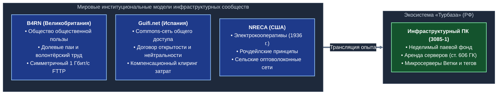
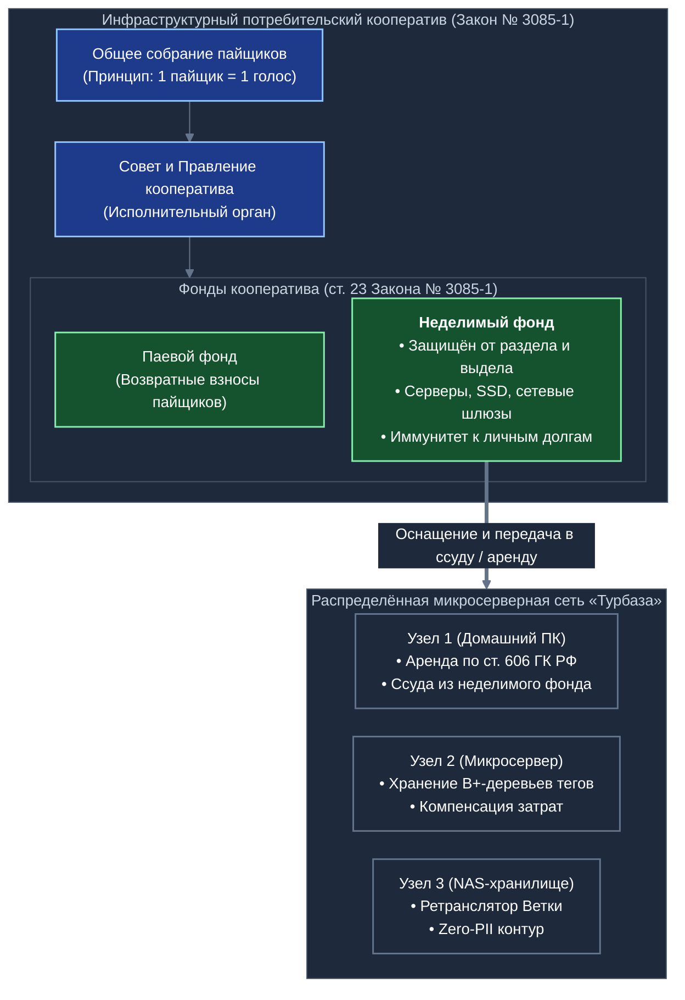
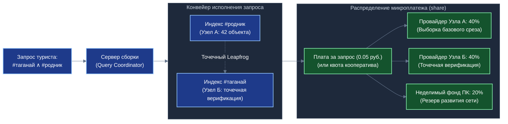
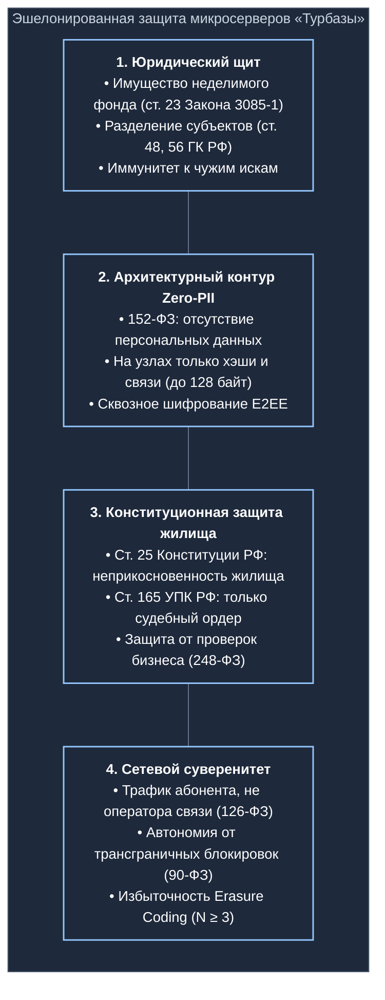

# Исследование организационно-правовых форм, экономической модели и механизмов защиты распределённой микросерверной инфраструктуры экосистемы «Турбаза» для Белой книги № 12

---

## Введение и предметная постановка

Архитектура экосистемы «Турбаза» реализует трёхуровневую распределённую топологию:
$$\text{Лист (Leaf)} \;\longrightarrow\; \text{Ветка (Branch)} \;\longrightarrow\; \text{Ствол (Trunk)}$$

Ключевым звеном промежуточного уровня (Ветка) и прикладных сервисов (включая автономный семейный навигатор «УраТур», сеть взаимной помощи «Забота», систему коллективных волеизъявлений «КубГолос» и интеллектуальный органайзер «Деловой») выступает распределённая микросерверная сеть. Данная сеть состоит из:
1. **Серверов общественных тегов («УраТур»):** специализированных узлов, поддерживающих сбалансированные хронологические $B^+$-деревья записей связей (минимальных дескрипторов туристических объектов, троп, стоянок, родников и достопримечательностей размером до 128 байт);
2. **Узлов ретрансляции уровня Ветка (Branch Relay Nodes):** легковесных серверов обмена и синхронизации локальных журналов изменений между клиентскими устройствами (Листьями);
3. **Локальных индексных хранилищ:** географически и тематически шардированных узлов, обеспечивающих оперативный поиск без концентрации трафика в магистральных центрах обработки данных (ЦОД).

Развёртывание указанной инфраструктуры опирается на физические вычислительные узлы (персональные компьютеры, микросерверы, сетевые накопители NAS), размещаемые непосредственно у участников экосистемы — рядовых граждан, энтузиастов и профильных сообществ. Настоящее исследование посвящено формированию институциональной, правовой, экономической и технологической модели функционирования таких провайдеров в юрисдикции Российской Федерации с учётом передового мирового опыта коммунальных сетей.

---

## 1. Правовая модель участия граждан (физических лиц) без статуса ИП

### 1.1. Аренда вычислительного оборудования гражданина (ст. 606 ГК РФ)

Базовой правовой конструкцией привлечения вычислительных мощностей граждан, не имеющих статуса индивидуального предпринимателя (ИП), выступает договор аренды движимого имущества.

#### Предмет и квалификация договора
В соответствии со **ст. 606 Гражданского кодекса РФ (ГК РФ)** по договору аренды (имущественного найма) арендодатель обязуется предоставить арендатору имущество за плату во временное владение и пользование или во временное пользование.
- **Объект аренды:** индивидуально-определённая непотребляемая вещь (**п. 1 ст. 607 ГК РФ**). В договоре фиксируются точные идентификационные параметры вычислительного комплекса:
  - серийные номера материнской платы, центрального процессора и шасси;
  - уникальные заводские номера постоянных накопителей (NVMe SSD / HDD);
  - аппаратные физические адреса сетевых адаптеров (MAC-адреса);
  - состав установленной оперативной памяти и блока питания.
- **Сохранение титула собственности:** право собственности на физический микросервер в полном объёме остаётся за гражданином (арендодателем). Оператор инфраструктуры или потребительский кооператив (арендатор) приобретает исключительно титул законного владения и целевого пользования вычислительными ресурсами.
- **Форма сделки:** согласно **п. 1 ст. 609 ГК РФ**, договор аренды, в котором хотя бы одной из сторон выступает юридическое лицо (кооператив или оператор платформы), заключается в простой письменной форме (в том числе в форме электронного документа, подписанного простой или усиленной электронной подписью в соответствии с Федеральным законом от 06.04.2011 № 63-ФЗ «Об электронной подписи»).

#### Разграничение с договором возмездного оказания услуг (ст. 779 ГК РФ)
Принципиальное юридическое значение имеет чёткое отграничение договора аренды оборудования от договора возмездного оказания услуг (ст. 779 ГК РФ):
- При аренде предметом выступает предоставление самого физического имущества во владение и пользование; арендатор самостоятельно эксплуатирует вычислительное устройство посредством автоматизированного программного обеспечения ноды «Турбазы».
- Гражданин **не принимает на себя обязательств** по личному круглосуточному системному администрированию, диспетчеризации запросов или оказанию телематических услуг. Принятие подобных личных обязательств повлекло бы переквалификацию отношений в договор возмездного оказания услуг или трудовой договор с возникновением обязанности по уплате полного пакета страховых взносов и риском признания деятельности незаконным предпринимательством (**ст. 171 УК РФ**, **ст. 14.1 КоАП РФ**).

---

### 1.2. Кооператив/оператор как налоговый агент: НДФЛ и освобождение от страховых взносов

#### Обязанности налогового агента по НДФЛ
В силу **п. 1 и п. 2 ст. 226 Налогового кодекса РФ (НК РФ)** российские организации (включая потребительские кооперативы), выплачивающие доходы физическим лицам, признаются налоговыми агентами.
- Доход гражданина от сдачи в аренду имущества, находящегося на территории Российской Федерации, относится к доходам от источников в РФ (**подп. 4 п. 1 ст. 208 НК РФ**).
- Кооператив/оператор обязан исчислить, удержать непосредственно из суммы арендной платы и перечислить в бюджет сумму налога на доходы физических лиц (НДФЛ).
- Начиная с 1 января 2025 года (в редакции Федерального закона от 12.07.2024 № 176-ФЗ) применяется дифференцированная шкала ставок НДФЛ (**ст. 224 НК РФ**):
  - **13%** — для годового дохода до 2,4 млн рублей включительно;
  - **15%** — для части дохода, превышающей 2,4 млн рублей и составляющей до 5 млн рублей;
  - повышенные ставки (18%, 20%, 22%) для последующих порогов дохода.
  Для подавляющего большинства провайдеров микросерверов фактическая ставка составляет базовые 13%.
- Гражданин полностью освобождён от необходимости подавать налоговую декларацию 3-НДФЛ по данным доходам, поскольку обязанность по расчёту и уплате исполнена налоговым агентом (**п. 2 ст. 226**, **ст. 229 НК РФ**).

#### Неначисление страховых взносов (п. 4 ст. 420 НК РФ)
Ключевым финансово-экономическим преимуществом конструкции аренды выступает прямое освобождение от уплаты страховых взносов на обязательное пенсионное, медицинское и социальное страхование (совокупный базовый тариф 30% в пределах единой предельной величины базы):
- В соответствии с **пунктом 4 статьи 420 Налогового кодекса РФ**:
  > *«Не признаются объектом обложения страховыми взносами выплаты и иные вознаграждения в рамках гражданско-правовых договоров, предметом которых является переход права собственности или иных вещных прав на имущество (имущественные права), и договоров, связанных с передачей в пользование имущества (имущественных прав)...»*
- Данная правовая норма носит императивный характер и последовательно подтверждается разъяснениями Министерства финансов РФ (письма Минфина России от 18.06.2018 № 03-15-07/41602, от 01.11.2017 № 03-15-06/71986, от 12.10.2020 № 03-15-06/88914, от 21.09.2020 № 03-15-06/82431).
- Экономический эффект: затраты кооператива на оплату аренды мощности не несут накладной фискальной нагрузки в 30%, что делает модель распределённой аренды высококонкурентной по сравнению с классическим корпоративным наймом или договорами подряда.

---

### 1.3. Механизм самозанятости (Налог на профессиональный доход, 422-ФЗ)

При наличии у гражданина статуса плательщика налога на профессиональный доход (НПД) в соответствии с Федеральным законом от 27.11.2018 № 422-ФЗ «О проведении эксперимента по установлению специального налогового режима "Налог на профессиональный доход"» открывается альтернативный сценарий взаимодействия.

#### Правовая допустимость сдачи движимого имущества в аренду самозанятым
- **Пункт 3 части 2 статьи 6 Закона № 422-ФЗ** устанавливает исключение: объектом налогообложения НПД не признаются доходы от передачи имущественных прав на *недвижимое имущество* (за исключением жилых помещений).
- Применяя метод логического толкования *a contrario* (от противного), ограничений на передачу в пользование *движимого имущества* закон не содержит.
- Данная позиция официально закреплена финансовым и налоговым регуляторами: доходы физических лиц, применяющих режим НПД, от сдачи в аренду движимого имущества (включая серверное, телекоммуникационное и вычислительное оборудование) признаются объектом налогообложения налогом на профессиональный доход (письма Минфина России от 17.02.2020 № 03-11-11/10799, от 27.12.2019 № 03-11-11/102607, от 13.01.2020 № 03-11-11/523; письмо ФНС России от 28.12.2021 № СД-4-3/18371@).

#### Преимущества применения НПД:
1. **Сниженная налоговая ставка:** в силу **ст. 10 Закона № 422-ФЗ** ставка составляет **6%** при получении доходов от юридических лиц (кооператива или оператора) вместо стандартных 13% НДФЛ.
2. **Освобождение юридического лица от функций налогового агента:** согласно **ч. 8 ст. 15 Закона № 422-ФЗ**, при наличии чека из мобильного приложения «Мой налог» организация освобождается от обязанности исчислять и удерживать НДФЛ.
3. **Отсутствие страховых взносов:** самозанятые граждане освобождены от обязательных страховых взносов в Социальный фонд России (**ч. 11 ст. 15 Закона № 422-ФЗ**).

#### Ограничения и регуляторные риски режима НПД:
1. **Предельный лимит дохода:** не более 2,4 млн рублей в течение календарного года (**п. 8 ч. 2 ст. 4 Закона № 422-ФЗ**). В случае превышения лимита гражданин автоматически теряет право на применение спецрежима, и с суммы превышения кооператив обязан удержать НДФЛ 13%/15%.
2. **Запрет на перепродажу имущественных прав:** в силу **п. 2 ч. 2 ст. 4 Закона № 422-ФЗ** не вправе применять НПД лица, осуществляющие перепродажу товаров или имущественных прав. Следовательно, сдаваемое оборудование должно принадлежать гражданину на праве собственности; субаренда чужого оборудования подпадает под запрет.
3. **Запрет на работу с бывшим работодателем:** по **п. 8 ч. 2 ст. 6 Закона № 422-ФЗ** не признаются объектом обложения НПД доходы, если заказчиком выступает текущий работодатель гражданина либо организация, у которой гражданин работал менее двух лет назад.
4. **Риск переквалификации в услуги связи:** если договор будет ошибочно составлен не как аренда аппаратного ресурса, а как комплекс телематических услуг, возникнут коллизии с законодательством о связи (Федеральный закон № 126-ФЗ), требующим наличия лицензии для оказания возмездных услуг связи неограниченному кругу лиц.

| Параметр сравнения | Физическое лицо без спецстатуса | Плательщик НПД (Самозанятый) | Индивидуальный предприниматель (УСН «Доходы») |
| :--- | :--- | :--- | :--- |
| **Основание** | Ст. 606 ГК РФ | Ст. 606 ГК РФ + 422-ФЗ | Ст. 606 ГК РФ + гл. 26.2 НК РФ |
| **Ставка налога** | 13% (15% свыше 2,4 млн руб.) | 6% (при расчётах с юрлицом) | 6% (до 1% в льготных регионах) |
| **Страховые взносы** | 0% (п. 4 ст. 420 НК РФ) | 0% (ч. 11 ст. 15 422-ФЗ) | Фиксированные взносы (~53,6 тыс. руб./год в 2025 г.) |
| **Налоговый агент** | Кооператив / Оператор | Отсутствует (гражданин платит сам) | Отсутствует (ИП платит сам) |
| **Предел дохода** | Не ограничен | 2,4 млн руб./год | 450 млн руб./год (с 2025 г.) |
| **Риск работодателя** | Минимален при чистой аренде | Запрет на работу с экс-работодателем (< 2 лет) | Отсутствует |

---

## 2. Мировой опыт коммунальных сетей и инфраструктурных кооперативов

Анализ международной практики демонстрирует высокую устойчивость моделей совместного владения критической связной и вычислительной инфраструктурой на принципах потребительской и общественной кооперации (Commons-based peer production).

### 2.1. B4RN (Broadband for the Rural North, Великобритания)

#### Организационно-правовая форма
B4RN зарегистрирован в 2011 году как **Community Benefit Society (BenCom)** в соответствии с британским Законом о кооперативах и обществах общественной пользы (Co-operative and Community Benefit Societies Act 2014). В отличие от коммерческих обществ, общество общественной пользы обязано вести деятельность исключительно в интересах локального сообщества, а его активы защищены блокировкой отчуждения (Asset Lock).

#### Механизм мобилизации ресурсов
- **Долевые паи сообщества (Community Shares):** сельские жители приобретали непередаваемые паи общества (минимальный порог инвестиций составлял 250–1500 фунтов стерлингов), получая право на скромный дивидендный доход (не более уровня инфляции), но без права спекулятивной перепродажи паёв.
- **Инфраструктурное донорство земли (Wayleaves):** ключевым препятствием для традиционных операторов (BT/Openreach) являлась колоссальная стоимость выкупа сервитутов на прокладку оптоволокна через частные сельскохозяйственные угодья. Фермеры — члены B4RN предоставили обществу **бессрочные безвозмездные сервитуты**, сняв 80% финансового бремени прокладки магистралей.
- **Волонтёрский физический труд (Sweat Equity):** прокладка защитных труб, земляные работы и копка траншей осуществлялись самими жителями и фермерами с использованием собственной сельскохозяйственной техники.
- **Результат:** B4RN построил независимую волоконно-оптическую сеть со скоростью 1 Гбит/с (симметричной) в сложнейших горных и сельских районах Ланкашира, Камбрии и Йоркшира при совокупной себестоимости подключения в 3–5 раз ниже коммерческих аналогов.

---

### 2.2. Guifi.net (Каталония, Испания)

#### Модель Сети общего доступа (Commons-Based Telecommunications Network)
Созданная в 2004 году в регионе Осона сеть Guifi.net насчитывает более 37 000 действующих узлов и признана крупнейшей в мире пиринговой телекоммуникационной сетью общего доступа. Юридическим координатором выступает некоммерческий фонд **Fundación Guifi.net**.

#### Принципы нейтральности и открытости (Network Commons Compact)
В основу Guifi.net положен четырёхпунктный публичный договор:
1. **Свобода подключения (Freedom to connect):** каждый гражданин или организация вправе подключиться к инфраструктуре без дискриминации.
2. **Свобода транзита и нейтральность (Freedom to route):** любой узел обязан пропускать транзитный трафик других участников без фильтрации по типу сервиса или содержимого.
3. **Открытость технических данных (Open knowledge):** топология сети, схемы маршрутизации и протоколы являются публично доступными.
4. **Сохранение общего достояния (Share-alike / Commons continuity):** любые улучшения инфраструктуры, выполненные за счёт общих ресурсов, автоматически становятся частью общего достояния.

#### Механизм компенсационного клиринга затрат (Cost-Clearing Model)
Guifi.net гармонично соединяет волонтёрские узлы граждан с коммерческими операторами связи (ISP):
- Коммерческие операторы вправе использовать общую инфраструктуру Guifi.net для предоставления гражданам платного высокоскоростного интернета.
- Однако операторы обязаны участвовать в системе **компенсационного клиринга затрат**: специализированный алгоритмический расчёт сопоставляет объём потребляемого оператором транзитного трафика с его инвестициями в магистральные узлы (Backbone). Операторы с дефицитом инвестиций выплачивают компенсационные взносы в фонд, из которого средства направляются на субсидирование и закупку оборудования для волонтёрских узлов.
- В 2015 году европейский регулятор признал Guifi.net эталоном децентрализованного развития инфраструктуры (премия European Broadband Award).

---

### 2.3. NRECA (National Rural Electric Cooperative Association, США)

#### Исторический генезис
До середины 1930-х годов свыше 90% сельских домохозяйств США не имели электричества: частные монополии отказывались электрифицировать фермы из-за низкой плотности населения и долгой окупаемости.
- В 1936 году президентом Франклином Рузвельтом был подписан Закон о сельской электрификации (**Rural Electrification Act, REA**), предоставивший льготные кредиты объединениям граждан.
- Фермеры массово организовали потребительские кооперативы. В 1942 году была создана национальная ассоциация **NRECA**, объединившая электрокооперативы по всей стране.

#### Принципы Рочдейла и «Возврат капитала» (Capital Credits)
Кооперативы NRECA функционируют на фундаментальных принципах кооперации:
- **Демократический контроль:** каждый член имеет строго один голос независимо от объёма потребления электроэнергии.
- **Некоммерческий статус:** кооператив работает по принципу «себестоимость плюс резерв». По итогам финансового года чистые накопления, превышающие резерв на амортизацию и развитие сетей, зачисляются на персональные счета членов кооператива в форме **«кредитов капитала» (Capital Credits)** и по мере стабилизации финансов выплачиваются пайщикам живыми средствами.

#### Современная трансформация: Сельские оптоволоконные кооперативы (Rural Fiber)
В последние годы кооперативы NRECA стали лидерами преодоления «цифрового неравенства»: используя существующую инфраструктуру опор ЛЭП, трансформаторных подстанций и сервитутов, более 250 потребительских кооперативов США создали дочерние оптоволоконные сети, обеспечив высокоскоростной связью миллионы сельских жителей там, где коммерческие телеком-гиганты оказались неэффективны.

---

## 3. Организационно-правовые формы коллективного владения инфраструктурой в Российской Федерации

Российское законодательство предоставляет глубокую и детально проработанную правовую платформу для построения распределённой микросерверной инфраструктуры.

### 3.1. Инфраструктурный потребительский кооператив (Закон РФ № 3085-1)

Оптимальной базовой организационно-правовой формой для объединения провайдеров вычислительных мощностей выступает **Потребительский кооператив (потребительское общество)**, создаваемый в соответствии с:
- **Гражданским кодексом РФ (ст. 50, ст. 123.2 ГК РФ)** — потребительский кооператив является некоммерческой корпоративной организацией;
- **Законом РФ от 19.06.1992 № 3085-1** «О потребительской кооперации (потребительских обществах, их союзах) в Российской Федерации».

#### Ключевые правовые характеристики:
1. **Цель создания:** удовлетворение материальных и иных потребностей членов кооператива (пайщиков) путём объединения имущественных паевых взносов (**ст. 1 Закона № 3085-1**). В контексте платформы «Турбаза» уставной целью выступает удовлетворение потребностей пайщиков в надёжном, независимом, суверенном доступе к каталогам открытых данных, навигационным индексам («УраТур») и защищённому информационному обмену.
2. **Демократический принцип управления:** в силу **п. 2 ст. 18 Закона № 3085-1** каждый пайщик имеет строго один голос при принятии решений на общем собрании потребительского общества независимо от размера внесённого паевого взноса. Это исключает риск олигархического захвата инфраструктуры сторонними инвесторами.
3. **Некоммерческий внутрикооперативный оборот:** передача вычислительных мощностей пайщиками в пользу своего кооператива и получение взамен доступа к распределённым сервисам, индексам и компенсациям не признаётся коммерческой реализацией товаров/работ/услуг в смысле **ст. 39 НК РФ** и не облагается налогом на добавленную стоимость (**подп. 1 п. 2 ст. 146 НК РФ**).

---

### 3.2. Специализированный обслуживающий кооператив

В качестве родственной правовой модели может выступать **обслуживающий потребительский кооператив** (создаваемый по аналогии с положениями Федерального закона от 08.12.1995 № 193-ФЗ «О сельскохозяйственной кооперации» или ст. 123.2 ГК РФ):
- Специализированный обслуживающий кооператив создаётся для оказания сопутствующих услуг своим членам: технического регламентного обслуживания вычислительных машин, ремонта накопителей, настройки системного окружения, предоставления криптографических шлюзов и балансировки сетевых потоков.
- Кооператив выступает централизованным представителем сообщества во взаимоотношениях с магистральными провайдерами связи, поставщиками электроэнергии и надзорными органами.

---

### 3.3. Формирование неделимого паевого фонда (ст. 23 Закона РФ № 3085-1)

Институт неделимого фонда потребительского общества представляет собой мощнейший юридический инструмент обеспечения долговременной сохранности и целостности распределённой инфраструктуры.

#### Правовой статус неделимого фонда
В силу **статьи 23 Закона РФ № 3085-1**:
- Потребительское общество вправе решением общего собрания формировать **неделимый фонд**.
- Имущество, составляющее неделимый фонд, **не подлежит разделу на доли (паи)** между пайщиками общества.
- В неделимый фонд могут направляться паевые взносы пайщиков, доходы от разрешённой приносящей доход деятельности кооператива, а также грантовые и целевые средства.
- **Иммунитет при выходе пайщика:** при прекращении членства в кооперативе пайщик имеет право исключительно на возврат своего паевого взноса (**ст. 14 Закона № 3085-1**), но не имеет права требовать выдела доли из неделимого фонда или натурального изъятия объектов инфраструктуры.
- **Иммунитет при ликвидации:** в случае ликвидации потребительского общества имущество неделимого фонда передаётся другому потребительскому обществу (союзу) в соответствии с уставом или решением ликвидационной комиссии и не распределяется между пайщиками.

#### Применение неделимого фонда для закупки микросерверного оборудования:
1. **Централизованная оптовая закупка:** кооператив за счёт средств неделимого фонда осуществляет оптовые закупки стандартизированных аппаратных компонентов промышленного класса:
   - высоконадёжных твердотельных накопителей Enterprise NVMe SSD с высоким ресурсом перезаписи (DWPD $\ge 1.0$–$3.0$);
   - компактных энергоэффективных системных блоков и одноплатных микросерверов;
   - источников бесперебойного питания (ИБП) с защитой от скачков напряжения;
   - управляемых сетевых коммутаторов и маршрутизаторов.
2. **Передача оборудования пайщикам:** закупленное оборудование остаётся собственностью неделимого фонда кооператива и передаётся проверенным пайщикам на ответственное хранение и в целевую эксплуатацию по договору безвозмездного пользования (ссуды по **ст. 689 ГК РФ**) либо договору целевой инфраструктурной аренды.
3. **Защита от фрагментации:** ни персональное банкротство отдельного гражданина, ни его выход из кооператива, ни имущественные споры третьих лиц с гражданином не могут повлечь арест или изъятие серверного узла, поскольку титул собственности принадлежит неделимому фонду некоммерческой организации.

---

## 4. Экономическая модель, тарификация и балансировка нагрузки

Функционирование распределённой сети узлов требует строгой экономической модели, гарантирующей покрытие расходов провайдеров и предотвращающей появление «безбилетников» (Free-riding) и фиктивных узлов (Sybil attack).

### 4.1. Механика компенсации эксплуатационных расходов провайдеров

Физические эксплуатационные затраты провайдера микросервера раскладываются на три составляющие:
1. **Затраты на электроэнергию ($C_{\text{power}}$):** непрерывное энергопотребление современного энергоэффективного микросервера или неттопа составляет от $25$ до $65$ Вт. При круглосуточной работе месячное потребление составляет:
   $$E_{\text{month}} = \frac{P_{\text{watt}} \times 24 \times 30.5}{1000} \approx 18.3 \dots 47.6 \text{ кВт}\cdot\text{ч}$$
   При среднем тарифе 3.50–5.50 руб./кВт$\cdot$ч прямые затраты на электричество составляют **80–260 рублей в месяц**.
2. **Затраты на канал связи ($C_{\text{net}}$):** узел использует существующее широкополосное домашнее подключение. Дополнительные издержки провайдера складываются из аренды статического «белого» IPv4/IPv6-адреса у оператора связи (около **100–200 рублей в месяц**).
3. **Амортизационный износ накопителей ($C_{\text{wear}}$):** постоянные операции записи при перестроении $B^+$-деревьев и уплотнении (compaction) структур расходуют ресурс ячеек памяти флеш-накопителей (Total Bytes Written, TBW). Для накопителя объёмом 1 ТБ с ресурсом 600 TBW и стоимостью 9 000 руб. удельная амортизация на 1 ТБ записанных данных составляет:
   $$\text{WearCost} = \frac{9000 \text{ руб.}}{600 \text{ TB}} = 15 \text{ руб./ТБ}$$
   При интенсивной записи 50 ГБ/сутки износ составляет порядка **25–30 рублей в месяц**.

#### Совокупная формула базовой компенсации:
$$C_{\text{base}} = \left( E_{\text{month}} \times T_{\text{power}} \right) + C_{\text{ip}} + \left( \frac{W_{\text{actual}}}{TBW_{\text{rated}}} \times Cost_{\text{ssd}} \right) + R_{\text{maint}}$$
где $R_{\text{maint}}$ — нормативный резерв на регламентную замену вентиляторов и термопасты.

Итоговая себестоимость поддержания стабильного узла составляет **250–550 рублей в месяц**. Возмещение указанных затрат осуществляется кооперативом либо в форме фиксированной части арендной платы, либо как целевое возмещение документально подтверждённых расходов пайщика (**ст. 10 Закона № 3085-1**).

---

### 4.2. Модель микроплатежей за обработку запросов к общественным тегам и индексам

Для обеспечения экономической самодостаточности сети вводится двухуровневая модель тарификации поисковых и ретрансляционных операций.

#### Двухуровневая модель:
1. **Базовый социальный уровень (Бесплатный для граждан):**
   - Простые запросы граждан в навигаторе «УраТур» (до 100 запросов в сутки на одно зарегистрированное устройство) обслуживаются **без взимания платы**.
   - Расходы провайдеров на социальный трафик компенсируются из централизованного компенсационного фонда кооператива, формируемого за счёт членских взносов, добровольных пожертвований и целевых программ развития туризма.
2. **Коммерческий уровень (Сверхлимитные и B2B-запросы):**
   - Запросы туристических агентств, гостиничных сетей, транспортных агрегаторов и коммерческих приложений тарифицируются микроплатежами (от $0.01$ до $0.10$ рубля за комплексный составной запрос).
   - Расщепление поступившего микроплатежа осуществляется автоматически детерминированным смарт-контрактом экосистемы через вызов `share(...)` (согласно Белой книге № 06):
     - **80%** суммы распределяется пропорционально вычислительному вкладу между узлами, чьи хронологические деревья участвовали в многотеговом соединении (Leapfrog Triejoin);
     - **20%** зачисляется в неделимый фонд кооператива для субсидирования базового уровня и закупки оборудования.

---

### 4.3. Балансировка нагрузки и защита от недобросовестных провайдеров

В открытой распределённой среде неизбежно возникают риски недобросовестного поведения:
- попытки узлов рапортовать о хранении индекса без реального выделения дискового пространства;
- возврат устаревших или случайных данных для снижения нагрузки на процессор;
- создание фиктивных виртуальных узлов для накрутки арендных выплат (Sybil attack).

Для нейтрализации указанных рисков применяются четыре взаимосвязанных механизма:

#### 1. Криптографическое доказательство хранения (Proof of Storage / Merkle Proofs)
Индексный узел формирует для каждого поддерживаемого тега дерево Меркла (Merkle Tree), где листьями являются хэши дескрипторов связей. Корень дерева ($R_{\text{merkle}}$) детерминированно публикуется в заголовке эпохи.
- Координатор сети периодически отправляет узлу случайные зондирующие запросы (Challenges) с требованием предоставить путь доказательства (Merkle Audit Path) для конкретного диапазона временных меток.
- Подделать доказательство невозможно без физического наличия всего массива индексов. Непредоставление ответа за нормативное время ($< 250$ мс) влечёт фиксацию сбоя.

#### 2. Динамический учёт качества обслуживания (SLA-метрики)
Каждый узел непрерывно оценивается по матрице объективных параметров:
$$\text{Score}_{\text{node}} = w_1 \times \text{Uptime} + w_2 \times \frac{1}{\overline{\text{RTT}}} + w_3 \times (1 - \text{PacketLoss}) - w_4 \times \text{ErrRate}$$
- Узлы с высоким временем кругового обращения (RTT) или частыми сбоями автоматически понижаются в таблицах маршрутизации и переводятся из категории основных серверов в резервные зеркала (Cold Standby).

#### 3. Алгоритм распределения нагрузки (Power of Two Random Choices)
Для исключения эффекта концентрации запросов на узлах с минимальным пингом координаторы применяют метод выбора наименее загруженного из двух случайных кандидатов (Power of Two Random Choices): из пула доступных реплик выбираются два случайных узла и опрашивается тот, у которого текущая очередь задач минимальна. Это обеспечивает математически доказанную равномерность нагрузки ($O(\ln \ln N)$) без централизованного балансировщика.

#### 4. Репутационный залог и социальное поручительство («Забота»)
Для получения статуса квалифицированного индексного провайдера узел обязан предоставить гарантийный паевой депозит (в неделимый фонд или возвратный фонд обеспечения) либо обладать подтверждённым социальным рейтингом доверия в приложении «Забота». Выявление злонамеренной фальсификации данных влечёт немедленное аннулирование репутации, отключение узла от сети и удержание депозита в пользу фонда компенсации пострадавших участников.

---

## 5. Защита суверенитета и устойчивости узлов

Распределённая инфраструктура должна обладать абсолютной правовой и физической неуязвимостью к внешним регуляторным, коммерческим и силовым воздействиям.

### 5.1. Юридическое обособление физических узлов от внешних корпоративных исков

Критическим фактором устойчивости децентрализованной сети выступает строгое разделение субъектов правоотношений (**ст. 48, 56 ГК РФ**):
1. **Иммунитет оборудования неделимого фонда:** в соответствии с **п. 2 ст. 56 ГК РФ** и **ст. 25 Закона № 3085-1** потребительское общество не отвечает по обязательствам своих членов (пайщиков), а пайщики не отвечают по обязательствам кооператива (за исключением ограниченной субсидиарной ответственности в пределах невнесённой части дополнительного взноса). Личные кредиторы гражданина, на территории которого физически находится сервер, не имеют права обращать взыскание на имущество кооператива (**ст. 237 ГК РФ** исключает взыскание по долгам гражданина на имущество третьих лиц).
2. **Иммунитет гражданина-арендодателя:** если оборудование принадлежит гражданину и сдано в аренду кооперативу, любые имущественные или договорные претензии третьих лиц к операторам прикладных сервисов («УраТур», «КубГолос») не могут быть обращены на физическое имущество гражданина-арендодателя.
3. **Архитектурный контур минимизации данных (Zero-PII и 152-ФЗ):**
   - На узлах ретрансляции Ветка и серверах общественных тегов **физически отсутствуют персональные данные**.
   - Дескрипторы тегов содержат исключительно обезличенные метаданные: неизменяемый идентификатор репозитория (`RepositoryGlobalId`), координатную рамку (`GeoBoundingBox`), контрольную сумму (`ContentChecksum`) и временные метки.
   - В соответствии с Федеральным законом от 27.07.2006 № 152-ФЗ «О персональных данных» указанные криптографические идентификаторы без сопоставительных таблиц и персональных ключей дешифрования субъекта не позволяют идентифицировать конкретное физическое лицо и не являются персональными данными.
   - Следовательно, к провайдеру микросервера невозможно предъявить правовые претензии касательно неправомерного сбора, хранения или утечки конфиденциальной персональной информации.

---

### 5.2. Защита оборудования от необоснованного изъятия и территориальная распределённость

#### Конституционные гарантии неприкосновенности жилища
Размещение микросерверных узлов в жилых помещениях участников кооператива формирует высший уровень правовой защиты:
- В силу **статьи 25 Конституции РФ**:
  > *«Жилище неприкосновенно. Никто не вправе проникать в жилище против воли проживающих в нем лиц иначе как в случаях, установленных федеральным законом, или на основании судебного решения».*
- В отличие от коммерческих серверных стоек в публичных дата-центрах (ЦОД), доступ к которым контролирующие и правоохранительные органы могут получить в рамках административных проверок или гласных оперативно-розыскных мероприятий (ОРМ) без предварительного судебного акта, проникновение в жилое помещение гражданина допускается **исключительно на основании решения суда** (**ст. 165 Уголовно-процессуального кодекса РФ, УПК РФ**).
- На жилые помещения граждан **не распространяется действие Федерального закона от 31.07.2020 № 248-ФЗ** «О государственном контроле (надзоре) и муниципальном контроле в Российской Федерации», регулирующего внеплановые выездные проверки бизнеса.

#### Географическая избыточность и математическая неуязвимость
- Архитектура «Турбазы» исключает наличие единой точки отказа (Single Point of Failure). Данные каждого общественного тега и индекса реплицируются минимум на $N \ge 3$ независимых узла в различных субъектах РФ с применением помехоустойчивого кодирования (Erasure Coding).
- Внезапное отключение, авария электросети или физическое изъятие отдельного узла не приводит к утрате информации или деградации поискового конвейера: клиентские приложения автоматически перенаправляют запросы на альтернативные узлы консенсусного кластера.

---

### 5.3. Взаимодействие с региональными операторами связи и требованиями регулятора

Функционирование домашних микросерверов полностью вписывается в действующее законодательство о связи и суверенном интернете:

#### 1. Соответствие Федеральному закону «О связи» (№ 126-ФЗ)
- Физическое лицо заключает со своим региональным интернет-провайдером (ПАО «Ростелеком», АО «ЭР-Телеком», ПАО «МТС» и др.) типовой абонентский договор об оказании телематических услуг связи для личных бытовых нужд.
- Гражданин **не является оператором связи** и не оказывает возмездных услуг связи третьим лицам. Он потребляет услугу доступа в сеть интернет как конечный абонент.
- Сетевой трафик микросервера (протоколы HTTPS, WebSockets, gRPC, QUIC) является стандартным пользовательским входящим и исходящим трафиком абонента. Законодательство РФ не содержит запретов на входящий P2P-трафик для абонентов физических лиц при соблюдении условий договора об объёме потребления полосы пропускания.

#### 2. Разграничение со статусом Организатора распространения информации (ОРИ, 149-ФЗ)
- **Статья 10.1 Федерального закона от 27.07.2006 № 149-ФЗ** возлагает обязанности по включению в реестр ОРИ, хранению метаданных и предоставлению ключей для декодирования сообщений органам безопасности (требования пакета законов Яровой и СОРМ) на лиц, осуществляющих деятельность по обеспечению функционирования информационных систем и (или) программ для ЭВМ, которые предназначены и (или) используются для приёма, передачи, доставки и (или) обработки электронных сообщений пользователей.
- **Инфраструктурный провайдер микросервера не является ОРИ:**
  - он не ведёт реестра учётных записей пользователей;
  - он не обрабатывает и не доставляет личные сообщения граждан;
  - он обслуживает исключительно открытые математические деревья связей общественных туристических меток или слепые P2P-потоки зашифрованных изменений.
  - В случае необходимости юридического диалога с Минцифры РФ и Роскомнадзором единым уполномоченным субъектом выступает Потребительский кооператив, что полностью освобождает отдельных граждан от бюрократического взаимодействия с регулятором.

#### 3. Устойчивость в суверенном контуре Рунета (№ 90-ФЗ)
- В рамках исполнения требований Федерального закона от 01.05.2019 № 90-ФЗ («О суверенном Рунете») распределённая сеть «Турбазы» изначально спроектирована автономной от трансграничной маршрутизации:
  - взаимодействие между узлами опирается на национальную систему доменных имён (НСДИ) и локальные точки обмена трафиком (IX);
  - в случае отключения магистральных зарубежных каналов региональные кластеры серверов тегов и ретрансляторов сохраняют 100% связность и работоспособность внутри автономных систем РФ;
  - локальные данные на Листьях (устройствах туристов) функционируют в режиме полной автономности (offline-first).

---

## 6. Сводная институционально-правовая матрица моделей провайдеров

| Критерий анализа | Модель 1: Физическое лицо (Аренда по ст. 606 ГК) | Модель 2: Самозанятый гражданин (НПД, 422-ФЗ) | Модель 3: Пайщик Инфраструктурного ПК (3085-1) | Модель 4: Коммерческий ЦОД / Хостинг-провайдер |
| :--- | :--- | :--- | :--- | :--- |
| **Организационно-правовая база** | Договор аренды движимого имущества | Договор аренды движимого имущества с самозанятым | Устав потребительского общества, целевая ссуда/аренда | Договор возмездного оказания услуг / IaaS |
| **Фискальная нагрузка** | НДФЛ 13% (удерживает кооператив/оператор) | Налог 6% (уплачивает гражданин) | Некоммерческий оборот (0% НДС, компенсация затрат) | Налог на прибыль 25% + НДС 20% (или УСН) |
| **Страховые взносы (30%)** | 0% (освобождение по п. 4 ст. 420 НК РФ) | 0% (освобождение по ч. 11 ст. 15 422-ФЗ) | 0% (выплаты в рамках уставной деятельности ПК) | Включены в фонд оплаты труда сотрудников ЦОД |
| **Собственность оборудования** | Физическое лицо | Физическое лицо | Неделимый фонд кооператива | Коммерческая организация |
| **Защита от изъятия** | Ст. 25 Конституции РФ (жилище) | Ст. 25 Конституции РФ (жилище) | Ст. 25 Конституции РФ + иммунитет неделимого фонда (ст. 23) | Низкая (коммерческое помещение, проверки 248-ФЗ) |
| **Регуляторные риски связи** | Нулевые (пользовательский трафик) | Нулевые (пользовательский трафик) | Нулевые (централизованный диалог через кооператив) | Высокие (СОРМ, ОРИ, лицензии на телематику) |
| **Операционные затраты (TCO)** | 250–550 руб./мес. | 250–550 руб./мес. | 200–450 руб./мес. (оптовые цены на закупки) | 3 000–12 000 руб./мес. за выделенный сервер/ВМ |
| **Устойчивость к цензуре** | Высокая (территориальная распределённость) | Высокая (территориальная распределённость) | Абсолютная (демократический контроль пайщиков) | Низкая (риск блокировки по требованию органов) |

---

## 7. Выводы и рекомендации для Белой книги № 12

На основе проведённого юридического, экономического и инфраструктурного исследования формулируются следующие фундаментальные выводы и рекомендации для формирования текста Белой книги № 12:

1. **Рекомендуемая базовая организационная модель экосистемы:**
   Создание **Инфраструктурного потребительского кооператива (ИПК)** на основании Закона РФ № 3085-1 «О потребительской кооперации...» с формированием **неделимого паевого фонда** (ст. 23 Закона № 3085-1). Данная модель гарантирует некоммерческий статус взаиморасчётов, исключает корпоративный рейдерский захват («один пайщик — один голос») и обеспечивает имущественный иммунитет ключевого серверного оборудования.
2. **Правовая модель взаимодействия с гражданами-провайдерами:**
   - Для граждан без специального налогового статуса — оформление договора аренды оборудования по **ст. 606 ГК РФ** с выполнением кооперативом функций налогового агента по НДФЛ (13%) и законным неначислением страховых взносов 30% в силу прямого указания **п. 4 ст. 420 НК РФ**.
   - Для граждан, имеющих статус плательщиков налога на профессиональный доход (422-ФЗ), — оформление аренды с уплатой 6% налога при освобождении кооператива от агентских обязанностей.
   - Предмет договора должен строго формулироваться как аренда аппаратных вычислительных мощностей, исключая личные обязательства по администрированию и оказанию телематических услуг во избежание рисков переквалификации.
3. **Экономическая архитектура самоокупаемости:**
   - Внедрение двухкомпонентной тарификации: гарантированная компенсация прямых эксплуатационных расходов ($C_{\text{base}} = 250\dots550$ руб./мес.) за счёт неделимого фонда плюс динамические микроплатежи за обработку запросов через смарт-контракты с детерминированным разделением комиссий (`share(...)`);
   - Защита от фиктивных узлов на основе криптографических доказательств хранения (Merkle Proofs), SLA-метрик отклика и репутационного залога через экосистему «Забота».
4. **Суверенный и регуляторный комплаенс:**
   - Фиксация статуса микросерверов как абонентских устройств конечных пользователей, исключающая необходимость лицензирования в области связи (126-ФЗ);
   - Соблюдение принципа Zero-PII (152-ФЗ) на узлах индексации и ретрансляции, снимающее риски утечки персональных данных и исключающее квалификацию узлов как ОРИ (149-ФЗ);
   - Использование конституционного статуса неприкосновенности жилища (ст. 25 Конституции РФ) и географической распределённости ($N \ge 3$) для гарантии абсолютной физической живучести инфраструктуры цифрового суверенитета экосистемы «Турбаза».

Материалы настоящего отчёта полностью готовы для интеграции в структуру глав и доказательную базу Белой книги № 12.