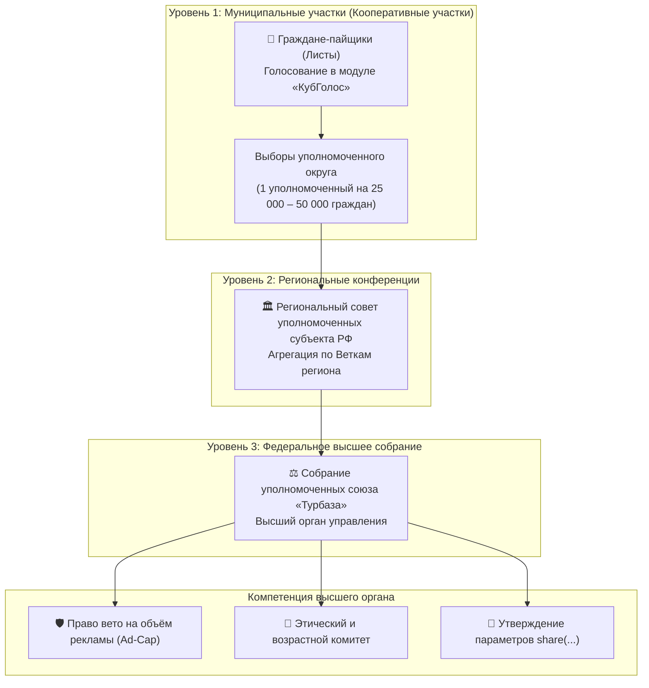
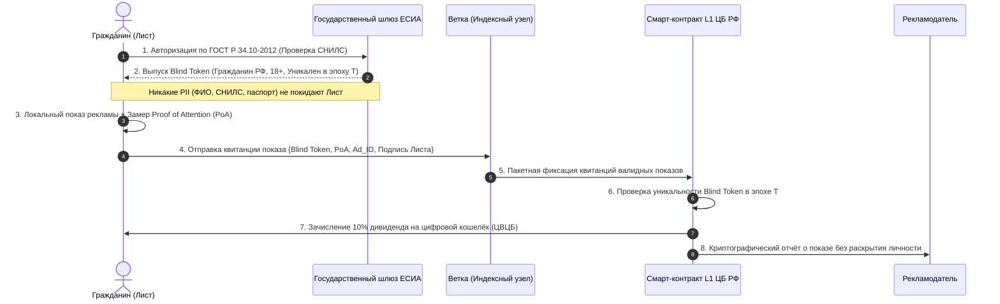
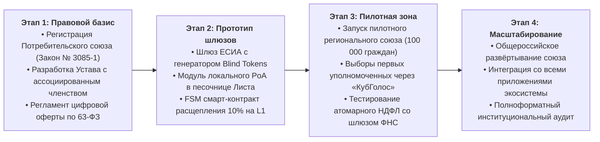

# Аналитический отчёт: Организационно-правовые, экономические и социально-демократические механизмы объединения граждан-потребителей платформы «Турбаза» для Белой книги № 12

---

## 1. Концептуальные основы и экономика внимания: 10% дивидендный поток

Архитектура распределённой платформы «Турбаза» базируется на детерминированном разделении экономических потоков. В соответствии с канонической спецификацией функции распределения выручки:
$$\text{share}(0.1,\ \text{Я},\ 0.9,\ \text{Е})$$
где $10\%$ рекламного бюджета рекламодателя направляется непосредственно гражданину («Я») за подтверждённое внимание и предоставление обезличенного параметрического профиля потребностей, а $90\%$ поступает в дерево программного обеспечения («Е») — разработчикам приложений, авторам библиотек, арендаторам вычислительных мощностей Ветки и площадкам встраивания.

В традиционной модели Web2 цифровые платформы монополизируют доходы от рекламы, безвозмездно извлекая поведенческие данные граждан. Модель платформы «Турбаза» возвращает стоимость внимания первичному субъекту — гражданину. 

Для легитимизации, институционализации и коллективной защиты прав миллионов пользователей в масштабах Российской Федерации требуется создание устойчивой организационно-правовой оболочки — **Потребительского союза платформы «Турбаза»**, способного выступать коллективным представителем граждан перед рекламным рынком, государственными регуляторами и банковской системой.

---

## 2. Организационно-правовые формы в Российской Федерации

### 2.1. Потребительское общество по Закону РФ № 3085-1
Наиболее релевантной организационно-правовой формой в правовом поле Российской Федерации выступает **потребительское общество (потребительский кооператив)**, регулируемое нормами:
- Гражданского кодекса РФ (ст. 123.2, 123.3 ГК РФ);
- Закона РФ от 19.06.1992 № 3085-1 «О потребительской кооперации (потребительских обществах, их союзах) в Российской Федерации».

#### Ключевые преимущества конструкции Закона № 3085-1:
1. **Некоммерческий статус и уставная цель (ст. 1):** удовлетворение материальных и иных потребностей пайщиков. Платформа позиционируется не как коммерческий агрегатор, извлекающий прибыль из граждан, а как кооперативная среда совместного потребления цифровых услуг.
2. **Право на ведение приносящей доход деятельности (п. 4 ст. 50 ГК РФ, ст. 24 Закона № 3085-1):** потребительское общество вправе оказывать возмездные услуги сторонним организациям (включая услуги размещения таргетированной рекламы и предоставления агрегированной аналитики) при условии, что доходы служат целям общества.
3. **Механизм кооперативных выплат (ст. 1, 24):** часть доходов потребительского общества распределяется между пайщиками пропорционально их участию в хозяйственной деятельности либо их паевым взносам.
4. **Неделимый фонд и иммунитет от банкротства по долгам пайщиков:** имущество общества защищено от взыскания по частным обязательствам отдельных членов (ст. 23).

---

### 2.2. Природа кооперативных выплат: патронаж против коммерческого дохода

В кооперативном праве и экономике строго разграничиваются две категории выплат:

```
┌────────────────────────────────────────────────────────────────────────┐
│              ЭКОНОМИКО-ПРАВОВАЯ ПРИРОДА ВЫПЛАТ ПАЙЩИКАМ                │
├───────────────────────────────────┬────────────────────────────────────┤
│ Классический патронажный дивиденд │ Кооперативная выплата от AdTech    │
│ (Patronage Refund)                │ (Модель платформы «Турбаза»)       │
├───────────────────────────────────┼────────────────────────────────────┤
│ Возврат пайщику части его         │ Источник средств — сторонние       │
│ собственных ранее уплаченных      │ рекламодатели, оплачивающие показ  │
│ средств (устранение переплаты за  │ рекламы и внимание пользователя    │
│ приобретённые товары/услуги).     │ через контракт share(0.1, Я...).   │
├───────────────────────────────────┼────────────────────────────────────┤
│ Не образует экономической выгоды  │ Образует экономическую выгоду      │
│ (ст. 41 НК РФ) — возврат          │ (ст. 41 НК РФ) — чистый прирост    │
│ собственных денег.                │ имущественного состояния физлица.  │
├───────────────────────────────────┼────────────────────────────────────┤
│ Не подлежит налогообложению НДФЛ. │ Подлежит налогообложению НДФЛ      │
│                                   │ в установленном законом порядке.   │
└───────────────────────────────────┴────────────────────────────────────┘
```

В модели «Турбазы» $10\%$ рекламного бюджета формируются за счёт внешних поступлений от бизнеса. В связи с этим данные выплаты **не могут быть признаны классическим возвратом потребительских расходов пайщика**, а представляют собой распределение доходов от приносящей доход деятельности общества в пользу пайщиков пропорционально их вовлечённости (объёму подтверждённого внимания).

---

### 2.3. Налоговый статус выплат гражданам: анализ ст. 217 НК РФ и администрирование НДФЛ

1. **Неприменимость ст. 217 НК РФ к денежным выплатам за рекламу:**
   - Статья 217 НК РФ («Доходы, не подлежащие налогообложению») содержит закрытый перечень необлагаемых доходов. В ней **отсутствует норма**, освобождающая от НДФЛ кооперативные выплаты в потребительских обществах по Закону № 3085-1.
   - Пункт 27.1 ст. 217 НК РФ распространяется исключительно на проценты по займам в *кредитных потребительских кооперативах (КПК)* и не применяется к потребительским обществам общего типа.
   - Пункт 68 ст. 217 НК РФ освобождает от налога бонусы и кешбэк по программам лояльности банковских карт при покупках, однако прямо указывает: освобождение не действует, если выплата выступает вознаграждением за оказание услуг, выполнение работ или совершение действий физическим лицом. Просмотр рекламы налоговые органы квалифицируют как совершение действий, приносящих доход.

2. **Статус налогового агента (ст. 226 НК РФ):**
   - При распределении кооперативных выплат в денежной форме физическим лицам потребительское общество признаётся **налоговым агентом**. Общество обязано исчислить, удержать и перечислить в бюджет НДФЛ (13% до 5 млн руб., 15% с превышения по ст. 224 НК РФ).
   - Администрирование миллионов микротранзакций традиционными бухгалтерскими методами парализовало бы организацию. 

3. **Решение: Атомарное расщепление на уровне смарт-контрактов L1 Банка России:**
   - На платформе Цифрового рубля Банка России (см. Белую книгу № 06) налог удерживается программно в момент исполнения смарт-контракта клиринга:
     $$\text{AdPayment} \xrightarrow{\text{FSM}} \begin{cases} 8{,}7\% & \to \text{Кошелёк гражданина (чистая выплата)} \\ 1{,}3\% & \to \text{Единый налоговый счёт ФНС (автоматический НДФЛ)} \\ 90{,}0\% & \to \text{Дерево софта Е (разработчики, Ветки, площадки)} \end{cases}$$
   - Данный подход полностью снимает административную нагрузку с общества: смарт-контракт формирует реестр платежей для ФНС в режиме реального времени.

4. **Альтернативный режим товарного покрытия (внутрикооперативный зачёт):**
   - Если кооперативные выплаты не выводятся в фиатные деньги, а засчитываются в счёт оплаты услуг внутри экосистемы (льготные тарифы ЖКХ, интернет-провайдеры, сервисы МСП, коммунальные платежи через ГИС ЖКХ), выплата трансформируется во встречное предоставление услуг пайщику по себестоимости, оптимизируя налогооблагаемую базу.

---

### 2.4. Механизм ассоциированного членства и безбумажного масштабирования

Участие десятков миллионов граждан требует устранения бюрократических барьеров приёма в члены кооператива:

1. **Электронное заявление и присоединение (ст. 428 ГК РФ, 63-ФЗ):**
   - Вступление осуществляется в интерфейсе приложения на Листе в 1 клик через подписание заявления квалифицированной или простой электронной подписью (ПЭП), подтверждённой через ЕСИА (Госуслуги).
   - Пользователь акцептует публичную оферту Устава потребительского общества.
2. **Формирование паевого взноса (ст. 1, 10 Закона № 3085-1):**
   - Устанавливается символический минимальный паевой взнос (например, 1 рубль).
   - Устав предусматривает опцию формирования пая за счёт капитализации первой части дивидендного потока от рекламы (первые начисления направляются на закрытие паевого взноса, после чего все последующие выплаты идут напрямую на кошелёк гражданина).
3. **Правовой статус ассоциированного пайщика:**
   - По аналогии с моделью ассоциированного членства (ст. 14 Федерального закона № 193-ФЗ) устав общества разграничивает:
     - *Ассоциированные пайщики (массовые пользователи):* вносят пай, получают дивиденды, участвуют в консультативных плебисцитах через модуль «КубГолос», наделены правом совещательного голоса;
     - *Действительные пайщики (уполномоченные):* наделены правом решающего голоса на общем собрании уполномоченных, делегируются от муниципальных округов.

---

## 3. Международные прецеденты и институциональные модели

### 3.1. Alaska Permanent Fund Dividend (Постоянный фонд Аляски)

Опыт Alaska Permanent Fund (APF) является ключевым мировым прецедентом институционализации безусловных выплат гражданам от монетизации общенародных ресурсов.

- **Правовая основа:** Поправка к Конституции Аляски 1976 года (Article IX, Section 15), учреждающая фонд, в который перечисляется не менее 25% всех государственных нефтяных роялти. В 1982 году принят закон о дивидендах (Alaska Statute 43.23).
- **Механизм начислений:** Ежегодный дивиденд рассчитывается по формуле 5-летнего скользящего среднего доходности фонда:
  $$\text{Dividend} = \frac{\text{Net Income}_{5\text{y}} \times 0.51}{\text{Eligible Residents}}$$
  Каждый житель штата (проживший не менее года и подтвердивший статус) получает равную сумму (от \$1,000 до \$3,284 в разные годы).
- **Социально-экономические последствия:**
  - *Снижение уровня бедности:* ежегодно фонд выводит из состояния бедности до 20,000 граждан, ликвидируя крайнюю нищету среди коренного населения.
  - *Минимальное неравенство:* Аляска удерживает один из самых низких показателей коэффициента Джини в США.
  - *Эффект занятости (NBER, 2018):* Исследования Д. Джонса и И. Маринеску доказали, что безусловные выплаты не снизили совокупную занятость населения; спрос на локальные товары и услуги вырос за счёт распределения покупательной способности.
  - *«Институциональный эффект совладельца» (Endowment Effect):* Население ревностно контролирует действия властей. Любые попытки лоббистов использовать средства фонда на сторонние бюджетные проекты блокируются избирателями, воспринимающими фонд как прямую личную собственность.

**Проекция на платформу «Турбаза»:** Цифровое внимание граждан и их потребительский профиль признаются неотчуждаемым нематериальным активом общества, а 10% дивиденд формирует цифровой аналог ресурсной ренты.

---

### 3.2. Концепция Трастов Данных (Data Trusts)

Концепция разработана институтом Open Data Institute (ODI) под руководством сэра Тима Бернерса-Ли и сэра Найджела Шэдболта, а также в фундаментальных работах профессоров Нейла Лоуренса и Сильвии Делакруа (*«Bottom-up Data Trusts: Directing the "Data Dividend"», 2019*).

- **Сущность механизма:** Физические лица не способны в одиночку вести переговоры с технологическими монополиями из-за радикальной асимметрии сил. Траст данных представляет собой юридическую структуру, которой бенефициары передают полномочия по управлению своими правами на данные.
- **Институт фидуциарной ответственности (Fiduciary Duty):** Доверительные управляющие (Trustees) связаны строгой фидуциарной обязанностью лояльности и осмотрительности. Они законодательно лишены права преследовать личную коммерческую выгоду за счёт бенефициаров и обязаны действовать исключительно в интересах граждан.
- **Прецедент AHT Data Trusts (Association for Health Technologies):** Опыт коллективного объединения медицинских записей пациентов, где траст лицензирует доступ фармацевтическим корпорациям к обезличенным выборкам на условиях роялти, возвращаемых на финансирование здравоохранения участников.

**Проекция на платформу «Турбаза»:** Потребительский союз платформы выступает в роли национального Траста Данных, защищающего пользователей от злоупотреблений рекламных сетей.

---

### 3.3. Дивиденды цифровых данных (Data Dividends): законодательные инициативы в Калифорнии и ЕС

1. **Калифорнийская инициатива (California Data Dividend):**
   - В 2019 году губернатор Гэвин Ньюсом инициировал разработку закона о дивидендах на данные, утверждая, что IT-гиганты извлекают триллионные прибыли из данных граждан без компенсации.
   - Развитие законов CCPA (2018) и CPRA (2020) закрепило права потребителей на отказ от продажи данных (*Do Not Sell My Info*) и стимулировало обсуждение введения обязательного отчисления корпорациями части доходов в общественный фонд.
2. **Европейский союз: Регламент об управлении данными (Data Governance Act — DGA, 2022/868):**
   - Глава III DGA законодательно закрепляет статус **посреднических служб данных (Data Intermediation Services)** и **кооперативов данных (Data Cooperatives)**.
   - Статья 10 DGA прямо признает кооперативы данных организациями, созданными физическими лицами для объединения прав на данные, ведения коллективных переговоров и обеспечения справедливого распределения доходов.

---

## 4. Наделение граждан реальным весом в управлении платформой

### 4.1. Механизмы представительского голосования (Институт уполномоченных)
Прямое голосование десятков миллионов пайщиков по текущим операционным вопросам технически затруднительно и ведёт к низкой явке (рациональная апатия избирателя). Закон РФ № 3085-1 (ст. 18) предоставляет готовое институциональное решение: **Собрание уполномоченных потребительского общества**.



- **Многофакторное волеизъявление через модуль «КубГолос»:** Выборы уполномоченных проводятся не по архаичным бумажным протоколам, а через защищённое 3D-волеизъявление на Листах с многофакторной оценкой кандидатов и передачей агрегированных результатов на районную Ветку (см. Белую книгу № 08).

---

### 4.2. Компетенция высшего органа потребителей

Собрание уполномоченных наделяется исключительными полномочиями, гарантирующими преобладание интересов граждан над коммерческими интересами рекламных сетей:

1. **Абсолютное право вето на повышение рекламной нагрузки (Ad-Cap):**
   - Запрет на превышение порога в 1 рекламный контакт за 15 минут активного взаимодействия;
   - Запрет интрузивных форматов (всплывающие окна Pop-up, автоматическое воспроизведение аудио, блокировка экрана до просмотра).
2. **Контроль этических, экологических и возрастных регламентов:**
   - Категорический запрет на размещение рекламы микрофинансовых займов с ростовщическими ставками, азартных игр (беттинг/казино), табачной и алкогольной продукции, непроверенных биодобавок и финансовых пирамид;
   - Защита несовершеннолетних: автоматическое отключение коммерческой рекламы для лиц моложе 18 лет на уровне ядра СУБД Листа (архитектурный инвариант $A_{\text{eff}}$, реализованный в приложении «УраТур»).
3. **Утверждение формул и параметров распределения:**
   - Десятина ($10\%$) гражданину закрепляется как неснижаемый конституционный инвариант платформы, изменение которого требует единогласного решения всех уполномоченных.

---

### 4.3. Антиолигархические барьеры и защита от враждебного поглощения

В коммерческих акционерных обществах (ПАО/ООО) управление зависит от концентрации финансового капитала (плутократия: 51% акций определяет всю политику). В потребительском союзе платформы «Турбаза» применяются строгие антиолигархические предохранители:

1. **Инвариант «Один пайщик — один голос» (ст. 17 Закона № 3085-1):**
   - Никакой олигархический рекламный холдинг или инвестиционный фонд не способен скупить голоса, так как право голоса неотчуждаемо и равно у всех участников независимо от объёма внесённых взносов.
2. **Сепарация коммерческих рекламодателей:**
   - Юридические лица-рекламодатели и рекламные агентства выступают исключительно в статусе внешних контрагентов по договорам возмездного оказания услуг. Им законодательно запрещено приобретать статус действительных пайщиков с правом голоса в Собрании уполномоченных.
3. **Математическая неизменяемость контракта L1:**
   - Формула `share(0.1, Я, 0.9, Е)` зафиксирована в детерминированном конечном автомате (FSM) Банка России на уровне L1. Даже Совет союза не может в одностороннем порядке перенаправить дивидендный поток без модификации открытого контракта через квалифицированный консенсус.

---

## 4. Верификация, противодействие фроду и безопасность Листа

### 4.1. Слепое доказательство гражданства через ЕСИА (Zero-PII Identity Gateway)

Главное противоречие таргетированной рекламы: рекламодателю необходимо подтверждение, что показ совершён реальному платежеспособному совершеннолетнему гражданину РФ, однако передача персональных данных (ФИО, паспорта, телефона, СНИЛС) рекламодателю грубо нарушает Федеральный закон № 152-ФЗ и тайну частной жизни.

Платформа «Турбаза» решает эту проблему через **архитектуру слепых маркеров (Blind Tokens) и доказательств с нулевым разглашением (Zero-Knowledge Proofs)**:



Рекламодатель получает математически неопровержимое доказательство: показ проведён уникальному реальному гражданину РФ, прошедшему идентификацию в Госуслугах, при полном отсутствии персональных данных (Zero-PII).

---

### 4.2. Механика Proof of Attention (PoA) на изолированном Листе

Вознаграждение за просмотр рекламы традиционно страдает от клик-фрода и скриптов автопросмотра. На платформе «Турбаза» вычисление коэффициента внимания $K_{\text{att}} \in [0, 1]$ выполняется **исключительно на локальном аппарате пользователя (Листе)** в изолированной доверенной среде (Secure Enclave / WASM Sandbox):

1. **Метрика нахождения в фокусе (Viewport Visibility & Dwell Time):**
   - Рекламный креатив должен занимать не менее $75\%$ площади видимой области активного экрана;
   - Время непрерывного удержания в фокусе должно составлять не менее заданного лимита ($t \ge 5$ секунд).
2. **Кинематический и стохастический анализ микродвижений:**
   - Оценка естественных микрокасаний, физиологического тремора пальцев и динамики скролла (фрактальный анализ сигналов сенсорного слоя);
   - Автоматические кликеры генерируют периодические, искусственно сглаженные координаты взаимодействия с околонулевой энтропией, что немедленно обнуляет коэффициент $K_{\text{att}}$.
3. **Аппаратная аттестация среды (Hardware Attestation):**
   - Смартфон проверяет целостность среды выполнения через системные механизмы аппаратной безопасности (Android Play Integrity / Apple DeviceCheck / аппаратные анклавы TEE);
   - Запуск внутри виртуальных эмуляторов, headless-браузеров или серверных ферм блокируется на уровне криптографического отказа в подписи замера ключом устройства.
4. **Формирование квитанции внимания:**
   - Лист генерирует криптографическую квитанцию:
     $$\text{Receipt} = \text{Sign}_{\text{Leaf}}(\text{Ad\_ID} \,\|\, K_{\text{att}} \,\|\, \text{Timestamp} \,\|\, \text{Nonce} \,\|\, \text{BlindToken})$$
   - Доказательство признаётся валидным только при выполнении условия $K_{\text{att}} \ge 0{,}8$.

---

### 4.3. Защита от бот-ферм, мультиаккаунтинга и автоматизированных кликеров

Экосистема защищена многослойным барьером:
1. **Принцип «Один СНИЛС — один дивидендный профиль в эпоху»:**
   - Государственный шлюз ЕСИА гарантирует, что каждый гражданин может сгенерировать ровно один слепой маркер для получения дивиденда в расчётную эпоху (месяц/квартал). Создание 100,000 фейковых аккаунтов требует наличия 100,000 реальных паспортов и СНИЛС, что выводит попытку организации бот-фермы в плоскость уголовной ответственности (ст. 327 УК РФ).
2. **Суточный физиологический потолок внимания (PoA Rate Limit):**
   - В ядре смарт-контракта зафиксировано ограничение: один пользователь может подтвердить не более $N$ квалифицированных рекламных контактов в сутки (например, не более 15–20 показов). Попытки непрерывного круглосуточного «скроллинга» не приводят к начислению дивидендов, лишая накрутчиков экономической мотивации.
3. **Энтропийный фильтр Пуассона:**
   - Временные интервалы между показами проверяются на соответствие пуассоновскому распределению активности живого человека. Равномерные интервалы времени вызывают временную дисквалификацию узла в текущей эпохе.

---

## 5. Выводы и практическая дорожная карта институционализации

### 5.1. Рекомендуемая институциональная структура

Для реализации положений Белой книги № 12 рекомендуется сформировать **Всероссийский союз потребителей цифровых платформ «Турбаза»** со следующей структурой органов:

```
┌────────────────────────────────────────────────────────────────────────┐
│      СТРУКТУРА ПОТРЕБИТЕЛЬСКОГО СОЮЗА ПЛАТФОРМЫ «ТУРБАЗА»              │
├────────────────────────────────────────────────────────────────────────┤
│ 1. Собрание уполномоченных союза (Высший орган представительства)      │
│    - Делегаты от муниципальных и региональных округов;                 │
│    - Принятие ключевых регламентов, утверждение Ad-Cap, вето на доли.  │
├────────────────────────────────────────────────────────────────────────┤
│ 2. Общественный комитет цифровой этики и безопасности                  │
│    - Независимые эксперты, педагоги, врачи, правозащитники;            │
│    - Ведение «чёрных списков» недобросовестных рекламодателей;         │
│    - Контроль соблюдения возрастного порога A_eff.                     │
├────────────────────────────────────────────────────────────────────────┤
│ 3. Совет союза и Исполнительное правление                              │
│    - Взаимодействие с Банком России (L1), ФНС и Минцифры России;       │
│    - Технический аудит смарт-контрактов и оракулов клиринга.           │
├────────────────────────────────────────────────────────────────────────┤
│ 4. Ревизионная комиссия союза                                          │
│    - Публичный математический аудит распределения 10% дивидендного     │
│      пула и реестров атомарного удержания налогов.                     │
└────────────────────────────────────────────────────────────────────────┘
```

---

### 5.2. Интеграция 10% потока в смарт-контракты L1 Банка России и локальные Хранилища

1. **Корневой смарт-контракт клиринга `AdClear_FSM` на L1 ЦВЦБ:**
   - Рекламодатель вносит предоплатный депозит в цифровых рублях на эскроу-счёт контракта;
   - Контракт принимает пакетные криптографические квитанции от районных Веток, содержащие слепые маркеры ЕСИА и локальные замеры PoA;
   - Выполняется атомарный клиринг: $8{,}7\%$ зачисляется на цифровой кошелёк гражданина в ЦВЦБ, $1{,}3\%$ перечисляется на единый казначейский счёт ФНС, $90\%$ расщепляется по дереву модулей ПО `SoftwareTree`.
2. **Локальное Хранилище Листа (SQLite):**
   - Факт зачисления и криптографическая квитанция сохраняются в локальной таблице `AdDividends_Audit` на устройстве гражданина;
   - Гражданин обладает непрерывным, юридически значимым доказательством всех выплат, защищённым от изменения третьими лицами и доступным для офлайн-просмотра в любое время.

---

### 5.3. Дорожная карта институционализации (Этапы 1–4)



---

## Резюме
Организационно-правовая модель **Потребительского общества по Закону РФ № 3085-1** в синергии со **смарт-контрактами L1 Банка России**, **слепой ЕСИА-верификацией** и **локальным подтверждением внимания Proof of Attention** формирует законченный, юридически безупречный и защищённый от мошенничества механизм перераспределения 10% рекламного дохода в пользу граждан. 

Этот подход трансформирует пассивных пользователей в суверенных совладельцев цифровой инфраструктуры, реализуя на практике концепцию демократического владения данными и справедливой экономики цифрового суверенитета. Отчёт подготовлен в качестве нормативной базы для формирования глав Белой книги № 12.