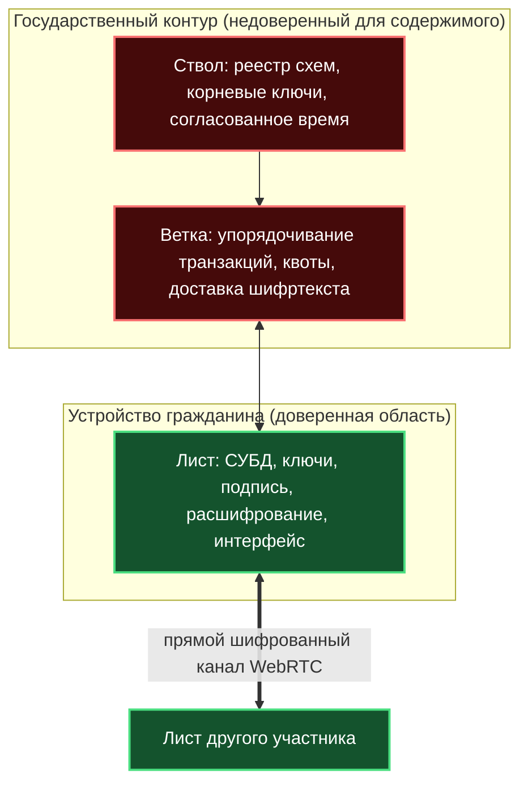
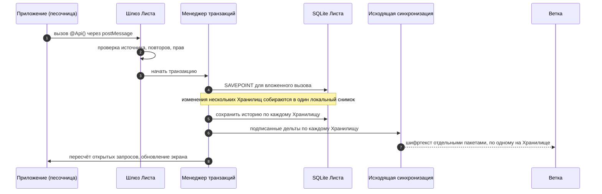
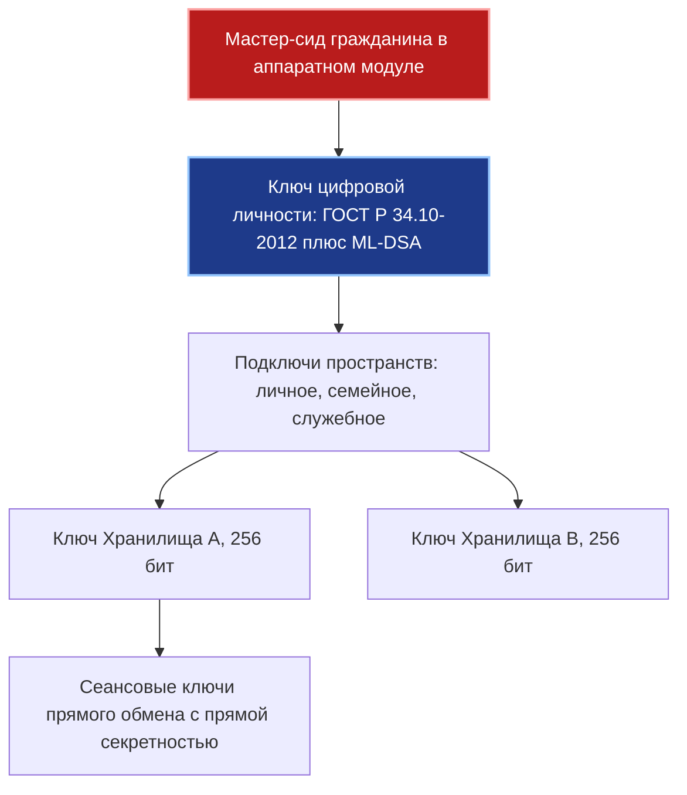

# Синтез: как работают Хранилища платформы «Турбаза» и почему они безопасны

> **Паспорт документа**
> - **Идентификатор группы задач:** `10-10_03_Ecosystem_whitepaper_and_presentation`
> - **Ступень:** Ступень 02 (Синтетическое доказательство работы и безопасности Хранилищ)
> - **Автор синтеза и доказательной части:** Claude Sonnet 5.5
> - **Исследовательская база (Ступень 01) и архитектор плана:** Gemini 3.8 Flash
> - **Автор платформы, изобретатель патента US 10,902,016 B2:** Артём Владимирович Шамсутдинов
> - **Входные отчёты:**
>   [01 — работоспособность](./01_Технический_документ_Работоспособность_Хранилищ.md) ·
>   [02 — безопасность](./02_Технический_документ_Безопасность_Хранилищ.md) ·
>   [03 — реализация в AIRport](./03_AIRport_Реализация_Хранилищ_в_Коде.md) ·
>   [04 — история и патент](./04_Историческая_эволюция_и_патент_Хранилищ.md)
> - **Проверка по коду:** выборочная сверка отчёта 03 с каталогом `AIRroot/AIRport` (дата сверки — 11 октября 2026 г.); результаты сведены в разделе 3
> - **Назначение:** опорный документ для Белой книги № 12 («Экосистема») и плана презентации

---

## 1. Краткое содержание

**Что утверждается.**
1. Данные платформы разбиты на множество малых **Хранилищ**. У каждого своя цепочка подписанных транзакций, свой ключ шифрования и свой круг участников. Одна сетевая транзакция затрагивает ровно одно Хранилище.
2. Из этого следует масштабируемость: стоимость любой операции зависит от размера одного Хранилища и нагрузки одной Ветки, но не от общего числа Хранилищ в сети. Общей точки синхронизации нет.
3. Из той же структуры следует безопасность: серверы Веток и Ствола видят только шифртекст. Чтение им недоступно, подделка обнаруживается подписью, исключённого участника отсекает ветвление Хранилища.

**Что доказано строго, а что нет.** Документ разделяет три категории утверждений:

| Категория | Смысл | Примеры |
| :--- | :--- | :--- |
| **Д — доказано** | Следует из конструкции при явно названных допущениях | уникальность ключей, отсутствие распределённых блокировок, сходимость состояний |
| **С — сводится к допущению** | Верно, пока верна стойкость примитива | конфиденциальность, невозможность подделки |
| **О — открыто** | Требует стендовой проверки, формальной верификации или доработки | рост нагрузки на одну «горячую» Хранилище, скрытие метаданных, ГОСТ-профиль в коде |

Безусловных утверждений вида «абсолютно безопасно» в документе нет. Безопасность здесь означает: взлом возможен только через нарушение названных допущений, а список остаточных рисков приведён полностью (раздел 8).

> [!NOTE]
> **Статус открытых вопросов.** Все слабые места и все вопросы, оставленные открытыми в настоящем документе (категория **О**, реестр рисков в разделе 8, пункты плана верификации в разделе 9), подлежат дальнейшей проработке. Они не считаются закрытыми и не должны подаваться в Белой книге № 12 и в презентации как решённые.

---

## 2. Топология и модель угроз

Модель доверия построена на одном решении: **ключи и открытый текст существуют только на Листе**. Ветка и Ствол выполняют транспортные и координационные функции. Для конфиденциальности и подлинности содержимого они недоверенные.

### 2.1. Противники и цели

| № | Противник | Возможности | Что должно быть гарантировано |
| :--: | :--- | :--- | :--- |
| P1 | Скомпрометированная Ветка или Ствол | полный доступ к памяти, дискам, сетевым портам; может удалять, задерживать, переупорядочивать, подменять пакеты | секретность содержимого; невозможность подделки записей |
| P2 | Внешний наблюдатель сети | перехват и подмена трафика | то же; защита сеансов прямого обмена |
| P3 | Вредоносное приложение внутри Листа | исполняет свой код в песочнице, шлёт сообщения шине | отсутствие записи в чужие схемы; отсутствие доступа к ключам и дескриптору базы |
| P4 | Исключённый участник Хранилища | знает старые ключи и всю историю до исключения | нечитаемость всего, что записано после исключения |
| P5 | Похититель устройства | физический доступ к Листу | защита ключей аппаратным модулем; отзыв устройства |
| P6 | Атака Сивиллы | массовое создание учётных записей | экономический барьер и квоты |
| P7 | Квантовый противник | алгоритм Шора, сбор шифртекста «на будущее» | постквантовая стойкость подписи и доставки ключей |

### 2.2. Допущения стойкости

Доказательства раздела 7 опираются на следующие допущения. Их нарушение ведёт к потере соответствующего свойства.

- **A1.** Шифр «Кузнечик» (ГОСТ Р 34.12-2015) в режиме аутентифицированного шифрования MGM (ГОСТ Р 34.13-2015) стоек к подбору шифртекстов и к подделке: $\mathbf{Adv}^{\text{AEAD}}$ пренебрежимо мала.
- **A2.** Подпись ГОСТ Р 34.10-2012 стойка к подделке при атаке с выбором сообщений (EUF-CMA).
- **A3.** Хэш-функция «Стрибог» (ГОСТ Р 34.11-2012) устойчива к коллизиям.
- **A4.** Генератор случайных чисел Листа криптографически стоек.
- **A5.** Закрытые ключи пользователя не покидают его устройство (аппаратный модуль, Secure Enclave, TPM).
- **A6.** Браузер и среда исполнения WASM корректно реализуют изоляцию источников (Same-Origin Policy).
- **A7.** Ядро Листа выполняет посредничество при каждом обращении приложений к базе (полное посредничество, раздел 7.5).

---

## 3. Что реализовано в коде, а что задано спецификацией

Выборочная сверка отчёта 03 с кодовой базой `AIRroot/AIRport` показала следующее.

| Механизм | Статус | Подтверждение |
| :--- | :--- | :--- |
| Сущности `Repository`, `Actor`, журнал `TransactionHistory → RepositoryTransactionHistory → OperationHistory → RecordHistory` | **реализовано** | `schemas/holding-pattern/src/ddl/repository/Repository.ts`, `.../ddl/history/*.ts` |
| Базовая сущность `AirEntity` с ключом `(REPOSITORY_LID, ACTOR_LID, ACTOR_RECORD_ID)` | **реализовано** | `schemas/final-approach/src/ddl/AirEntity.ts` |
| Таблицы `WITHOUT ROWID` | **реализовано** | `databases/sqlite/src/SqLiteSchemaBuilder.ts` |
| Глобальный идентификатор строки (11 сегментов) | **реализовано** | `apis/aviation-communication/src/AirEntityUtils.ts` |
| Копирование внешней записи и учёт в `CopiedRecordLedger` | **реализовано** | `schemas/holding-pattern/src/manager/CrossRepositoryRelationManager.ts` |
| Точки сохранения `SAVEPOINT` для вложенных вызовов `@Api()` | **реализовано** в драйвере, вызывается из менеджера транзакций | `databases/sqljs/src/SqlJsDriver.ts`, `engines/terminal/src/orchestration/TransactionManager.ts` |
| Порядок завершения: запись истории → исходящая синхронизация → пересчёт открытых запросов | **реализовано** | `TransactionManager.ts`, методы `commit`, `saveRepositoryHistory` |
| Песочница приложений и шлюз `postMessage` | **реализовано** | `platforms/web-terminal/src/WebMessageGateway.ts` (проверка признака сообщения и повторов в `AirMessageUtils.validateIncomingMessage`) |
| Двухстадийный приём входящих дельт | **реализовано** | `libs/ground-transport/src/synchronization/in/TwoStageSyncedInDataProcessor.ts` (путь в отчёте 03 указан без подкаталога `synchronization/in/`) |
| Формат сообщения синхронизации: одна история одного Хранилища, подписи участников | **реализовано** | `apis/ground-control/src/definition/synchronization/SyncRepositoryMessage.ts` |
| Ключи и подпись | **реализовано частично**: `KeyUtils` использует Web Crypto (SHA, универсальные ключи шифрования и подписи) | `apis/ground-control/src/implementation/utils/KeyUtils.ts` |
| ГОСТ-профиль («Кузнечик», «Стрибог», ГОСТ Р 34.10-2012), ML-DSA, деривация ключей HKDF | **целевой профиль**: в проверенных модулях не найден | отчёт 02, раздел 2 |
| Ветка и Ствол (секвенсор, TrueTime, квоты, накопители в памяти) | **целевая архитектура**: в каталоге AIRport относится к клиентскому ядру, серверные узлы здесь не рассматривались | отчёт 01, раздел 2 |
| `Security Forking`, `Crypto-Shredding`, трёхрежимная регистрация | **целевой профиль**: протоколы заданы в техническом документе платформы | отчёт 02, разделы 3–6 |

Вывод: **модель данных, ключи, журнал, транзакции и изоляция приложений работают в коде.** Криптографический профиль ГОСТ и серверные протоколы Веток и Ствола заданы спецификацией и подлежат реализации. Раздел 7 доказывает безопасность профиля при допущениях A1–A7, а не того, что уже собрано в AIRport.

---

## 4. Как устроено Хранилище

### 4.1. Хранилище как единица данных, права и ключа

Хранилище $\mathcal{R}_k$ определяется как четвёрка

$$\mathcal{R}_k = \big\langle \text{RepositoryId}_k,\; \mathcal{M}_k,\; K_k,\; \mathcal{L}_k \big\rangle,$$

где $\mathcal{M}_k$ — множество участников, $K_k$ — симметричный ключ (256 бит), $\mathcal{L}_k$ — журнал транзакций. Участники, ключ и журнал принадлежат только этому Хранилищу. Остальные Хранилища на них не ссылаются.

В физической базе Листа все Хранилища лежат в одном файле SQLite, а логически разделены префиксом `RepositoryId` в составном первичном ключе (отчёты 01, 03). Это даёт локальные реляционные выборки (`JOIN`) по всем доступным Хранилищам без сетевых обращений.

### 4.2. Адресация записи

Любая запись адресуется тройкой

$$\mathcal{K} = \langle \text{RepositoryId},\; \text{ActorId},\; \text{ActorRecordId} \rangle,\qquad \text{ActorId} = (\text{UserAccount},\ \text{Terminal},\ \text{Application}).$$

Внешняя ссылка на запись разворачивается кодогенератором в три столбца (`*_RID_*`, `*_AID_*`, `*_ARID_*`). Глобальная строковая форма (11 сегментов) — это `repository.GUID`, `actor.GUID` и номер записи через дефис.

`ActorId` служит для устранения коллизий ключей. Анонимизации он не обеспечивает (раздел 7.7).

### 4.3. Журнал транзакций

Журнал Хранилища — цепочка

$$T_k^{(i)} = \big\langle v^{(i)},\ \mathcal{H}\big(T_k^{(i-1)}\big),\ \Delta^{(i)},\ \text{ActorId},\ \sigma^{(i)} \big\rangle,\qquad v^{(i)} = v^{(i-1)}+1,$$

где $\Delta^{(i)}$ — набор изменённых строк, $\sigma^{(i)}$ — подпись автора. В кодовой базе транзакция раскладывается на четыре уровня: `TransactionHistory` (действие пользователя), `RepositoryTransactionHistory` (дельта одного Хранилища), `OperationHistory` (вставка, изменение или удаление в таблице), `RecordHistory` (строка со старыми и новыми значениями).

### 4.4. Путь записи от действия пользователя до сети

Ключевое свойство: **многохранилищное действие пользователя атомарно только на самом Листе** (локальная транзакция SQLite, формула пункта 12 патента US 10,902,016 B2). В сеть оно уходит как семейство независимых транзакций, по одной на Хранилище. Согласование между серверами не требуется.

Цена такого решения — **возможная рассогласованность между Хранилищами в сети на короткое время**. Если пакеты части Хранилищ доставлены, а других нет, участники временно видят разные части одного действия. Бизнес-инварианты, пересекающие Хранилища (например, «резерв средств» и «поручение»), поддерживаются порядком шагов и компенсирующими действиями в прикладном коде. Распределённая транзакция их не охраняет (раздел 8, риск Р-3).

### 4.5. Связи между Хранилищами: снимки вместо блокировок

Ссылка из $\mathcal{R}_A$ на запись в $\mathcal{R}_B$ при создании копирует запись вместе с её транзитивным замыканием внутрь $\mathcal{R}_A$. Факт копирования учитывается в `CopiedRecordLedger`.

Следствия:
- экран строится из локального снимка без обращения в сеть;
- последующие правки в $\mathcal{R}_B$ не меняют подписанную запись в $\mathcal{R}_A$ (историческая неизменяемость);
- запись в $\mathcal{R}_A$ не требует ни чтения, ни блокировки в $\mathcal{R}_B$.

Размер замыкания ограничен: пусть глубина ссылок не превышает $d$, а ветвление — $b$, тогда в снимок попадает не более $\sum_{j=0}^{d} b^{j}$ записей. Проектировщик схем управляет этой величиной выбором глубины.

Для коллекций «один ко многим» (голоса, отклики, комментарии) применяются самозапечатываемые страницы `IChildRecordPage` примерно по 1000 лёгких проекций. Страница после заполнения запечатывается и далее не изменяется. Её можно кэшировать бессрочно.

### 4.6. Приём чужих дельт

Входящие пакеты обрабатываются в две стадии (`TwoStageSyncedInDataProcessor`): сначала сопоставление глобальных идентификаторов с локальными и проверка конфликтов версий, затем пакетное применение в одной локальной транзакции. Правило для повторов: дельта с версией $v \le v_{\text{тек}}$ не меняет состояние.

### 4.7. Время

Для финансовых и юридически значимых операций метка времени берётся с Ветки (согласование времени между Стволами). Для личных данных допустимы локальные гибридные логические часы Листа. Второй вариант сохраняет работу без связи.

---

## 5. Строгие утверждения о работе Хранилищ

Обозначения: $\mathfrak{R}$ — множество всех Хранилищ сети, $N=|\mathfrak{R}|$; $\mathbb{T}$ — множество сетевых транзакций.

### 5.1. Уникальность ключей без координатора

**Утверждение 1.** Пусть для каждого актора $\text{ActorId}$ значения $\text{ActorRecordId}$ выдаются строго возрастающим счётчиком и никогда не повторяются. Тогда две различные записи сети имеют различные ключи $\mathcal{K}$.

*Доказательство.* Пусть $\mathcal{K}_1=\mathcal{K}_2$. Из совпадения третьих компонентов при совпадении $\text{ActorId}$ следует, что значение счётчика одного актора выдано дважды. Это противоречит допущению. Из совпадения $\text{RepositoryId}$ и $\text{ActorId}$ получаем: записи созданы одним актором в одном Хранилище. Остаётся один номер, значит, это одна и та же запись. $\blacksquare$

*Условие и его применение.* Допущение о счётчике нарушается, если образ устройства клонируется целиком, включая счётчик. Поэтому клон должен получать новый идентификатор `Terminal` (новый актор). Это требование вводится в протокол привязки устройств. Для восстановления из резервной копии оно же означает: после восстановления продолжать счётчик нельзя, а нужно регистрировать новый `Terminal`.

### 5.2. Факторизация транзакций

**Утверждение 2.** Каждая сетевая транзакция $T$ несёт ровно один $\text{RepositoryId}$, поэтому
$$\mathbb{T}=\bigsqcup_{\mathcal{R}\in\mathfrak{R}}\mathbb{T}_{\mathcal{R}}.$$

*Доказательство.* Это свойство формата. Сообщение синхронизации `SyncRepositoryMessage` (`apis/ground-control/src/definition/synchronization/SyncRepositoryMessage.ts`) несёт одну историю `IRepositoryTransactionHistory`, то есть дельту ровно одного Хранилища. Лист расщепляет локальную транзакцию по Хранилищам до отправки. Принадлежность однозначна, значит, классы не пересекаются. $\blacksquare$

### 5.3. Отсутствие распределённых блокировок

**Утверждение 3.** Запись в $\mathcal{R}_i$ не требует захвата блокировок на объектах $\mathcal{R}_j$ при $j\ne i$ ни на одном сервере сети.

*Доказательство.* Запись в $\mathcal{R}_i$ читает только строки $\mathcal{R}_i$ и локальные копии-снимки внутри $\mathcal{R}_i$ (раздел 4.5). Операций над строками $\mathcal{R}_j$ в пути записи нет. Следовательно, граф ожидания блокировок между Хранилищами пуст, а циклов в пустом графе нет. $\blacksquare$

*Уточнение.* Внутри Листа блокировки SQLite существуют, но они локальны и не пересекают границу устройства. Взаимная блокировка между двумя Листами невозможна, потому что оба не ждут друг друга при записи.

### 5.4. Сходимость состояний

**Утверждение 4.** Пусть для Хранилища $\mathcal{R}$ секвенсор выдал журнал версий $1,\dots,m$ без пропусков. Пусть Лист применяет дельты в порядке версий, повторы игнорирует, а каждая дельта $\Delta^{(i)}$ детерминирована (содержит материализованные значения без вызовов случайных и временных функций, схема данных одной версии). Тогда любые два Листа, применившие журнал, имеют одинаковое состояние $\mathcal{S}^{(m)}$.

*Доказательство.* Индукцией по $m$. Для $m=0$ состояние пусто на обоих Листах. Допустим, оба Листа находятся в состоянии $\mathcal{S}^{(m-1)}$. Применение $\Delta^{(m)}$ — детерминированная функция от состояния и дельты, поэтому состояния совпадут. Повторная доставка $\Delta^{(i)}$ с $i\le m$ по правилу игнорирования оставляет состояние неизменным: $f(f(\mathcal{S},T),T)=f(\mathcal{S},T)$. Дельта $v>m+1$ откладывается до получения недостающих версий. $\blacksquare$

*Условие.* Сходимость гарантируется в пределах одного Хранилища и одного порядка секвенсора. Между Хранилищами порядок не определён, и общая сходимость не заявляется (раздел 4.4).

Конфликт двух одновременных правок одной строки разрешается порядком секвенсора. Порядок один и тот же для всех Листов, а старые и новые значения сохранены в `RecordHistory`, что даёт прикладному слою возможность слияния.

### 5.5. Масштабирование

Параметры: $B$ — число Веток, $m_R$ — число участников Хранилища $R$, $w_R$ — частота записи в него. Нагрузка на Ветку $b$, которая ведёт набор $\mathfrak{R}_b$:

$$\Lambda_b=\sum_{R\in\mathfrak{R}_b}w_R\,m_R,$$

так как каждая запись принимается один раз и рассылается $m_R-1$ получателям. Стоимость на Листе пользователя $u$ равна $\sum_{R\ni u}w_R$ и не содержит $N$.

**Утверждение 5.** Если Хранилища распределены по Веткам и для каждой $\Lambda_b\le\mu_b$ (пропускная способность Ветки), то:
1. стоимость операции над Хранилищем $R$ не зависит от $N$;
2. суммарная пропускная способность растёт линейно с числом Веток, $\Lambda_{\text{сеть}}\le\sum_b\mu_b$;
3. доля последовательной работы, общей для всех Хранилищ, равна нулю.

*Доказательство.* По утверждениям 2 и 3 операции разных Хранилищ не разделяют ни блокировок, ни порядка, поэтому выполняются независимо. Порядок нужен только внутри $R$ и обеспечивается одной Веткой. Сложение пропускных способностей Веток следует из независимости. Ограничение (2) достигается при равномерном распределении. $\blacksquare$

**Границы и условия.**
- **Горячее Хранилище.** Пропускная способность одного Хранилища не превышает $\mu_b$ одной Ветки: $w_R\,m_R\le\mu_b$. Для голосований и отзывов с миллионами записей это ограничение смягчается постраничным разбиением (`IChildRecordPage`) и накоплением мелких событий в оперативной памяти секвенсора. Оценка снижения дискового ввода-вывода на 99,8 %, приведённая в техническом документе, **не измерена** и подлежит стендовой проверке (риск Р-5).
- **Хранение на Листе.** Лист хранит только Хранилища, на которые он подписан, то есть $\mathcal{O}(r_u)$, а не $\mathcal{O}(N)$.
- **Согласованность.** В терминах PACELC система выбирает доступность и малую задержку. Строгая последовательность обеспечивается внутри одного Хранилища. Между Хранилищами — итоговая согласованность.

---

## 6. Иерархия ключей

Каждое Хранилище шифруется собственным ключом $K_k$, сгенерированным на Листе. Участникам ключ передаётся в зашифрованном виде на их открытых ключах. Компрометация одного $K_k$ раскрывает только одно Хранилище.

---

## 7. Доказательство безопасности

### 7.1. Формат защищённой записи

Лист строит запись так:

$$C=\mathbf{Enc}_{K_k}\big(\Delta;\ N_{\text{n}},\ \text{AAD}\big),\qquad \text{AAD}=(\text{RepositoryId}_k,\ \text{ActorId},\ v),$$
$$H=\mathbf{Hash}(\text{AAD}\parallel C\parallel\mathcal{H}(T^{(i-1)})),\qquad \sigma=\mathbf{Sign}_{SK_{\text{Actor}}}(H).$$

Ветка получает $(\text{AAD},C,\sigma)$. Открытые поля AAD нужны для маршрутизации, поэтому они остаются видимыми (раздел 7.7).

**Требование к одноразовому значению (nonce).** Повтор пары (ключ, nonce) разрушает стойкость режима MGM. Значение формируется детерминированно из $(\text{ActorId},\text{ActorRecordId})$ и номера дельты. По утверждению 1 такие значения не повторяются у разных акторов и у одного актора, а ключ $K_k$ общий для участников. Поэтому повтор невозможен без нарушения счётчика, и этой конструкции достаточно без обращения к генератору случайных чисел. Это требование к реализации профиля: в проверенном коде оно не найдено (раздел 3).

### 7.2. Конфиденциальность перед скомпрометированной Веткой

**Утверждение 6.** Пусть противник P1 видит все $(\text{AAD},C,\sigma)$ и всё содержимое памяти Ветки и Ствола, но не знает $K_k$. При допущениях A1, A4, A5 его преимущество в различении шифртекстов двух сообщений равной длины не превышает
$$\mathbf{Adv}\ \le\ n_{\text{ключей}}\cdot\mathbf{Adv}^{\text{AEAD}}_{\text{Кузнечик-MGM}}(q,\ t),$$
где $n_{\text{ключей}}$ — число Хранилищ, ключи которых противник пытается взломать, $q$ — число перехваченных шифртекстов, $t$ — время вычислений.

*Доказательство (схема сведения).* Ключи Хранилищ порождены независимо (A4) и не покидают Листы в открытом виде (A5). Взлом одного Хранилища сводится к атаке на режим MGM с ключом, неизвестным противнику. Для $n_{\text{ключей}}$ независимых ключей по гибридному доводу потери в оценке не превышают множителя $n_{\text{ключей}}$. $\blacksquare$

*Замечание об оценке из отчёта 02.* Запись «$\mathbf{Adv}\le 2^{-256}$» в отчёте 02 неточна: преимущество определяется стойкостью режима и числом запросов, а не только длиной ключа. Корректная форма приведена выше. Практический вывод прежний: при стойком шифре Ветка не получает содержимого, а подбор 256-битного ключа неосуществим.

### 7.3. Подлинность и целостность

**Утверждение 7.** Противник P1 не может создать запись $(\text{AAD}',C',\sigma')$, принимаемую Листом получателя, от имени актора, чей ключ ему неизвестен, и не может изменить принятую запись.

*Доказательство.* Принять запись значит проверить $\mathbf{Verify}_{PK_{\text{Actor}}}(H',\sigma')$. Возможны два случая. Если $H'\ne H$ для какой-либо уже подписанной записи, то $\sigma'$ — новая корректная подпись, что противоречит A2. Если $H'=H$ при $(\text{AAD}',C')\ne(\text{AAD},C)$, найдена коллизия хэш-функции, что противоречит A3. $\blacksquare$

**Что Утверждение 7 не покрывает.** Ветка как секвенсор способна:
1. **удалить или задержать** запись (нарушает доступность);
2. **выдать разным Листам разные последовательности** одного Хранилища (расщепление представления);
3. **изменить порядок** записей разных акторов.

Свойства 2 и 3 ограничиваются хэш-цепочкой: каждая запись включает $\mathcal{H}(T^{(i-1)})$, поэтому два Листа, сравнившие свои «головы» цепочки, обнаруживают расщепление. Сравнение выполняется по прямому каналу между Листами при каждом сеансе (проверка головы журнала). Подпись самой Ветки на присвоенной версии $v$ даёт доказательство её недобросовестности. Эти два механизма **требуют реализации в протоколе синхронизации** (риск Р-2). Удаление и задержка остаются возможными, но их обнаруживают по разрыву версий.

### 7.4. Отсечение исключённого участника (Security Forking)

**Утверждение 8.** Участник $C$, исключённый в момент $T_0$, не получает информации о содержимом записей Хранилища $\mathcal{R}_{v2}$, созданных после $T_0$, сверх того, что вытекает из длины и времени шифртекстов.

*Доказательство.* Ключ $K_2$ порождён независимо от $K_1$ ($K_2\leftarrow\text{CSPRNG}(256)$) и передан только остальным участникам на их открытых ключах. Данные, доступные $C$ — шифртексты $\mathcal{R}_{v2}$ и ключ $K_1$ — не зависят от $K_2$ как от функции. По A1 шифртексты под неизвестным $K_2$ неотличимы от шифртекстов под случайным ключом, следовательно, содержимое $\mathcal{R}_{v2}$ для $C$ закрыто. $\blacksquare$

**Границы.**
- Всё, что $C$ уже прочитал до $T_0$, остаётся у него. Любой протокол доступа обладает этим пределом.
- Утверждение требует, чтобы $C$ не получил $K_2$ иным путём, например от соучастника из числа оставшихся.
- Точка отсечения и запечатывание старого Хранилища выполняются Веткой. Ветка может отказаться их выполнить (нарушение доступности), но не может раскрыть $K_2$.
- Асимметрия добавления: новый участник $D$ получает $K_2$ и не получает $K_1$, поэтому предыстория ему закрыта, пока ему не передан снимок.
- Стоимость: перенос снимка состояния и перераздача ключей оставшимся. Перешифровка всего архива не нужна, что и есть выигрыш перед отзывом ключа.

### 7.5. Изоляция приложений внутри Листа

**Утверждение 9.** При допущениях A6 и A7 приложение $X$ может изменять данные схемы приложения $Y\ne X$ только через опубликованный интерфейс `@Api()` приложения $Y$.

*Доказательство.* У приложения нет дескриптора базы данных: оно исполняется в изолированном источнике (A6) и взаимодействует с ядром только сообщениями. Любое сообщение проходит проверку ядром (A7), и запись в таблицу с префиксом чужой схемы отвергается. Изменение чужой схемы возможно только вызовом `@Api()` владельца. Он выполняется кодом $Y$ под проверкой прав $Y$. Других путей к базе нет. $\blacksquare$

**Границы.**
- Правило «читай отовсюду» намеренно разрешает чтение чужих таблиц. **Между приложениями одного пользователя конфиденциальность чтения обеспечивается не изоляцией схем, а выдачей ключей Хранилищ:** приложение читает содержимое только тех Хранилищ, ключи которых ему выданы.
- Уязвимости самого браузера, побочные каналы и ошибки ядра вне этого доказательства. Они входят в доверенную вычислительную базу (риск Р-6).
- Отсутствие серверного рендеринга устраняет классы инъекций на Ветке, но на защиту Листа от межсайтовых атак не влияет.

### 7.6. Право на забвение (Crypto-Shredding)

**Утверждение 10.** Если все копии ключа $K_k$ уничтожены, а шифртексты Хранилища остались, то содержимое Хранилища вычислительно недоступно (при A1).

*Доказательство.* Без $K_k$ извлечение открытого текста сводится к взлому режима MGM (A1). $\blacksquare$

**Границы.**
- Условие «все копии ключа» принципиально. В групповом Хранилище ключ есть у каждого участника, поэтому стирание обязано быть согласованным действием всех держателей или инициироваться владельцем с прекращением доступа через ветвление (раздел 7.4). Для личных Хранилищ условие выполняется само собой.
- Участники, уже получившие копию данных, сохраняют её. Крипто-стирание не отзывает прочитанное.
- Утверждение о том, что шифртекст без ключа **не считается** персональными данными по ст. 14 и 21 152-ФЗ, — правовая позиция, а не математический факт. Её следует подтвердить заключением регулятора (риск Р-7).
- Физическое удаление таблиц и журнала Хранилища секвенсором не затрагивает остальные Хранилища, поскольку перекрёстных хэш-ссылок между цепочками нет (раздел 4.1).

### 7.7. Метаданные и анонимность

Записи на Ветке несут открытые поля `RepositoryId`, `ActorId`, номер версии, размер и время. Поэтому Ветка и сетевой наблюдатель видят:
- какие учётные записи участвуют в одном Хранилище (граф связей);
- частоту и объём записи;
- момент активности.

Содержимое при этом закрыто. Режимы «полная» и «социальная» анонимность, описанные в отчёте 02, снижают эту видимость, но не устраняют её полностью. `ActorId` нормативно не является средством анонимизации. Для защиты от профилирования при переезде гражданина применяется перешифрование на Листе: новая Ветка получает массив, не сопоставимый со старым по шифртексту. Метаданные поведения (график активности) при этом остаются.

### 7.8. Ссылки между Хранилищами

Копия внешней записи внутри $\mathcal{R}_A$ подписана автором $\mathcal{R}_A$. Из этого следует, что автор подтверждает факт «на момент $t$ я видел такое значение». Из этого **не следует**, что автор $\mathcal{R}_B$ подтвердил это значение. Для неоспоримости копия должна нести исходную подпись записи из $\mathcal{R}_B$ вместе с её проверяемым номером версии. Это рекомендуемое требование к формату снимка (риск Р-4). `CopiedRecordLedger` хранит координаты копии, подписи в нём не хранится.

### 7.9. Постквантовая стойкость

- **Симметричная часть.** Ключи 256 бит. Алгоритм Гровера уменьшает запас до порядка $2^{128}$ операций, чего достаточно.
- **Подпись.** Гибрид ГОСТ Р 34.10-2012 и ML-DSA сохраняет подлинность, пока стоек хотя бы один из двух.
- **Доставка ключей.** Это слабое звено: если $K_k$ передаётся на открытом ключе эллиптической кривой, противник, сохранивший трафик, раскроет его после появления квантового компьютера («собрать сейчас, расшифровать потом»). Передачу ключей Хранилищ нужно переводить на гибридный механизм инкапсуляции ключа с постквантовым компонентом (ML-KEM в сочетании с эллиптической кривой). В отчёте 02 указана только подпись ML-DSA (риск Р-1).

### 7.10. Защита от массовых учётных записей

Защита от атаки Сивиллы построена на институциональных и экономических мерах, а не на криптографии: один кошелёк Банка России на гражданина, подтверждённая личность через ЕСИА, квоты пропускной способности по коэффициенту верификации, анализ плотности учётных записей на Ветке. Доказательства здесь нет: надёжность определяется стоимостью получения подтверждённой личности и должна оцениваться отдельно. Криптографическая часть лишь гарантирует, что записи нельзя подделать от имени чужой личности.

---

## 8. Реестр остаточных рисков

| № | Риск | Влияние | Мера | Статус |
| :--: | :--- | :--- | :--- | :--: |
| Р-1 | Доставка ключей Хранилищ без постквантовой защиты | раскрытие архива через годы | гибридная инкапсуляция ключей (ML-KEM плюс эллиптическая кривая) | **О** |
| Р-2 | Ветка выдаёт разным Листам разные последовательности | нарушение согласованности, обман | сравнение голов хэш-цепочки по прямому каналу; подпись Веткой версии | **О** |
| Р-3 | Рассогласование Хранилищ при межхранилищном действии | временная неполнота картины | порядок шагов, компенсирующие операции, индикация незавершённости | **Д** (принято по конструкции) |
| Р-4 | Снимок без исходной подписи не защищает от отказа автора $\mathcal{R}_B$ | спор о значении | включение подписи исходной записи в снимок | **О** |
| Р-5 | «Горячее» Хранилище упирается в одну Ветку | потолок пропускной способности | постраничное разбиение, накопители в памяти; стендовые замеры | **О** |
| Р-6 | Уязвимость браузера, побочные каналы, ошибка ядра Листа | выход из песочницы | обновления, независимый аудит ядра, минимизация доверенной базы | **О** |
| Р-7 | Правовой статус шифртекста при стирании ключа | оценка по 152-ФЗ | заключение регулятора | **О** |
| Р-8 | Утечка метаданных (граф связей, активность) | профилирование | режимы анонимности, перешифрование при переезде, выравнивание размеров | **О** |
| Р-9 | Клонирование устройства вместе со счётчиком записей | коллизия ключей, повтор nonce | новый `Terminal` при клонировании и восстановлении | **О** |
| Р-10 | Профиль ГОСТ не реализован в проверенном коде | расхождение документа и кода | реализация профиля, тесты совместимости | **О** |

---

## 9. План верификации

Каждый пункт ниже относится к будущей проработке. Все риски со статусом **О** из раздела 8 должны быть закрыты этими работами либо явно приняты с обоснованием.

1. **Формальная модель протокола.** Описать запись, приём, ветвление и доставку ключей в средстве проверки протоколов (ProVerif или Tamarin) и проверить свойства утверждений 6–8 при противнике P1.
2. **Стендовые замеры.** Для утверждения 5: пропускная способность одной Ветки $\mu_b$, потолок «горячего» Хранилища, проверка оценки 99,8 %.
3. **Проверка кода.** Модульные тесты на уникальность ключей (утверждение 1), идемпотентность и порядок применения дельт (утверждение 4), отказ записи в чужую схему (утверждение 9).
4. **Реализация ГОСТ-профиля** в `KeyUtils` и в транспортном слое, включая правило формирования nonce (раздел 7.1).
5. **Независимый аудит** песочницы и шлюза сообщений.

---

## 10. Заключение

1. Хранилище — единица данных, прав, ключа и порядка. Из-за того, что сетевая транзакция затрагивает ровно одно Хранилище, исчезают распределённые блокировки, а пропускная способность растёт добавлением Веток.
2. Ветка и Ствол видят шифртекст, подписи и метаданные маршрутизации. Содержимое им недоступно, подделать запись они не могут. Это строгий результат при допущениях A1–A5.
3. Три свойства требуют доработки протокола и не заявляются как готовые (как и все прочие открытые вопросы раздела 8, они подлежат дальнейшей проработке): обнаружение расщепления представления Веткой, постквантовая доставка ключей и подпись исходной записи в снимке.
4. Ядро данных (Хранилище, ключ записи, журнал, снимки, песочница) работает в коде AIRport. ГОСТ-профиль и серверные протоколы Веток заданы спецификацией и подлежат реализации и проверке.

---

## 11. Атрибуция

- **Синтез, доказательные утверждения, сверка с кодом и реестр рисков:** Claude Sonnet 5.5 (Ступень 02).
- **Исследовательские отчёты 01–04 и архитектура мастер-плана:** Gemini 3.8 Flash.
- **Автор платформы, патента US 10,902,016 B2 и кодовой базы AIRport:** Артём Владимирович Шамсутдинов.
