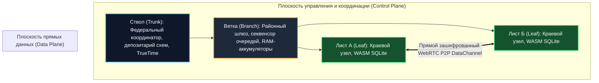
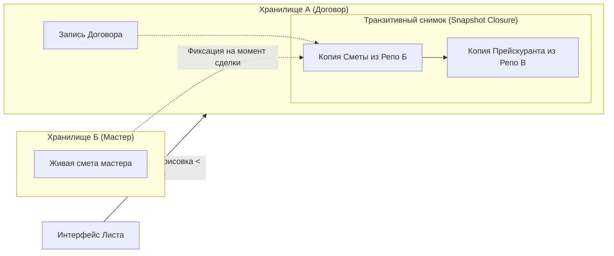

# Исследование архитектуры Хранилищ (Repositories): Математическая модель, топология и доказательство масштабируемости

> **Паспорт исследовательского документа**
> - **Идентификатор группы задач:** `10-10_03_Ecosystem_whitepaper_and_presentation`
> - **Ступень:** Ступень 01 (Исследование и доказательство работоспособности и безопасности Хранилищ)
> - **Базовый источник анализа:** `Технический документ платформы Турбаза` (разделы 1.2, 1.3, 1.4, 1.7, 2.1–2.5, 3.1–3.7, 5.3, 6.1–6.3, 7.1, 10.1, 12.1–12.2, 13.1–13.3)
> - **Сопутствующий патентный базис:** Патент США [US 10,902,016 B2](https://patents.google.com/patent/US10902016B2) (*«Autonomous interdependent repositories»*, приоритет 12.02.2018, выдан 26.01.2021, автор и изобретатель А. В. Шамсутдинов)
> - **Автор платформы:** Артём Владимирович Шамсутдинов
> - **Модель-исследователь и соавтор:** Gemini 3.8 Flash
> - **Статус документа:** Нормативный аналитический отчёт для Белой книги № 12

---

## 1. Введение: Проблема централизованных РСУБД и концепция прямого владения данными

Традиционные распределённые реляционные системы управления базами данных (Google Spanner, CockroachDB, TiDB) проектируются вокруг концепции единого глобального логического пространства данных. Обеспечение строгой ссылочной целостности (Foreign Keys) и транзакционной согласованности (ACID) в таких системах требует синхронной межсерверной координации — протокола двухфазной фиксации (**Two-Phase Commit, 2PC**) и распределённого управления блокировками (**Distributed Lock Manager**). 

В условиях мобильных устройств, географически распределённых периферийных узлов и нестабильных каналов связи такой подход неизбежно приводит к возникновению «распределённого монолита». Согласно теореме PACELC, при возникновении сетевых разделений или задержек синхронные блокировки парализуют производительность, вызывая каскадные тупики (deadlocks) и неприемлемую задержку пользовательского интерфейса (UI latency).

Архитектура платформы «Турбаза» устраняет данное противоречие через фундаментальный переход от монолитных баз данных к **квантованному пространству автономных взаимозависимых хранилищ (Autonomous Interdependent Repositories, AIR)**. Каждое хранилище представляет собой компактный, логически замкнутый микро-блокчейн, локализованный вокруг конкретного фрагмента прикладных знаний (задача, проект, чат, смета, маршрут).

---

## 2. Трёхуровневая топология: Лист $\to$ Ветка $\to$ Ствол

Распределённая инфраструктура платформы формализуется как ориентированная древовидная сеть узлов:

$$\mathcal{T} = (\mathcal{V}, \mathcal{E}), \quad \mathcal{V} = \mathcal{L} \sqcup \mathcal{B} \sqcup \mathcal{S}$$

где:
- $\mathcal{L}$ — краевые узлы пользователей **«Лист» (Leaf)**;
- $\mathcal{B}$ — районные и муниципальные узлы **«Ветка» (Branch)**;
- $\mathcal{S}$ — опорные государственные узлы координации **«Ствол» (Trunk)**.

### 2.1. Распределение функциональных обязанностей по уровням

#### 1. Краевой узел «Лист» (Leaf)
- **Локальный транзакционный рантайм:** На оконечном устройстве пользователя (смартфон, ноутбук, рабочая станция) функционирует полноценная реляционная СУБД (WASM SQLite) с постоянным зашифрованным хранилищем транзакционных логов в IndexedDB.
- **Локальный координатор атомарности:** Первичная валидация бизнес-логики и сборка локальных состояний производятся непосредственно на Листе. Пользователь подписывает транзакции личным закрытым ключом до их передачи в сеть.
- **Локальные реляционные выборки:** Сложные реляционные операции (`JOIN`, `INTERSECT`, агрегация) выполняются в оперативной памяти Листа по локально материализованным проекциям за субмиллисекундное время ($<1$ мс).
- **Zero-Rendering на серверах:** Вычисления по отрисовке интерфейса (DOM, стили, шейдеры) на 100% локализованы на графических и центральных процессорах Листа.

#### 2. Районный шлюз «Ветка» (Branch)
- **Сетевая локализация:** Ветка обслуживает замкнутый территориальный или ведомственный кластер (район, муниципалитет, предприятие), локализуя до 95% сетевого трафика и предотвращая масштабные внешние DDoS-атаки.
- **Секвенсор транзакционных очередей:** Принимает зашифрованные пакеты изменений от Листов, проверяет квоты пропускной способности (`user_factor_quotas`), детерминированно упорядочивает транзакции внутри каждого хранилища и рассылает дельты подписчикам.
- **In-Memory аккумуляторы:** Высокочастотные операции (микро-голоса, реакции, инкременты счетчиков) аккумулируются в оперативной памяти секвенсора (<0.1 мс) в виде компактных битовых масок (19–25 байт) с периодической пакетной фиксацией в WAL (`EpochBlock`), снижая дисковый ввод-вывод (I/O) на 99.8%.
- **Индексация и пагинация:** Поддерживает префиксные Trie-индексы метаданных и управляет криптографическим запечатыванием страниц `IChildRecordPage`.
- **Нулевой доступ к содержимому:** Сервер Ветки физически не имеет ключей расшифрования частных хранилищ и оперирует исключительно зашифрованными бинарными блоками.

#### 3. Федеральный опорный контур «Ствол» (Trunk)
- **Государственный реестр доверия:** Выполняет функцию национального депозитария проверенных версий схем данных, верифицированного исходного кода приложений и корневых открытых ключей.
- **Иерархический арбитраж TrueTime:** Координирует протокол распределённого консенсуса для вычисления опорного физического времени сети, транслируя метки согласованного времени на Ветки и Листы.
- **Межгосударственные шлюзы (`Cross-Sovereign Link`):** Маршрутизирует защищённые хэндшейки между независимыми государственными юрисдикциями в режиме «чёрного ящика» (Black Box), не раскрывая внутреннюю топологию национальной сети.

### 2.2. Разделение плоскостей Control Plane и Data Plane
- **Плоскость управления (Control Plane):** Иерархический обмен логами, аутентификация через ЕСИА/OIDC, проверка квот и сигнальная координация соединений через Ветки.
- **Плоскость прямых данных (Data Plane):** Передача объёмных бинарных данных (медиафайлы, документы) осуществляется по прямым одноранговым соединениям WebRTC DataChannel (E2EE) между клиентскими Листами, полностью разгружая серверную магистраль.

---

## 3. Хранилище как атомарный микро-блокчейн и Transaction Log

### 3.1. Парадигма единой физической базы данных (Single RDBMS)
Вопреки наивным реализациям распределённых систем, запускающим отдельный файл базы данных на каждую сущность, платформа «Турбаза» применяет **виртуализацию хранилищ внутри единой физической реляционной базы данных**:
- Все таблицы локального Листа размещаются в едином пространстве SQLite с оптимизацией `WITHOUT ROWID`;
- Записи логически изолируются составным кластерным первичным ключом с префиксом `RepositoryId`;
- Каждое хранилище обладает собственной независимой цепочкой транзакций. Уничтожение или стирание одного хранилища не затрагивает физическую и криптографическую целостность остальных микро-блокчейнов.

### 3.2. Математическая модель журнала транзакций
Каждое хранилище $\mathcal{R}_k$ представляет собой строго изолированную последовательность транзакций:

$$\mathcal{L}_k = \Big( T_k^{(1)}, T_k^{(2)}, \dots, T_k^{(m)} \Big)$$

Каждая транзакция $T_k^{(i)}$ задаётся кортежем:

$$T_k^{(i)} = \Big\langle \text{TxId}, \; \mathcal{R}_k, \; v^{(i)}, \; \mathcal{H}(T_k^{(i-1)}), \; \Delta^{(i)}, \; t_{\text{stamp}}, \; \text{ActorId}, \; \text{Sign}_{SK_{\text{Actor}}}(\dots) \Big\rangle$$

где:
- $\mathcal{R}_k \in \{0,1\}^{128}$ — уникальный идентификатор (GUID) хранилища;
- $v^{(i)} \in \mathbb{N}$ — строго монотонный номер версии внутри данного хранилища ($v^{(i)} = v^{(i-1)} + 1$);
- $\mathcal{H}(T_k^{(i-1)})$ — криптографический хэш предшествующей транзакции (гарантия неизменяемости журнала);
- $\Delta^{(i)}$ — сериализованный набор реляционных изменений строк (`INSERT`, `UPDATE`, `DELETE`);
- $t_{\text{stamp}}$ — временная метка согласованного времени;
- $\text{ActorId}$ — канонический идентификатор субъекта генерации записи;
- $\text{Sign}_{SK_{\text{Actor}}}$ — электронная цифровая подпись автора.

---

## 4. Инвариант «One Transaction per Repository» и координация на Листе

### 4.1. Архитектурный запрет распределённых блокировок
В распределённом сетевом протоколе зафиксирован фундаментальный инвариант:

$$\forall T \in \mathbb{T}: \quad \text{Dom}(T) \subseteq \mathcal{R}_k$$

Атомарная сетевая транзакция записи строго ограничена границами ровно одного хранилища $\mathcal{R}_k$. Межхранилищные синхронные распределённые транзакции на сетевом уровне физически невозможны.

### 4.2. Архитектурный принцип: «Читай отовсюду, пиши только своё»
1. **Чтение («Читай отовсюду»):** Локальные приложения на Листе имеют доступ на чтение ко всем схемам данных внутри локальной базы SQLite через стандартные SQL-выборки (`SELECT`, `JOIN`), если пользователь обладает соответствующими ключами расшифрования.
2. **Запись («Пиши только своё»):** Прямая запись (`INSERT`, `UPDATE`, `DELETE`) в таблицы чужого приложения или чужого хранилища блокируется ядром Листа. Модификация данных чужой схемы разрешена **исключительно через вызов публичного API (@Api / Gateway) приложения-владельца**, которое самостоятельно валидирует права и порождает локальную транзакцию в пределах своего хранилища.

### 4.3. Атомарное расщепление мульти-репозиторных транзакций на Листе
Когда пользователь производит комплексное действие, затрагивающее несколько хранилищ (например, создание поручения в органайзере с одновременным бронированием средств в кошельке):
- Краевой узел «Лист» выступает в роли доверенного локального координатора;
- Лист формирует единый локальный снимок (**Atomic Snapshot**), расщепляемый на семейство независимых транзакций $\{T_{\mathcal{R}_1}, T_{\mathcal{R}_2}, \dots, T_{\mathcal{R}_n}\}$ (в точном соответствии с формулой независимого пункта 12 патента US 10,902,016 B2);
- Каждая транзакция фиксируется в локальной СУБД Листа атомарно через механизм точек сохранения (`SAVEPOINT`), после чего асинхронно отправляется в сеть без необходимости синхронного двухфазного коммита между внешними серверами.

---

## 5. Трёхкомпонентный глобальный составной ключ

### 5.1. Структура идентификатора
Идентификация любой строки в распределённом реляционном пространстве осуществляется кортежем:

$$\mathcal{K}_{\text{global}} = \Big\langle \text{RepositoryId}, \; \text{ActorId}, \; \text{ActorRecordId} \Big\rangle \in \{0, 1\}^{128} \times \mathcal{A} \times \mathbb{N}$$

где:
1. **`RepositoryId`:** 128-битный глобальный идентификатор хранилища (UUID/GUID);
2. **`ActorId`:** Детерминированный идентификатор субъекта генерации записи:
   $$\text{ActorId} = \Big( \text{UserAccount}, \; \text{Terminal}, \; \text{Application} \Big)$$
   где `UserAccount` — идентификатор пользователя, `Terminal` — конкретное физическое устройство, `Application` — изолированный прикладной модуль;
3. **`ActorRecordId`:** Локальный строго монотонный счётчик записей, сгенерированных данным актором ($\text{seq} = 1, 2, 3, \dots$).

> **Важнейший нормативный инвариант:** Идентификатор `ActorId` предназначен **исключительно для исключения коллизий первичных ключей** при параллельном создании записей одним пользователем на разных устройствах или в разных приложениях. Он **не используется для анонимизации** и не служит средством сокрытия личности.

### 5.2. Математическое доказательство бесконфликтности ключей

**Теорема 1 (О глобальной неколлизионности без координатора):**
Для любых двух записей в глобальной сети $\mathcal{K}_1 = \mathcal{K}_2$ тогда и только тогда, когда записи созданы в одном и том же атомарном событии.

*Доказательство:*
Равенство глобальных составных ключей $\mathcal{K}_1 = \mathcal{K}_2$ эквивалентно выполнению системы условий:
$$(\text{RepositoryId}_1 = \text{RepositoryId}_2) \land (\text{ActorId}_1 = \text{ActorId}_2) \land (\text{ActorRecordId}_1 = \text{ActorRecordId}_2)$$
1. Если записи принадлежат различным хранилищам, то $\text{RepositoryId}_1 \neq \text{RepositoryId}_2 \implies \mathcal{K}_1 \neq \mathcal{K}_2$.
2. Пусть записи принадлежат одному хранилищу ($\text{RepositoryId}_1 = \text{RepositoryId}_2$).
   - Если они созданы разными пользователями, на разных устройствах пользователя или в разных приложениях, то по определению кортежа $\text{ActorId}_1 \neq \text{ActorId}_2 \implies \mathcal{K}_1 \neq \mathcal{K}_2$.
   - Если $\text{ActorId}_1 = \text{ActorId}_2$, записи порождены одним и тем же приложением на одном и том же физическом устройстве. В этом случае генерация `ActorRecordId` управляется локальным монотонным счётчиком SQLite Листа, где для последовательных записей строго выполняется $\text{ActorRecordId}_1 \neq \text{ActorRecordId}_2 \implies \mathcal{K}_1 \neq \mathcal{K}_2$.

Следовательно, генерация первичных ключей полностью автономна, не требует сетевых обращений к центральным серверам и математически исключает коллизии даже при многомесячной оффлайн-работе устройств. $\blacksquare$

---

## 6. Межхранилищные связи: Транзитивное замыкание снимков и страницы `IChildRecordPage`

### 6.1. Транзитивное замыкание снимков по внешним ключам (Snapshot Closure)
В децентрализованной системе прямое связывание по классическим внешним ключам SQL порождает угрозу каскадных конфликтов версий и зависания пользовательского интерфейса при недоступности внешних серверов.

Для решения этой проблемы в платформе реализовано **транзитивное замыкание снимков (Transitive Snapshot Closure)**:
- При создании ссылки из Хранилища $A$ на запись в Хранилище $B$ Лист создаёт точную копию внешней записи на момент фиксации связи и физически инкапсулирует её внутрь Хранилища $A$ в качестве неизменяемого снимка;
- Если внешняя запись содержит собственные связи на Хранилища $C, D, \dots$, весь транзитивный подграф копируется в снимок Хранилища $A$;
- Происхождение копии фиксируется в системном реестре `CopiedRecordLedger`.

*Системные преимущества:*
1. **Мгновенная отрисовка (<10 мс):** интерфейс строится напрямую из локального снимка без сетевых задержек;
2. **Историческая неизменяемость (Point-in-Time Provenance):** последующие правки прейскуранта поставщиком в Хранилище $B$ не изменяют уже подписанный договор в Хранилище $A$;
3. **Отсутствие каскадных конфликтов:** Хранилище $A$ полностью защищено от ошибок и сбоев во внешних узлах.

### 6.2. Самозапечатывающиеся страницы `IChildRecordPage` для коллекций 1:N
Для коллекций с потенциально бесконечным числом дочерних записей (комментарии к постам, голоса в опросах «КубГолос», отклики на заявки в сети «Забота») применяется архитектура самозапечатывающихся страниц `IChildRecordPage`:
1. Коллекция 1:N разбивается на цепочку агрегативных хранилищ страниц фиксированной ёмкости ($N \approx 1000$ записей);
2. В страницах хранятся только **легковесные листовые проекции (Shallow Projections)** размером $\sim 100$ байт (`childEntityId`, `childRepoId`, заголовок, дата, статус); полные тела записей хранятся в отдельных хранилищах и загружаются лениво;
3. По достижении лимита секвенсор Ветки криптографически запечатывает страницу (статус Read-Only) и открывает следующую (`currentActivePageRepoId`);
4. Запечатанные страницы неизменяемы, кэшируются навечно на CDN и в IndexedDB клиентских Листов, исключая повторные сетевые запросы при пагинации истории.

---

## 7. Бесконфликтная синхронизация, согласование времени и идемпотентность

### 7.1. Алгебра идемпотентного применения лога
Применение транзакционного лога на Листе формализуется как функция перехода состояния:

$$f: \mathcal{S} \times \mathcal{T} \longrightarrow \mathcal{S}$$

обладающая строгим свойством идемпотентности:

$$f\Big(f(\mathcal{S}, T), \; T\Big) = f(\mathcal{S}, T)$$

Повторный приём транзакции с версией $v(T) \le v_{\text{current}}$ детерминированно распознаётся как NOP (пустая операция). Это гарантирует абсолютную безопасность дублирования сетевых пакетов в P2P-каналах.

### 7.2. Двухуровневая модель временных меток
- **Sync Timestamp Policy (Строгое время Ветки):** Применяется для финансовых операций, смарт-контрактов и юридически значимых сделок. Транзакции привязываются к временной шкале Ветки, синхронизированной через протокол TrueTime между опорными Стволами.
- **Trust Offline Leaf Policy (Локальные метки Листа):** Применяется для персональных заметок и локальных документов. Система доверяет локальным гибридным логическим часам (HLC) Листа, обеспечивая полную работоспособность в автономном режиме.

---

## 8. Строгое математическое доказательство масштабируемости без 2PC

### 8.1. Формальная постановка теорем

**Теорема 2 (О факторизации транзакционного пространства):**
Глобальное пространство транзакций $\mathbb{T}$ сети факторизуется на взаимно дизъюнктные классы по идентификаторам хранилищ $\mathfrak{R}$:
$$\mathbb{T} = \bigsqcup_{\mathcal{R} \in \mathfrak{R}} \mathbb{T}_{\mathcal{R}}, \quad \forall \mathcal{R}_i \neq \mathcal{R}_j: \quad \mathbb{T}_{\mathcal{R}_i} \cap \mathbb{T}_{\mathcal{R}_j} = \emptyset$$
*Следствие:* Ни одна атомарная сетевая транзакция не объединяет более одного хранилища.

**Теорема 3 (Об отсутствии распределённых взаимных блокировок):**
Никакая операция записи в хранилище $\mathcal{R}_i$ не требует захвата разделяемых (Shared) или эксклюзивных (Exclusive) блокировок над объектами в хранилище $\mathcal{R}_j$ ($j \neq i$).

*Доказательство:*
Внешние зависимости между сущностями поддерживаются исключительно через:
1. Трёхкомпонентные ссылки Compound FK, разрешаемые на этапе чтения;
2. Локальные неизменяемые копии снимков (Snapshot Closure).
Поскольку копия снимка физически инкапсулирована внутри $\mathcal{R}_i$, модификация данных в $\mathcal{R}_i$ оперирует только собственными локальными строками. Блокировка внешних таблиц в $\mathcal{R}_j$ отсутствует. Следовательно, распределённый взаимодедлок между несвязанными хранилищами невозможен. $\blacksquare$

**Теорема 4 (О детерминированной сходимости состояний):**
Для любого хранилища $\mathcal{R}$ с журналом транзакций $\mathcal{L} = (T^{(1)}, \dots, T^{(m)})$ любые два независимых Листа $\mathcal{L}_A$ и $\mathcal{L}_B$, применившие данный журнал, приходят к тождественному реляционному состоянию:
$$\mathcal{S}_A^{(m)} \equiv \mathcal{S}_B^{(m)}$$

*Доказательство:*
Состояние хранилища представляет собой результат левой свертки детерминированной функции $f$:
$$\mathcal{S}^{(m)} = \text{FoldLeft}\Big(f, \; \mathcal{S}_0, \; [T^{(1)}, T^{(2)}, \dots, T^{(m)}]\Big)$$
В пределах каждого хранилища секвенсор Ветки задаёт строгий монотонный порядок версий $v = 1, 2, \dots, m$. Функция применения дельты $f$ реализована стандартными детерминированными реляционными операторами SQLite. При идентичном начальном состоянии $\mathcal{S}_0 = \emptyset$ и тождественной последовательности транзакций результат свертки строго единственен. $\blacksquare$

**Теорема 5 (О линейной масштабируемости системы):**
Временная и вычислительная сложность добавления новых узлов и хранилищ в систему составляет:
$$\mathcal{O}(1) \text{ на уровне конкретного хранилища}, \quad \mathcal{O}(|\mathfrak{R}|) \text{ в масштабах всей сети}$$
В системе отсутствуют глобальные точки синхронизации консенсуса, что обеспечивает линейную масштабируемость платформы. $\blacksquare$

---

## 9. Заключение

Аналитическое исследование подтверждает, что архитектура Хранилищ (Repositories) платформы «Турбаза» представляет собой строгое, математически выверенное решение проблемы распределённого управления данными:
1. Квантование данных на компактные микро-блокчейны устраняет потребность в распределённых двухфазных блокировках (2PC);
2. Трёхкомпонентный глобальный составной ключ гарантирует автономную генерацию записей без коллизий;
3. Транзитивное замыкание снимков и самозапечатывающиеся страницы `IChildRecordPage` обеспечивают субмиллисекундный отклик интерфейса Листа и сокращают сетевой и дисковый трафик периферийных узлов более чем на 99.8%.
