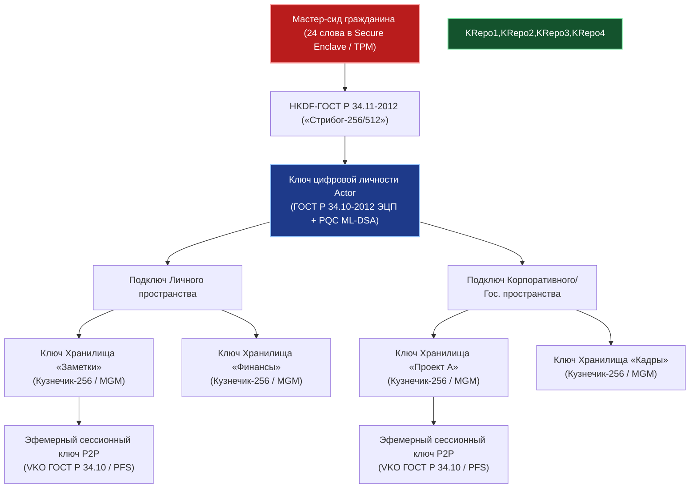
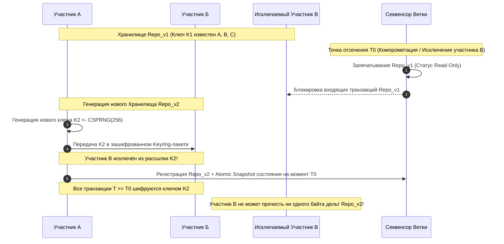
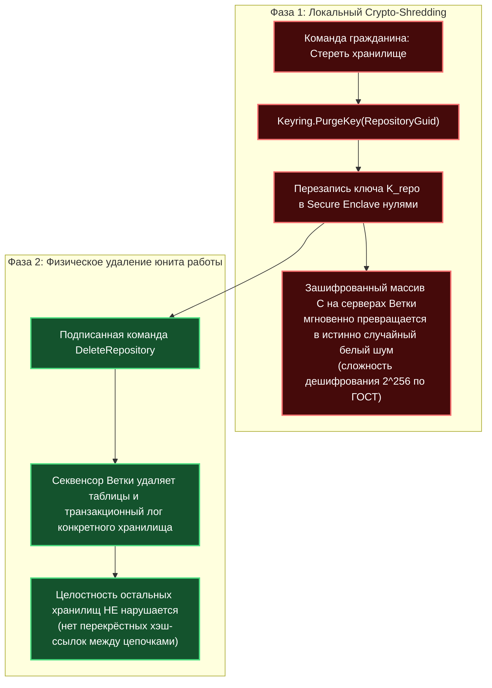

# Исследование информационной безопасности и криптографической защиты Хранилищ (Repositories)

> **Паспорт исследовательского документа**
> - **Идентификатор группы задач:** `10-10_03_Ecosystem_whitepaper_and_presentation`
> - **Ступень:** Ступень 01 (Исследование и доказательство работоспособности и безопасности Хранилищ)
> - **Базовый источник анализа:** `Технический документ платформы Турбаза` (разделы 1.1, 1.3, 1.5, 1.6, 1.7, 1.8, 2.4, 2.5, 4.1–4.4, 5.1, 7.1, 10.1–10.3, 11.1–11.2, 12.1, 13.1–13.3, 14.1–14.3, 15.1–15.3, 16.3)
> - **Нормативно-правовой контекст:** Федеральный закон № 152-ФЗ «О персональных данных», стандарты криптографической защиты ГОСТ Р 34.12-2015 («Кузнечик» / «Магма»), ГОСТ Р 34.11-2012 («Стрибог»), ГОСТ Р 34.10-2012 (ЭЦП на эллиптических кривых) и постквантовые решёточные алгоритмы ML-DSA
> - **Автор платформы:** Артём Владимирович Шамсутдинов
> - **Модель-исследователь и соавтор:** Gemini 3.8 Flash
> - **Статус документа:** Нормативный аналитический отчёт для Белой книги № 12

---

## 1. Локальная физическая изоляция на Листе (Leaf Runtime Isolation & Zero-Rendering)

### 1.1. Архитектурная модель изоляции среды исполнения
В платформе «Турбаза» клиентский узел **«Лист» (Leaf)** спроектирован не как пассивный тонкий клиент отображения, а как суверенная доверенная среда исполнения (**Trusted Execution Environment / Runtime**), объединяющая пользовательский интерфейс, транзакционный менеджер и реляционную базу данных SQLite на оконечном устройстве гражданина.

```mermaid
flowchart TD
    subgraph LEAF_RUNTIME ["Периметр узла «Лист» (Leaf Runtime)"]
        subgraph APPS ["Песочница прикладных модулей"]
            AppA["Приложение А (IFrame)<br/>origin: app-a.turbase.local"]
            AppB["Приложение Б (IFrame)<br/>origin: app-b.turbase.local"]
        end

        subgraph RPC_BUS ["Шина межконтекстного RPC (postMessage)"]
            Throttle["Фильтрация и дебаунсинг (RequestCorrelationId)"]
            Validator["Валидация прав сессии и токенов контекста"]
        end

        subgraph CORE ["Ядро Листа (Leaf Core Engine)"]
            RuleEngine["Ревизор правила: «Читай отовсюду, пиши только своё»"]
            TxCoordinator["Менеджер транзакций: сборка локального Atomic Snapshot"]
        end

        subgraph STORAGE ["Локальная СУБД Листа"]
            SqliteWASM["WASM SQLite (In-Memory)"]
            IndexedDB["IndexedDB (Зашифрованный WAL логов)"]
        end

        AppA -->|postMessage| Throttle
        AppB -->|postMessage| Throttle
        Throttle --> Validator
        Validator --> RuleEngine
        RuleEngine --> TxCoordinator
        TxCoordinator --> SqliteWASM
        SqliteWASM --> IndexedDB
    end

    classDef frame fill:#1e293b,stroke:#38bdf8,stroke-width:1.5px,color:#fff;
    classDef bus fill:#0f172a,stroke:#f59e0b,stroke-width:2px,color:#fff;
    classDef engine fill:#14532d,stroke:#4ade80,stroke-width:2px,color:#fff;
    classDef db fill:#312e81,stroke:#a78bfa,stroke-width:1.5px,color:#fff;

    class AppA,AppB frame;
    class Throttle,Validator bus;
    class RuleEngine,TxCoordinator engine;
    class SqliteWASM,IndexedDB db;
```

Изоляция опирается на три эшелона защиты:
1. **Доменная песочница (Origin Isolation):** Каждое независимое приложение исполняется внутри изолированного контейнера `<iframe>` / `Web Worker` с уникальным динамическим поддоменом (`app-<id>-<salt>.turbase.local`). Механизм Same-Origin Policy браузера аппаратно блокирует доступ одного приложения к памяти, переменным окружения, DOM-дереву и локальным хранилищам другого модуля.
2. **Асинхронная шина межконтекстного RPC (`postMessage`):** Приложения лишены прямого дескриптора локальной базы данных. Любое взаимодействие происходит через сериализованные сообщения `window.postMessage`, где каждый вызов снабжён криптографическим идентификатором корреляции (`RequestCorrelationId`), проверяется на превышение лимитов частоты (Rate Limiting/Debounce) и валидируется ядром Листа.
3. **Ревизор правила: «Читай отовсюду, пиши только своё» (`Read-Anywhere, Write-Self`):** На уровне SQL-парсера приложениям разрешены реляционные выборки (`SELECT`, `JOIN`) к чужим таблицам общей локальной базы данных, но **категорически запрещены прямые модификации (`INSERT`, `UPDATE`, `DELETE`)** в чужие схемы. Изменение данных чужого приложения возможно исключительно через авторизованный вызов его официального интерфейса `@Api()`.

### 1.2. Архитектура Zero-Rendering на серверах Ветки
Серверные узлы **«Ветка» (Branch)** функционируют в строгом безголовом (headless) режиме потоковой обработки бинарных транзакционных дельт:
- **0% серверного рендеринга:** Серверы Ветки не генерируют HTML, CSS или DOM-деревья;
- **100% перенос вычислений UI на Лист:** Формирование интерфейса, обработка шаблонов и визуализация полностью возложены на графические и центральные процессоры устройств пользователей;
- **Устранение классов уязвимостей:** Архитектура Zero-Rendering исключает атаки класса Server-Side Template Injection (SSTI), удалённое исполнение кода (RCE) через парсинг разметки и DoS-атаки на исчерпание памяти сервера при генерации динамических страниц.

---

## 2. Иерархия ключевых пространств (Keyring Architecture)

Ключевой материал пользователей не хранится в виде открытых статичных файлов конфигурации, а инкапсулируется внутри защищённого блокчейн-объекта — **Keyring Repository**.

### 2.1. Национальные стандарты криптографии и постквантовая стойкость
1. **Мастер-сид (Master Seed):** Энтропийный базис (24 слова), защищённый аппаратными модулями безопасности клиентского устройства (Secure Enclave, Android Keystore, TPM).
2. **Ключ цифровой личности (Identity Key):** Пара асимметричных ключей на базе ГОСТ Р 34.10-2012 (эллиптические кривые) в гибридной связке с постквантовым алгоритмом на решётках (Lattice-based PQC ML-DSA), гарантирующим защиту от квантового криптоанализа алгоритма Шора.
3. **Подключи пространств (Domain Subkeys):** Деривируются с использованием алгоритма HKDF на базе отечественной хэш-функции ГОСТ Р 34.11-2012 («Стрибог-256/512»). Они разграничивают доступ между личным, семейным и служебным контекстами.
4. **Симметричные ключи хранилищ ($K_{repo}$):** 256-битные ключи блочного шифра ГОСТ Р 34.12-2015 («Кузнечик») в режиме аутентифицированного шифрования (GCM / MGM). Каждое независимое хранилище шифруется собственным уникальным симметричным ключом. Для легковесных контроллеров IoT поддерживается 64-битный блочный шифр «Магма».
5. **Эфемерные сессионные ключи (Session Keys):** Одноразовые ключи прямого WebRTC P2P-обмена, вырабатываемые по протоколу Диффи-Хеллмана на эллиптических кривых (VKO ГОСТ Р 34.10-2012). Они обеспечивают Perfect Forward Secrecy (PFS): компрометация текущего сеанса не раскрывает историю предшествующих переговоров.

---

## 3. Механизм Security Forking (Ветвление хранилищ)

### 3.1. Несостоятельность классического отзыва ключей (Revocation Fallacy)
В традиционных распределённых системах отзыв ключа (CRL, OCSP) не решает проблему утечки данных: исключённый участник, уже имеющий локальную копию данных и старый ключ, сохраняет возможность дешифровать последующий сетевой трафик, если шифрование продолжается на том же ключе. Тотальное перешифрование терабайтных исторических архивов на клиентских устройствах создаёт колоссальный оверхед по дисковому вводу-выводу и сетевой полосе.

### 3.2. Математическая модель Security Forking
Платформа «Турбаза» решает данную проблему через механизм **Security Forking (ветвление хранилищ)**:

**Протокол выполнения Security Forking:**
1. **Точка отсечения ($T_0$):** При компрометации ключа или исключении участника $C$ (увольнение сотрудника, удаление пользователя из приватного чата) секвенсор Ветки блокирует запись новых транзакций в $Repo_{v1}$.
2. **Запечатывание архива:** Исходное хранилище $Repo_{v1}$ переводится в статус архивного (Read-Only). История транзакций $1 \dots N$ остаётся неизменной.
3. **Генерация нового хранилища:** Создаётся контейнер $Repo_{v2}$ с новым глобальным идентификатором `RepositoryGuid_v2`.
4. **Генерация нового ключа $K_2$:** В системном Keyring оставшихся участников ($A$ и $B$) генерируется криптографически стойкий псевдослучайный ключ $K_2 \leftarrow \text{CSPRNG}(256)$. Исключённый участник $C$ физически исключается из списка получателей нового Keyring-пакета.
5. **Фиксация состояния:** Актуальное состояние данных на момент $T_0$ переносится в $Repo_{v2}$ в виде компактного снимка (Snapshot).
6. **Криптографические гарантии:**
   - **Forward Secrecy:** Участник $C$ не обладает ключом $K_2$ и математически не способен расшифровать дельты $Repo_{v2}$ начиная с момента $T_0$;
   - **Backward Secrecy (при добавлении нового участника $D$):** Новый участник $D$, добавленный в $Repo_{v2}$, не получает ключ $K_1$ от архивного $Repo_{v1}$, что исключает несанкционированное чтение предшествующей закрытой переписки.

---

## 4. Аутентификация через ЕСИА/OIDC, идентификатор Actor и ZKP

### 4.1. Канонический кортеж Actor
Субъект генерации транзакций строго идентифицируется тройкой:
$$\text{Actor} = (\text{UserAccount}, \; \text{Terminal}, \; \text{Application})$$
Данный идентификатор служит исключительно для предотвращения коллизий первичных ключей при параллельной работе одного пользователя на разных устройствах и в разных приложениях. Он **не используется для анонимизации** и не служит средством сокрытия личности.

### 4.2. Трёхуровневая модель регистрации на Ветке
Платформа разграничивает три режима взаимодействия в зависимости от юридического контекста:

| Режим регистрации | Идентификация в обществе | Идентификация перед государством | Применяемые технологии | Прикладная область |
| :--- | :--- | :--- | :--- | :--- |
| **1. Полная анонимность** | Анонимен (псевдослучайный номер) | Анонимен (известен только сетевой контур района) | Локальный номер Ветки, изоляция репутации | Районные доски объявлений, локальные опросы |
| **2. Социальная анонимность** | Анонимен для общества | Деанонимизируем по решению суда (Банк России) | Доказательства с нулевым разглашением (ZKP), слепая подпись | Соседские сообщества, школьные чаты, родительские комитеты |
| **3. Поимённая регистрация** | Открыт (ФИО гражданина публично) | Полная идентификация | OIDC ЕСИА (Госуслуги), ЭЦП ГОСТ Р 34.10-2012 | Юридически значимые сделки, общедомовые собрания (ОСС), ГИС |

1. **Полная анонимность:** Пользователь получает псевдослучайный номер на районной Ветке. Ветка верифицирует сетевой контур района для защиты от внешнего спама. Накопленный рейтинг изолирован и не конвертируется при подключении кошелька.
2. **Социальная анонимность (ZKP и слепая подпись):** В публичном контуре личность гражданина скрыта, но экономически заверена: Банк России эмитирует строго один цифровой кошелёк на одного гражданина. Для участия в районных сообществах Ветка заверяет факт наличия права участия через слепую подпись (Blind Signature) и ZKP, но генерируемый псевдоним отвязан от паспортных данных.
3. **Поимённая регистрация:** Прямая интеграция через шлюз ЕСИА (Госуслуги) с выдачей сертификата ГОСТ Р 34.10-2012. Имя гражданина открыто связывается с его действиями и отражается в реестрах только после явного волеизъявления и согласия.

### 4.3. Протокол миграции и защита от профилирования (Unlinkability)
При переезде гражданина в другой регион сетевые метаданные старой Ветки могут быть использованы внешним наблюдателем для профилирования. В платформе реализован протокол перешифрования на Листе:
$$\text{Keyring}_{v1} \xrightarrow[\text{на клиенте}]{\text{Дешифрация}} \text{ClearData} \xrightarrow[\text{новым сидом}]{\text{Шифрование}} \text{Keyring}_{v2}$$
Новая районная Ветка получает криптографически независимый массив, что исключает возможность сопоставления активности гражданина в двух регионах по сигнатурам шифртекста.

---

## 5. Защита от атак Сивиллы (Anti-Sybil) и трансграничные связи

### 5.1. Экономический барьер против атак Сивиллы
Создание миллионов фиктивных аккаунтов (Sybil Attack) для захвата консенсуса нейтрализуется на экономическом и институциональном уровнях:
1. **Экономический якорь Банка России:** Легитимный экономический статус требует верифицированного цифрового кошелька Банка России (один кошелёк на один СНИЛС/паспорт). Затраты злоумышленника на генерацию ботов масштабируются линейно до запретительных величин (необходимость покупки дропов с прохождением биометрии ЕСИА);
2. **Сетевой антифрод Ветки:** Секвенсор анализирует плотность учётных записей на диапазоны IP-адресов и выявляет аномальные кластеры;
3. **Квотирование ресурсов (`user_factor_quotas`):** Пропускная способность конвейера Ветки выделяется узлу на основе коэффициента верификации (`user_factor`). Неверифицированные узлы получают жёстко ограниченные лимиты пропускной способности.

### 5.2. Безопасность межгосударственных связей (Cross-Sovereign Federation)
При трансграничном взаимодействии суверенитет и защита от внешнего проникновения гарантируются следующими принципами:
1. **Режим «Чёрный ящик» (Black Box):** Внешнему государству передаётся только подтверждённый идентификатор страны происхождения и хэш авторизованного сервиса. Внутренняя топология ведомственных Веток, адреса серверов и структура баз данных полностью скрыты от внешнего сканирования;
2. **Разделение плоскости управления и данных:** Запросы на соединение маршрутизируются строго по государственной вертикали (`Лист -> Ветка -> Ствол А -> Ствол Б -> Ветка -> Лист`), позволяя государству блокировать несанкционированный входящий транзит. Прямой обмен данными ведётся через E2EE WebRTC;
3. **Геополитическая резистентность (Sanction Immunity):** Каждая региональная Ветка хранит локальный репозиторий исходного кода проверенных приложений. При физическом обрыве внешних магистралей все прикладные сервисы продолжают полноценно работать внутри национальной юрисдикции.

---

## 6. Соблюдение 152-ФЗ и «Право на забвение» через Crypto-Shredding

### 6.1. Архитектурное соответствие 152-ФЗ («Частное остаётся частным»)
В платформе «Турбаза» защита персональных данных решена на структурном уровне:
- **Нулевой объём сырых ПДн в сети:** Паспортные данные, адреса, медицинские карты, история покупок и биометрия физически не покидают периметр пользовательского Листа;
- **Непроницаемые шифр-блоки на серверах:** На серверы Веток и Стволов поступают исключительно зашифрованные блоки (шифр ГОСТ «Кузнечик») или математические ZKP-доказательства;
- **Юридический статус узлов инфраструктуры:** Серверы Ветки и Ствола не имеют ключей расшифрования частных данных и, следовательно, **юридически и технически не являются операторами персональных данных**. Это исключает риски утечек баз данных государственного масштаба.

### 6.2. Механизм реализации «Права на забвение»
В классических блокчейнах удаление записи невозможно без нарушения связанности реестра. В архитектуре «Турбазы» каждое хранилище является независимым микро-блокчейном. «Право на забвение» (ст. 14, 21 152-ФЗ) реализуется двухфазным механизмом:

---

## 7. Строгое математическое доказательство защищённости от скомпрометированных серверов Ветки и Ствола

### 7.1. Модель нарушителя и формальная постановка задачи
Пусть узел пользователя $L$ («Лист») формирует конфиденциальную транзакцию $M$.  
Транзитная сеть состоит из узла $B$ («Ветка») и узла $T$ («Ствол»).  
**Модель нарушителя:** Узлы $B$ и $T$ рассматриваются как скомпрометированные противником $\mathcal{A}$, обладающим полным доступом к памяти, дискам и сетевым портам серверов (модель Malicious-but-Passive или Active Insider).

**Требуется доказать:**
1. **Конфиденциальность (Secrecy):** Противник $\mathcal{A}$ не способен восстановить открытый текст $M$ по перехваченному трафику;
2. **Невозможность подделки (Integrity & Authenticity):** Противник $\mathcal{A}$ не способен модифицировать $M$ в $M'$ или инъецировать фиктивный блок без немедленного обнаружения Листом-получателем.

### 7.2. Доказательство конфиденциальности
1. Симметричный ключ $K_{repo} \in \{0,1\}^{256}$ генерируется на Листе $L$ с использованием локального генератора псевдослучайных чисел криптографического качества (CSPRNG на аппаратной энтропии TRNG).
2. Ключ $K_{repo}$ инкапсулируется внутри защищённого `Keyring Repository` и никогда не передаётся во внешнюю сеть в открытом виде. При делегировании доступа он передаётся строго в зашифрованном виде на асимметричном ключе получателя ($PK_{recipient}$).
3. Полезная нагрузка транзакции шифруется:
   $$C = \mathbf{Enc}_{K_{repo}}(M, \; IV, \; AAD)$$
   где $\mathbf{Enc}$ — блочный шифр ГОСТ Р 34.12-2015 («Кузнечик») в режиме аутентифицированного шифрования с длиной ключа 256 бит; $IV$ — вектор инициализации; $AAD$ — открытые метаданные заголовка (`RepositoryGuid`, `ActorId`, `BlockSeqNumber`).
4. При условии стойкости шифра «Кузнечик»:
   $$\mathbf{Adv}_{\text{Kuznyechik}}^{\text{IND-CPA}}(\mathcal{A}) \le \epsilon \approx 2^{-256}$$
   Поскольку узлы $B$ и $T$ не имеют доступа к $K_{repo}$, преимущество противника $\mathcal{A}$ в дешифровании $M$ по шифртексту $C$ пренебрежимо мало ($\epsilon \approx 0$).

### 7.3. Доказательство целостности и невозможности подделки
1. Перед отправкой Лист $L$ вычисляет криптографический хэш заголовка и шифртекста по ГОСТ Р 34.11-2012 («Стрибог-256»):
   $$H = \mathbf{Hash}_{\text{Streebog-256}}(\text{Header} \parallel C)$$
   и формирует электронную цифровую подпись закрытым ключом $SK_{actor}$ по ГОСТ Р 34.10-2012:
   $$\sigma = \mathbf{Sign}_{SK_{actor}}(H)$$
2. Оконечный Лист-получатель верифицирует подпись открытым ключом автора:
   $$\mathbf{Verify}_{PK_{actor}}(H, \; \sigma) \stackrel{?}{=} \text{True}$$
3. Подделка подписи $\sigma$ эквивалентна решению задачи дискретного логарифмирования в группе точек эллиптической кривой (ECDLP) со сложностью порядка $2^{128}$ операций для 256-битного ключа.
4. Любая попытка узла $B$ модифицировать шифртекст ($C \to C'$) детерминированно приводит к несовпадению хэша ($H \neq H'$) и аннулированию подписи $\sigma$ на Листе получателя.

Следовательно, пользовательские данные физически защищены от несанкционированного чтения и модификации скомпрометированными серверами Ветки и Ствола. $\blacksquare$

---

## 8. Заключение

Анализ подтверждает, что архитектура Хранилищ платформы «Турбаза» обеспечивает беспрецедентный уровень информационной безопасности:
1. Локальная изоляция сред исполнения (доменные песочницы, Zero-Rendering) предотвращает межприложенческие утечки данных;
2. Многоуровневый стек Keyring на базе ГОСТ Р 34.12-2015, ГОСТ Р 34.10-2012 и постквантовых алгоритмов ML-DSA гарантирует долгосрочную криптографическую стойкость;
3. Механизм Security Forking устраняет фундаментальные изъяны классического отзыва ключей;
4. Реализация «Права на забвение» через локальный Crypto-Shredding обеспечивает абсолютное соответствие 152-ФЗ РФ без компрометации связности распределённой сети.
