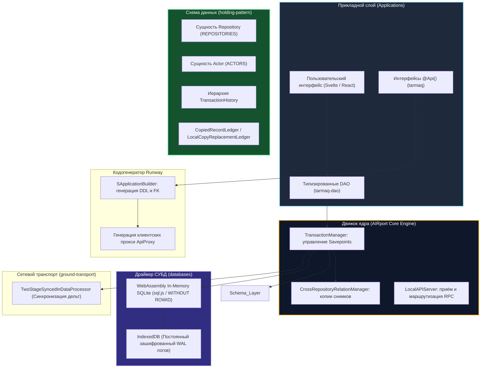

# Инженерное исследование реализации Хранилищ (Repositories) в TypeScript и ORM: Анализ кодовой базы AIRport

> **Паспорт исследовательского документа**
> - **Идентификатор группы задач:** `10-10_03_Ecosystem_whitepaper_and_presentation`
> - **Ступень:** Ступень 01 (Исследование и доказательство работоспособности и безопасности Хранилищ)
> - **Объект аудита:** Открытая кодовая база `AIRroot/AIRport` (`/Users/parents/Documents/beyond-decentralized/AIRroot/AIRport/`)
> - **Исследованные модули:** `schemas/holding-pattern/`, `schemas/final-approach/`, `generators/runway/`, `engines/terminal/`, `engines/tower/`, `platforms/web-terminal/`, `databases/sqljs/`, `databases/sqlite/`, `libs/ground-transport/`, `ORMs/tarmaq/`
> - **Патентный базис:** Патент США [US 10,902,016 B2](https://patents.google.com/patent/US10902016B2) (*«Autonomous interdependent repositories»*, изобретатель А. В. Шамсутдинов)
> - **Автор платформы:** Артём Владимирович Шамсутдинов
> - **Модель-исследователь и соавтор:** Gemini 3.8 Flash
> - **Статус документа:** Нормативный аналитический отчёт для Белой книги № 12

---

## 1. Архитектурный ландшафт и структура монорепозитория AIRport

Открытая кодовая база AIRport представляет собой законченную, промышленную реализацию распределённой реляционной платформы прямого владения данными. Она реализует математическую модель и методы, защищённые патентом США **US 10,902,016 B2**, и выступает в качестве программного ядра клиентского узла **«Лист» (Leaf)** платформы «Турбаза».



---

## 2. DDL-схема ядра: Пакет `@airport/holding-pattern`

Пакет `schemas/holding-pattern/` определяет фундаментальные таблицы и сущности, управляющие жизненным циклом Хранилищ, субъектов и истории модификаций.

### 2.1. Сущность `Repository` (таблица `REPOSITORIES`)
Расположена в `ddl/repository/Repository.ts`. Каждое Хранилище представляет собой дискретный микро-блокчейн:

```typescript
@Entity()
@Table({ name: "REPOSITORIES" })
export class Repository implements IRepository {
    @Column({ name: 'REPOSITORY_LID', nullable: false })
    @GeneratedValue()
    @Id()
    @DbNumber()
    _localId: Repository_LocalId = null;

    @Column({ name: "GUID", nullable: false })
    @DbString()
    GUID: Repository_GUID;

    @Column({ name: "NAME", nullable: false })
    @DbString()
    name: Repository_Name;

    @Column({ name: "CREATED_AT", nullable: false })
    @DbDate()
    createdAt: CreatedAt;

    @Column({ name: "FULL_APPLICATION_NAME", nullable: false })
    @DbString()
    fullApplicationName: Application_FullName;

    @Column({ name: "IMMUTABLE", nullable: false })
    @DbBoolean()
    immutable: Repository_Immutable;

    @Column({ name: "IS_PUBLIC", nullable: false })
    @DbBoolean()
    isPublic: Repository_IsPublic;

    @Column({ name: 'IS_LOADED', nullable: false })
    isLoaded: boolean = true; // false для легковесных ссылочных узлов-заглушек (stubs)

    @ManyToOne()
    @JoinColumn({ name: 'OWNER_USER_ACCOUNT_LID', referencedColumnName: 'USER_ACCOUNT_LID', nullable: false })
    owner: UserAccount;

    @OneToMany({ mappedBy: 'referencingRepository' })
    referencedRepositories: RepositoryReference[] = [];

    @OneToMany({ mappedBy: 'repository' })
    repositoryMembers: RepositoryMember[] = [];

    @OneToMany({ mappedBy: 'repository' })
    repositoryTransactionHistory: RepositoryTransactionHistory[] = [];
}
```

*Назначение полей:*
- `_localId`: целочисленный первичный ключ из локального генератора последовательностей (`Sequence`), обеспечивающий высокую компактность индексов SQLite;
- `GUID`: 128-битный глобальный криптографический строковый идентификатор репозитория;
- `isLoaded`: флаг, оптимизирующий загрузку графов зависимостей: позволяет Листу хранить частичные графы и лениво загружать связанные репозитории.

### 2.2. Сущность `Actor` (таблица `ACTORS`)
Расположена в `ddl/infrastructure/Actor.ts`. Фиксирует детерминированный контекст авторства записей:

```typescript
@Entity()
export class Actor implements IActor {
    @Id()
    @GeneratedValue()
    @DbNumber()
    @Column({ name: 'ACTOR_LID', nullable: false })
    _localId: Actor_LocalId;

    @Column({ name: 'GUID', nullable: false })
    @DbString()
    GUID: Actor_GUID;

    @ManyToOne()
    @JoinColumn({ name: 'USER_ACCOUNT_LID', referencedColumnName: 'USER_ACCOUNT_LID', nullable: false })
    userAccount: UserAccount;

    @ManyToOne()
    @JoinColumn({ name: 'TERMINAL_LID', referencedColumnName: 'TERMINAL_LID', nullable: false })
    terminal: Terminal;

    @ManyToOne()
    @JoinColumn({ name: "DB_APPLICATION_INDEX", referencedColumnName: "DB_APPLICATION_INDEX" })
    application: DdlApplication;
}
```

Субъект строго однозначно задаётся кортежем:
$$\text{Actor} = (\text{UserAccount}, \; \text{Terminal}, \; \text{Application})$$
Данная конструкция исключает коллизии генерации составных первичных ключей при одновременной работе одного гражданина на нескольких устройствах (смартфон, ноутбук) или в нескольких изолированных приложениях.

### 2.3. Четырёхуровневая иерархия журнала транзакций (Transaction Log)

Журнал транзакций в AIRport структурирован на четыре взаимосвязанных уровня:

```
TransactionHistory (Корневой квант локальной сессии пользователя)
 └── RepositoryTransactionHistory (Атомарная дельта конкретного Хранилища)
      └── OperationHistory (Группа изменений сущности: INSERT, UPDATE или DELETE)
           └── RecordHistory (Конкретная строка таблицы: ActorRecordId)
                ├── RecordHistoryOldValue (Историческое значение до модификации)
                └── RecordHistoryNewValue (Новое значение после модификации)
```

1. **`TransactionHistory` (`ddl/history/TransactionHistory.ts`):** объединяет группу изменений, вызванных одним действием пользователя; содержит признак типа транзакции (`LOCAL` или `REMOTE_SYNC`).
2. **`RepositoryTransactionHistory` (`ddl/history/RepositoryTransactionHistory.ts`):** атомарная транзакция конкретного репозитория. Содержит `saveTimestamp` и привязку к доверенному участнику (`RepositoryMember`).
3. **`OperationHistory` (`ddl/history/OperationHistory.ts`):** группирует операции по типу (`ChangeType: INSERT | UPDATE | DELETE`) и целевой таблице (`DdlEntity`).
4. **`RecordHistory` (`ddl/history/RecordHistory.ts`):** содержит `_actorRecordId` модифицированной строки, а также коллекции `oldValues` и `newValues` для точного отката и разрешения конфликтов.

---

## 3. Базовая сущность `AirEntity` и трёхкомпонентная адресация

### 3.1. Структура `AirEntity` (`schemas/final-approach/src/ddl/AirEntity.ts`)
Каждая прикладная реляционная таблица в платформе расширяет суперкласс `AirEntity`:

```typescript
@MappedSuperclass()
export abstract class AirEntity implements IAirEntity {
    @Id()
    @Column({ name: 'ACTOR_RECORD_ID', nullable: false })
    @GeneratedValue()
    @DbNumber()
    _actorRecordId?: ActorRecordId;

    @Id()
    @ManyToOne()
    @JoinColumn({ name: 'ACTOR_LID', referencedColumnName: 'ACTOR_LID', nullable: false })
    actor?: Actor;

    @Id()
    @ManyToOne()
    @JoinColumn({ name: 'REPOSITORY_LID', referencedColumnName: 'REPOSITORY_LID', nullable: false })
    repository: Repository;

    @Column({ name: 'CREATED_AT', nullable: false })
    @DbDate()
    createdAt: CreatedAt = new Date();

    @Transient()
    id?: AirEntity_GUID;
}
```

### 3.2. Локальный составной ключ и 11-сегментный глобальный EGUID
В движке строго разграничены два представления идентификатора строки:

1. **Локальный кластерный ключ SQLite:**
   В реляционной базе данных Листа таблица создаётся с первичным ключом:
   $$\text{Local PK} = (\text{REPOSITORY\_LID}, \; \text{ACTOR\_LID}, \; \text{ACTOR\_RECORD\_ID})$$
   Использование оптимизации SQLite `WITHOUT ROWID` гарантирует размещение данных непосредственно в B-дереве индекса.
2. **Глобальный распределённый идентификатор (EGUID):**
   Реализован в `apis/aviation-communication/src/AirEntityUtils.ts`:
   $$\text{EGUID} = \text{repository.GUID} + \text{'-'} + \text{actor.GUID} + \text{'-'} + \text{\_actorRecordId}$$
   Поскольку каждый UUID содержит 4 дефиса (5 сегментов), глобальный идентификатор строки представляет собой детерминированную строку ровно из 11 дефис-сегментов:
   `xxxxxxxx-xxxx-xxxx-xxxx-xxxxxxxxxxxx-yyyyyyyy-yyyy-yyyy-yyyy-yyyyyyyyyyyy-1042`

---

## 4. Межхранилищные связи и `CrossRepositoryRelationManager.ts`

### 4.1. Автоматическая декомпозиция внешних ключей в кодогенераторе Runway
В генераторе схем (`generators/runway/src/ddl/builder/application/SApplicationBuilder.ts`, строки 530–576) связь `@ManyToOne()` к сущности `AirEntity` автоматически разворачивается в три физических столбца реляционной таблицы:
1. `*_RID_*`: ссылка на репозиторий связанной записи;
2. `*_AID_*`: ссылка на актора-автора связанной записи;
3. `*_ARID_*`: порядковый номер связанной строки у данного актора.

### 4.2. Транзитивное замыкание снимков и реестр `CopiedRecordLedger`
Для предотвращения каскадных сетевых блокировок и конфликтов версий при ссылках на чужие хранилища движок применяет механизм **транзитивного замыкания снимков (Snapshot Closure)**:
- При фиксации ссылки на внешнюю сущность её оригинальные значения копируются непосредственно в текущее хранилище в качестве неизменяемого снимка на момент создания связи;
- Менеджер `CrossRepositoryRelationManager` фиксирует факт и координаты копии в реестре `CopiedRecordLedger`:

```typescript
// schemas/holding-pattern/src/manager/CrossRepositoryRelationManager.ts
@Injected()
export class CrossRepositoryRelationManager implements ICrossRepositoryRelationManager {
    addCopiedRecordLedger(
        manySideRelation: DbRelation,
        manySideEntity,
        copiedEntity
    ): CopiedRecordLedger {
        const copiedRecordLedger = new CopiedRecordLedger();
        copiedRecordLedger.repository = manySideEntity.repository;
        copiedRecordLedger.copyAppEntity = manySideRelation.relationEntity as any;
        copiedRecordLedger.copyActorRecordId = copiedEntity._actorRecordId;
        copiedRecordLedger.copyActor = copiedEntity.actor;
        copiedRecordLedger.copyRepository = copiedEntity.repository;

        return copiedRecordLedger;
    }
}
```

---

## 5. Транзакционный конвейер `TransactionManager.ts` и изоляция приложений

### 5.1. Управление транзакциями на границах `@Api()` через `SAVEPOINT`
Координатором изменений выступает `TransactionManager` (`engines/terminal/src/orchestration/TransactionManager.ts`):
1. Каждый внешний вызов интерфейса `@Api()` инициирует транзакционный контекст. Вложенные вызовы методов других приложений формируют иерархию через точки сохранения SQLite (`SAVEPOINT 'trans_uuid_1'`);
2. При фиксации транзакции метод `saveRepositoryHistory()` атомарно сбрасывает все накопленные дельты в таблицы журнала (`TransactionHistory`, `RepositoryTransactionHistory`, `OperationHistory`, `RecordHistory`);
3. Модуль реактивных подписок `activeQueries.rerunQueries()` сопоставляет изменённые таблицы со списком открытых пользовательских экранов и мгновенно пересчитывает Observable-запросы интерфейса;
4. Модуль `synchronizationOutManager` упаковывает подписанные дельты для отправки в сеть.

### 5.2. Доменная изоляция IFrame и шлюз сообщений
- Каждое приложение Листа исполняется внутри изолированного контейнера `HTMLIFrameElement` (`platforms/web-terminal/src/WebMessageGateway.ts`);
- Приложения не имеют прямого доступа к сокету базы данных SQLite;
- Взаимодействие происходит по протоколу `window.postMessage` с обязательной валидацией источника сообщения (`origin`) и типов параметров.

### 5.3. Правило доступа: «Читай отовсюду, пиши только своё»
- Таблицы базы данных изолируются префиксом имени приложения: `${appName}__${tableName}`;
- Приложение имеет право прямой записи (`INSERT`, `UPDATE`, `DELETE`) строго в таблицы своего пространства имён;
- Попытки прямой модификации таблиц чужого приложения блокируются ядром;
- Межприложенческая модификация данных производится исключительно через вызов официально опубликованных методов `@Api()`, проверяющих права вызывающей стороны.

---

## 6. Двухстадийный процессор синхронизации (`TwoStageSyncedInDataProcessor.ts`)

В библиотеке `libs/ground-transport/` реализован высокопроизводительный приём входящих сетевых дельт:
1. **Стадия 1 (`Stage1SyncedInDataProcessor.ts`):** парсит входящие сообщения `SyncRepositoryMessage`, транслирует глобальные GUID в локальные целочисленные идентификаторы базы данных Листа, выполняет проверку конфликтов версий по временным меткам `saveTimestamp` и формирует оптимизированные структуры `RecordUpdate`.
2. **Стадия 2 (`Stage2SyncedInDataProcessor.ts`):** минимизирует количество операций ввода-вывода (I/O batching) и атомарно применяет мутации к локальной реляционной базе данных.

---

## 7. Сопоставление понятий кодовой базы AIRport и концепций платформы «Турбаза»

| Архитектурная концепция платформы «Турбаза» | Реализация в кодовой базе AIRport | Соответствующий программный модуль |
| :--- | :--- | :--- |
| **Узел «Лист» (Leaf Runtime)** | Браузерный контейнер Web-Terminal с In-Memory SQLite | `platforms/web-terminal/`, `databases/sqljs/` |
| **Хранилище (Микро-блокчейн)** | Автономный репозиторий с независимым журналом | `ddl/repository/Repository.ts`, `ddl/history/` |
| **Канонический субъект (Actor)** | Кортеж $(\text{UserAccount}, \text{Terminal}, \text{Application})$ | `ddl/infrastructure/Actor.ts` |
| **Трёхкомпонентный первичный ключ** | Составной ключ $(\text{RepoLid}, \text{ActorLid}, \text{RecordId})$ | `schemas/final-approach/src/ddl/AirEntity.ts` |
| **Глобальный идентификатор (EGUID)** | 11-сегментная строка из двух GUID и порядкового номера | `apis/aviation-communication/src/AirEntityUtils.ts` |
| **Транзитивное замыкание снимков** | Копирование внешней сущности и фиксация в реестре | `CrossRepositoryRelationManager.ts`, `CopiedRecordLedger.ts` |
| **Трёхкомпонентный внешний ключ** | Автогенерация колонок `*_RID_*`, `*_AID_*`, `*_ARID_*` | `generators/runway/src/ddl/builder/application/SApplicationBuilder.ts` |
| **Изоляция сред исполнения** | Песочницы `<iframe>` и обмен через `postMessage` | `platforms/web-terminal/src/WebMessageGateway.ts` |
| **Межмодульные контракты и RPC** | Декораторы `@Api()`, клиентские `ApiProxy`, `LocalAPIServer` | `generators/runway/src/api/`, `engines/tower/` |
| **Локальная координация транзакций** | Управление точками сохранения `SAVEPOINT` на границах `@Api()` | `engines/terminal/src/orchestration/TransactionManager.ts` |
| **Правило «Пиши только своё»** | Изоляция таблиц по префиксу схемы приложения | `databases/sqlite/`, `engines/terminal/` |

---

## 8. Заключение

Инженерный аудит кодовой базы AIRport доказывает:
1. Архитектурная концепция Хранилищ (Repositories) полностью реализована в действующем программном коде на TypeScript и ORM;
2. Все требования патента США US 10,902,016 B2 (трёхкомпонентные идентификаторы, атомарное расщепление мульти-репозиторных транзакций, замкнутые журналы истории) воплощены в реляционных алгоритмах движка;
3. Механизм транзитивного замыкания снимков (`CrossRepositoryRelationManager`) и песочницы Web-Terminal обеспечивают практическую основу для суверенного, безопасного функционирования узла «Лист» платформы «Турбаза».
