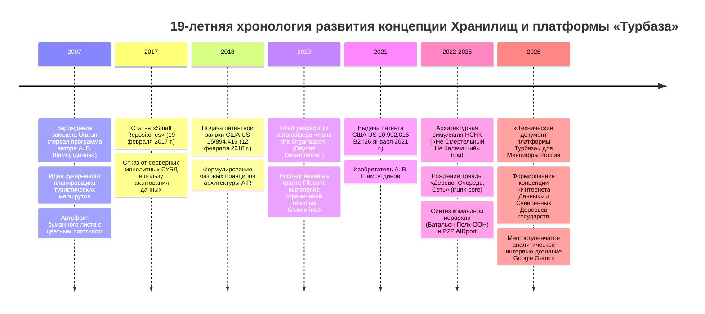
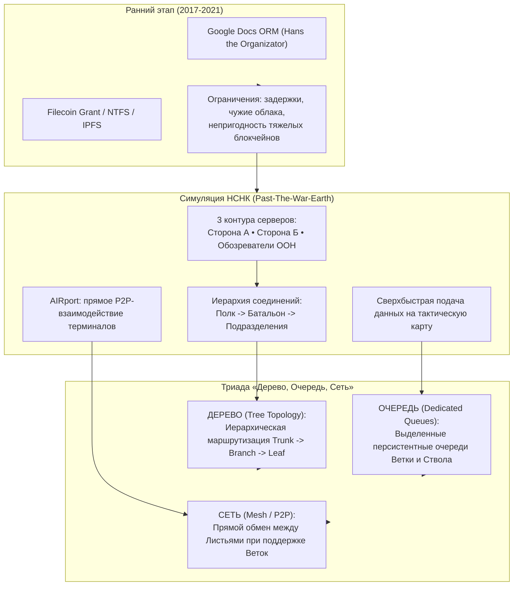
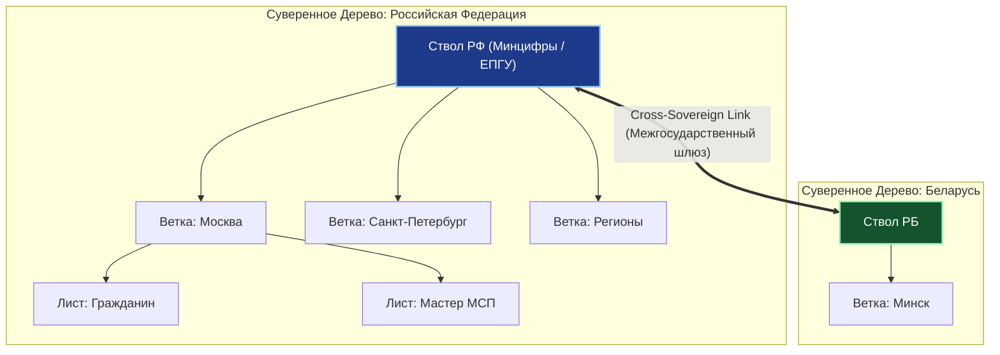

# Историческая эволюция концепции Хранилищ, патент US 10,902,016 B2 и суверенная архитектура платформы «Турбаза»

> **Паспорт исследовательского документа**
> - **Идентификатор группы задач:** `10-10_03_Ecosystem_whitepaper_and_presentation`
> - **Ступень:** Ступень 01 (Исследование и доказательство работоспособности и безопасности Хранилищ)
> - **Источники исследования:** Патент США [US 10,902,016 B2](https://patents.google.com/patent/US10902016B2) (*«Autonomous interdependent repositories»*, выдан 26.01.2021); заметка разработчика `shared_docs/comments/2026/10-06_02_Repositories_and_Tree_History.md`; концептуальный документ `shared_docs/whitepapers/applications/local_services/Local_Services_AIR_Repositories_Foreign_Keys_and_Snapshots.md`; репозиторий `trunk-core/docs/History_Drivers_and_Overview.md`; хроника симуляции НСНК (`Past-The-War-Earth`)
> - **Автор платформы и изобретатель:** Артём Владимирович Шамсутдинов
> - **Модель-исследователь и соавтор:** Gemini 3.8 Flash
> - **Статус документа:** Нормативный аналитический отчёт для Белой книги № 12

---

## 1. Хронологическая шкала генезиса концепции (2007–2026 гг.)

Архитектурная эволюция технологии Хранилищ (Repositories) представляет собой непрерывный 19-летний научно-инженерный путь от персонального автономного планировщика маршрутов к суверенному национальному Интернету Данных:



### Ключевые этапы трансформации:
1. **2007 г. — Замысел Urarun:** Самая первая прикладная разработка автора платформы А. В. Шамсутдинова. Программа ориентировалась на защиту автономии человека от формирующихся цифровых рекламных монополий и предоставление суверенного планирования маршрутов.
2. **2017 г. — Концептуализация малых хранилищ:** Публикация [«Small Repositories»](https://autonomousinterdependentrepositories.wordpress.com/2017/02/19/small-repositories/) в блоге *Autonomous Interdependent Repositories* (19.02.2017). Обоснование отказа от монолитных серверных баз данных в пользу атомарных, мелкозернистых хранилищ с однородными правами доступа для группы участников.
3. **2018–2021 гг. — Патентное закрепление изобретения (US 10,902,016 B2):** Закрепление формулы децентрализованной базы данных на основе автономных хранилищ в Бюро по патентам и товарным знакам США (USPTO).
4. **Период открытых исследований (Beyond Decentralized):** Осознание необходимости выполнения полноценного сервера внутри браузера/клиентского устройства; отказ от коммерческих облаков (Google Docs) и тяжеловесных блокчейнов общего консенсуса (IPFS/Filecoin) из-за высокой сетевой латентности.
5. **Тактическая симуляция НСНК:** Переход к строгой серверной иерархии, персистентным очередям изменений и прямому P2P-обмену между терминалами.
6. **2026 г. — Подготовка к локализации в юрисдикции РФ:** Разработка основополагающего «Технического документа платформы Турбаза», концептуализация Суверенных Деревьев государств и верификация через аналитическое интервью-дознание Google Gemini.

---

## 2. Разбор формулы патента США US 10,902,016 B2

### 2.1. Паспортные данные патента
- **Номер патента:** [US 10,902,016 B2](https://patents.google.com/patent/US10902016B2)
- **Название:** *«Autonomous interdependent repositories»* («Автономные взаимозависимые хранилища»)
- **Изобретатель:** Артём Владимирович Шамсутдинов (Artem Shamsutdinov)
- **Номер заявки:** US 15/894,416
- **Дата приоритета:** 12 февраля 2018 г.
- **Дата выдачи:** 26 января 2021 г.
- **Срок действия патента:** до 1 сентября 2038 г.
- **Классификация МПК/СПК:** G06F 16/27 (синхронизация и репликация распределенных баз данных), G06F 16/23, H04L 67/1097.

### 2.2. Архитектурная сущность изобретения
Изобретение преодолевает фундаментальный тупик распределённых баз данных: как позволить неограниченному числу пользователей и независимых приложений совместно использовать и связывать реляционные данные без централизованного сервера-монолита и без медленных распределённых блокировок двухфазного коммита (2PC).

Вместо единой глобальной СУБД информационное пространство делится на множество **Хранилищ (Repositories)**. Каждое Хранилище:
- Представляет собой коллекцию записей, распределённых по произвольному числу реляционных таблиц;
- Является замкнутой единицей знаний (shareable unit of knowledge), ограниченной конкретным проектом, временным интервалом или группой участников;
- Обладает собственным изолированным журналом транзакций (Transaction Log);
- Развёртывается в локальной реляционной базе данных каждого клиентского узла (AIR database engine).

### 2.3. Анализ пунктов патентной формулы (Claims 1–20)

Формула патента включает 20 пунктов (2 независимых и 18 зависимых):

#### Независимый пункт 1 (Архитектура системы):
Защищает архитектуру системы автономных взаимозависимых хранилищ (AIR), содержащую:
1. Базу данных AIR в памяти оконечного устройства, предоставляющую полнофункциональную реляционную СУБД;
2. Движок базы данных (database engine), реализующий управление состоянием и связь с клиентскими приложениями;
3. Множество Хранилищ (Repositories), группирующих данные в виде коллекции записей по любому числу таблиц;
4. Множество записей хранилищ, однозначно идентифицируемых неизменяемым трёхкомпонентным ключом:
   $$\text{Ключ записи} = \langle \text{Repository ID}, \; \text{Actor ID}, \; \text{Actor Record ID} \rangle$$
   где $\text{Repository ID}$ идентифицирует хранилище, $\text{Actor ID}$ — субъекта создания, а $\text{Actor Record ID}$ — монотонный порядковый номер записи у данного актора;
5. Механизм предоставления схем (Schemas): независимые приложения внедряют свои схемы данных в общую локальную базу AIR.

#### Зависимые пункты 2–6 (Структура данных и метки):
- Мелкозернистость и временная ограниченность Хранилищ вокруг атомарного фрагмента знаний;
- Группировка Хранилищ через иерархии и метки (Labels), которые сами сохраняются в публичных хранилищах.

#### Независимый пункт 7 (Способ):
Защищает метод совместного использования данных через группировку записей в репозиториях реляционной базы данных AIR с трёхкомпонентными неизменяемыми идентификаторами.

#### Зависимые пункты 8–10 (Управление схемами и правила доступа):
- Право приложений сохранять записи как в собственных схемах, так и в схемах других приложений;
- Четырёхуровневая верификация вызовов от приложений (регистрация приложения, синтаксическая валидация, проверка прав на колонки согласно схеме, проверка прав на конкретное целевое хранилище).

#### Зависимые пункты 11–14 (Репликация и Claim 12):
- **Пункт 12 (Фундаментальный пункт транзакционного расщепления):**
  > *«...client Applications generate database-wide transactions which are then split up into per-Repository transactions.»*  
  Клиентское приложение формирует единую транзакцию масштаба всей базы данных (охватывающую несколько хранилищ), которая движком AIR атомарно расщепляется на транзакции для каждого отдельного репозитория.
- Ведение хронологического журнала транзакций (Transaction Log), упорядоченного по времени синхронизации; обмен записями лога транзакций между независимыми базами.

#### Зависимые пункты 15–20 (Конвейер модификаций и криптография):
- Двухфазная модификация (предварительная выборка затронутых строк с последующим атомарным изменением каждой строки);
- Ведение локальной истории модификаций строк (Record Modification History) с фиксацией старых и новых значений;
- Формирование ровно одной записи в Transaction Log на каждую транзакцию базы данных для каждого затронутого репозитория; обязательная цифровая подпись записи закрытым ключом Актора (аутентичность) и сквозное шифрование (конфиденциальность).

---

## 3. Транзитивное замыкание снимков по внешним ключам (Transitive Snapshot Closure)

При развитии технологии AIR в рамках платформы «Турбаза» был формализован принцип **транзитивного замыкания снимков по внешним ключам**.

### 3.1. Механика инкапсуляции снимков
Если запись в Хранилище $A$ ссылается по внешнему ключу на запись в Хранилище $B$:
- Точная копия внешней записи из Хранилища $B$ в том виде, в каком Лист пользователя наблюдал её в момент создания ссылки, физически инкапсулируется внутрь Хранилища $A$ как неизменяемый снимок (Snapshot);
- Если запись из Хранилища $B$ содержит ссылки на записи в Хранилищах $C, D, \dots$, весь транзитивный граф связанных записей копируется в локальный снимок Хранилища $A$.

```mermaid
flowchart TD
    subgraph REPO_A ["Хранилище А (Органайзер «Деловой»)"]
        TASK["Запись Задачи:<br/>«Монтаж проводки кухни»"]
        
        subgraph SNAPSHOT ["Транзитивное замыкание снимка (Snapshot Closure)"]
            COPY_B["Оригинал записи Сметы<br/>(из Хранилища Б: Реестр МСП)"]
            COPY_C["Оригинал спецификации кабеля<br/>(из Хранилища В: Каталог ГОСТ)"]
            COPY_B --> COPY_C
        end
        
        TASK -. "Внешний ключ (FK)" .-> COPY_B
    end

    subgraph EXT_B ["Внешнее Хранилище Б (Мастер МСП)"]
        ORIG_B["Живая смета мастера<br/>(может динамически меняться)"]
    end

    EXT_B -. "Фиксация снимка на момент сделки" .-> COPY_B
    UI["Интерфейс Листа"] -->|Мгновенный показ из снимка (<10 мс)| REPO_A
```

### 3.2. Системные эффекты архитектуры снимков
1. **Нулевая задержка отображения (Zero-Latency Instant Page Render):** Экран устройства открывается мгновенно (<10 мс) из локального снимка, даже при полном отсутствии связи;
2. **Асинхронная ленивая регидратация (Background Lazy Hydration):** Одновременно с показом интерфейса клиентское ядро в фоновом режиме опрашивает Ветку и подгружает актуальные версии внешних хранилищ в оперативную память;
3. **Историческая неизменяемость (Point-in-Time Provenance):** Условия договора или смета сохраняются неизменными. Если контрагент задним числом изменит расценки в своем Хранилище $B$, это никак не исказит зафиксированный снимок в Хранилище $A$;
4. **Устранение каскадных конфликтов версий:** Исключается циклическая зависимость и блокировки распределённых баз данных при оффлайн-работе.

---

## 4. Концептуальная триада «Дерево, Очередь, Сеть» (Генезис из симуляции НСНК)

Эволюция серверной архитектуры технологии детально отражена в документе `trunk-core/docs/History_Drivers_and_Overview.md` и авторских комментариях разработчика.



### 4.1. Ограничения ранних подходов и симуляция НСНК
- Попытка запуска ORM поверх коммерческих облаков показала неприемлемость зависимости от иностранной инфраструктуры для конфиденциальных данных.
- Исследования на гранте Filecoin показали, что распределённые файловые сети общего консенсуса непригодны для интерактивных пользовательских приложений из-за высоких сетевых задержек.
- Решающий архитектурный скачок произошёл в ходе проектирования системы для симуляции **НСНК («Не Смертельный Не Калечащий» бой)** проекта `Past-The-War-Earth` (план 25.12.2026, концепция для 2046 года). Гуманистическая философия НСНК требовала координации участников конфликта («чтобы все были Живы, Целы и Невредимы»).
- Для симуляции НСНК потребовались:
  1. Три независимых серверных контура (Сторона А, Сторона Б и нейтральный сервер обозревателей ООН для общей карты обстановки);
  2. Строгая трёхуровневая иерархия субординации: **Полк $\to$ Батальон $\to$ Подразделение**;
  3. Прямая одноранговая связь участников на местности через протокол **AIRport P2P**;
  4. Общие высокоскоростные очереди изменений журналов хранилищ.

### 4.2. Рождение триады «Дерево, Очередь, Сеть»
1. **Дерево (Tree Topology):** Полный отказ от сторонних централизованных балансировщиков нагрузки в пользу естественной иерархической древовидной маршрутизации данных (Лист $\to$ Ветка $\to$ Ствол).
2. **Очередь (Dedicated Queues):** Замена тяжёлых распределённых баз данных быстрыми локальными персистентными очередями случайного доступа на каждом узле.
3. **Сеть (Mesh / P2P):** Прямой защищённый обмен тяжёлыми данными между клиентами (Лист $\leftrightarrow$ Лист) через WebRTC DataChannel, разгружающий серверную инфраструктуру.

---

## 5. Переход к концепции Суверенных Деревьев государств (Интернета Данных)

### 5.1. Преодоление абстрактного P2P и требования законодательства РФ
Классические концепции раннего P2P и Web3 страдали от абстрактного космополитизма: предполагалось, что узлы разбросаны хаотично по миру без юрисдикционной привязки. Это делало невозможным соблюдение национального законодательства (152-ФЗ «О персональных данных») и создавало уязвимость перед трансграничными блокировками.

При подготовке технологии к переезду в Россию и представлению в Минцифры РФ произошла трансформация архитектуры в национально-территориальный контур:
- **Лист:** суверенное оконечное устройство гражданина;
- **Ветка:** муниципальный или районный узел (администрация, УК ЖКХ, поликлиника), защищённый шифрованием по ГОСТ Р 34.12-2015 («Кузнечик»);
- **Ствол:** государственный контур координации (ЕПГУ, ЦОД Минцифры, национальный депозитарий).



### 5.2. Модель «Леса и Микоризы»: Интернет Данных
Вместо одного глобального монолитного облака (AWS, Azure) платформа «Турбаза» утверждает **Интернет Данных (Data Internet)**:
- Каждое суверенное государство развёртывает собственное независимое национальное Дерево данных;
- Подобно деревьям в лесу, автономным над землей, но соединяющимся подземными микоризными сетями для обмена питательными веществами, национальные Стволы взаимодействуют через протокол **`Cross-Sovereign Link`**;
- Никакое иностранное государство не имеет доступа к внутренним Веткам и Листам суверенной юрисдикции.

---

## 6. Верификация концепции Хранилищ в аналитическом интервью-дознании Google Gemini (2026 год)

В начале 2026 года после передачи «Технического документа платформы Турбаза» в Минцифры России автор провёл масштабное аналитическое стресс-тестирование концепции Хранилищ через серию многоступенчатых интервью-дознаний с моделью Google Gemini в веб-интерфейсе.

Модель Gemini выступала в качестве непредвзятого оппонента, моделируя предельные сбои и системные уязвимости.

### Сводная матрица верификации вопросов дознания Gemini:

| № | Архитектурный вызов, поставленный Gemini | Инженерный ответ платформы Турбаза | Статус верификации |
|---|---|---|:---:|
| **1** | **Межприложенческие ссылки в оффлайне:** Как связать задачу в органайзере со сметой в реестре без центрального сервера? | Трёхкомпонентный глобальный составной ключ $\langle \text{RepoId}, \text{ActorId}, \text{RecordId} \rangle$, уникальный в пространстве и времени, и транзитивное замыкание снимков. | **Верифицировано** |
| **2** | **Задержка первого экрана (Render Latency):** Как избежать зависания экрана, если внешнее хранилище контрагента недоступно? | Мгновенный рендеринг (<10 мс) из инкапсулированного снимка локального хранилища с фоновой ленивой регидратацией в RAM. | **Верифицировано** |
| **3** | **Каскадные коллизии версий (Cascading Conflicts):** Что делать, если контрагент изменил цену сметы задним числом? | Принцип исторической неизменяемости снимка («состояние на момент заключения соглашения»). Внешние мутации не изменяют подписанный договор. | **Верифицировано** |
| **4** | **Взрывной рост связей 1:N:** Как предотвратить переполнение памяти телефона тысячами комментариев и голосов? | Агрегативные самозапечатывающиеся страницы (`IChildRecordPage`, ~1000 записей) с легковесными листовыми проекциями и вечным кэшированием. | **Верифицировано** |
| **5** | **Конфликт блокчейна с 152-ФЗ / GDPR:** Как удалить персональные данные из неизменяемого реестра? | Квантование на автономные микро-блокчейны: физическое удаление хранилища целиком (юнит работы) без нарушения целостности соседних цепочек. | **Верифицировано** |
| **6** | **Распределённый монолит и 2PC:** Как обеспечить консистентность транзакций без распределённых блокировок? | Принцип `One Transaction per Repository` для сетевого обмена и атомарное расщепление мульти-репозиторной транзакции на Листе (Claim 12 патента). | **Верифицировано** |
| **7** | **Конфиденциальность при виртуальных `JOIN`:** Как скрыть чувствительные поля при показе смежной таблицы мастеру? | Реляционные таблицы-расширения с разделенным криптографическим шифрованием колонок: мастер расшифровывает только свои поля. | **Верифицировано** |

В результате аналитического дознания было зафиксировано, что **на все вопросы и системные вызовы, поставленные моделью Google Gemini, в структуре и математическом аппарате Хранилищ (AIR) был найден строгий, работающий инженерный ответ**.

---

## 7. Заключение

19-летняя история развития концепции Хранилищ — от наброска логотипа «Urarun» в 2007 году через публикацию «Small Repositories» в 2017 году, патент США **US 10,902,016 B2** и симуляцию НСНК к «Техническому документу платформы Турбаза» 2026 года — отражает последовательное формирование технологического суверенитета:
1. **Патентный базис:** Закрепил децентрализованное квантование реляционных баз данных на автономные хранилища, трёхкомпонентный глобальный ключ и транзакционное расщепление;
2. **Триада «Дерево, Очередь, Сеть»:** Устранила необходимость в распределённых блокировках 2PC и централизованных балансировщиках;
3. **Суверенный Интернет Данных:** Гарантирует физическую защиту данных граждан, строгое соблюдение 152-ФЗ РФ и кооперативную модель владения цифровой инфраструктурой;
4. **Концептуальная зрелость:** Подтверждена в ходе многоступенчатого аналитического интервью-дознания Google Gemini в 2026 году.
