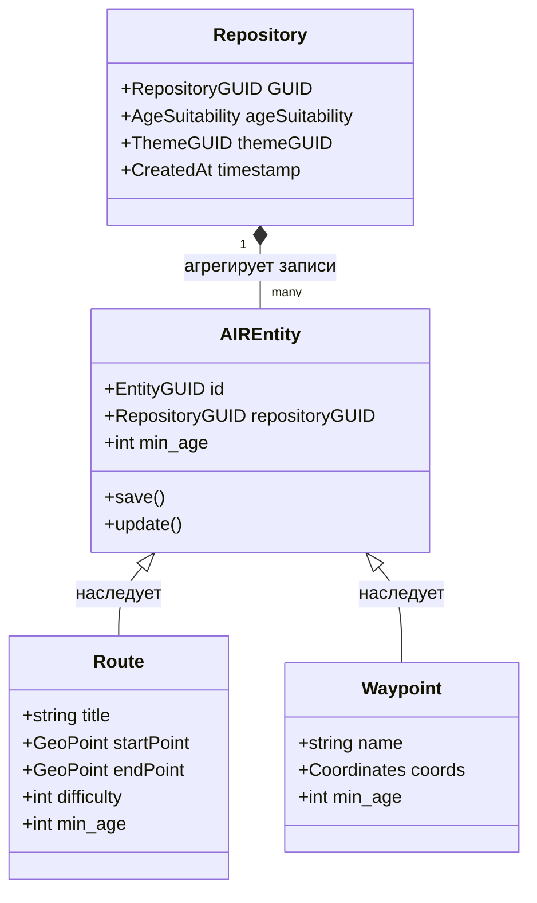
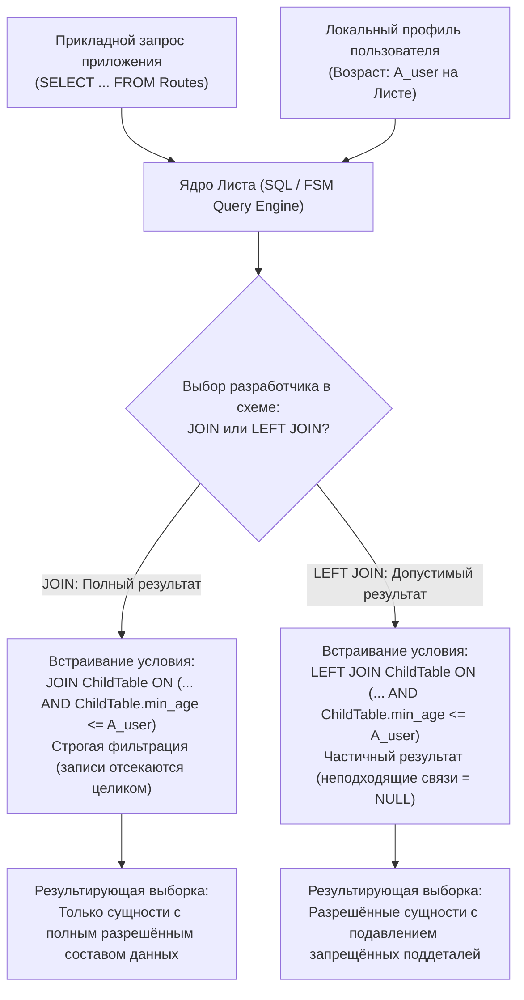

# Архитектура защиты детей в платформе «Турбаза»

## Нормативно-техническая спецификация механизмов возрастного разграничения доступа на уровне ядра Листа, реляционных сущностей AIREntity и изолированных Хранилищ

*Классификация: Системная безопасность, защита несовершеннолетних от нежелательной информации, реляционная модель данных `AIREntity`, локальная фильтрация запросов ядра Листа (`JOIN` / `LEFT JOIN`), криптографическая автономия устройства*  
*Концептуальный автор платформы и архитектор: Артём Владимирович Шамсутдинов*  
*Модель-соавтор инженерной спецификации: Gemini 3.8 Flash*  
*Связанные документы: [README.md](README.md), [02_Uratur_Family_Age_Differentiation.md](02_Uratur_Family_Age_Differentiation.md), [UraTur_Public_Tags_and_Index_Cooperatives.md](UraTur_Public_Tags_and_Index_Cooperatives.md), [Белая книга № 01](../../01_platform_overview_whitepaper.md)*  
*Исходные репозитории: [AIRport](https://github.com/Data-Independence-Network/AIRport), [holding-pattern](https://github.com/Data-Independence-Network/holding-pattern)*

---

## 1. Введение и нормативные основания

Защита детей и подростков от информации, способной причинить вред их здоровью и развитию, является безусловным приоритетом законодательства Российской Федерации (включая Федеральный закон № 436-ФЗ). В традиционных централизованных веб-платформах контроль доступа неизбежно влечёт за собой принудительную деанонимизацию: сбор паспортных данных родителей, передачу биометрии или накопление цифровых профилей несовершеннолетних во внешних облачных базах данных, что создаёт критические риски утечек персональных данных.

Платформа «Турбаза» решает эту задачу принципиально иным путём: **гарантия защиты ребёнка закладывается непосредственно в архитектуру реляционного ядра на устройстве пользователя (Листе)**. Механизмы фильтрации действуют математически и аппаратно на локальном узле, исключая возможность показа несовершеннолетнему неподобающего контента, не требуя при этом передачи сведений о возрасте ребёнка во внешнюю сеть.

---

## 2. Модель сущностей и реляционный базис AIREntity

### 2.1. Атрибут пригодности по возрасту (`ageSuitability`) в Хранилище
В архитектурном ядре AIRport неделимой криптографической и логической единицей изоляции данных выступает **Хранилище (Repository)**. В схеме метаданных сущности `Repository` ([holding-pattern/src/ddl/repository/Repository.ts](https://github.com/Data-Independence-Network/holding-pattern)) предусмотрен системный атрибут:

$$\text{ageSuitability} \in \mathbb{N}_0 \quad (0, 6, 12, 16, 18+)$$

Данное поле определяет минимальный возраст допуска ко всему массиву записей, упакованных в данное Хранилище.

### 2.2. Оптимизация локальной СУБД: денормализация поля `min_age`
В высоконагруженных мобильных и встраиваемых сценариях выполнение динамического соединения (`JOIN`) каждой прикладной таблицы с системной таблицей `Repository` для проверки возрастного ценза приводило бы к деградации производительности СУБД SQLite на Листе.

Для оптимизации скорости ответа реляционного ядра платформы применяется архитектурное решение:
- В базовый класс реляционных сущностей **`AIREntity`** вводится системная колонка **`min_age`**;
- Во время создания записи или фиксации изменений Хранилища значение `ageSuitability` родительского Хранилища автоматически копируется в колонку `min_age` каждой сохраняемой строки;
- Колонка `min_age` является локальной (не синхронизирующейся во внешние каналы на текущем этапе), что обеспечивает мгновенную фильтрацию по индексу внутри одной таблицы без накладных расходов на межтабличные соединения.

### 2.3. Гранулярное шифрование и многоролевые Хранилища
В развитии ядра платформы реализован аппарат нескольких ролей внутри единого Хранилища: отдельные фрагменты в журнале изменений (Change History Journal) могут шифроваться разными криптографическими ключами. Это позволяет в перспективе размещать в одном Хранилище записи с дифференцированным цензом, где расшифровка записей повышенного возрастного порога невозможна без соответствующего ключа роли. На базовом уровне изоляция по Хранилищам обеспечивает абсолютную границу отсечения.

---

## 3. Автоматическое встраивание проверок ядром Листа: семантика `JOIN` и `LEFT JOIN`

Ключевым инвариантом платформы «Турбаза» является невозможность обхода возрастного фильтра на уровне прикладного пользовательского интерфейса. Разработчик прикладного приложения не пишет ручные условия `WHERE age >= ...` — фильтрация внедряется автоматически транслятором запросов Листа.

При генерации SQL-запроса ядро Листа сопоставляет локальный возрастной профиль активного пользователя $A_{\text{user}}$ с порогом `min_age`.

### 3.1. Стратегия `JOIN` (Строгая фильтрация полной информации)
При использовании стратегии `JOIN` разработчик декларирует, что сущность имеет смысл для пользователя только тогда, когда все её связанные составные части полностью доступны по возрасту:
- Если хотя бы одна связанная запись имеет `min_age > A_{\text{user}}`, родительская запись исключается из результирующего набора данных;
- **Пользовательский опыт:** Несовершеннолетний пользователь не видит объект целиком, исключается сам факт присутствия недопустимого объекта в каталогах или на карте.

### 3.2. Стратегия `LEFT JOIN` (Мягкая деградация и частичная выдача)
При использовании стратегии `LEFT JOIN` разработчик допускает частичный показ информации:
- Основная родительская сущность (например, семейный туристический маршрут) отображается в интерфейсе;
- Связанные дочерние сущности с возрастным цензом выше возраста пользователя (например, отдельная радиальная тропа по крутому склону с цензом 16+) возвращаются со значением `NULL`;
- **Пользовательский опыт:** Пользователь видит общую информацию о маршруте, но потенциально опасные или не предназначенные для детей ответвления автоматически скрываются из схемы движения, не создавая риска дезориентации.

---

## 4. Иерархия цензов и принцип максимального ограничения

Информационное пространство платформы организовано по многоуровневой топологии:

$$\text{Тема (Theme)} \longrightarrow \text{Общественный тег (Tag)} \longrightarrow \text{Хранилище (Repository)} \longrightarrow \text{Запись (Record)}$$

Каждый уровень наделен собственным возрастным ограничением:
- **Тема:** глобальный контекст предметной области (например, «Экстремальный альпинизм» — 18+; «Городские прогулки» — 0+);
- **Общественный тег:** фасетная классификация кооперативных индексов (например, `#скалолазание_без_страховки` — 18+; `#детская_площадка` — 0+);
- **Хранилище:** криптографически изолированный контейнер записей (`ageSuitability`).

### 4.1. Формула результирующего возрастного ценза
Эффективный возрастной ценз допуска к информации вычисляется по принципу максимального ограничения:

$$A_{\text{effective}} = \max\left(A_{\text{Theme}}, \; A_{\text{Tag}}, \; A_{\text{Repository}}\right)$$

### 4.2. Упреждающая экономия трафика: отсечение на сетевом уровне
Если эффективный ценз Хранилища превышает возраст локального пользователя Листа ($A_{\text{effective}} > A_{\text{user}}$), Лист **полностью отказывается от скачивания данного Хранилища с Ветки**:
1. Не расходуется мобильный трафик устройства;
2. Не расходуется локальная память flash-накопителя;
3. Физически исключается возможность извлечения недопустимых данных путём прямого анализа бинарных файлов на устройстве ребёнка.

---

## 5. Приватность несовершеннолетних и соответствие законодательству

### 5.1. Принцип автономии пользовательского устройства
В отличие от корпоративных экосистем, требующих передачи персональных данных несовершеннолетних на центральные серверы авторизации, платформа «Турбаза» строго следует правилу:
- Числовой возраст пользователя хранится исключительно на локальном доверенном узле (Листе);
- Внешние узлы сети (Ветки и Ствол) оперируют только открытыми метаданными Хранилищ (`ageSuitability`) и не получают сведений о том, кто именно запрашивает или фильтрует данные;
- Архитектура полностью нейтральна к конкретным государственным стандартам подтверждения возраста (от родительской локальной настройки до интеграции с государственными доверенными шлюзами ЕСИА/Госуслуги, если это будет прямо предписано федеральным законодательством).

---

## 6. Резюме архитектурных инвариантов защиты детей

| Архитектурный уровень | Механизм реализации | Назначение и гарантия |
| :--- | :--- | :--- |
| **Хранилище (Repository)** | Системный атрибут `ageSuitability` | Атомарная единица разграничения и сетевой фильтрации |
| **Реляционная запись (AIREntity)** | Локальная колонка `min_age` | Скоростная бессоединительная (`O(1)`) фильтрация запросов в SQLite |
| **Транслятор запросов Листа** | Автоматическое внедрение условий (`JOIN` / `LEFT JOIN`) | Невозможность обхода фильтра прикладным интерфейсом приложения |
| **Сетевой клиент синхронизации** | Отказ от загрузки Хранилищ с $A_{\text{eff}} > A_{\text{user}}$ | Экономия трафика и физическое отсутствие нежелательных байтов на диске |
| **Профиль пользователя** | Локальное хранение возраста без сетевой утечки | Полное соблюдение 152-ФЗ и тайна частной жизни |
