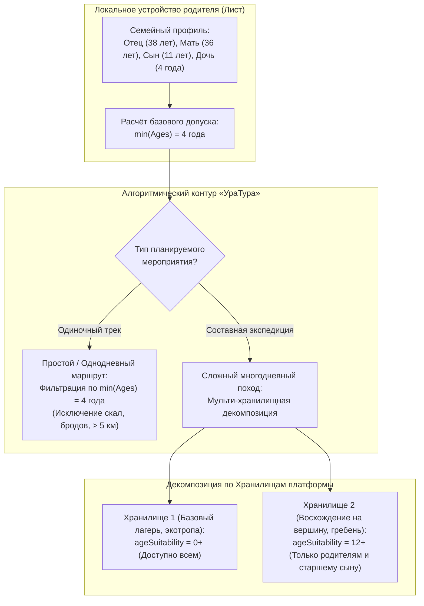
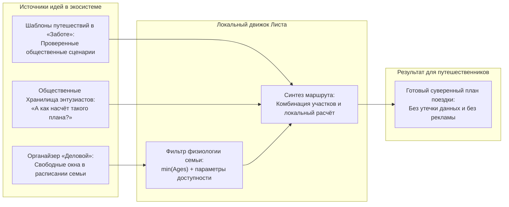

# Концепция приложения «УраТур» и семейная возрастная дифференциация путешествий

## Методология проектирования децентрализованного туристического навигатора, многоуровневого планирования маршрутов и безопасного семейного краеведения

*Классификация: Прикладное программное обеспечение, семейный туризм, краеведческая навигация, возрастная дифференциация рисков, мульти-хранилищная декомпозиция экспедиций, локальная синтетическая маршрутизация*  
*Концептуальный автор платформы и архитектор: Артём Владимирович Шамсутдинов*  
*Модель-соавтор инженерной спецификации: Gemini 3.8 Flash*  
*Связанные документы: [README.md](README.md), [01_Child_Protection_Architecture.md](01_Child_Protection_Architecture.md), [03_Yandex_Maps_Integration.md](03_Yandex_Maps_Integration.md), [UraTur_Ecosystem_Impact_Guide.md](UraTur_Ecosystem_Impact_Guide.md), [UraTur_Public_Tags_and_Index_Cooperatives.md](UraTur_Public_Tags_and_Index_Cooperatives.md)*

---

## 1. Введение: Миссия и архитектурный профиль «УраТура»

Современная индустрия туризма и картографии ориентирована преимущественно на коммерциализированные потоки: продвижение платных аттракционов, бронирование отелей и рекламу заведений общепита. В то же время фундаментальные потребности семей — безопасность детей, доступное родное краеведение, экологические тропы, посильные пешеходные маршруты и совместный развивающий досуг — остаются вне фокуса крупных агрегаторов.

Приложение **«УраТур»** в экосистеме «Турбаза» создаётся как **автономный суверенный навигатор, краеведческий реестр и умный планировщик путешествий** широкого спектра: от однодневных городских пешеходных экскурсий по историческим центрам до многодневных межрегиональных экспедиций по природным заповедникам и горным хребтам.

Ключевым принципом «УраТура» является **абсолютная безопасность и возрастная пригодность маршрутов для каждого члена семьи**, реализуемая через архитектурные механизмы изолированных Хранилищ (Repositories) и локального анализа данных на Листе.

---

## 2. Проблема семейного планирования и архитектурный ответ «УраТура»

### 2.1. Ограничения централизованных сервисов
1. **Отсутствие дифференциации по физиологии детей:** Традиционные навигаторы рассчитывают маршруты усреднённо, предлагая семьям с колясками или дошкольниками тропы с непреодолимыми курумниками, заболоченными бродами или опасными скальными прижимами;
2. **Утечка семейных геоданных:** Передача планов отпусков, точек ночёвок и геопозиции детей на удалённые облачные серверы ставит под угрозу физическую безопасность семьи;
3. **Рекламная навязчивость:** Вместо природных памятников и безопасных родников алгоритмы продвигают коммерческие точки партнёров.

### 2.2. Архитектурный подход «УраТура»
- **Локальный суверенный профиль семьи:** Состав семьи, возраст детей и индивидуальные физические ограничения хранятся исключительно на локальном Листе родителей и никогда не отправляются во внешнюю сеть;
- **Двухконтурная модель безопасности:** Сочетание автоматического фильтра минимального возраста группы ($\min(\text{Ages})$) и декомпозиции сложных походов на независимые Хранилища с разным возрастным допуском.



---

## 3. Механизм мульти-хранилищной декомпозиции семейных путешествий

В платформе «Турбаза» Хранилище (Repository) является **неделимой единицей информации и криптографической защиты**. Если в семье есть дети разных возрастных категорий, и все они используют «УраТур» на своих смартфонах, приоритетная инженерная задача приложения — **структурно разделять походные планы по независимым Хранилищам**.

### 3.1. Пример составной экспедиции на Южный Урал
Рассматривается семейный выезд в природный парк (родители, подросток 13 лет и ребёнок 5 лет):

1. **Хранилище № 1: «Семейная стоянка и экотропа к роднику» (`ageSuitability = 0+`)**
   - Точки стоянки, подъезд на автомобиле, оборудованные костровища, безопасная дощатая тропа, визит-центр парка;
   - Загружается на устройства всех участников (включая смартфон 5-летнего ребёнка);
   - Ребёнок видит карту базового лагеря, детские познавательные квесты и интерактивные краеведческие метки флоры и фауны.

2. **Хранилище № 2: «Радиальный выход на скальный хребет» (`ageSuitability = 12+`)**
   - Перепад высот 650 м, курумники, крутые участки с провешенными перилами, видовые площадки на обрывах;
   - Загружается только на устройства родителей и 13-летнего подростка;
   - На устройстве младшего ребёнка данное Хранилище физически отсутствует: оно не скачивается с Ветки и не отображается в интерфейсе, исключая риск случайного ухода ребёнка на опасную тропу.

---

## 4. Категоризация маршрутов и параметры карточки `AIREntity`

Для гарантированного отсечения неприемлемых маршрутов сущность туристического маршрута (`RouteEntity`), наследующая `AIREntity`, содержит расширенный комплекс объективных параметров безопасности:

```typescript
interface UraTurRouteEntity extends AIREntity {
    // Возрастные и категорийные ограничения
    min_age: number;               // Базовый возрастной ценз (копия ageSuitability)
    difficulty_level: 1 | 2 | 3 | 4 | 5; // Категория сложности (от 1 - семейная прогулка до 5 - экспедиция)
    
    // Физические характеристики
    distance_meters: number;       // Полная длина трека
    elevation_gain_meters: number; // Суммарный набор высоты
    max_slope_degrees: number;     // Максимальный угол уклона тропы
    
    // Инфраструктура и безопасность
    has_water_sources: boolean;    // Наличие проверенных питьевых родников
    has_restrooms: boolean;        // Наличие санитарных зон и туалетов
    stroller_accessible: boolean;  // Доступность для детских и инвалидных колясок
    cellular_coverage_pct: number; // Процент покрытия сотовой связью (0..100%)
    emergency_access_minutes: number; // Расчётное время прибытия спасательных служб (МЧС)
    
    // Временные и сезонные рамки
    allowed_seasons: SeasonFlags;  // Зима, весна, лето, осень
    weather_sensitivity: number;   // Чувствительность к осадкам (риск размыва тропы)
}
```

### 4.1. Матрица физиологических порогов для детей
На основе рекомендаций спортивного туризма и педиатрии алгоритм «УраТура» на Листе применяет предельные физические пороги:

| Возраст ребёнка | Макс. дневной переход | Макс. набор высоты | Допустимые типы покрытия | Обязательные условия |
| :---: | :---: | :---: | :---: | :---: |
| **0–3 года** | до 3 км (в коляске/слинге) | до 50 м | Асфальт, утрамбованный грунт | Доступность медпункта, санитарные зоны |
| **4–6 лет** | до 5–6 км | до 150 м | Грунтовые тропы без осыпей | Родники, отсутствие крутых обрывов |
| **7–11 лет** | до 12–15 км | до 400 м | Лесные тропы, умеренные камни | Укрытия от непогоды, устойчивая связь |
| **12–15 лет** | до 20–25 км | до 900 м | Горные тропы, курумник, броды | Навыки ориентирования, инструктаж |

---

## 5. Механическая подача идей без рекламной слежки

«УраТур» отвергает принципы централизованного профилирования пользователей, применяемые коммерческими рекомендательными системами. Подача идей для поездок строится исключительно на **механических, прозрачных и подконтрольных пользователю процедурах**:



1. **Шаблоны путешествий в сети «Забота»:** В прикладной теме туризма сообщества краеведов и опытные путешественники публикуют готовые открытые шаблоны (маршруты выходного дня, школьные экскурсии, исторические кольца). Пользователь может загрузить шаблон, адаптировать его под возможности своей семьи и сохранить в собственное локальное Хранилище.
2. **Общественные Хранилища и народный диалог:** Путешественники делятся своими маршрутами в открытых географических ветках («А как насчёт такого плана для поездки на майские праздники?»). Любой пользователь может скопировать публичный план целиком или фрагментарно, не раскрывая своих персональных дат и планов.
3. **Локальный синтез на Листе:** Если семья предпочитает полную конфиденциальность, «УраТур» выполняет сопоставление данных на устройстве без единого сетевого запроса:
   - Из органайзера «Деловой» извлекаются свободные выходные дни;
   - Из локальной базы Листа берутся точки интереса (POI) в радиусе доступности автомобиля или пригородного транспорта;
   - Применяется фильтр $\min(\text{Ages})$, и на экране формируется персональная подборка безопасных маршрутов.

---

## 6. Выводы и значение для экосистемы «Турбаза»

Возрастная дифференциация в «УраТуре» превращает туризм из зоны повышенного риска в инструмент гармоничного воспитания и сплочения поколений:
1. Родители получают абсолютную уверенность в безопасности рекомендованных троп;
2. Дети защищены от неприемлемого контента и непосильных физических нагрузок на уровне архитектуры Листа;
3. Персональные данные семьи, геотреки и история передвижений остаются суверенной тайной дома, защищённой российскими криптографическими алгоритмами.
