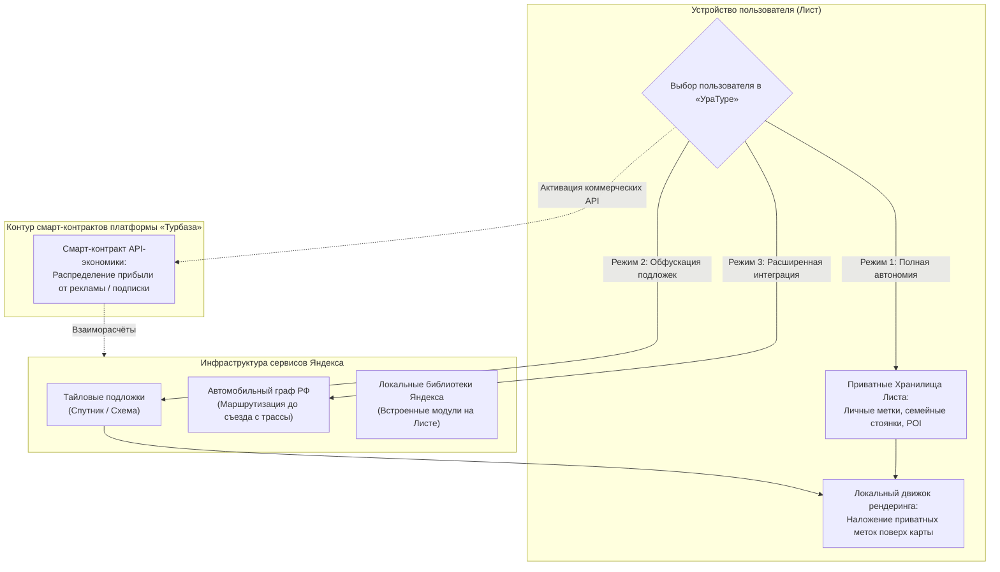
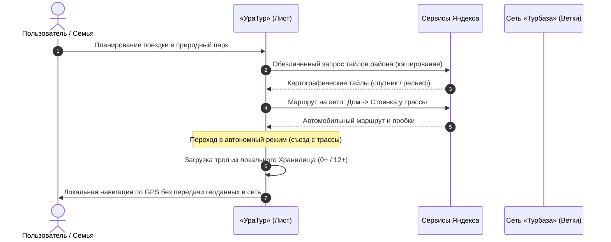

# Архитектура интеграции «УраТура» с Яндекс Картами

## Спецификация гибридного картографического взаимодействия, экономики смарт-контрактов, офлайн-автономии и защиты тайны частной жизни

*Классификация: Геоинформационные системы, внешние картографические API, автономия Листа, смарт-контракты распределения прибыли, офлайн-кэширование тайлов, обфускация геоданных*  
*Концептуальный автор платформы и архитектор: Артём Владимирович Шамсутдинов*  
*Модель-соавтор инженерной спецификации: Gemini 3.8 Flash*  
*Связанные документы: [README.md](README.md), [01_Child_Protection_Architecture.md](01_Child_Protection_Architecture.md), [02_Uratur_Family_Age_Differentiation.md](02_Uratur_Family_Age_Differentiation.md), [UraTur_Ecosystem_Impact_Guide.md](UraTur_Ecosystem_Impact_Guide.md), [05_Uratur_History_and_Evolution.md](05_Uratur_History_and_Evolution.md)*

---

## 1. Концептуальные принципы: свобода выбора и гибридная модель

Приложение «УраТур» решает комплексную задачу объединения передовых коммерческих картографических сервисов страны с архитектурными гарантиями неприкосновенности частной жизни граждан. Компания «Яндекс» обладает наиболее развитой, точной и обновляемой картографической инфраструктурой в Российской Федерации (спутниковые снимки, схема дорожного графа, оперативная дорожная обстановка, данные общественного транспорта).

Взаимодействие «УраТура» с экосистемой Яндекса базируется на **безусловной свободе выбора пользователя**:
1. **Режим абсолютной автономии (Zero-Leakage Offline):** Пользователь не передаёт во внешнюю сеть никаких сведений. Все расчеты, поиск точек интереса (POI) и построение пешеходных маршрутов выполняются локальным движком Листа на основе предварительно загруженных данных;
2. **Режим выборочного взаимодействия (Selective Sharing):** Пользователь задействует отдельные сервисы Яндекса (например, загрузку визуальных подложек или геокодирование адресов) через механизмы локальной обфускации;
3. **Режим полнофункциональной интеграции (Full Synergy):** Пользователь подключает расширенные сервисы Яндекса (пробки, автомобильная навигация до места старта похода), при этом взаимодействие регламентируется прозрачной экономикой смарт-контрактов платформы «Турбаза».

---

## 2. Экономика смарт-контрактов и партнерство с Яндексом

В традиционной централизованной модели разработчики сторонних приложений либо выплачивают непосильные лицензионные платежи за корпоративные API-ключи, либо принудительно отдают весь пользовательский трафик в распоряжение рекламного трекера корпорации.

Платформа «Турбаза» предлагает взаимовыгодную модель сотрудничества, защищённую децентрализованными смарт-контрактами:
- **Пропорциональное разделение доходов:** Если пользователь использует расширенный набор услуг Яндекса в «УраТуре», активируются соответствующие смарт-контракты платформы. Они обеспечивают перечисление Яндексу справедливой доли прибыли от просмотров таргетированных объявлений в приложении либо отчислений из платформенной подписки пользователя;
- **Собственные прикладные библиотеки Яндекса:** Яндекс получает возможность выпускать специализированные легковесные модули (библиотеки) для платформы «Турбаза». Такие модули выполняют первичную обработку геоданных непосредственно на Листе, кардинально снижая нагрузку на серверные мощности Яндекса и минимизируя объём конфиденциальных сведений, передаваемых по сети.

---

## 3. Автономия в походах и локальные офлайн-карты

Одной из главных проблем туристической навигации является нестабильность или полное отсутствие сотовой связи в горных, лесных и таёжных районах. 

### 3.1. Механизм фонового пакетного кэширования
«УраТур» реализует технологию упреждающего сохранения картографических подложек:
- При формировании или загрузке плана путешествия (из «Заботы» или открытых Хранилищ) приложение рассчитывает пространственный полигон района путешествия с буферной зоной безопасности;
- Через клиентские библиотеки Яндекса Лист выполняет фоновую пакетную загрузку растровых и векторных тайлов заданного масштаба во flash-память устройства;
- В ходе полевого похода навигация работает непрерывно в режиме отключённой сети (Airplane Mode), сохраняя заряд аккумулятора смартфона.

---

## 4. Защита тайны частной жизни и механизмы обфускации

Для исключения профилирования перемещений и интересов семьи со стороны внешних серверов предусмотрена многоуровневая архитектура защиты:

### 4.1. Двухконтурная модель учётных записей: «Планирование ⟷ Исполнение»
Архитектурная идея разделения жизненного цикла маршрута:
1. **Анонимная регистрация на этапе проектирования:** Составление предварительного плана путешествия, подбор точек интереса и просмотр картографических слоев производятся с использованием временного обезличенного идентификатора;
2. **Зарегистрированный счёт на этапе активной навигации:** Подключение к платным сервисам или координация с группой осуществляется через подтверждённую учётную запись с оплатой по смарт-контракту, не связанную с историей анонимного поиска.

### 4.2. Архитектурное разделение маршрутного графа
«УраТур» физически разделяет логику движения на два независимых слоя:
- **Магистральный автотранспортный слой (Яндекс):** Запрос к сервисам Яндекса формируется только для участка дорог общего пользования (например, «Маршрут от дома до стоянки лесничества у подножия горы»). Сервер Яндекса видит стандартную поездку на автомобиле;
- **Пешеходно-краеведческий слой (Лист «УраТура»):** Пешеходная тропа, стоянки, родники, палаточные лагеря и радиальные выходы обрабатываются и визуализируются исключительно локальным движком Листа по данным изолированных Хранилищ. Внешний картографический сервис не получает ни одной точки пешеходного трека.

---

## 5. Системная модульность: вклад «УраТура» в платформу «Турбаза»

Хотя «УраТур» не является системообразующим каркасом всей платформы (в отличие от базовых протоколов Листа или органайзера «Деловой»), создаваемые в нём решения проектируются с высоким уровнем абстракции:
- **Модуль пространственной обфускации геозапросов;**
- **Библиотека локального кэширования внешних тайловых подложек;**
- **Унифицированный интерфейс взаимодействия со смарт-контрактами провайдеров геоданных.**

Эти компоненты формулируются как отчуждаемые системные модули платформы «Турбаза», доступные для повторного использования в смежных прикладных проектах (городской транспорт, логистика МСП, ЖКХ и реестры недвижимости).
