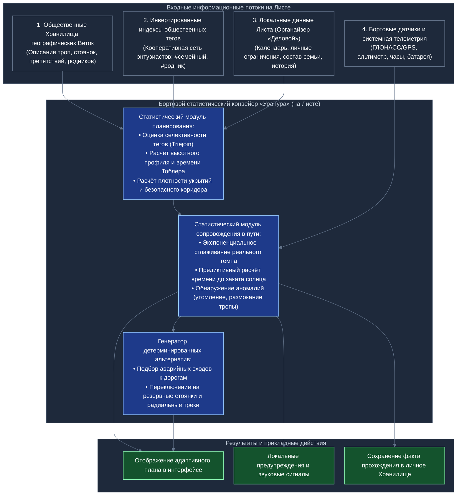
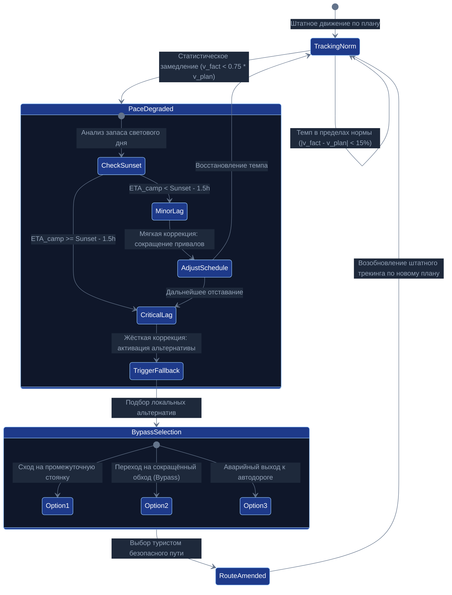
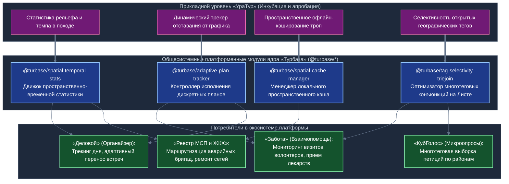

# Статистические программные модули «УраТура»: Автономный анализ на Листе, динамическая корректировка маршрута и системное абстрагирование в ядро платформы

## Концептуальный документ архитектурных исходных данных для Белой книги № 11 («УраТур») и Белой книги № 12 («Экосистема платформы "Турбаза"»)

*Классификация: Прикладное программное обеспечение, статистический анализ на устройстве, автономная навигация, адаптивное планирование, системное абстрагирование модулей*  
*Концептуальный автор платформы и архитектор: Артём Владимирович Шамсутдинов*  
*Модель-соавтор инженерной спецификации: Gemini 3.8 Flash*  
*Связанные документы: [README.md](README.md), [02_Uratur_Family_Age_Differentiation.md](02_Uratur_Family_Age_Differentiation.md), [03_Yandex_Maps_Integration.md](03_Yandex_Maps_Integration.md), [UraTur_Public_Tags_and_Index_Cooperatives.md](UraTur_Public_Tags_and_Index_Cooperatives.md)*

---

## 1. Введение и проблемный контекст предметной области

В традиционных картографических и туристических сервисах централизованных технологических монополий планирование путешествий и навигация неразрывно связаны с непрерывной эксплуатацией личных данных пользователя. Корпоративные алгоритмы рекомендаций функционируют как непрозрачные «чёрные ящики» в удалённых дата-центрах:
1. **Тотальное профилирование и утрата тайны частной жизни:** местоположение гражданина, темп его перемещения, состав спутников, физические кондиции, частота остановок и предпочтения фиксируются на серверах провайдера для последующей продажи таргетированной рекламы;
2. **Коммерческая манипуляция поисковой выдачей:** пользователю навязываются платные туристические базы, партнёрские гостиницы и платные экскурсии, в то время как бесплатные природные тропы, оборудованные волонтёрами стоянки, родники и исторические памятники искусственно отодвигаются на задний план;
3. **Критическая зависимость от непрерывного канала связи:** попадая в зоны со слабым сигналом или в условия полного отсутствия сотовой сети (в лесных массивах, горных ущельях, на водных маршрутах), централизованное приложение теряет способность анализировать обстановку, пересчитывать график движения и предупреждать о рисках.

Прикладное решение экосистемы «Турбаза» — децентрализованный туристический навигатор и краеведческий реестр **«УраТур»** — базируется на диаметрально противоположной архитектурной парадигме: **полнофункциональный статистический анализ выполняется непосредственно на устройстве пользователя (на Листе)**. 

Статистическая обработка в «УраТуре» строго детерминирована, прозрачна, математически воспроизводима и абсолютно автономна. Она не требует передачи телеметрии во внешние сети, опирается на открытые данные распределённых Хранилищ и локальную историю Листа, а также гарантирует динамическую адаптацию планов в режиме реального времени при любых внешних катаклизмах и в условиях стопроцентного отсутствия интернет-связи.

---

## 2. Источники данных и архитектура статистического конвейера на Листе

Статистический конвейер «УраТура» развёртывается в изолированном локальном окружении Листа (смартфон, планшет, защищённый бортовой терминал или персональный компьютер) и агрегирует четыре независимых информационных потока.


*Схема 1. Архитектура локального статистического конвейера приложения «УраТур» на Листе.*

### 2.1. Входные компоненты конвейера
1. **Открытые общественные Хранилища географических Веток (Public Repositories):** картографические треки, топографические описания, перепады высот, паспорта перевалов, родников и стоянок, прошедшие верификацию в сообществах путешественников и краеведов.
2. **Индексы открытых общественных тегов (Public Tag Cooperative Indices):** легковесные дескрипторы мощности и распределения тематических меток (`#детский_маршрут`, `#родник_с_водой`, `#сложный_перевал`), доставляемые через кооперативную сеть индексных серверов.
3. **Локальный контекст пользователя из органайзера «Деловой»:** располагаемый временной бюджет, личный календарь экспедиции, автономный профиль семьи (минимальный возраст участников $\min(\text{Ages})$, физическая подготовка), индивидуальные предпочтения по темпу.
4. **Бортовая телеметрия физического устройства:** текущие географические координаты (ГЛОНАСС/GPS), показания барометрического высотомера, акселерометра/шагомера, системное астрономическое время, заряд аккумулятора устройства и температура батареи.

---

## 3. Статистические программные модули предварительного планирования маршрута

На этапе подготовки к походу или экскурсии статистические модули «УраТура» решают задачу формирования оптимального графика движения, расчёта ресурсных потребностей и проверки безопасности без вызова внешних вычислительных серверов.

### 3.1. Модуль расчёта физиологических затрат времени по рельефу (Модифицированная функция Тоблера)
Для оценки реальной продолжительности перехода по горным и пересечённым ландшафтам применяется математический аппарат швейцарского географа Вальдо Тоблера (Tobler's Hiking Function) с введением адаптивных коэффициентов возрастной группы и состояния поверхности.

Базовая скорость пешехода на ровной горизонтальной поверхности принимается равной $v_0 \approx 5{,}0$ км/ч. Скорость движения на склоне с уклоном $s = \frac{dh}{dx} = \tan(\theta)$ описывается экспоненциальной зависимостью:
$$W(s) = 6 \cdot \exp\left(-3{,}5 \cdot |s + 0{,}05|\right)$$
Нормализованная скорость движения на расчётном участке:
$$v(s) = v_0 \cdot \frac{W(s)}{W(0)} \cdot K_{\text{surface}} \cdot K_{\text{group}}$$

где:
- $W(0) \approx 5{,}03$ км/ч — опорная скорость на плоском грунте;
- $K_{\text{surface}} \in [0{,}4; \ 1{,}0]$ — статистический коэффициент типа покрытия (асфальт $= 1{,}0$, лесная утрамбованная тропа $= 0{,}9$, курумник/камни $= 0{,}6$, заболоченная низина $= 0{,}4$);
- $K_{\text{group}} \in [0{,}5; \ 1{,}0]$ — возрастной и командный коэффициент, детерминированно вычисляемый на Листе на основе данных семейного профиля:
$$K_{\text{group}} = \min_{u \in \text{Group}} \left( \psi(\text{age}_u, \ \text{fitness}_u) \right)$$

Общее расчётное время движения по маршруту, разбитому на $N$ однородных микросегментов длиной $\Delta L_i$ и перепадом высот $\Delta h_i$, составляет:
$$T_{\text{plan}} = \sum_{i=1}^N \frac{\Delta L_i}{v(s_i)} + \sum_{j=1}^M T_{\text{rest}}^{(j)}$$
где $T_{\text{rest}}^{(j)}$ — детерминированные интервалы обязательного привала (например, 10 минут отдыха на каждые 50 минут непрерывного движения для групп с детьми).

### 3.2. Модуль статистической плотности инфраструктуры безопасности (Safety Buffer Density)
Маршрут проходит проверку на наличие достаточного «коридора безопасности». Программный модуль строит непрерывную функцию расстояния от текущей точки трека до ближайших ключевых объектов инфраструктуры:
- $D_{\text{water}}(x)$ — расстояние до гарантированного питьевого источника (родник, обустроенная скважина);
- $D_{\text{shelter}}(x)$ — расстояние до оборудованного укрытия (навес, охотничья изба, туристский приют);
- $D_{\text{road}}(x)$ — расстояние до дороги с возможностью автомобильной эвакуации;
- $D_{\text{cellular}}(x)$ — расстояние до зоны статистически устойчивого покрытия сотовой связи (по открытым агрегированным данным сообщества).

Если на каком-либо отрезке маршрута расстояние $D_{\text{road}}(x)$ превышает предельно допустимый радиус автономности для текущей возрастной категории (например, 7 км для семей с детьми до 8 лет), модуль выносит в интерфейс предупреждение и автоматически ищет точки возможных промежуточных радиальных выходов.

### 3.3. Модуль механического комбинирования идей путешествий (Deterministic Idea Synthesizer)
Вместо непрозрачных рекомендаций «УраТур» реализует механический фильтрационный синтез:
1. Запрашиваются пересечения открытых тегов через алгоритм наискорейшего прыжкового соединения (Leapfrog Triejoin) по локально кэшированным индексам;
2. Из результирующего множества открытых Хранилищ извлекаются варианты с возрастным цензом $\text{ageSuitability} \le \min(\text{Ages})$;
3. Фильтруется подмножество по доступному временному окну из органайзера «Деловой» ($T_{\text{plan}} \le T_{\text{available}}$);
4. На экран выводятся точные математические варианты без ранжирования в пользу спонсоров: варианты сортируются строго по физической близости, дате верификации тропы или минимальному перепаду высот.

---

## 4. Модули динамической корректировки плана непосредственно во время поездки

Главное практическое испытание туристического навигатора происходит не в кабинете за компьютером, а в полевых условиях: при резком ухудшении погоды, физическом утомлении участников группы, травмах или потере тропы в сумерках. 

В условиях отсутствия сотовой сети все расчёты производятся бортовым статистическим процессором на Листе в фоновом режиме.


*Схема 2. Конечный автомат (FSM) адаптивной корректировки маршрута в пути при статистической фиксации падения темпа.*

### 4.1. Модуль фильтрации телеметрии и экспоненциального сглаживания реального темпа (Pace Fatigue Tracker)
Сырые показания спутниковой навигации подвержены шумам и разбросу из-за многолучевого отражения сигнала в лесу и ущельях. Бортовой модуль выполняет первичную калмановскую фильтрацию координат и рассчитывает мгновенную путевую скорость $v_{\text{instant}}(t)$.

Для предотвращения ложных срабатываний при кратковременных остановках (завязать шнурки, свериться с ориентиром) вычисляется экспоненциально взвешенное скользящее среднее (EMA) темпа:
$$v_{\text{actual}}(t) = \alpha \cdot v_{\text{instant}}(t) + (1 - \alpha) \cdot v_{\text{actual}}(t - \Delta t)$$
где $\alpha = \frac{2}{K + 1}$ — сглаживающий фактор для временного окна в $K$ минут (оптимальное значение $K = 15$ минут, $\alpha \approx 0{,}125$).

Модуль непрерывно сравнивает фактический сглаженный темп с плановым темпом Тоблера для текущего рельефа:
$$\delta_v(t) = \frac{v_{\text{actual}}(t)}{v_{\text{plan}}(s(t))}$$

Если коэффициент выполнения плана $\delta_v(t)$ устойчиво опускается ниже порога $0{,}75$ на протяжении более 30 минут, система фиксирует статистически достоверную деградацию темпа группы (накопление усталости, размягчение грунта или ухудшение самочувствия участников).

### 4.2. Предиктивный модуль границы светового дня (Daylight Threshold Predictor)
Ключевая угроза безопасности в пешем походе — наступление темноты до выхода к месту оборудованной стоянки. 

Модуль вычисляет астрономическое время захода солнца $t_{\text{sunset}}(\text{lat}, \ \text{lon}, \ \text{date})$ непосредственно на Листе по формулам небесной механики (алгоритм NOAA Solar Calculator), без внешних серверов погоды:
1. Вычисляется склонение солнца $\delta$ и уравнение времени $EoT$;
2. Находится часовой угол захода солнца $\omega_0 = \arccos(-\tan(\phi) \cdot \tan(\delta))$;
3. Определяется точное локальное время заката $t_{\text{sunset}}$.

Далее модуль производит непрерывный расчёт ожидаемого времени прибытия в лагерь ($\text{ETA}_{\text{camp}}$) с учётом текущего сглаженного темпа $v_{\text{actual}}$:
$$\text{ETA}_{\text{camp}} = t_{\text{curr}} + \sum_{k = \text{curr}}^{\text{finish}} \frac{\Delta L_k}{v_{\text{actual}} \cdot \frac{W(s_k)}{W(s_{\text{curr}})}}$$

Вычисляется резерв безопасности светового дня:
$$\Delta T_{\text{safety}} = t_{\text{sunset}} - \text{ETA}_{\text{camp}}$$

Критерии вмешательства алгоритма:
- **Зелёная зона ($\Delta T_{\text{safety}} \ge 2{,}0$ ч):** движение строго по графику, лагерь будет разбит засветло;
- **Жёлтая зона ($1{,}0 \text{ ч} \le \Delta T_{\text{safety}} < 2{,}0$ ч):** риск поздней установки лагеря. Модуль рекомендует сократить время ближайших привалов;
- **Красная зона ($\Delta T_{\text{safety}} < 1{,}0$ ч):** критическая угроза наступления темноты на сложном участке. Модуль активирует сценарий аварийной перестройки маршрута.

### 4.3. Модуль подбора запасных вариантов и аварийных сходов (Dynamic Fallback Resolver)
При переходе в красную зону модуль не просто выдаёт звуковое предупреждение, а мгновенно генерирует три готовых альтернативных сценария из локально сохранённого топологического графа:
1. **Сценарий А: Ближайшая промежуточная стоянка.** Поиск в радиусе 1–2 часов хода обустроенной поляны или навеса с открытым тегом `#стоянка` и подтверждённым источником воды `#родник`;
2. **Сценарий Б: Срезной маршрут (Bypass Trail).** Локальное исключение запланированного радиального подъёма на вершину или перевал с сохранением движения по пологой низинной тропе напрямую к базовому лагерю;
3. **Сценарий В: Аварийный сход к автодороге (Emergency Egress).** Построение кратчайшего пологого вектора схода к дороге общего пользования с выходом к точке, доступной для автотранспорта экстренных служб.

Туристу на экран выводятся сравнительные карточки решений с точным расчётом времени прибытия засветло, перепада высот и профиля сложности. После нажатия одной кнопки план маршрута на Листе мгновенно замещается выбранной альтернативой.

---

## 5. Проектирование структур реляционных данных Листа (`AIREntity`)

Все описанные модули опираются на строгие реляционные структуры данных платформы «Турбаза», поддерживающие версионирование, атомарную изоляцию Хранилищ и обязательное поле минимального возраста `min_age`.

### 5.1. Сущность контрольной точки плана (`UraTurPlanCheckpoint`)
```typescript
/**
 * Контрольная точка планируемого маршрута в Хранилище «УраТур».
 * Базируется на универсальном системном типе AIREntity.
 */
@Entity()
export class UraTurPlanCheckpoint extends AIREntity {

    @Id()
    id: number;

    /** Порядковый номер точки в маршруте */
    @Column()
    sequenceNumber: number;

    /** Наименование контрольной точки или ориентира */
    @Column()
    title: string;

    /** Географическая широта WGS-84 */
    @Column({ precision: 10, scale: 7 })
    latitude: number;

    /** Географическая долгота WGS-84 */
    @Column({ precision: 10, scale: 7 })
    longitude: number;

    /** Высота над уровнем моря (метры) */
    @Column()
    elevationMeters: number;

    /** Расчётное плановое время прибытия по Тоблеру (UNIX timestamp ms) */
    @Column()
    plannedArrivalTime: number;

    /** Фактическое время фиксации прохождения точки (NULL если не пройдена) */
    @Column({ nullable: true })
    actualArrivalTime?: number;

    /** Тип точки: 0 - промежуточная, 1 - привал, 2 - ночёвка, 3 - вершина, 4 - сход */
    @Column()
    checkpointType: number;

    /** Флаг критической точки: обязательна для прохождения засветло */
    @Column()
    mustPassBeforeDark: boolean;

    /** Минимальный возраст допуска к данной точке (денормализованный инвариант) */
    @Column()
    min_age: number;
}
```

### 5.2. Сущность локального телеметрического среза (`UraTurTelemetrySample`)
```typescript
/**
 * Срез бортовой телеметрии, сохраняемый локально на Листе во время движения.
 * Не подлежит внешней синхронизации, сохраняет тайну частной жизни.
 */
@Entity()
export class UraTurTelemetrySample extends AIREntity {

    @Id()
    id: number;

    /** Точное время измерения */
    @Column()
    timestamp: number;

    @Column({ precision: 10, scale: 7 })
    latitude: number;

    @Column({ precision: 10, scale: 7 })
    longitude: number;

    /** Барометрическая или спутниковая высота */
    @Column()
    altitude: number;

    /** Мгновенная путевая скорость (м/с) */
    @Column()
    instantSpeed: number;

    /** Сглаженная экспоненциальная скорость (м/с) */
    @Column()
    smoothedSpeed: number;

    /** Текущий уклон рельефа (градиент dh/dx) */
    @Column()
    slopeGradient: number;

    /** Остаточный заряд батареи устройства (процент 0-100) */
    @Column()
    batteryPercent: number;

    /** Возрастной ценз сущности (наследуется от сессии Листа) */
    @Column()
    min_age: number;
}
```

### 5.3. Сущность коридора безопасности и аварийных сходов (`UraTurSafetyCorridor`)
```typescript
/**
 * Описание коридора безопасности маршрута с привязкой к запасным вариантам.
 */
@Entity()
export class UraTurSafetyCorridor extends AIREntity {

    @Id()
    id: number;

    /** Идентификатор родительского маршрута */
    @Column()
    routeId: number;

    /** Порядковый номер сегмента привязки */
    @Column()
    segmentIndex: number;

    /** Название запасной стоянки или дороги схода */
    @Column()
    escapeTargetTitle: string;

    /** Расстояние до точки эвакуации по тропе схода (метры) */
    @Column()
    escapeDistanceMeters: number;

    /** Ожидаемое время экстренного схода (минуты) */
    @Column()
    escapeEstimatedMinutes: number;

    /** Доступность автомобильного подъезда: 0 - пеший выход, 1 - внедорожник, 2 - шоссе */
    @Column()
    accessLevel: number;

    /** Возрастное ограничение для тропы эвакуации */
    @Column()
    min_age: number;
}
```

---

## 6. Дорожная карта вывода статистических модулей на уровень общесистемных библиотек платформы «Турбаза»

В соответствии с фундаментальным принципом эволюции платформы «Турбаза» (успешно применённым в триаде системообразующих приложений «КубГолос», «Забота» и «Деловой»), алгоритмы и компоненты, доказавшие свою надёжность в прикладной предметной области, **абстрагируются и выводятся на уровень общесистемных модулей ядра (Platform System Modules / Shared SDK)**.

Хотя сам «УраТур» является прикладным навигатором и краеведческим реестром, созданный для него математический аппарат статистического анализа временных рядов, пространственных координат и адаптивного планирования представляет исключительную ценность для всей экосистемы.


*Схема 3. Матрица трансляции прикладных статистических модулей «УраТура» в системные библиотеки платформы «Турбаза» и их повторное использование другими сервисами.*

### 6.1. Реестр выводимых системных модулей

#### 1. Модуль `@turbase/spatial-temporal-stats` (Движок пространственно-временной статистики)
- **Функционал:** расчёт скользящих средних, квантилей распределения, гистограмм плотности, фильтрации выбросов (Калман / Савицкий-Голей) над произвольными потоками данных `AIREntity`, имеющими метку времени и географические координаты.
- **Повторное использование в других приложениях:**
  - **«Локальный реестр МСП и ЖКХ»:** статистический анализ плотности аварийных заявок по микрорайонам города, выявление сезонных аномалий износа водопроводных и тепловых сетей, расчёт нормативного времени прибытия аварийной бригады;
  - **«Деловой»:** вычисление пространственной плотности встреч пользователя за месяц, автоматическое выявление скрытых временных потерь в дорожных заторах, персональная аналитика мобильности.

#### 2. Модуль `@turbase/adaptive-plan-tracker` (Адаптивный контроллер исполнения планов)
- **Функционал:** мониторинг цепочки запланированных событий во времени, обнаружение деградации темпа исполнения, вероятностный расчёт срыва дедлайна ($P(\text{finish} > t_{\text{deadline}})$), детерминированная активация сценариев смягчения или переключения на резервные ветки графа задач.
- **Повторное использование в других приложениях:**
  - **«Деловой» (Органайзер):** интеллектуальный помощник рабочего дня. При затягивании первой утренней встречи модуль динамически сокращает второстепенные интервалы, переносит несрочные звонки на вечер и заранее уведомляет участников третьей встречи о задержке;
  - **«Забота» (Сеть взаимопомощи):** контроль графика ухода за пожилыми людьми. Если социальный работник или волонтёр опаздывает к подопечному из-за непредвиденных обстоятельств, модуль автоматически инициирует поиск резервного волонтёра поблизости из локального Хранилища взаимопомощи.

#### 3. Модуль `@turbase/spatial-cache-manager` (Менеджер локального пространственного кэша)
- **Функционал:** управление автономным хранением картографических подложек, векторных слоёв и топологических графов в пределах географического ограничивающего прямоугольника (Bounding Box). Политика вытеснения устаревших данных по алгоритмам LRU (Least Recently Used) и ARC (Adaptive Replacement Cache) с гарантией сохранения критического радиуса безопасности.
- **Повторное использование в других приложениях:**
  - **«Локальный реестр МСП и ЖКХ»:** загрузка схем подземных коммуникаций, газопроводов и электрических кабелей на планшеты полевых ремонтных бригад для работы в подвалах, колодцах и загородных распределительных подстанциях без сотовой связи;
  - **«Курьерские и выездные службы МСП»:** офлайн-навигация по закрытым дворовым территориям, промышленным базам и садовым товариществам.

#### 4. Модуль `@turbase/tag-selectivity-triejoin` (Локальный оптимизатор Leapfrog Triejoin)
- **Функционал:** зондирование мощности индексных срезов открытых тегов, выбор оптимального порядка соединения от наименее объёмного к наибольшему, проведение точечных проверок пересечения непосредственно на Листе с минимальным расходом оперативной памяти.
- **Повторное использование в других приложениях:**
  - **«КубГолос»:** выборка актуальных общественных петиций по сложным конъюнкциям тегов (например, `#совет_ветеранов` $\wedge$ `#благоустройство_сквера` $\wedge$ `#осень_2026`) без обращения к центральному серверу;
  - **«Забота»:** сведение запросов помощи и предложений навыков волонтёров по специфическим комбинациям тегов (например, `#сурдоперевод` $\wedge$ `#юридическая_консультация` $\wedge$ `#приморский_район`).

---

### 6.2. Четырёхэтапная дорожная карта системного абстрагирования

Перевод программных модулей из прикладного репозитория «УраТура» в системное ядро «Турбазы» регламентируется четырьмя последовательными фазами:

| Фаза | Название фазы | Ключевые инженерные мероприятия | Критерий завершения фазы |
| :---: | :--- | :--- | :--- |
| **I** | **Прикладная инкубация в «УраТуре»** | Реализация первичных TypeScript-классов и SQLite-запросов в составе монолитного пакета `uratur-core`. Полевые испытания алгоритмов Тоблера и скользящих средних на реальных туристических треках Южного Урала. | Устойчивая работа алгоритмов на Листе без утечек памяти; подтверждение математической сходимости при Zero-Overflow. |
| **II** | **Выделение универсальных интерфейсов** | Декомпозиция кода: отделение туристической специфики (привалы, стоянки) от универсальной математики (графы, временные ряды, географические координаты). Оформление контрактов через абстрактные сущности `AIREntity` с обязательным полем `min_age`. | Формирование обособленных NPM/Node пакетов `@turbase/spatial-temporal-stats` и `@turbase/adaptive-plan-tracker`. |
| **III** | **Интеграция в системный дистрибутив ядра (Platform SDK)** | Включение библиотек в базовую поставку платформы Листа (`AIRport Engine`). Предоставление системного API для всех прикладных приложений через глобальный контекст `@turbase/core`. | Успешная сборка и прохождение сквозных интеграционных тестов в приложениях «Деловой», «Забота» и «Реестр ЖКХ». |
| **IV** | **Стандартизация в Белой книге № 12 («Экосистема»)** | Фиксация архитектурных спецификаций, интерфейсов и гарантий производительности в фундаментальной Белой книге № 12 «Экосистема платформы "Турбаза"». Включение модулей в реестр платформенных стандартов. | Официальная публикация спецификаций и включение в состав эталонной инженерной документации платформы. |

---

## 7. Согласованность с фундаментальными инвариантами платформы «Турбаза»

Спроектированные статистические модули и регламент их системного абстрагирования безукоризненно отвечают всем руководящим принципам экосистемы:
1. **Неприкосновенность тайны частной жизни:** вся математическая обработка телеметрии туриста (скорость, задержки, координаты, пульс) выполняется исключительно в оперативной памяти и локальной базе Листа. Во внешнюю сеть (на Ветки или Ствол) не уходит ни одного байта персональных треков;
2. **Абсолютная автономность без централизованных монополий:** ни планирование маршрута, ни расчёт времени до заката, ни переключение на аварийный сход не требуют соединения с серверами. Поход остаётся управляемым и безопасным в глухой тайге и глубоких каньонах;
3. **Встроенная защита детей:** все сущности маршрутов, точек схода и инфраструктуры наследуют системный атрибут `min_age`. Алгоритмы генерации альтернатив физически исключают предложение опасных или категорийных троп для групп с детьми;
4. **Строгое разграничение терминологии:** понятия суверенитета защищены как прерогатива государства и национальной юрисдикции Российской Федерации; устройства граждан, программы и локальные базы данных строго классифицируются как автономные, локальные, частные и защищающие тайну частной жизни;
5. **Кооперативная польза для всей экосистемы:** вычислительный опыт краеведов и туристов обогащает единый системный фундамент «Турбазы», ускоряя цифровую трансформацию жилищно-коммунального хозяйства, малого предпринимательства и социальной взаимопомощи.
