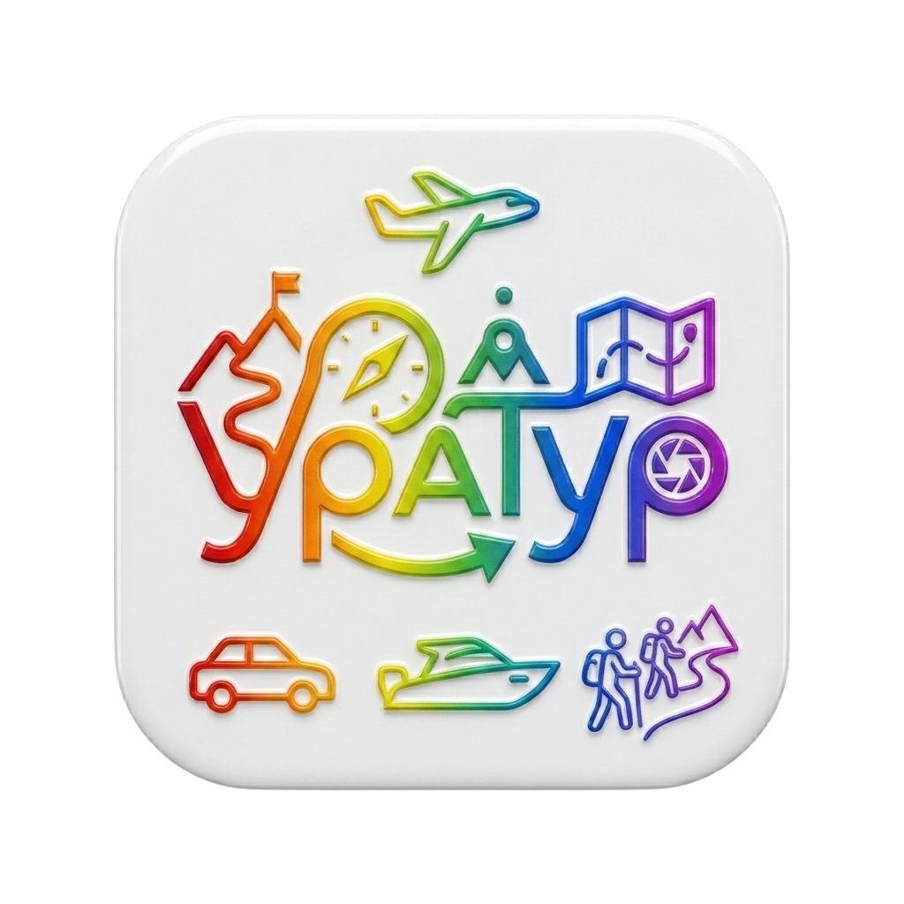
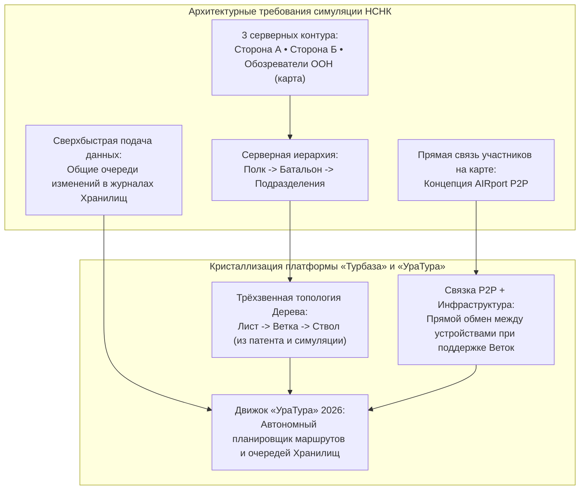

# Исторический контекст и развитие проекта: от истоков Urarun к «УраТуру»

## Документальное исследование эволюции концепции, артефакта цветного логотипа Минцифры, архитектурной синергии с симуляцией НСНК и становления децентрализованного навигатора 2026 года

*Классификация: История проекта, эволюция архитектурных идей, артефакт цветного логотипа, симуляция НСНК, топология дерева, децентрализованный туристический навигатор*  
*Концептуальный автор платформы и архитектор: Артём Владимирович Шамсутдинов*  
*Модель-соавтор инженерной спецификации: Gemini 3.8 Flash*  
*Связанные нормативные документы: [README.md](README.md), [01_Child_Protection_Architecture.md](01_Child_Protection_Architecture.md), [02_Uratur_Family_Age_Differentiation.md](02_Uratur_Family_Age_Differentiation.md), [03_Yandex_Maps_Integration.md](03_Yandex_Maps_Integration.md), [UraTur_Ecosystem_Impact_Guide.md](UraTur_Ecosystem_Impact_Guide.md), [10-06_01_Urarun-Uratur_History.md](../../../comments/2026/10-06_01_Urarun-Uratur_History.md)*

---

## 1. Введение: Историческая ретроспектива замысла

Концепция приложения «УраТур» не возникла как сиюминутная коммерческая разработка. Её истоки уходят почти на два десятилетия назад: прошло **19 лет** (2007 год) с момента зарождения начального замысла, который стал **самой первой идеей о создании прикладной программы в творческой биографии автора платформы Артёма Владимировича Шамсутдинова**. Замысел зародился именно как идея **частного автономного планировщика путешествий**.

В то время глобальные цифровые корпорации только начинали выстраивать централизованные монополии слежки и таргетированной рекламы. Исходный замысел автора был ориентирован на человека: создать инструмент, позволяющий свободно прокладывать маршруты, сохранять воспоминания и исследовать мир без навязанных коммерческих алгоритмов.

---

## 2. Артефакт цветного логотипа: от листа бумаги к материалам Минцифры России

Оригинальная электронная документация ранней задумки проекта не сохранилась. Единственным материальным свидетельством первого этапа оставался бумажный лист с нарисованным от руки многоцветным логотипом.

Позднее этот образ был бережно оцифрован и графически доведён до совершенства. Его официальная версия была помещена на **27-ю страницу расширенной версии художественной презентации платформы «Турбаза»**, переведённой на русский язык и направленной в Министерство цифрового развития, связи и массовых коммуникаций Российской Федерации (Минцифры России).

*Рис. 1. Официальный логотип приложения «УраТур» (артефакт 27-й страницы презентации для Минцифры России)*

### 2.1. Семантика и визуальная иконография логотипа
Визуальное решение логотипа содержит глубокую образную композицию, объединяющую все измерения путешествий:
1. **Небесный горизонт:** В верхней части расположен летящий самолёт — символ дальних перелётов и открытости мира;
2. **Типографика «УРАТУР» в радужной гамме:**
   - Буква **«У»** трансформируется в крутую горную тропу с покоренной вершиной и развевающимся флагом;
   - Буква **«Р»** заключает в себе циферблат и стрелку компаса — символ точного ориентирования;
   - Буква **«А»** образует геодезический знак и фигуру шагающего путешественника;
   - Буква **«Т»** переходит в мост и развёрнутую топографическую карту местности;
   - Вторая буква **«У»** перетекает в диафрагму объектива фотоаппарата — фиксацию семейных воспоминаний и красоты родного края;
   - Замкнутая дуговая стрелка в основании символизирует непрерывность познавательного круговорота и безопасное возвращение домой;
3. **Три стихии движения в основании:**
   - **Автомобиль** — автотуризм, семейные поездки по дорогам Отечества;
   - **Катер / моторная лодка** — водный туризм, сплавы по рекам и исследование озёр;
   - **Пешие туристы с треккинговыми палками на горной тропе** — пешеходное краеведение, экологические походы и единение с природой.

---

## 3. Архитектурная синергия с симуляцией НСНК 2046 года

Важнейшим поворотным пунктом в технической кристаллизации платформы стала разработка архитектуры для симуляции **НСНК («Не Смертельный Не Калечащий» бой)** (план 25.12.2026, концептуальная разработка для 2046 года на территории России).

> [!NOTE]
> **Философский контекст НСНК:**  
> Контекст симуляции не является «постапокалиптическим» или «экстремальным». Смысл проекта заключается в гуманистическом переходе человечества к нелетальному противоборству без серьёзных повреждений («чтобы все были Живы, Целы и Невредимы»). Как отмечает автор: *«В защиту НСНК — это идея важнее Турбазы, поскольку она показывает, как можно сделать, чтобы все были живы на войне, но время этой идеи пока еще не пришло, а Турбаза может помочь уже сейчас»*.

### 3.1. Как симуляция сформировала архитектуру Дерева и AIRport
1. **Топология Дерева (Tree Topology):** Для симуляции требовалась устойчивая иерархия серверов: по одному контуру на батальон, по одному на полк, плюс независимый сервер обозревателей местности («ООН»). Эта задача вновь активизировала идеи раннего патента автора и оформилась в трёхзвенную топологию платформы: **Лист $\to$ Ветка $\to$ Ствол**;
2. **Жизнеспособность AIRport:** Идея прямой связи устройств участников (P2P) сама по себе не могла быть функциональной в изоляции. Лишь в гармоничном соединении с серверной инфраструктурой Веток и Ствола концепция AIRport обрела практическую устойчивость;
3. **Общие очереди изменений в журналах Хранилищ:** Для сверхбыстрого обновления тактической карты симуляции была разработана механика очередей изменений, которая легла в основу молниеносной репликации геоданных между Листьями в «УраТуре».

---

## 4. Эволюция имени: от Urarun к «УраТуру»

Семантическая эволюция названия проекта отражает углубление его прикладного содержания:
1. **Первоначальное имя «Urarun»:** Возникло как слияние восклицания «Ура!» и слова «Run» (бег, движение). Автор вкладывал в «Ура» жизнеутверждающий смысл праздничного ликования («Ух ты!», первомайское «Ура!») и стремительного туристического пробега по достопримечательностям, городам и странам;
2. **Тактическое планирование в НСНК:** Концепция динамичного перемещения и навигации гармонично вписалась в симуляцию действий на местности;
3. **Зрелый «УраТур» 2026 года:** Смещение фокуса с индивидуального спринта на глубокое семейное краеведение, экологический туризм, межрегиональные походы и защиту детей трансформировало название в фундаментальный **«УраТур»**.

---

## 5. Перспективы развития: аугментированная реальность (AR)

Идея использования дополненной реальности — а точнее, концепция **защищённого шлема с оптической проекцией целей, ориентиров и динамики движения на местности** — первоначально возникла у автора во время детальной проработки тактической симуляции НСНК (НЛНК).

В дальнейшем этот аппарат наглядной пространственной проекции естественно раскрывает свой потенциал и в гражданском краеведческом контексте «УраТура». В перспективе туристические гарнитуры или очки дополненной реальности смогут проецировать перед глазами путешественника безопасную траекторию движения на развилках троп, историко-краеведческие справки о памятниках и вершинах, названия редких растений или указатели скрытых родников с чистой питьевой водой.

Хотя в текущем релизе 2026 года основной акцент сделан на надёжной работе смартфонов в автономном офлайн-режиме, архитектурная модель `AIREntity` и пространственные индексы «УраТура» изначально закладывают фундамент для будущего бесшовного подключения носимых устройств дополненной реальности отечественного производства.

---

## 6. Резюме исторического пути

| Этап | Временной горизонт | Ключевая концепция | Результат и артефакты |
| :--- | :---: | :--- | :--- |
| **Ранний замысел** | 2007 г. (19 лет назад) | Первая в жизни автора идея о создании программы: частный планировщик поездок | Рисунок цветного логотипа на бумаге |
| **Симуляция НСНК** | Проект 2026 / 2046 гг. | Нелетальное противоборство, 3 сервера, тактическая карта, шлем с проекцией движения | Рождение архитектуры Дерева, P2P в AIRport, очереди изменений, истоки AR-проекции |
| **Официальная презентация** | 2026 г. | Представление платформы государству | Страница 27 художественной презентации для Минцифры РФ |
| **Флагманский «УраТур»** | 2026 г. — настоящее время | Автономный семейный навигатор и краеведческий реестр | Белая книга № 11, база знаний, мульти-хранилищная защита детей |
| **Будущий горизонт** | Перспективный релиз | Дополненная реальность (AR) | Туристические гарнитуры и интерактивная краеведческая проекция на тропах |
