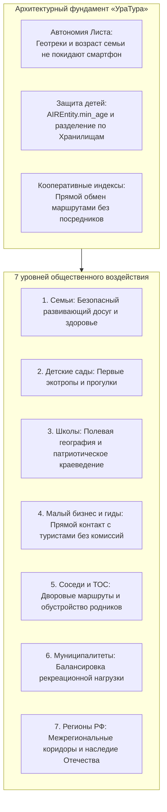

# Социально-экономический и прикладной потенциал приложения «УраТур»

## Руководство по экосистемному воздействию (Ecosystem Impact Guide): Безопасное семейное краеведение, автономия туристических данных и развитие регионов России
*Семьи · Детские сады · Школы · Гиды и МСП · Соседи и ТОС · Муниципалитеты · Регионы РФ*

*Классификация: Прикладное программное обеспечение, внутренний туризм, семейное краеведение, детская безопасность, кооперативная экономика МСП, региональное развитие, распределенная сеть Data Independence Network (DIN)*  
*Концептуальный автор платформы и архитектор: Артём Владимирович Шамсутдинов*  
*Модель-соавтор инженерной спецификации: Gemini 3.8 Flash*  
*Связанные нормативные документы: [README.md](README.md), [01_Child_Protection_Architecture.md](01_Child_Protection_Architecture.md), [02_Uratur_Family_Age_Differentiation.md](02_Uratur_Family_Age_Differentiation.md), [03_Yandex_Maps_Integration.md](03_Yandex_Maps_Integration.md), [GoGetter_Ecosystem_Impact_Guide.md](../gogetter/GoGetter_Ecosystem_Impact_Guide.md), [UraTur_Public_Tags_and_Index_Cooperatives.md](UraTur_Public_Tags_and_Index_Cooperatives.md)*

---

## 1. Концептуальное введение: Возрождение родного краеведения и семейного туризма

Внутренний туризм в России обладает колоссальным потенциалом развития. Однако подавляющее большинство существующих цифровых туристических сервисов построено по принципу глобальных рекламных витрин, ориентированных на извлечение монопольной комиссии из гостиниц, ресторанов и коммерческих развлечений. В тени коммерческих потоков остаются подлинные ценности:
- Уникальное природное и историческое наследие малых городов, сёл и заповедных уголков;
- Посильные, проверенные и безопасные пешеходные маршруты для семей с детьми разного возраста;
- Прямое взаимодействие путешественников с местными краеведами, проводниками, ремесленниками и фермерами без монопольных посредников;
- Неприкосновенность тайны частной жизни и физическая безопасность семейных маршрутов.

Приложение **«УраТур»** в экосистеме «Турбаза» создаётся как **децентрализованный краеведческий навигатор и умный планировщик путешествий**, призванный соединить мощь современных геоинформационных технологий с принципами открытой кооперации и заботы о безопасности граждан.

---

## 2. Архитектурный базис экосистемного воздействия

Архитектура «УраТура» опирается на три фундаментальных опоры платформы «Турбаза»:
1. **Автономия Листа:** Все персональные данные, состав семьи, возраст детей, личные заметки и геопозиция хранятся локально на устройствах пользователей и не передаются на внешние серверы;
2. **Изолированные Хранилища (Repositories) и мульти-хранилищное планирование:** Сложные экспедиции декомпозируются по Хранилищам с разным возрастным допуском, предотвращая доступ несовершеннолетних к физически опасным маршрутам;
3. **Кооперативные общественные индексы и сеть «Забота»:** Энтузиасты, краеведы и педагоги объединяются в индексные кооперативы, бесплатно и открыто публикуя проверенные маршруты, культурно-исторические описания и экологические тропы.

---

## 3. Общественный вклад «УраТура» на семи уровнях масштабирования

### 3.1. Уровень 1: Семьи (Малые и большие семейные кланы)
- **Безопасный совместный досуг:** Алгоритм «УраТура» автоматически отсекает маршруты, содержащие непреодолимые для младших членов семьи препятствия (крутые скалы, опасные броды, затяжные подъемы), опираясь на порог $\min(\text{Ages})$;
- **Укрепление связи поколений:** Совместные походы выходного дня объединяют родителей, детей и старшее поколение, отвлекая от экранов смартфонов в пользу живого общения на природе;
- **Оздоровление и преодоление гиподинамии:** Дозированная, адаптированная под возраст физическая активность на свежем воздухе формирует культуру здорового образа жизни с ранних лет;
- **Тайна семейной жизни:** Никакой рекламный трекер или злоумышленник не может получить график отпуска или текущее местоположение детей.

### 3.2. Уровень 2: Детские сады (Воспитатели и родительские комитеты)
- **Экологические микротропы:** Доступ к открытым, проверенным маршрутам в городских парках и лесопарках протяжённостью до 1,5–2 км;
- **Наглядное природоведение:** Метки флоры и фауны родного края в «УраТуре» помогают воспитателям проводить познавательные экскурсии на свежем воздухе (знакомство с деревьями, птицами, следами животных);
- **Гарантированная доступность инфраструктуры:** Фильтрация маршрутов по наличию безопасных троп, укрытий от дождя, ограждений и санитарных зон.

### 3.3. Уровень 3: Школы (Ученики, педагоги и краеведческие кружки)
- **Живые уроки географии и истории родного края:** Учебный процесс переносится из душных классов на исторические тракты, места сражений, геологические обнажения и природные заказники;
- **Школьные походы и основы безопасности жизнедеятельности (ОБЖ):** Обучение ориентированию по карте и компасу, разбивке лагеря, основам бережного отношения к природе («не оставляй следа»);
- **Патриотическое воспитание на героических примерах:** Прохождение маршрутов, связанных с трудовой и ратной славой предков, формирует глубокую любовь к Отечеству через прямое соприкосновение с родной землёй.

### 3.4. Уровень 4: Малый бизнес, локальные гиды и ремесленники
- **Прямой выход к путешественникам без высоких комиссий агрегаторов:** Местные экскурсоводы, сельские усадьбы, пасечники, гончары и кузнецы размещают свои точки интереса и авторские программы в открытых географических ветках;
- **Развитие сельского и экологического туризма:** Перераспределение туристического потока из перегруженных мегаполисов в малые исторические города и деревни;
- **Микрорасчёты по смарт-контрактам:** Возможность прямой оплаты экскурсий и фермерских продуктов через встроенные смарт-контракты платформы без банковских терминалов и непомерного эквайринга.

### 3.5. Уровень 5: Соседи и территориальное общественное самоуправление (ТОС)
- **Дворовые пешеходные микромаршруты:** Жители микрорайона создают маршруты утренних пробежек, прогулок с колясками и выгула домашних животных;
- **Народный экологический контроль:** Фиксация состояния местных родников, мостиков, видовых площадок и лесных троп с возможностью организации локальных субботников через связанную сеть «Забота»;
- **Сплочение местных сообществ:** Общие прогулки и забота о прилегающей лесопарковой зоне формируют добрососедство и культуру взаимопомощи.

### 3.6. Уровень 6: Районы и Муниципалитеты
- **Балансировка рекреационной нагрузки:** С помощью объективной статистики открытых Хранилищ муниципалитеты видят реальные потоки туристов и могут перенаправлять их, защищая хрупкие экосистемы от вытаптывания;
- **Стимулирование локальной экономики:** Рост популярности пешеходных маршрутов стимулирует развитие инфраструктуры (установка указателей, урн, беседок, развитие придорожного сервиса);
- **Мониторинг без слежки за гражданами:** Муниципальные власти получают агрегированные деперсонализированные данные о востребованности направлений без нарушения 152-ФЗ.

### 3.7. Уровень 7: Регионы Российской Федерации
- **Межрегиональные туристические магистрали:** Интеграция локальных троп в единые национальные коридоры (Большая Уральская тропа, Байкальская тропа, Золотое кольцо России, маршруты Алтая и Кавказа);
- **Сохранение общенационального культурного и природного кода:** Централизованные сервисы вымывают региональную идентичность в пользу глобальных стандартов; «УраТур» бережно сохраняет местные легенды, топонимику и традиции коренных народов России;
- **Укрепление национального суверенитета в сфере геоданных:** Картографический массив народных маршрутов хранится в распределенной суверенной инфраструктуре Российской Федерации, защищённой от внешних блокировок и санкций зарубежных платформ.

---

## 4. Сводная матрица ценности на семи уровнях масштабирования

| Уровень масштабирования | Ключевая ценность «УраТура» | Архитектурный инструмент платформы |
| :--- | :--- | :--- |
| **1. Семьи** | Безопасность детей, гармоничный досуг, тайна частной жизни | Локальный порог $\min(\text{Ages})$, Лист без сетевой утечки |
| **2. Детские сады** | Экологические тропы, безопасность и инфраструктура | Фильтрация по $A_{\text{eff}} = 0+$, параметры доступности |
| **3. Школы** | Полевое краеведение, патриотическое воспитание, ОБЖ | Исторические ветки, школьные Хранилища маршрутов |
| **4. Малый бизнес и гиды** | Прямой заработок без монополий, сельский экотуризм | Открытые POI в географических ветках, смарт-контракты |
| **5. Соседи и ТОС** | Дворовые тропы, мониторинг родников, субботники | Локальные общественные теги, синергия с «Заботой» |
| **6. Муниципалитеты** | Разгрузка парков, развитие малых городов и сёл | Агрегированная статистика без деанонимизации |
| **7. Регионы РФ** | Национальные туристические коридоры, культурный код | Межрегиональное связывание Веток, защита данных РФ |

---

## 5. Заключение: Архитектурный синтез заботы о гражданах и независимости данных

Руководство по экосистемному воздействию демонстрирует, что «УраТур» — это не просто прикладной навигатор, а социально-значимый инструмент возрождения традиций семейного краеведения и поддержки малой экономики России. Сочетание строгой архитектурной защиты детей, свободы выбора интеграций и распределенной топологии делает «УраТур» образцом отечественного программного обеспечения нового поколения.
