# ИНФОРМАЦИЯ К ПЛАНУ Белой книги № 11 — «УраТур»

**Назначение.** Рабочий справочник для исполнителя плана `ПЛАН_11_Уратур.md`. Собирает всё, что нужно для написания книги `11_uratur_whitepaper.md`: решения автора, правила, проверенные факты, формулы с пересчитанными примерами, готовые схемы, шаблон атрибуции, расхождения источников, контрольные списки.

**Для кого.** Исполнитель — модель Gemini 3.8 Flash (так её называет автор). Планирование выполнила модель Claude Sonnet 5.5. Предполагается, что исполнитель не видел предыдущих обсуждений. Где данные взяты у автора, где получены из документов базы знаний, где выведены составителем, где не проверены — указано явно (колонка «Статус»).

**Это не часть книги.** Здесь допустимы названия файлов, номера разделов, имена программных сущностей. В текст книги они не переносятся (раздел 2).

**Границы задачи исполнителя.** Только книга `11_uratur_whitepaper.md` и реестры по делу 4.3 плана Ступени 3. Если не хватает сведений, исполнитель задаёт вопрос автору.

**Формат выпуска.** Markdown. PDF не собирается, страничного бюджета и оглавления с номерами страниц нет. Остальные стандарты (тон, запреты, русская речь, формулы, схемы) действуют.

**Условные обозначения источников** (все в `whitepapers/applications/uratur/`): `Б1` = `01_Child_Protection_Architecture.md`; `Б2` = `02_Uratur_Family_Age_Differentiation.md`; `Б3` = `03_Yandex_Maps_Integration.md`; `Б4` = `04_Статистические_программные_модули_УраТура.md`; `Б5` = `05_Uratur_History_and_Evolution.md`; `Б6` = `UraTur_Ecosystem_Impact_Guide.md`; `Б7` = `UraTur_Public_Tags_and_Index_Cooperatives.md`; `Заметка-возраст` = `comments/2026/10_05_01_Age_restrictions.md`; `Заметка-история` = `comments/2026/10-06_01_Urarun-Uratur_History.md`.

---

## 0. Как пользоваться документом

1. Прочитать общий план `ОБЩИЙ_ПЛАН_08-10_…` (разделы 1–6, 10–12), книги № 08–10 (согласовать термины), `ПЛАН_11_Уратур.md`.
2. Для каждой главы взять тезисы плана и факты из разделов 5–8.
3. Формулы и числа — только из раздела 6. Раздел 9 перечисляет места, где документы базы знаний расходятся или неточны: в книгу переносить исправленные формулировки.
4. Схемы — из раздела 7; таблицы — из раздела 8.
5. Перед сдачей пройти контрольный список (раздел 11).

**Пять принципов:**
- Книга о вкладе приложения в платформу: возрастной допуск на уровне ядра, общественные теги и кооперативные индексы, механическая подача идей, статистика на Листе, гибридная работа с внешними картами.
- Всё, что рассчитывается, рассчитывается на устройстве пользователя и воспроизводимо: один и тот же ввод даёт один и тот же вывод.
- Книга описывает проектную концепцию. Ничего не подаётся как работающее, согласованное с Яндексом, ведомством, врачами или юристами.
- Числа в разделе 6 — проектные значения и условные примеры; физиологические пороги не являются нормами.
- Слово «суверенитет» относится только к государству; для устройств, программ и людей: автономия, частная жизнь.

---

## 1. Решения автора

Статус: **А** — слова автора (интервью, сообщения оператора); **Д** — документ базы знаний, подготовленный моделью, прямого подтверждения автора в протоколах нет; **В** — вывод составителя.

| № | Решение | Источник | Статус |
|---|---|---|:-:|
| 1 | «УраТур» — флагманское туристическое приложение платформы; книга № 11. Первая идея автора о программе (частный автономный планировщик поездок) возникла 19 лет назад | Заметка-история; Б5 §1 | А |
| 2 | Хранилище — неделимая единица информации и допуска. Если у детей разных возрастов есть доступ к записям о поездке, правильно разделять информацию по нескольким хранилищам: это приоритет «УраТура» | Интервью, блок 2, п. 1 | А |
| 3 | В хранилище есть показатель пригодности по возрасту; для скорости запросов его значение копируется в каждую запись таблиц (локальная колонка, не синхронизируется «на данный момент») | Интервью, блок 1, п. 1 | А |
| 4 | Способ определения возраста определяется законами государства; технически подойдёт любой работающий способ | Интервью, блок 1, п. 1 | А |
| 5 | Встраивание проверки возраста в запросы выполняет Лист. Разработчик выбирает режим: полные результаты (внутреннее соединение) или допустимые результаты (внешнее соединение); записи, негодные по возрасту, не возвращаются в любом случае | Интервью, блок 1, п. 2; Заметка-возраст | А |
| 6 | Иерархия допуска: тема, общественный тег, хранилище; уровня отдельной записи сейчас нет; хранилище с ограниченным доступом можно не скачивать | Интервью, блок 1, п. 3; Заметка-возраст | А |
| 7 | Порог по младшему участнику ($\min(\text{Ages})$) и разбиение поездки на хранилища — оба способа хороши, их можно сочетать для разных ситуаций | Интервью, блок 2, п. 1 | А |
| 8 | Параметры категоризации маршрутов (сложность, длина, набор высоты, доступность и др.) — «отличные идеи», в дорожную карту «УраТура» | Интервью, блок 2, п. 2 | А |
| 9 | Подача идей зависит от выбора пользователей: шаблоны в теме путешествий «Заботы»; сохранение своих поездок в общественных хранилищах и копирование частей чужих («А как насчёт такого плана?»); если делиться не нужно, всё делается на Листе | Интервью, блок 2, п. 3 | А |
| 10 | Яндекс Карты: свобода выбора пользователя (от полной изоляции Листа до расширенного использования пробок и автомобильной навигации); смарт-контракты распределения прибыли; возможность библиотек Яндекса для Листа; два контура учётных записей; автодороги — в сервисе карт, внутренние тропы и личные точки интереса — на Листе | Интервью, тема 1.3; Б3 | А |
| 11 | Семь уровней общественного воздействия утверждены без дополнений: семьи, детские сады, школы, малый бизнес и гиды, соседи и ТОС, муниципалитеты, регионы | Интервью, тема 1.4; Б6 | А |
| 12 | История: логотип на бумаге; отточенная версия — на 27-й странице расширенной русской презентации (в Минцифры России); симуляция НСНК («Не Смертельный Не Калечащий» бой) носит гуманистический смысл, не «постапокалиптический»; из неё вернулись идеи Дерева, прямой связи устройств, общих очередей изменений; идея защищённого шлема с проекцией целей и движения возникла в НСНК | Интервью, тема 1.5; шаги 7–8 сессии оператора; Б5 | А |
| 13 | Статистические модули «УраТура» работают на Листе для планирования и корректировки планов в поездке; модули, пригодные другим приложениям, выводятся на уровень системных, как в других приложениях | Шаг 9 сессии оператора; Б4 | А (замысел); Д (формулы, пороги) |
| 14 | Общественные теги: кооперативы энтузиастов, аренда домашних компьютеров под индексные узлы, хронологическое сбалансированное дерево, серверы сборки групп тегов, сборка на Листе | Б7 | Д |
| 15 | «Суверенитет» применяется только к государству и Отечеству; для устройств и людей: автономия, приватность | Интервью; общий план, раздел 10 | А |
| 16 | Доля гражданина в распределении рекламной выручки — десятина, 10% | Общий план, решение 12 | А |
| 17 | Выпуск только в Markdown; графики Mermaid хорошо проработаны; нет дат дорожной карты, кода, меток с процентом | Общий план, решения 7, 14; `whitepapers/AGENTS.md` | А |
| 18 | Общественные теги в книге № 10 даны только идеей; полное описание — в этой книге | Общий план, строка 18 матрицы; № 10, глава 4 | В |
| 19 | Достоверность авторов маршрутов: верифицированный статус на основе подтверждённого Опыта «Заботы» | № 09, раздел о применении рейтинга | А (в № 09) |

---

## 2. Правила для текста и шаблон атрибуции

### 2.1. Запреты

Общий план, раздел 10.1. Дополнительно для этой книги:
1. Не использовать обороты базы знаний: «тотальное профилирование», «централизованные монополии слежки», «чёрные ящики», «коммерческая манипуляция выдачей», «навязываются платные базы», «непосильные лицензионные платежи», «кабальные комиссии», «поборы», «монопольная комиссия», «вымывают региональную идентичность», «мониторинг без слежки», «безукоризненно», «абсолютная уверенность», «колоссальный потенциал».
2. Не писать «безопасность гарантирована», «спасёт жизнь», «гарантированно успеете засветло», «абсолютная защита детей», «невозможно обойти», «100%», «0%».
3. Не писать, что решения согласованы или поддержаны Яндексом, Минцифры, Банком России, МЧС, педиатрами, федерациями туризма.
4. Не называть физиологические пороги для детей нормами или рекомендациями педиатрии: источник в базе знаний не указан.
5. Не использовать «таргетированные объявления» и «профилирование» в описании рекламы: приложение не выгружает сведения о семье (вопрос 6 плана).
6. Не писать «ни одной точки трека» как абсолютное утверждение: «при штатной работе приложения пешеходные треки сервису карт не передаются».
7. Не называть названия чужих продуктов (кроме Яндекса как поставщика карт и партнёра по предлагаемой модели) и не сравнивать с ними по возможностям.
8. Не использовать номера статей законов. Название закона допустимо: «закон о защите детей от информации, причиняющей вред их здоровью и развитию».
9. Не использовать названия программных сущностей, полей, пакетов, функций: `AIREntity`, `min_age`, `ageSuitability`, `UraTurRouteEntity`, `UraTurPlanCheckpoint`, `@turbase/…`, `RepositoryGlobalId` и т. п.
10. Не использовать английские названия режимов и приёмов без перевода: «Zero-Leakage Offline», «Selective Sharing», «Full Synergy», «Airplane Mode», «Bypass», «Fallback», «Safety Buffer», «Pace Fatigue Tracker», «Deterministic Idea Synthesizer».
11. Слово «ценз» употреблять редко (не более двух раз, с пояснением); вместо него: «возрастное ограничение», «допуск».
12. Не сообщать даты плана симуляции (25.12.2026 и 2046 год).
13. Не утверждать, что итоги голосований «автоматически» создают маршруты или задачи.
14. Не употреблять «НЛНК»; правильно «НСНК».

### 2.2. Как формулировать спорные места

| Нельзя | Можно |
|---|---|
| «Облачные сервисы следят за семьёй» | «Для расчёта облачному сервису нужны сведения на сервере поставщика; здесь расчёт выполняется на устройстве» |
| «Ребёнок абсолютно защищён» | «Лист не скачивает хранилища, допуск которых выше возраста профиля; защита действует настолько, насколько надёжно задан возраст» |
| «Алгоритм гарантирует возвращение засветло» | «Модуль показывает запас светлого времени и предлагает запасные варианты; решение принимает группа» |
| «Рекомендательная система УраТура» | «Механическая подача идей: отбор по понятным условиям и сортировка по выбранному ключу» |
| «Яндекс получит долю прибыли» | «В предлагаемой модели смарт-контракт платформы может распределять часть выручки поставщику карт» |
| «Приложение работает без интернета» | «Расчёты и навигация по загруженным данным работают без связи; загрузка подложек и данных требует связи заранее» |
| «Индекс быстрый: менее 128 байт на запись» | «Запись связи лёгкая (порядка сотни байт, проектная оценка), поэтому один накопитель вмещает порядка сотен миллионов связей» |
| «Пошаговый алгоритм пропорционален размеру ответа» | «Пересечение упорядоченных списков идёт за время порядка наименьшего списка с поправкой на логарифм отношения размеров» |
| «Суверенная инфраструктура УраТура» | «Инфраструктура Российской Федерации»; «автономный навигатор» |
| «Верифицированный проводник» без пояснений | «Автор с подтверждённым Опытом путешественников в теме (№ 09)» |
| «Мониторинг потоков туристов муниципалитетами» без оговорок | «Муниципалитеты получают агрегированные обезличенные сведения; порядок их получения определяется отдельно» |

### 2.3. Шаблон атрибуции (вставить в начало книги)

> *Автор: Артём Владимирович Шамсутдинов, разработчик платформы цифрового суверенитета государства «Турбаза» — интернета автономных и частных данных / открытого стека AIRport.*
> *Методология подготовки: замысел приложения «УраТур» (первая идея автора о создании программы), архитектура возрастной защиты на уровне ядра Листа, идеи общественных тегов и кооперативных индексов, гибридной работы с картографическими сервисами, вывода статистических модулей на уровень платформы и все решения по семейному путешествию сформированы автором. Планирование документа выполнено моделью Claude Sonnet 5.5; распределение понятий между книгами комплекта и порядок изложения предложены ею для утверждения автором. Базу знаний приложения подготовила модель Gemini 3.8 Flash. Детальная проработка текста выполнена моделью Gemini 3.8 Flash.*

Примечания: названия моделей записываются «как есть» (решение автора). Слова «для утверждения автором» заменить на «и приняты автором» после подтверждения плана. Строки об агенте Antigravity в книге нет.

---

## 3. Формат книги (Markdown)

Общий план, раздел 6.3. Заголовок:

```
# «УраТур»: находить, беречь и сопровождать
**Белая книга № 11: возрастная защита на уровне ядра, общественные теги и кооперативные индексы, статистика на Листе и работа с картами без передачи троп**
*Версия: 1.0 (2026)*
*Статус: проектная концепция*
*Классификация: прикладной уровень платформы «Турбаза»*
```

Один абзац — одна строка файла. Таблицы без знака `---` и вертикальной черты внутри ячеек. Не более одной схемы на главу, кроме глав 4, 6, 7, 8 (по две). Формулы `$…$` и `$$…$$`.

---

## 4. Глоссарий для читателя

| Термин | Пояснение |
|---|---|
| Лист, Ветка, Ствол | Три звена платформы: устройство пользователя, районный узел, национальный узел |
| Хранилище | Автономная единица данных с собственным журналом изменений и ключом шифрования; неделимая единица возрастного допуска |
| Возрастной допуск | Минимальный возраст, с которого разрешён показ материала; задан для хранилища, темы и общественного тега |
| Эффективный допуск | Наибольшее из ограничений темы, тега и хранилища |
| Профиль на Листе | Возраст и подготовка участников; хранится только на устройстве |
| Порог семьи | Возраст младшего участника, по которому отбираются простые маршруты |
| Строгий режим | Запись показывается, только если все нужные её части разрешены по возрасту (внутреннее соединение) |
| Мягкий режим | Запись показывается, недопустимые части не возвращаются (внешнее соединение) |
| Составная поездка | Поездка, разбитая на несколько хранилищ с разными допусками |
| Общественный тег | Открытая метка в общедоступном реестре; видна всем (отличается от личной метки «Делового») |
| Личная и внешняя метка | Метка на устройстве пользователя, никому не видна (№ 10) |
| Кооператив тегов | Объединение энтузиастов, которое задаёт правила проверки меток и держит индексную сеть |
| Индексный узел | Стационарный компьютер участника, хранящий только лёгкие записи связи тега и хранилища |
| Запись связи | Краткая запись: идентификатор хранилища, название, время создания, время присвоения тега, граница территории, контрольная сумма состояния |
| Два времени | Время создания объекта и время присвоения тега; новые записи могут попасть в середину хронологии |
| Хронологическое сбалансированное дерево | Индекс записей связи по времени с логарифмическим поиском; глубина растёт очень медленно |
| Курсорная выдача | Выдача порциями с меткой последней записи: без пропусков и повторов при вставках |
| Сервер сборки групп тегов | Узел, который опрашивает мощность каждого тега и соединяет списки от меньшего к большему |
| Прыжковое пересечение | Пересечение упорядоченных списков с перескоком через ненужные участки (Leapfrog Triejoin) |
| Механическая подача идей | Отбор по понятным условиям и сортировка по выбранному ключу без скрытых оценок |
| Функция Тоблера | Эмпирическая зависимость скорости ходьбы от уклона |
| Коэффициент покрытия, коэффициент группы | Поправки на тип поверхности и на самого медленного участника |
| Коридор безопасности | Расстояния от точки маршрута до воды, укрытия, дороги и устойчивой связи |
| Радиус автономности | Наибольшее допустимое расстояние до дороги для возрастной группы |
| Сглаженный темп | Скользящее среднее темпа с большим весом недавних измерений |
| Запас светлого времени | Разность между временем захода солнца и ожидаемым временем прибытия на стоянку |
| Запасной вариант | Готовая альтернатива: ближайшая стоянка, срезной обход, аварийный выход к дороге |
| Три режима работы с картами | Полная автономия; выборочное взаимодействие; расширенная интеграция |
| Два контура учётных записей | Анонимное планирование и подтверждённый счёт для исполнения и оплаты |
| Базовый модуль | Конструкция, которая выводится из приложения на уровень платформы и становится общей (№ 12) |

---

## 5. Факты по главам (с источниками)

### 5.1. Глава 1

- Облачные сервисы хорошо решают задачи картографии и каталогов; для расчёта по составу семьи и положению им нужны сведения на сервере поставщика. Платформа предлагает иное устройство (Б4 §1; Б2 §2.1). Формулировка нейтральная (раздел 2.2).
- Миссия: автономный навигатор, краеведческий реестр и планировщик путешествий: от однодневных городских прогулок до многодневных межрегиональных экспедиций (Б2 §1).
- Заметка автора: «планировщик поездок и создатель маршрутов от межрегиональных до оптимальных пешеходных по достопримечательностям города» (Заметка-история).
- «УраТур» использует оболочку «Делового» как готовый исполнительский каркас (№ 10, глава 7).
- Положение в комплекте: «КубГолос» — оценка, «Забота» — вклады и шаблоны, «Деловой» — исполнение и органайзер, «УраТур» — местность, возраст и движение (составитель).

### 5.2. Глава 2 (возрастной допуск): подробный материал

1. **Основа** (Заметка-возраст; Б1 §2): все записи таблиц платформы базируются на общей основе и имеют колонку минимального возраста допуска; все записи распределены по хранилищам; хранилища записаны под темой; темы и общественные теги имеют возрастные ограничения.
2. **Хранилище** — неделимая единица допуска и шифрования. Показатель допуска хранилища: ряд значений 0, 6, 12, 16, 18 (Б1 §2.1). Ряд совпадает с категориями закона № 436-ФЗ (раздел 10); для информационной продукции категории установлены законом, для маршрутов тот же ряд служит шкалой удобства; книга различает эти два смысла.
3. **Копия допуска в записях** (Б1 §2.2; интервью, блок 1): при создании записи и при изменении хранилища допуск родительского хранилища копируется в каждую запись; колонка локальная, не синхронизируется «на данный момент». Смысл: фильтр внутри одной таблицы по индексу, без соединения с таблицей хранилищ; на мобильной СУБД на Листе это ускоряет запросы.
4. **Несколько ролей в хранилище** (Б1 §2.3): записи журнала могут шифроваться разными ключами; теоретически возможны записи с разными допусками внутри одного хранилища; сегодня разделение строго по хранилищам (автор).
5. **Эффективный допуск** (Б1 §4.1): максимум из ограничений темы, тега и хранилища. Показ разрешён, если $A_{\text{eff}} \le A_{\text{польз}}$.
6. **Встраивание проверки** (Б1 §3; Заметка-возраст): Лист добавляет условие допуска к каждому запросу; разработчик приложения вручную не пишет проверок и не может обойти их из интерфейса. Строгий режим (внутреннее соединение): запись исключается целиком, если любая нужная связанная запись недоступна; пользователь не видит и самого факта наличия объекта. Мягкий режим (внешнее соединение): запись показывается, недоступные связанные части возвращаются пустыми; пример: семейный маршрут виден, крутое ответвление с допуском 16 скрыто.
7. **Упреждающее отсечение** (Б1 §4.2; интервью, блок 1, п. 3): если $A_{\text{eff}} > A_{\text{польз}}$, Лист не скачивает хранилище. Следствия: экономия трафика и памяти; на устройстве нет недопустимых данных; их нельзя извлечь анализом файлов на устройстве ребёнка.
8. **Тайна частной жизни** (Б1 §5): возраст хранится только на Листе; Ветки и Ствол оперируют открытыми метаданными хранилищ и не получают возраст; способ подтверждения возраста нейтрален (от родительской настройки до государственных шлюзов, если это предпишет закон); база знаний называет проект соответствующим 152-ФЗ: в книге писать «проектируется для соответствия».
9. **Границы** (составитель; обязательный подраздел): (а) возраст профиля — локальная настройка; допуск действует настолько, насколько надёжно её задали родители или предписал закон; (б) закон о защите детей регулирует информационную продукцию; пригодность маршрута по физическим условиям — другая задача, которую решает та же шкала по соглашению; (в) набор запрошенных хранилищ может косвенно говорить о возрасте; вариант меры: запрашивать открытые сведения о хранилищах целиком и решать на Листе (автор не принимал, подать как вариант); (г) ограничение на уровне записи — перспектива.

**Таблица «что видит каждый узел»** — раздел 8.2.

### 5.3. Глава 3 (семейное путешествие)

- Семейный профиль (состав, возраста, подготовка) хранится на Листе родителей, наружу не отправляется (Б2 §2.2).
- Простой маршрут: отбор по порогу семьи $\min(\text{Ages})$: исключаются скалы, броды, длинные переходы для младших (Б2 §2.2).
- Составная экспедиция: несколько хранилищ с разными допусками (Б2 §3). Условный пример (текст Б2 §3.1): родители, подросток 13 лет, ребёнок 5 лет; хранилище 1 — семейная стоянка и экотропа к роднику (допуск 0): стоянка, подъезд на автомобиле, оборудованные места для костра, безопасная дощатая тропа, центр посетителей парка; хранилище 2 — радиальный выход на скальный хребет (допуск 12): перепад высот 650 м, камнепады-курумники, крутые участки с перилами, видовые площадки у обрывов. На устройстве младшего ребёнка хранилище 2 отсутствует.
- Автор: оба способа (порог и разбиение) можно сочетать для разных ситуаций.
- Параметры карточки маршрута (дорожная карта, решение автора): допуск, категория сложности (от 1 — семейная прогулка до 5 — экспедиция), длина, суммарный набор высоты, наибольший уклон, питьевые родники, санитарные зоны, доступность для колясок, процент покрытия сотовой связью, расчётное время прибытия спасателей, допустимые сезоны, чувствительность к осадкам. В книге перечислить словами, без имён полей.
- Ориентиры для детей (Б2 §4.1) — таблица 8.10: проектные значения, источник не указан.

### 5.4. Глава 4 (общественные теги и индексная сеть): подробный материал

1. **Предметная область** (Б7 §1): объекты — достопримечательности, тропы, родники, стоянки, видовые площадки, перевалы; описываются многомерно: тематические теги (семейный отдых, сплав, историческое место), сезонные и временные (май, золотая осень, зимник, паводок), географические (река, хребет, пещера), эксплуатационные (родник с питьевой водой, оборудованное место для костра, стоянка с навесом, доступная среда).
2. **Личные и общественные** (Б7 §1.1): в «Деловом» — внешняя личная метка на устройстве, невидима; в «УраТуре» — открытый реестр общественных тегов. Таблица 8.3.
3. **Две задачи открытой каталогизации** (Б7 §1.1): независимость описаний от решений одного владельца витрины и защита от замусоривания (боты, реклама, нерелевантные отметки). В книге формулировать нейтрально: «открытому каталогу нужны правила проверки и устойчивость к нерелевантным отметкам».
4. **Кооперативы** (Б7 §2.1): клубы водного туризма, краеведческие общества, ассоциации экологического и сельского туризма, добровольные спасательные и маркировочные отряды; пример: «Кооператив водных маршрутов Урала». Кооператив задаёт правила верификации меток, поддерживает стандарты описаний, обеспечивает работу индексной инфраструктуры.
5. **Индексный узел** (Б7 §2.2): стационарный домашний или офисный компьютер с постоянной связью, сдаваемый кооперативу в аренду. Узел не хранит медиафайлы; обслуживает запись связи: идентификатор хранилища, название, время создания, время присвоения тега, граница территории, контрольная сумма состояния. Размер записи и ёмкость — раздел 6.7.
6. **Два времени и вставка в середину** (Б7 §3.1): время создания объекта и время присвоения тега; запись может попасть в середину хронологии (актуализация старого объекта).
7. **Дерево** (Б7 §3.2): сбалансированное хронологическое B+-дерево; ключ — пара «время, хэш идентификатора»; два параллельных индекса (по времени присвоения и по времени создания); при превышении ёмкости страницы (в примере 512 записей) страница делится пополам, медианный ключ поднимается; листья связаны в обе стороны. Глубина — раздел 6.7. Вариант «LSM» не вводить.
8. **Срезы и курсор** (Б7 §3.3): год, сезон, месяц, день; «ранее даты» и «позже даты»; курсор — метка последней записи (время и идентификатор); следующая порция без пропусков и повторов при вставках.
9. **Составные запросы** (Б7 §4): пример запроса из четырёх тегов; без координации устройство получило бы все списки (раздел 6.6: порядка 13–22 МБ); сервер сборки опрашивает мощности, строит порядок от наименьшего тега, проверяет принадлежность точечно. Условный пример чисел: 84 → 3 200 → 45 000 → 120 000; после проверок 19, затем 12 стоянок. Объём обмена на точечных проверках — около 1,3 КБ идентификаторов (раздел 6.6; в базе знаний «десятки байт» — неточность, Р4).
10. **Сверхоперативное хранение** (Б7 §5): очередь «первым пришёл — первым вышел» для быстро меняющихся выборок (перекрытия троп); вытеснение давно не востребованных и наименее частых для популярных пересечений региона; срез «Топ-1000 новейших» на каждом узле. Утверждение «свыше 80% запросов из памяти» — проектное допущение без измерений (Р5): в книгу не переносить как факт.
11. **Сборка на Листе** (Б7 §6): для малозначимых и персональных сочетаний тегов устройство само опрашивает узлы редких тегов, получает компактные списки и пересекает их в памяти; ни один узел не видит всего сочетания (если списки запрашиваются раздельно); работа при слабой связи после получения срезов. Остаточные риски: узлы видят отдельные теги и сетевой адрес, время запросов (раздел 8.4).
12. **Достоверность** (составитель на основе Б7 и № 09): контрольная сумма состояния хранилища в записи связи позволяет Листу проверить загруженное; статус автора маршрутов опирается на Опыт «Заботы»; правила проверки меток внутри кооператива автор не раскрывал (вопрос 4 плана).
13. **Допуск тега** (Заметка-возраст; Б1 §4): тег имеет возрастное ограничение; Лист применяет его при отборе записей связи. Кто назначает допуск тега и темы — вопрос 8 плана.
14. **Научная основа** (Б7 §7): распределённые инвертированные индексы; временные деревья (Salzberg, Tsotras; структуры многоверсионных деревьев); оптимальные по худшему случаю соединения (Veldhuizen, 2014); одноранговые сети (DHT и подобные). В книге достаточно одной фразы со ссылкой на названия работ (раздел 10).
15. **Итог для комплекта** (Б7 §8): личные задачи и метки — «Деловой»; оценка и проверка инициатив — «КубГолос»; взаимная поддержка и опыт — «Забота»; открытая коллективная карта природы, троп и общественных благ — «УраТур».

### 5.5. Глава 5 (механическая подача идей)

- Источники (Б2 §5; интервью, блок 2, п. 3): шаблоны путешествий в теме «Заботы» (маршруты выходного дня, школьные экскурсии, исторические кольца; пользователь загружает, адаптирует, сохраняет в своё хранилище); открытые хранилища энтузиастов («А как насчёт такого плана для поездки на майские праздники?»; копирование целиком или частями без раскрытия личных дат); локальный синтез на Листе (свободные выходные из «Делового», точки интереса из локальных данных в радиусе доступности автомобиля или пригородного транспорта, отбор по порогу семьи).
- Шаги отбора (Б4 §3.3): пересечение тегов; допуск хранилища не выше порога семьи; время маршрута не больше свободного окна; сортировка по близости, дате проверки тропы или наименьшему перепаду высот; ранжирования в пользу спонсоров нет.
- Воспроизводимость: условия и ключ сортировки видны пользователю; одинаковый ввод даёт одинаковый вывод; пользователь может изменить условия и увидеть, как меняется выдача.
- Выбор принадлежит пользователю: если ничего не публиковать, всё работает на Листе.

### 5.6. Глава 6 (статистика: планирование)

- Четыре потока (Б4 §2.1): общественные хранилища географических Веток (треки, описания, перепады высот, паспорта перевалов, родников и стоянок); индексы общественных тегов; локальный контекст (время, календарь, профиль семьи); телеметрия устройства (координаты, барометрическая высота, шагомер, время, заряд и температура батареи).
- Модуль времени (Б4 §3.1): функция Тоблера с поправками; формулы и пример — разделы 6.1–6.2.
- Коридор безопасности (Б4 §3.2): расстояния до питьевой воды, укрытия, дороги с эвакуацией, зоны устойчивой связи (по открытым агрегированным данным сообщества); предельный радиус автономности для возрастной категории (пример: 7 км для семей с детьми до 8 лет — проектное значение); при превышении — предупреждение и поиск промежуточных выходов.
- Всё детерминировано; внешние вычислительные серверы не нужны.

### 5.7. Глава 7 (сопровождение в пути)

- Первичная фильтрация шума координат (в лесу и ущельях — многократные отражения сигнала); мгновенная скорость; сглаженный темп (раздел 6.3).
- Отношение $\delta_v$ фактического темпа к плановому для текущего уклона; устойчиво ниже 0,75 дольше 30 минут — замедление (Б4 §4.1).
- Закат рассчитывается на устройстве (раздел 6.4); ожидаемое время прибытия (6.5); зоны: зелёная (запас не менее 2 часов), жёлтая (от 1 до 2 часов: сократить привалы), красная (менее 1 часа: перестройка) (Б4 §4.2).
- Автомат (Б4 §4, схема 2): движение по плану → замедление → проверка запаса светлого времени → мягкая коррекция или жёсткая коррекция → подбор вариантов → выбор человека → новый план. Расхождение порогов 1,5 часа в автомате и 1–2 часа в зонах снято: использовать зоны (Р2).
- Три запасных варианта (Б4 §4.3): (А) ближайшая промежуточная стоянка в радиусе 1–2 часов хода с признаками «стоянка» и «родник»; (Б) срезной обход: пропуск радиального подъёма, пологая низинная тропа к базовому лагерю; (В) аварийный сход: кратчайший пологий вектор к дороге общего пользования, доступной для экстренных служб. Карточки вариантов: время прибытия засветло, перепад высот, сложность; выбор — одной кнопкой; план замещается.
- Данные пути остаются на Листе; срез телеметрии не синхронизируется (Б4 §5.2).
- Пульс в модуле не используется (Р6).

### 5.8. Глава 8 (картографические сервисы)

- Три режима (Б3 §1): (1) полная автономия: ничего не уходит наружу; расчёты по предварительно загруженным данным; (2) выборочное взаимодействие: загрузка подложек и поиск адресов с обезличиванием; (3) расширенная интеграция: дорожная обстановка и автомобильная навигация до места старта; взаимодействие по смарт-контракту.
- Распределение выручки (Б3 §2): при расширенных сервисах смарт-контракты платформы могут перечислять поставщику карт долю выручки от рекламы или подписки; доля гражданина — десятина (общий план, решение 12); доли иных сторон не определены, чисел не называть. Поставщик карт мог бы выпускать лёгкие библиотеки для Листа, которые выполняют первичную обработку геоданных на устройстве (предложение).
- Разделение графа (Б3 §4.2): автомобильный участок («от дома до стоянки лесничества у подножия») строит сервис карт; пешеходные тропы, стоянки, родники, лагеря, радиальные выходы и личные точки интереса — Лист. Остаточные сведения: сервис видит начало и конец автомобильного участка и время запроса; мера: использовать приблизительную точку начала или режим 1.
- Два контура учётных записей (Б3 §4.1): анонимное планирование с временным идентификатором; подтверждённая учётная запись с оплатой по смарт-контракту на этапе исполнения, не связанная с историей анонимного поиска.
- Фоновая загрузка подложки (Б3 §3.1): при формировании плана рассчитывается район с буферной зоной и загружаются подложки заданного масштаба во флеш-память; в походе навигация работает без связи. **Условие:** открытые условия использования API Яндекс Карт запрещают сохранять полученные данные, допуская кэш ответов геокодера до 30 дней; сервис плиток отдаёт схему; поэтому автономная подложка возможна только на условиях отдельного соглашения с поставщиком (раздел 10; вопрос 5). В книге писать: «при согласии поставщика и на условиях договора».
- Системные модули (Б3 §5): пространственная обфускация запросов; кэш внешних подложек; единый интерфейс со смарт-контрактами поставщиков геоданных. Применимы к городскому транспорту, логистике малого бизнеса, ЖКХ, реестрам недвижимости.
- Формулировка о Яндексе: «развитая картографическая инфраструктура» (без «наиболее»).

### 5.9. Глава 9 (семь уровней)

Факты — Б6 §3, оценка — «условные примеры из руководства»:

1. **Семьи:** отбор по порогу семьи; совместный досуг; тайна семейных планов; дозированная нагрузка.
2. **Детские сады:** экологические микротропы 1,5–2 км (ориентир); метки флоры и фауны; фильтрация по наличию укрытий, ограждений, санитарных зон.
3. **Школы:** полевая география и история; основы безопасности жизнедеятельности (ориентирование, разбивка лагеря, бережное отношение к природе); краеведческие маршруты.
4. **Малый бизнес и гиды:** экскурсоводы, усадьбы, пасечники, гончары размещают точки интереса и авторские программы в открытых ветках; прямые расчёты по смарт-контрактам платформы; формулировки о «кабальных комиссиях» не переносить.
5. **Соседи и территориальное общественное самоуправление:** дворовые микромаршруты; фиксация состояния родников, мостиков, троп; субботники через «Заботу».
6. **Муниципалитеты:** агрегированные обезличенные сведения о востребованности направлений; снижение нагрузки на хрупкие участки; развитие инфраструктуры (указатели, урны, беседки).
7. **Регионы:** межрегиональные коридоры (в качестве примеров: Большая Уральская тропа, Байкальская тропа, Золотое кольцо — названия брать как условные примеры); сохранение местных легенд, топонимики и традиций; данные о народных маршрутах хранятся в инфраструктуре Российской Федерации.

Сводная таблица — 8.7.

### 5.10. Глава 10 (примеры, все условные)

1. **Составная семейная экспедиция на Южный Урал.** Родители, подросток 13 лет, ребёнок 5 лет. Два хранилища (допуск 0 и 12). Профиль на Листе, порог 5 лет. Расчёт времени (раздел 6.2). В пути: замедление, запас светлого времени, жёлтая зона; выбор срезного обхода. Приватно: профиль, треки, телеметрия. Публикуется: по желанию семьи — отчёт о поездке в общественном хранилище. Платформа получает: образец составной поездки, модуль статистики, контроллер плана.
2. **Экологическая тропа для детского сада и школьный поход.** Шаблон из «Заботы»; допуск 0 (детский сад) и 6 (школа); отбор по тегам «детский маршрут» и «укрытие»; воспитатель и родительский комитет дополняют шаблон. Приватно: состав группы. Публикуется: тропа и шаблон. Платформа получает: образец работы возрастного допуска в учреждениях.
3. **Кооператив водных маршрутов.** Клуб сплавщиков поддерживает правила проверки меток; пять участников сдают компьютеры под индексные узлы; составной запрос из четырёх тегов; сборка на Листе; курсорная выдача свежих отметок о паводке. Приватно: интересы пользователя. Публикуется: теги и записи связи. Платформа получает: образец кооперативной индексной сети.

Чисел эффекта в примерах нет.

### 5.11. Глава 11 (история)

- 19 лет назад (2007 год) — самая первая идея автора о создании программы: частный автономный планировщик путешествий; в то время идея строилась вокруг человека: прокладывать маршруты, сохранять воспоминания и исследовать мир без навязанных алгоритмов (Б5 §1; формулировку о «монополиях слежки» не переносить).
- Единственный материальный артефакт: лист бумаги с нарисованным вручную многоцветным логотипом; оцифрованная версия — на 27-й странице расширенной русской презентации платформы (направлена в Минцифры России) (Заметка-история; Б5 §2).
- Логотип (Б5 §2.1): небесный горизонт с самолётом; буквы «УРАТУР» в радужной гамме: горная тропа с флагом, циферблат с компасом, геодезический знак и путник, мост и карта, объектив фотоаппарата; дуговая стрелка (безопасное возвращение домой); три стихии движения: автомобиль, катер, пешие туристы. Файл `UraTur_logo.png`.
- Название: «Urarun» — слияние «Ура!» и «Run»; позже «УраТур» (Б5 §4). Подать русскими словами: «первое имя «Urarun» — от восклицания «Ура!» и слова «бег»».
- НСНК (Б5 §3; интервью, тема 1.5): симуляция нелетального противоборства; автор: идея «важнее Турбазы», но «время идеи ещё не пришло»; из неё вернулись: три контура серверов (две стороны и наблюдатели), иерархия «полк — батальон — подразделения», прямая связь устройств в связке с Ветками, общие очереди изменений в журналах хранилищ; отсюда трёхзвенная топология «Лист — Ветка — Ствол».
- AR: идея защищённого шлема с оптической проекцией целей, ориентиров и движения на местности возникла в НСНК; в мирном применении: траектория на развилках, справки о памятниках и растениях, указатели родников (Б5 §5; шаг 7 оператора). В текущем выпуске основной упор на смартфон без связи; хранилища и индексы «УраТура» закладывают основу для носимых устройств (перспектива, без сроков).
- Таблица этапов (Б5 §6) без дат плана; дата 2007 допустима.

### 5.12. Глава 12 (базовые модули и границы)

- Модули (Б4 §6.1): (1) пространственно-временная статистика: скользящие средние, квантили, плотности, фильтрация выбросов над потоками записей с временем и координатами; (2) контроллер исполнения планов: мониторинг цепочки событий, обнаружение замедления, вероятность срыва срока, переключение на резервные ветки; (3) менеджер пространственного кэша: хранение подложек и графов в ограничивающем прямоугольнике, вытеснение давно не используемых и по адаптивному правилу, сохранение критического радиуса безопасности; (4) оптимизатор многотеговых запросов: оценка мощности срезов, порядок от меньшего к большему, точечные проверки на Листе. К ним добавляются из книги: (5) возрастной допуск; (6) общественные теги и индексная сеть; (7) адаптер внешних сервисов со смарт-контрактом и обфускацией запросов (Б3 §5).
- Потребители (Б4 §6.1): «Деловой» (трекинг дня, перенос встреч); «Забота» (контроль графика ухода, поиск резервного волонтёра); «КубГолос» (выборка петиций по сочетаниям тегов); реестр услуг и ЖКХ (плотность заявок, маршрутизация бригад, схемы коммуникаций без связи); курьерские и выездные службы.
- Четыре фазы (Б4 §6.2), без дат: инкубация в приложении (испытания на реальных треках Южного Урала); выделение универсальных интерфейсов; включение в поставку платформы; стандартизация в Белой книге № 12. В книге писать как порядок, не как график.
- Границы (составитель): раздел 12.3 плана.

---

## 6. Числа и формулы (пересчитаны при подготовке)

Все значения — проектные или условные, если не сказано иное. В тексте книги указывать статус.

### 6.1. Скорость по рельефу (функция Тоблера)

Скорость пешехода на склоне с уклоном $s = \tan\theta$ (подъём положителен):
$$W(s) = 6\,\exp\left(-3{,}5\,\lvert s + 0{,}05\rvert\right)\ \text{км/ч}$$
Опорное значение $W(0) \approx 5{,}04$ км/ч (в базе знаний 5,03); наибольшая скорость 6 км/ч достигается на лёгком спуске ($s = -0{,}05$). Нормированная скорость на участке:
$$v(s) = v_0 \cdot \frac{W(s)}{W(0)} \cdot K_{\text{пов}} \cdot K_{\text{гр}},\quad v_0 = 5{,}0\ \text{км/ч}$$
Значения при $K_{\text{пов}} = K_{\text{гр}} = 1$ (график — схема 8):

| Уклон, % | −20 | −10 | −5 | 0 | 5 | 10 | 15 | 20 | 30 |
|---|:-:|:-:|:-:|:-:|:-:|:-:|:-:|:-:|:-:|
| Скорость, км/ч | 3,52 | 5,00 | 5,96 | 5,00 | 4,20 | 3,52 | 2,96 | 2,48 | 1,75 |

Ограничения: зависимость выведена для пеших переходов по тропам; не учитывает рюкзак, погоду, высоту, усталость; для детей коэффициенты подбираются отдельно.

Коэффициент покрытия (Б4 §3.1, проектные): асфальт 1,0; лесная утрамбованная тропа 0,9; курумник и камни 0,6; заболоченная низина 0,4. Коэффициент группы определяется по самому медленному участнику:
$$K_{\text{гр}} = \min_{u \in \text{Группа}} \psi(\text{возраст}_u,\ \text{подготовка}_u),\quad K_{\text{гр}} \in [0{,}5;\ 1{,}0]$$
Функция $\psi$ в базе знаний не определена: в книге не придумывать её вид; писать, что значения подбираются по результатам полевых испытаний.

### 6.2. Время маршрута и условный пример

$$T_{\text{план}} = \sum_{i=1}^{N} \frac{\Delta L_i}{v(s_i)} + \sum_{j=1}^{M} T_{\text{прив}}^{(j)}$$
Привал: 10 минут на каждые 50 минут движения для групп с детьми (проектное правило).

**Условный пример** ($K_{\text{пов}} = 0{,}9$, $K_{\text{гр}} = 0{,}6$ — условные значения для группы с маленьким ребёнком): участок 3 км по ровной лесной тропе: $v = 5{,}0 \cdot 0{,}9 \cdot 0{,}6 = 2{,}7$ км/ч, время 66,7 мин; участок 1 км с подъёмом 10%: $v = 5{,}0 \cdot (3{,}55/5{,}04) \cdot 0{,}54 \approx 1{,}90$ км/ч, время 31,5 мин. Движение 98,2 мин; привалов $\lfloor 98{,}2/50 \rfloor = 1$ (10 мин). Итого около 108 мин (1 час 48 минут).

### 6.3. Сглаженный темп и обнаружение замедления

$$v_{\text{ф}}(t) = \alpha\, v_{\text{мгн}}(t) + (1-\alpha)\, v_{\text{ф}}(t-\Delta t),\quad \alpha = \frac{2}{K+1}$$
При окне $K = 15$ минут и отсчётах раз в минуту $\alpha = 0{,}125$. Отношение к плану:
$$\delta_v(t) = \frac{v_{\text{ф}}(t)}{v_{\text{план}}(s(t))}$$
Порог $0{,}75$; условие: ниже порога устойчиво дольше 30 минут (проектные значения; шум координат фильтруется первично).

**Условный пример** (плановый темп 4,0 км/ч, отсчёты раз в минуту):
- Краткая остановка (3 минуты стоим, затем идём прежним темпом): сглаженный темп снижается до 2,68 км/ч ($\delta_v = 0{,}67$) и возвращается выше 3,0 примерно через 5 минут после возобновления движения; условие «дольше 30 минут» не выполняется, замедление не фиксируется.
- Устойчивое снижение до 2,5 км/ч: сглаженный темп пересекает порог 3,0 км/ч ($\delta_v = 0{,}75$) примерно на 9-й минуте, поэтому замедление фиксируется, когда выдержано условие 30 минут (около 39 минут после начала). Ряд значений для графика (схема 10): минуты 0, 3, 6, …, 30 → 4,00; 3,50; 3,17; 2,95; 2,80; 2,70; 2,64; 2,59; 2,56; 2,54; 2,53.

### 6.4. Заход солнца

Расчёт на устройстве по положению и дате (метод NOAA, основан на формулах Ж. Мееса). Часовой угол восхода и захода с поправкой на рефракцию и размер диска (зенитный угол 90,833°):
$$\cos\omega_0 = \frac{\cos 90{,}833^\circ}{\cos\varphi\,\cos\delta} - \tan\varphi\,\tan\delta$$
Время захода: солнечный полдень плюс $4\,\omega_0$ минут ($\omega_0$ в градусах), где полдень $= 720 - 4\lambda - E + 60\,z$ минут ($\lambda$ — долгота, восточная положительна; $E$ — уравнение времени в минутах; $z$ — часовой пояс).

В базе знаний приведена упрощённая формула $\omega_0 = \arccos(-\tan\varphi \tan\delta)$ без поправки: она даёт закат раньше на 6–8 минут (см. таблицу); использовать формулу с поправкой.

Условный пример (55° с. ш., 60° в. д., UTC+5):

| Дата | Склонение δ | Закат с поправкой | Закат упрощённый |
|---|:-:|:-:|:-:|
| 15 июня | 23,29° | 21:39 | 21:31 |
| 15 сентября | 3,34° | 19:20 | 19:14 |
| 15 декабря | −23,22° | 16:31 | 16:23 |

Примечания: (а) точность порядка нескольких минут, для планирования достаточно; (б) в горах и ущельях видимый закат наступает раньше расчётного из-за горизонта: запас светлого времени нужно считать с учётом профиля местности; (в) если $\lvert\cos\omega_0\rvert > 1$ (полярный день или ночь, выше примерно 66,5° с. ш.), закат не определён: приложение сообщает об этом и не показывает запас по закату (в книге одна фраза).

### 6.5. Ожидаемое время прибытия и запас светлого времени

$$\text{ETA} = t + \sum_{k=\text{тек}}^{\text{финиш}} \frac{\Delta L_k}{\delta_v\, v_{\text{план}}(s_k)},\qquad \Delta T_{\text{зап}} = t_{\text{закат}} - \text{ETA}$$
В базе знаний ту же величину задают через отношение $W(s_k)/W(s_{\text{тек}})$; при постоянном покрытии обе записи совпадают, запись справочника учитывает покрытие каждого участка (Р3). Зоны:

| Зона | Запас светлого времени | Действие |
|---|---|---|
| Зелёная | не менее 2 часов | движение по плану |
| Жёлтая | от 1 до 2 часов | мягкая коррекция: сократить ближайшие привалы |
| Красная | менее 1 часа | жёсткая коррекция: три запасных варианта |

**Условный пример** (15 сентября, закат 19:20, сейчас 15:00; по плану до лагеря 2 часа 20 минут):
- $\delta_v = 0{,}75$: фактическое время $140/0{,}75 \approx 187$ мин; прибытие около 18:07; запас 1 час 13 минут — жёлтая зона.
- $\delta_v = 0{,}60$: $140/0{,}6 \approx 233$ мин; прибытие около 18:53; запас 27 минут — красная зона.

### 6.6. Селективность тегов и пересечение списков

Пересечение $k$ упорядоченных списков (прыжковое пересечение, Veldhuizen, 2014): время порядка $O\big(N_{\min}\log(N_{\max}/N_{\min})\big)$ при небольшом $k$ (с множителем $k$ в общем виде). Оптимальность алгоритма понимается по худшему случаю для данных заданного размера, а не как «время пропорционально размеру ответа» (Р4).

**Условный пример** (мощности из Б7 §4: 84; 3 200; 45 000; 120 000):
$$84\cdot\log_2\frac{120\,000}{84} \approx 84 \cdot 10{,}5 \approx 880\ \text{шагов на пару списков;}\ \text{порядка 3–4 тысяч для четырёх списков}$$
против 120 000 при просмотре крупнейшего списка. Объём точечных проверок: 84 идентификатора по 16 байт — около 1,3 КБ. Если бы устройство получало списки целиком: $(120\,000+45\,000+3\,200+84)$ записей по 80–128 байт — около 13,5–21,5 МБ (в базе знаний «десятки мегабайт»). Итог условного примера: после проверок 19, затем 12 стоянок.

Порядок: сначала самый малочисленный тег (наибольшая избирательность).

### 6.7. Дерево, запись связи, ёмкость

Минимальная заполненность страницы при вставках — половина (256 записей при ёмкости 512). Глубина:
$$h \le \left\lceil \log_{256} N \right\rceil$$
$N = 10^6 \Rightarrow h = 3$; $N = 10^8 \Rightarrow h = 4$; $N = 10^9 \Rightarrow h = 4$ (до $256^4 \approx 4{,}3 \cdot 10^9$ записей). В базе знаний «3–4 уровня для миллионов» верно.

Размер записи связи: идентификатор 16 байт, два времени по 8 байт, граница территории 16 байт (четыре числа по 4 байта), контрольная сумма 32 байта — 80 байт и название (около 48 байт) — порядка 128 байт; при длинных названиях больше. В базе знаний «менее 128 байт» верно только для коротких названий; писать «порядка ста с небольшим байт» (Р5).

Ёмкость (проектная оценка): накопитель 300 ГБ, запись 150 байт, средняя заполненность страниц около 69% (известная оценка для случайных вставок), два индекса (по времени создания и по времени присвоения):
$$\frac{300 \cdot 10^9}{150/0{,}69 \cdot 2} \approx 6{,}9 \cdot 10^8$$
то есть порядка семисот миллионов связей — «сотни миллионов» из базы знаний подтверждаются.

### 6.8. Возрастной допуск

Ряд значений: $\{0, 6, 12, 16, 18\}$.
$$A_{\text{eff}} = \max\big(A_{\text{тема}},\ A_{\text{тег}},\ A_{\text{хран}}\big);\quad \text{показ допустим при}\ A_{\text{eff}} \le A_{\text{польз}}$$
Для семейной выдачи $A_{\text{польз}} = \min(\text{Ages})$ по составу группы.

**Условный пример:** тема 0, тег 12, хранилище 0 → $A_{\text{eff}} = 12$. На устройстве 5-летнего ребёнка запись не показывается, хранилище не скачивается; на устройстве 13-летнего — показывается.

### 6.9. Ориентиры для детей и радиус автономности (проектные, раздел 8.10)

Источник значений в базе знаний не указан; на этапе проектирования они требуют проверки специалистами (педиатрами, спортивным туризмом). Радиус автономности: пример 7 км до дороги для семей с детьми до 8 лет.

### 6.10. Доля гражданина

Десятина, 10%: $\text{share}(0{,}1;\ \text{гражданин};\ 0{,}9;\ \text{программный стек})$ (общий план, решение 12). Для «УраТура»: доли поставщика карт и иных сторон не определены.

### 6.11. Реестр разрешённых чисел

| Число | Где | Статус |
|---|---|---|
| 0, 6, 12, 16, 18 | допуск | закон о защите детей (категории); для маршрутов — шкала по соглашению |
| 5,0 км/ч; 6 км/ч; формулы Тоблера | глава 6 | известная зависимость; проектные поправки |
| 0,4–1,0 (покрытие); 0,5–1,0 (группа) | глава 6 | проектные |
| 10 минут на 50 минут | глава 6 | проектное правило |
| 7 км | радиус автономности | проектный пример |
| 15 минут; 0,125; 0,75; 30 минут | глава 7 | проектные |
| 2 часа; 1 час | зоны | проектные |
| 512; 3–4 | дерево | проектные |
| 84; 3 200; 45 000; 120 000; 19; 12 | селективность | условный пример |
| 80–150 байт; около 700 млн | запись связи и ёмкость | проектная оценка |
| 1000 | срез новейших | проектное значение |
| 650 м; 13 и 5 лет | пример семьи | условный пример |
| 1,5–2 км | экотропа для детского сада | ориентир руководства |
| 19 лет; 2007 | история | слова автора |
| 27-я страница | логотип | факт |
| 10% | доля гражданина | решение автора |
| 7 | уровней | решение автора |

---

## 7. Готовые схемы (Mermaid, единый стиль комплекта)

### 7.0. Правила оформления схем (обязательные для книги)

Вставлять готовые блоки ниже целиком, вместе с первой строкой настройки (она начинается с `%%{init:`).

1. **Палитра** (как в комплекте): синий — Лист; зелёный — Ветка и узлы сети; янтарный — Ствол; фиолетовый — внешние сервисы, договоры и публикуемые числа; серый — частные хранилища; красный — риск или угроза.
2. **Тёмная подложка**; светлый фон не использовать.
3. **Размер**: ширина колонки 760 px, шрифт 15 px; узлы не шире 4 слов в строке; переносы через `<br/>`.
4. **Вид схемы по задаче**: поток — `flowchart LR`; дерево — `flowchart TD`; обмен — `sequenceDiagram` (не более 8 стрелок); жизненный цикл — `stateDiagram-v2`; числа и формулы — `xychart-beta`.
5. **Подписи**: только русские слова; без программных имён; тег записывать словами (знак решётки в подписях не использовать).
6. **Подпись под схемой**: одна строка курсивом.
7. **Проверка**: `node scripts/check_markdown_mermaid.js shared_docs/whitepapers/11_uratur_whitepaper.md --viewer`; результат «замечаний: 0».
8. **Цифры на графиках** — только из раздела 6; указывать, что значения условные.

### 7.1. Готовые схемы

**Схема 1. Что «УраТур» даёт платформе (глава 1)**

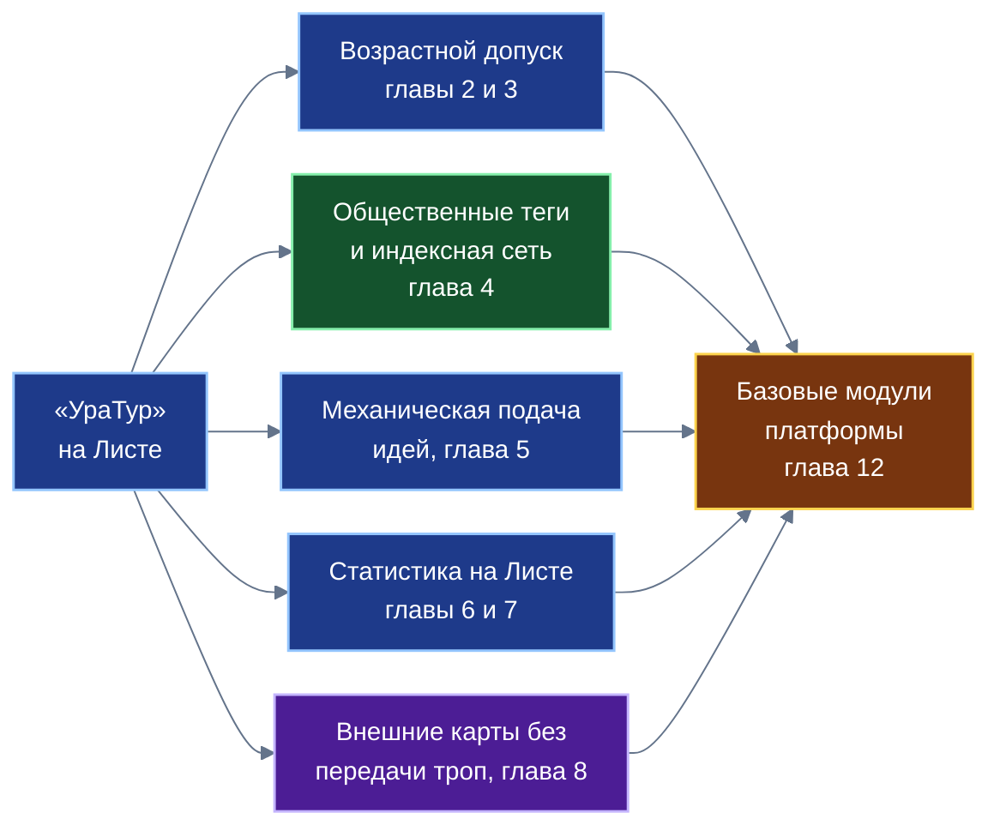
*Схема 1. Пять вкладов приложения; каждый проектируется как общий модуль платформы.*

**Схема 2. Возрастной допуск (глава 2)**

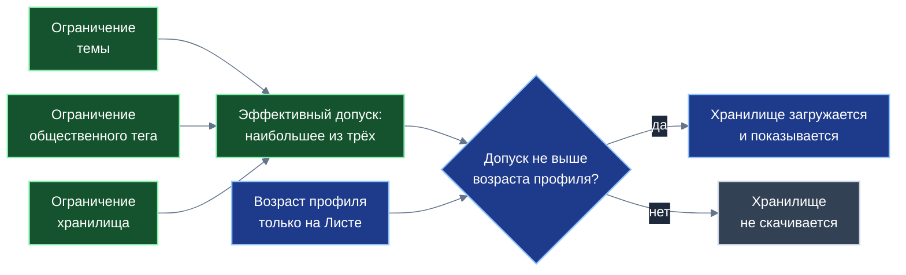
*Схема 2. Три открытых ограничения сводятся к максимуму; решение принимает Лист по возрасту, который не покидает устройство.*

**Схема 3. Семья, порог и хранилища (глава 3)**

```mermaid
%%{init: {"theme":"base","themeVariables":{"background":"#0f172a","fontFamily":"Arial, Helvetica, sans-serif","fontSize":"15px","primaryColor":"#1e3a8a","primaryTextColor":"#ffffff","primaryBorderColor":"#93c5fd","secondaryColor":"#14532d","tertiaryColor":"#1e293b","lineColor":"#64748b","textColor":"#94a3b8","mainBkg":"#1e3a8a","nodeBorder":"#93c5fd","clusterBkg":"#1e293b","clusterBorder":"#475569","titleColor":"#cbd5e1","edgeLabelBackground":"#1e293b"},"themeCSS":"foreignObject *{font-family:Arial,Helvetica,sans-serif !important}","flowchart":{"curve":"basis","htmlLabels":true,"nodeSpacing":26,"rankSpacing":40,"padding":12,"useMaxWidth":true}}}%%
flowchart TD
    F["Профиль семьи на Листе<br/>родители, 13 лет, 5 лет"] --> K["Порог по младшему<br/>участнику: 5 лет"]
    K --> Q{"Какая поездка?"}
    Q -->|"простой маршрут"| S["Отбор маршрутов<br/>с допуском не выше 5"]
    Q -->|"составная экспедиция"| X["Разбиение<br/>на хранилища"]
    X --> H0["Хранилище 1<br/>стоянка и экотропа<br/>допуск 0, у всех"]
    X --> H12["Хранилище 2<br/>радиальный выход<br/>допуск 12, у старших"]
    class F,K,Q,S,X leaf
    class H0 branch
    class H12 priv
    classDef leaf fill:#1e3a8a,stroke:#93c5fd,stroke-width:1.5px,color:#ffffff
    classDef branch fill:#14532d,stroke:#86efac,stroke-width:1.5px,color:#ffffff
    classDef trunk fill:#78350f,stroke:#fcd34d,stroke-width:1.5px,color:#ffffff
    classDef bank fill:#4c1d95,stroke:#c4b5fd,stroke-width:1.5px,color:#ffffff
    classDef priv fill:#334155,stroke:#cbd5e1,stroke-width:1.5px,color:#ffffff
    classDef risk fill:#7f1d1d,stroke:#fca5a5,stroke-width:1.5px,color:#ffffff
```
*Схема 3. Условный пример: на устройстве младшего ребёнка второго хранилища нет.*

**Схема 4. Хронологическое дерево индексного узла (глава 4)**

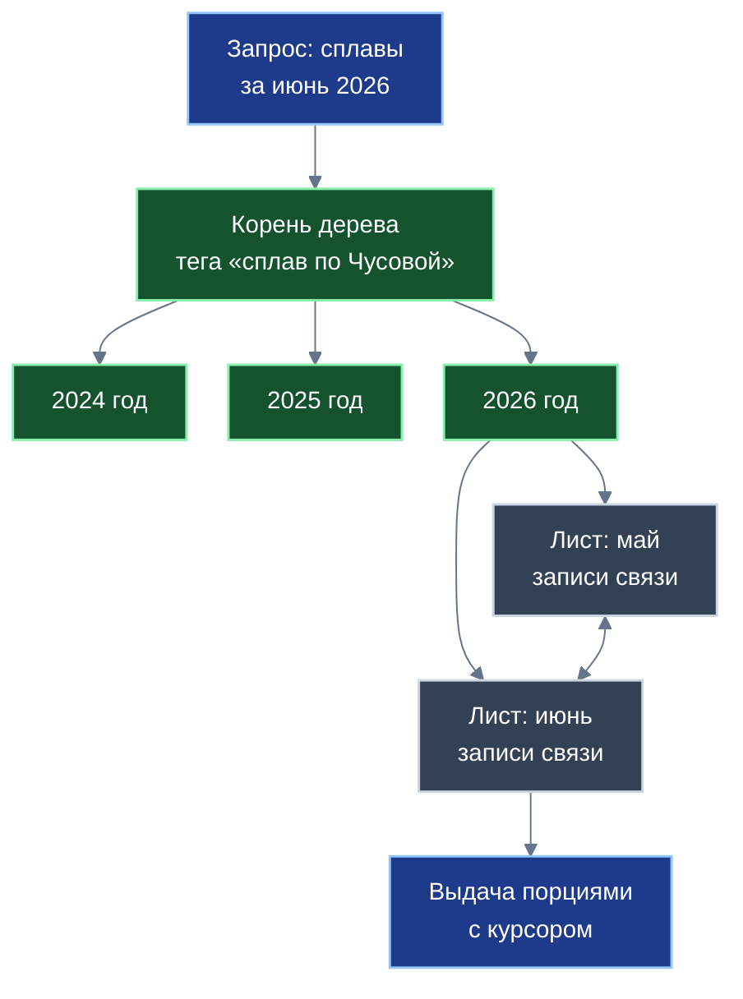
*Схема 4. Листья дерева связаны в обе стороны: период читается без возврата к корню.*

**Схема 5. Сборка группы тегов (глава 4)**

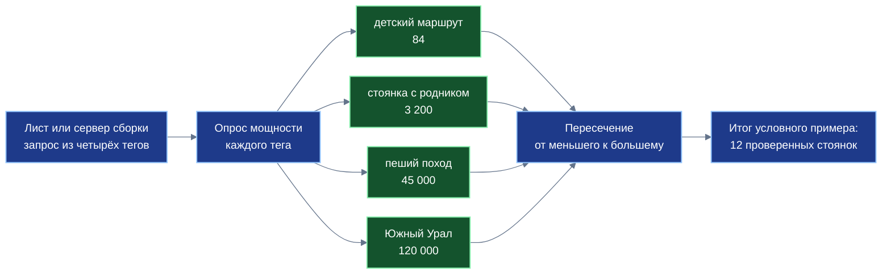
*Схема 5. Числа условные. Пересечение начинается с самого малочисленного тега, поэтому по сети идут лишь идентификаторы.*

**Схема 6. Источники идей (глава 5)**

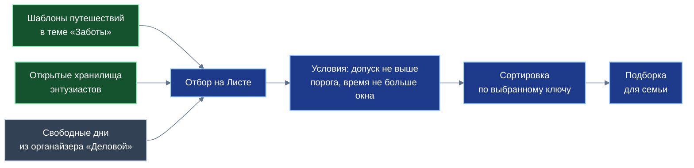
*Схема 6. Один и тот же ввод даёт один и тот же вывод; ключ сортировки выбирает пользователь.*

**Схема 7. Статистический конвейер на Листе (глава 6)**

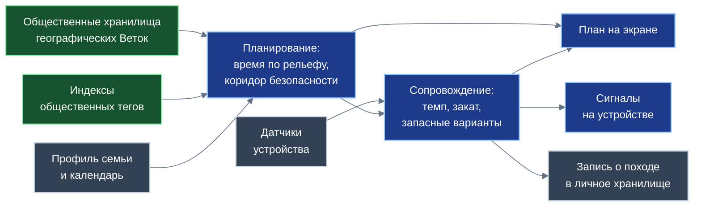
*Схема 7. Расчёты выполняются на устройстве; личные данные и телеметрия наружу не уходят.*

**Схема 8. Скорость пешехода по уклону (глава 6)**

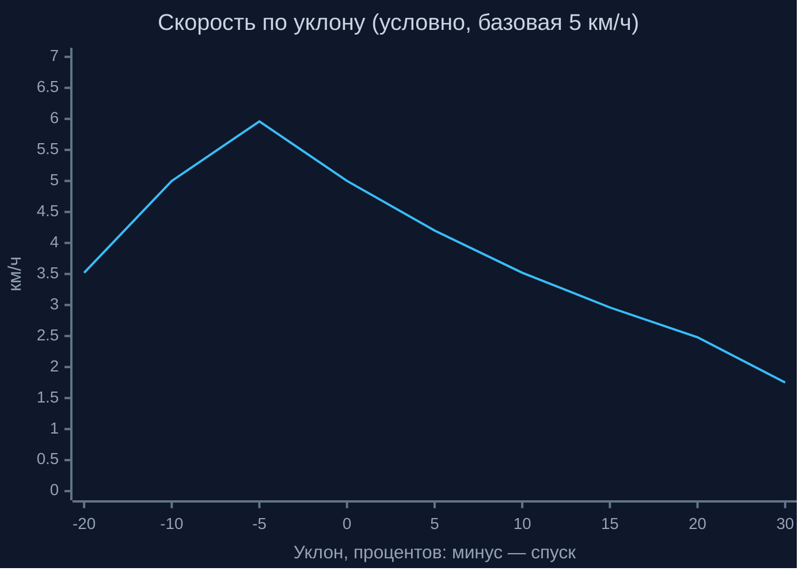
*Схема 8. Наибольшая скорость на лёгком спуске; на подъёмах скорость падает быстро. Значения условные, без поправок на покрытие и группу.*

**Схема 9. Автомат сопровождения (глава 7)**

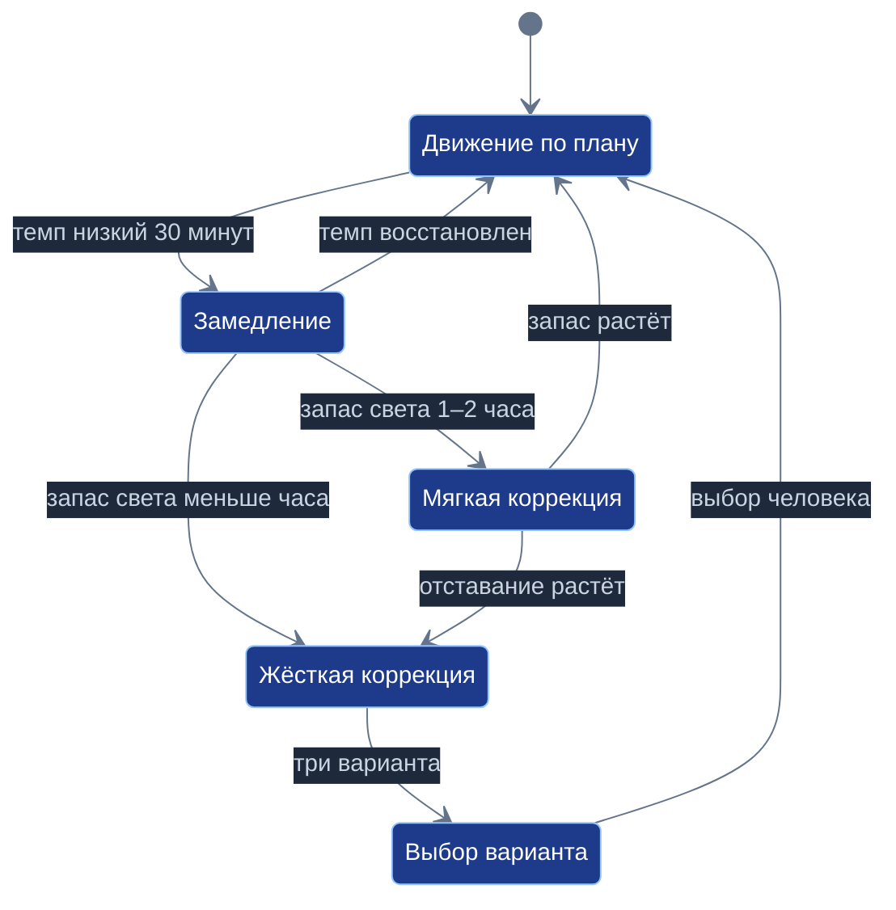
*Схема 9. Автомат только предлагает; план заменяет человек одним нажатием.*

**Схема 10. Сглаживание темпа (глава 7)**

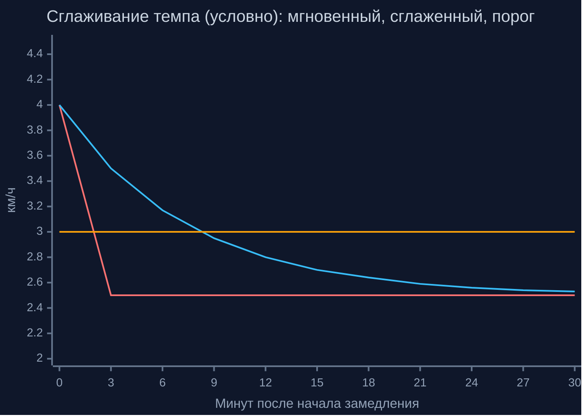
*Схема 10. Сглаженный темп следует за мгновенным с запаздыванием и пересекает порог около девятой минуты; сигнал подаётся, лишь когда снижение выдержано дольше 30 минут. Значения условные.*

**Схема 11. Три режима работы с картами (глава 8)**

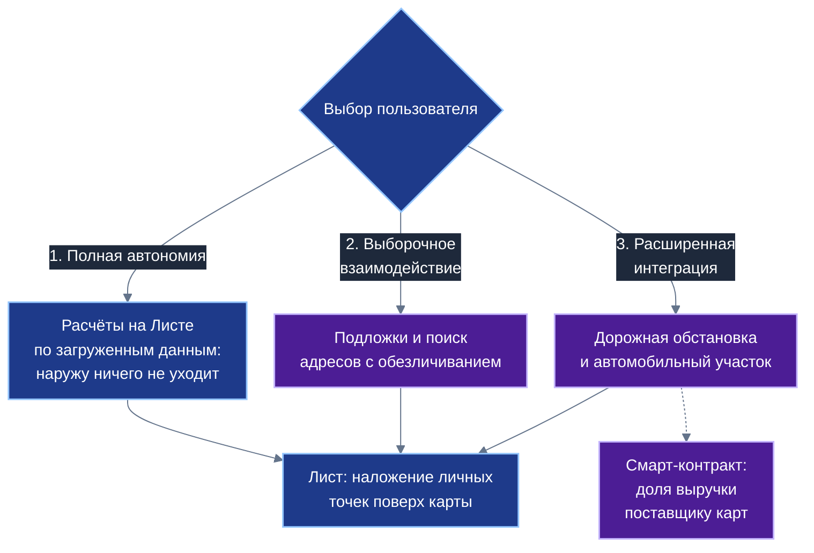
*Схема 11. Степень участия сервиса карт выбирает пользователь; личные точки всегда накладываются на Листе.*

**Схема 12. Обмен с сервисом карт (глава 8)**

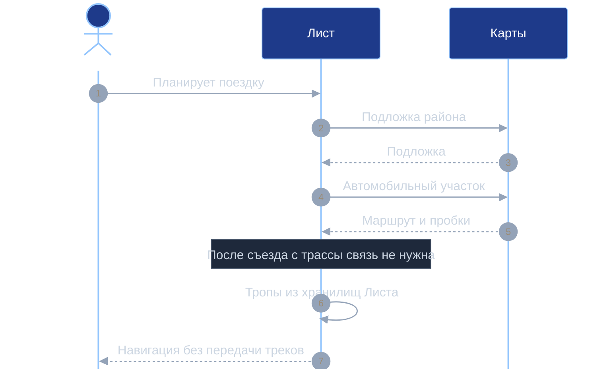
*Схема 12. Сервис карт участвует только в автомобильном участке; пешеходная часть остаётся на Листе.*

**Схема 13. Основание и семь уровней (глава 9)**

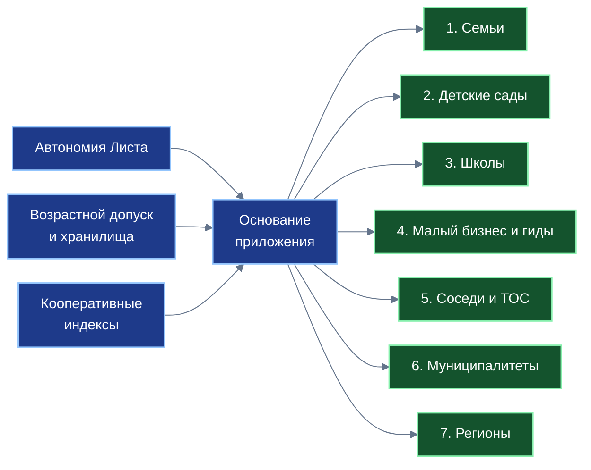
*Схема 13. Три опоры дают ценность на каждом из семи уровней общества.*

**Схема 14. Путь замысла (глава 11)**

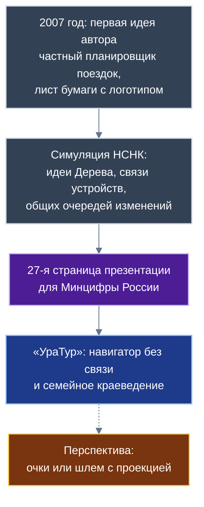
*Схема 14. Путь замысла от рисунка на бумаге до приложения; перспектива показана пунктиром.*

**Схема 15. От приложения к модулям (глава 12)**

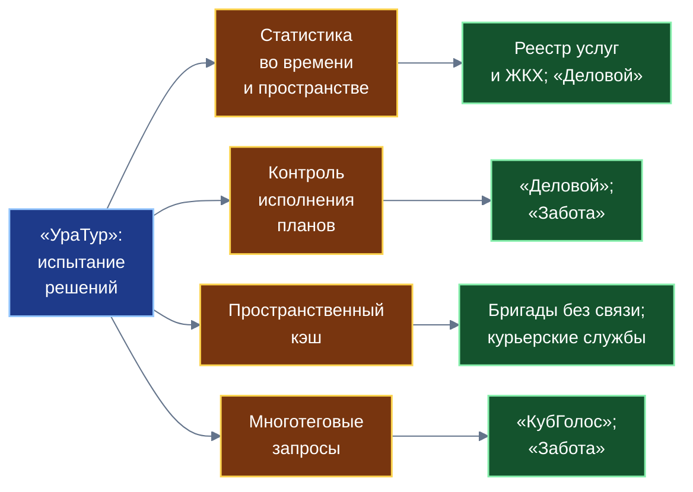
*Схема 15. Четыре статистических модуля, испытанных в «УраТуре», нужны и другим приложениям; остальные модули — в таблице главы 12.*

---

## 8. Таблицы для книги

### 8.1. Строгий и мягкий режимы (глава 2)

| Признак | Строгий режим (внутреннее соединение) | Мягкий режим (внешнее соединение) |
|---|---|---|
| Что получает пользователь | Только записи, у которых разрешены все нужные части | Записи с разрешёнными частями; недопустимые части не возвращаются |
| Пример | Маршрут с ответвлением 16 для ребёнка 11 лет не показывается совсем | Маршрут показывается без ответвления 16 |
| Когда выбирает разработчик | Часть без остальных теряет смысл | Часть полезна и без недоступных частей |
| Общее | Записи, негодные по возрасту, не возвращаются в обоих режимах | |

### 8.2. Что видит каждый узел (глава 2)

| Узел | Что видит | Чего не видит |
|---|---|---|
| Лист пользователя | Свой возраст и профиль; открытые сведения о хранилищах | Профили других людей |
| Ветка | Открытые сведения о хранилищах (допуск, тема); какие хранилища запрашивает Лист | Числовой возраст пользователя |
| Ствол | Сводные сведения и открытые метаданные | Профиль и запросы конкретного Листа |
| Соседний Лист | Только то, что пользователь сам публикует | Профиль и треки |

Остаточное: по набору запрошенных хранилищ можно косвенно судить о возрастной группе; вариант меры — запрашивать открытые сведения целиком и решать на Листе.

### 8.3. Личные метки и общественные теги (глава 4)

| Признак | Личная и внешняя метка («Деловой») | Общественный тег («УраТур») |
|---|---|---|
| Где хранится | На Листе владельца | В открытом реестре индексных узлов |
| Кому видна | Только владельцу | Всем |
| Для чего | Личная каталогизация и личный поиск | Общая каталогизация троп, стоянок, родников |
| Кто задаёт правила | Владелец | Кооператив тегов |
| Что хранится | Метка и ссылка на запись | Лёгкая запись связи тега и хранилища |
| Возрастное ограничение | Не применяется к личной метке | Задано для тега |

### 8.4. Риски кооперативной индексной сети (глава 4)

| Риск | Что это | Направление меры (без обещаний) |
|---|---|---|
| Недоступность узла | Домашний компьютер выключен | Несколько узлов на тег; переключение |
| Недобросовестный узел | Отдаёт неполные или подменённые списки | Проверка контрольной суммы состояния хранилища; сравнение с другими узлами |
| Нерелевантные отметки | Лишние или ложные теги | Правила кооператива; Опыт и рейтинг автора («Забота») |
| Интересы пользователя | Узел видит запрос по тегу и сетевой адрес | Раздельные запросы; сборка на Листе; случайные задержки; смешивание запросов (идеи) |
| Ответственность владельцев узлов | Узлы хранят только лёгкие записи; правовая оценка нужна | Отдельная правовая проработка (открытый вопрос) |
| Нагрузка в сезон | Пик запросов | Срез новейших записей; очередь и вытеснение; кэш |

### 8.5. Режимы работы с картами (глава 8)

| Режим | Что уходит наружу | Что остаётся на Листе | Для кого |
|---|---|---|---|
| 1. Полная автономия | Ничего | Всё | Кто не хочет передавать сведений |
| 2. Выборочное взаимодействие | Запросы подложек и поиска адресов без сведений о семье | Профили, треки, личные точки | Кто хочет лучшую подложку |
| 3. Расширенная интеграция | Автомобильный участок, запрос дорожной обстановки, платёж по договору | Пешеходные треки, личные точки | Кто едет на автомобиле до стоянки |

### 8.6. Что видит сервис карт (глава 8)

| Сведение | Режим 1 | Режим 2 | Режим 3 |
|---|:-:|:-:|:-:|
| Район запроса подложки | нет | да, обезличенно | да |
| Начало и конец автомобильного участка, время | нет | нет | да |
| Пешеходные треки и личные точки | нет | нет | нет |
| Состав семьи | нет | нет | нет |

### 8.7. Семь уровней (глава 9)

| Уровень | Ценность | Механизм платформы | Оговорка |
|---|---|---|---|
| 1. Семьи | Безопасный отбор маршрутов; тайна планов | Порог семьи; профиль на Листе | Пороги проектные |
| 2. Детские сады | Короткие экотропы, метки природы | Допуск 0; фильтр по инфраструктуре | Ориентир 1,5–2 км |
| 3. Школы | Полевое краеведение, ориентирование | Школьные хранилища и шаблоны | Пример из руководства |
| 4. Малый бизнес и гиды | Прямой выход к путешественникам | Открытые точки; смарт-контракты | Без оценок чужой практики |
| 5. Соседи и ТОС | Дворовые маршруты; состояние родников | Общественные теги; «Забота» | Без числовых эффектов |
| 6. Муниципалитеты | Агрегированные сведения о востребованности | Обезличенная статистика | Порядок получения определяется отдельно |
| 7. Регионы | Межрегиональные коридоры; местные традиции | Связывание Веток | Названия маршрутов — условные примеры |

### 8.8. Приложение → модуль (глава 12)

| Модуль | Откуда в «УраТуре» | Кто будет использовать |
|---|---|---|
| Возрастной допуск | Главы 2–3 | Любое приложение с материалами для разных возрастов |
| Общественные теги и индексная сеть | Глава 4 | Любое приложение с открытым каталогом |
| Многотеговые запросы | Главы 4–5 | «КубГолос» (петиции), «Забота» (помощь) |
| Пространственно-временная статистика | Глава 6 | Реестр услуг и ЖКХ, «Деловой» |
| Контроль исполнения планов | Глава 7 | «Деловой», «Забота» |
| Пространственный кэш | Глава 8 | Бригады без связи, курьерские службы |
| Адаптер внешних сервисов со смарт-контрактом | Глава 8 | Транспорт, логистика, реестры |

### 8.9. Три примера (глава 10)

| Пример | Главы | Приватно | Публикуется | Что получает платформа |
|---|---|---|---|---|
| Семейная экспедиция | 2, 3, 6, 7 | Профиль, треки | По желанию отчёт | Образец составной поездки |
| Тропа для детского сада и школы | 2, 3, 5 | Состав группы | Тропа, шаблон | Образец допуска в учреждениях |
| Кооператив водных маршрутов | 4, 5 | Интересы | Теги, записи связи | Образец индексной сети |

### 8.10. Ориентиры для детей (глава 3; проектные, источник не указан)

| Возраст | Наибольший переход за день | Наибольший набор высоты | Покрытие | Условия |
|:-:|:-:|:-:|---|---|
| 0–3 года | до 3 км (коляска, слинг) | до 50 м | Асфальт, утрамбованный грунт | Медпункт, санитарные зоны |
| 4–6 лет | до 5–6 км | до 150 м | Грунтовые тропы без осыпей | Родники, нет обрывов |
| 7–11 лет | до 12–15 км | до 400 м | Лесные тропы, умеренные камни | Укрытия, устойчивая связь |
| 12–15 лет | до 20–25 км | до 900 м | Горные тропы, курумник, броды | Навыки ориентирования, инструктаж |

Подпись под таблицей: «Ориентиры проектные, требуют проверки специалистами; не являются нормами».

---

## 9. Расхождения источников и как их снять

| № | Расхождение | Где | Как поступить в книге |
|---|---|---|---|
| Р1 | Схема «Локальное устройство родителя»: сын 11 лет, дочь 4 года, хранилище 12 «для старшего сына» (11 < 12); текст: подросток 13 лет и ребёнок 5 лет | Б2 §2.2 и §3.1 | Использовать пример 13 и 5 лет |
| Р2 | Автомат: мягкая коррекция при запасе меньше 1,5 часа от заката; зоны: 1–2 часа и менее 1 часа | Б4 §4 и §4.2 | Использовать зоны |
| Р3 | Формула ожидаемого времени через отношение скоростей Тоблера не учитывает смену покрытия на участках | Б4 §4.2 | Использовать запись раздела 6.5 |
| Р4 | «Время строго пропорционально размеру итогового ответа» для оптимальных по худшему случаю соединений; «трафик несколько десятков байт» для 84 идентификаторов (около 1,3 КБ) | Б7 §7, §4.2 | Формулировка раздела 6.6 |
| Р5 | «Свыше 80% запросов из памяти», «менее 128 байт» — без измерений и расчёта | Б7 §2.2, §5 | Проектные оценки; расчёт раздела 6.7 |
| Р6 | Раздел о согласованности называет пульс среди телеметрии; в перечне потоков пульса нет | Б4 §7 и §2.1 | Пульс не упоминать |
| Р7 | «18 лет назад» (план пакета, интервью) и «19 лет (2007 год)» (после уточнения автора) | Overall_Plan; Б5 | Писать 19 лет, 2007 год |
| Р8 | Термины «суверенная инфраструктура», «национальный суверенитет в сфере геоданных» применены к инфраструктуре и данным | Б6 §3.7 | «Инфраструктура Российской Федерации» |
| Р9 | «Таргетированные объявления» при локальном профиле и без профилирования | Б3 §2 | Не использовать «таргетированные»; вопрос 6 плана |
| Р10 | Фоновая загрузка подложек и открытые условия сервисов карт, запрещающие сохранение данных | Б3 §3.1; раздел 10 | «При согласии поставщика и на условиях договора» |
| Р11 | В описании сервиса Яндекса: «наиболее развитая» | Б3 §1 | «Развитая картографическая инфраструктура» |
| Р12 | Даты плана симуляции (25.12.2026; 2046 год) в заметке автора | Заметка-история | Не использовать |
| Р13 | «НЛНК» в сообщении автора и «НСНК» в документах | Шаг 7 оператора | Писать «НСНК» |
| Р14 | Ориентиры для детей приписаны «рекомендациям спортивного туризма и педиатрии» без ссылок | Б2 §4.1 | Не приписывать нормам |
| Р15 | Функция $\psi$ коэффициента группы не определена | Б4 §3.1 | Не придумывать |
| Р16 | Сопоставления с «2ГИС, TripAdvisor, AllTrails» в плане Ступени 3 | Session_03_Plan | Не сопоставлять по именам (раздел 2.1, п. 7) |
| Р17 | Слово «суверенный» в названии «суверенный навигатор» в планах пакета | Overall_Plan; Session_03_Plan | «Автономный навигатор» |

---

## 10. Внешние источники (проверены поиском; документы целиком не читались)

- Tobler W. (1993), «Three presentations on geographical analysis and modeling», NCGIA Technical Report 93-1: функция скорости ходьбы по уклону. Использовать в главе 6 как «известную зависимость, предложенную географом Вальдо Тоблером».
- Veldhuizen T. (2014), «Leapfrog Triejoin: a simple, worst-case optimal join algorithm», ICDT 2014: для пересечения упорядоченных списков время порядка $O(N_{\min}\log(N_{\max}/N_{\min}))$; оптимальность понимается по худшему случаю. Использовать в главе 4 как ссылку на название работы.
- Meeus J. «Astronomical Algorithms» и расчётные таблицы NOAA: положение солнца и время захода. В главе 7 достаточно: «расчёт по общеизвестным формулам астрономии».
- Закон № 436-ФЗ «О защите детей от информации, причиняющей вред их здоровью и развитию»: категории информационной продукции 0+, 6+, 12+, 16+, 18+. В главе 2 назвать закон и категории; статей не приводить.
- Открытые условия использования API Яндекс Карт: данные, получаемые через API, нельзя сохранять, кроме кэша ответов геокодера и маршрутизатора на срок до 30 дней; сервис плиток отдаёт схему. Условия относятся к общедоступной версии; для коммерческого соглашения могут отличаться. Использовать в главе 8: «открытые условия ограничивают сохранение данных; автономная подложка предполагает соглашение с поставщиком». Условия сверить перед публикацией.
- Средняя заполненность страниц дерева при случайных вставках около 69% (ln 2): известная оценка (работа Яо, 1978). Использовать только в примере раздела 6.7.

---

## 11. Контрольный список перед сдачей

Общий контрольный список (общий план, раздел 11) и список плана (раздел 6) плюс:
- [ ] Врезка «Из предыдущих книг» содержит 8 понятий.
- [ ] Глава 2: три ограничения, максимум, хранилище как единица, копия допуска, строгий и мягкий режимы, упреждающее отсечение, таблица «что видит каждый узел», границы.
- [ ] Глава 4: таблица личных меток и общественных тегов; кооператив; индексный узел; два времени; дерево; курсор; серверы сборки; сборка на Листе; таблица рисков; формулировка Leapfrog из раздела 6.6.
- [ ] Главы 6–7: формулы по разделам 6.1–6.5; оговорки; зоны; три запасных варианта; полярные широты.
- [ ] Глава 8: три режима; разделение графа; два контура; условие соглашения о подложке; нет «Яндекс согласился»; остаточные сведения названы.
- [ ] Нет слов из списка раздела 2.1, п. 1.
- [ ] Нет «НЛНК», нет дат 25.12.2026 и 2046.
- [ ] Просмотр в `viewer.html`; проверка схем: «замечаний: 0».
- [ ] Не правились другие документы, кроме реестров (дело 4.3 плана Ступени 3).

---

## 12. Что осталось неизвестным

- Правила проверки общественных тегов внутри кооператива; вознаграждение владельцев индексных узлов; противодействие недобросовестным узлам.
- Условия сохранения подложки у поставщика карт; наличие соглашения.
- Подбор коэффициентов группы для детей и источник ориентиров для детей.
- Допуск темы и допуск общественного тега: кто назначает.
- Подбор рекламы без выгрузки сведений о семье; доля поставщика карт.
- Мера против косвенного определения возраста по набору запрошенных хранилищ.
- Сопоставление запросов узлами по сетевому адресу и времени.
- Состояние прототипов: хранилища нет; писать «отдельные механики реализованы в прототипах» только если автор подтвердит, иначе «проектная концепция».
- Размещение логотипа в книге (вопрос 3 плана).
- Название моделей в атрибуции (вопрос 1 плана).

Новые вопросы, возникающие при написании, исполнитель задаёт автору.
