# ИНФОРМАЦИЯ К ПЛАНУ Белой книги № 12 — «Экосистема платформы «Турбаза»»

**Назначение.** Рабочий справочник для исполнителя плана [ПЛАН_12_Экосистема.md](./ПЛАН_12_Экосистема.md). Собирает всё, что нужно для написания книги `12_ecosystem_whitepaper.md`: решения автора, правила, проверенные факты с указанием источников, формулы с пересчитанными примерами, готовые схемы, таблицы, расхождения источников и контрольные списки.

**Для кого.** Исполнитель — модель Gemini 3.8 Flash (так её называет автор). Планирование и справочник подготовила модель Claude Sonnet 5.5. Предполагается, что исполнитель не видел предыдущих обсуждений. Где данные взяты у автора, где получены из документов базы знаний, где выведены составителем, где не проверены — указано явно (колонка «Статус»).

**Это не часть книги.** Здесь допустимы названия файлов, номера разделов, имена программных сущностей и пакетов. В текст книги они не переносятся (раздел 2).

**Границы задачи исполнителя.** Только книга `12_ecosystem_whitepaper.md` и документы пакета по плану Ступени 06. Если не хватает сведений, исполнитель задаёт вопрос автору.

**Формат выпуска.** Markdown. PDF не собирается, страничного бюджета и оглавления с номерами страниц нет. Остальные стандарты (тон, запреты, русская речь, формулы, схемы) действуют.

**Условные обозначения источников** (пути относительно `shared_docs/whitepapers/`):
- `С2` — [00_Синтез_Работоспособность_и_Безопасность_Хранилищ.md](./applications/local_services/repositories/00_Синтез_Работоспособность_и_Безопасность_Хранилищ.md);
- `Х1`…`Х4` — [01](./applications/local_services/repositories/01_Технический_документ_Работоспособность_Хранилищ.md), [02](./applications/local_services/repositories/02_Технический_документ_Безопасность_Хранилищ.md), [03](./applications/local_services/repositories/03_AIRport_Реализация_Хранилищ_в_Коде.md), [04](./applications/local_services/repositories/04_Историческая_эволюция_и_патент_Хранилищ.md) каталога `repositories/`;
- `О0` — [прогностический абстракт](./applications/local_services/organizations/00_Прогностический_абстракт_Кооперативная_занятость_в_эпоху_роботизации_20-40_лет.md);
- `О1`…`О4` — документы каталога `organizations/`: [01](./applications/local_services/organizations/01_Оргформы_Разработчиков_Приложений.md), [02](./applications/local_services/organizations/02_Оргформы_Провайдеров_Инфраструктуры_и_Тегов.md), [03](./applications/local_services/organizations/03_Оргформы_Потребителей_Рекламного_Пула.md), [04](./applications/local_services/organizations/04_Историко_географический_свод_артелей_и_кооперативов.md);
- `ЛС1` — [Local_Services_AIR_Repositories_Foreign_Keys_and_Snapshots.md](./applications/local_services/Local_Services_AIR_Repositories_Foreign_Keys_and_Snapshots.md);
- `ЛС2` — [Local_Services_Cross_App_Schemas_and_Virtual_Joins.md](./applications/local_services/Local_Services_Cross_App_Schemas_and_Virtual_Joins.md);
- `ЛС3` — [Local_Services_Cooperative_Economy_and_L1_Contracts.md](./applications/local_services/Local_Services_Cooperative_Economy_and_L1_Contracts.md);
- `ЛС4` — [Local_Services_Cross_App_Code_Implementation_in_AIRport_and_AIRline.md](./applications/local_services/Local_Services_Cross_App_Code_Implementation_in_AIRport_and_AIRline.md): исследование реализации взаимодействия приложений в коде; сверено с исходными текстами `AIRroot` выборочно, 11 октября 2026 года (таблица 8.14);
- `У4` — [04_Статистические_программные_модули_УраТура.md](./applications/uratur/04_Статистические_программные_модули_УраТура.md);
- `Пр` — [presentation_outline.md](../../applications_presentations/05_local_services_presentation/docs/presentation_outline.md) презентации реестра МСП и ЖКХ;
- `Кн.06`…`Кн.11` — книги комплекта; `ОП` — [ОБЩИЙ_ПЛАН_08-10_….md](./ОБЩИЙ_ПЛАН_08-10_Белые_книги_прикладных_приложений.md); `МП` — [Overall_Plan.md](../../sessions/2026/10-10_03_Ecosystem_whitepaper_and_presentation/Overall_Plan.md) пакета задач.

---

## 0. Как пользоваться документом

1. Прочитать `ОП` (разделы 1–6, 10–12), книги № 08–11 (согласовать термины), `ПЛАН_12_Экосистема.md`.
2. Для каждой главы взять тезисы плана и факты из разделов 5–8.
3. Формулы и числа — только из раздела 6. Раздел 9 перечисляет места, где документы базы знаний расходятся, неточны или нарушают правила: в книгу переносить исправленные формулировки.
4. Схемы — из раздела 7; таблицы — из раздела 8.
5. Перед сдачей пройти контрольный список (раздел 11).

**Шесть принципов:**
- Книга собирает комплект: хранилища, соединение приложений, общие модули, экономика, кооперативы, горизонт. Она воплощает девиз Beyond Decentralized «Справедливое Владение Данными и Независимая Разработка Программного Обеспечения» (Fair Data Ownership and Independent Software Development), раскрывает синтез пользовательских интерфейсов и логических модулей и подчеркивает частичную роль «Турбазы» в будущей многоукладной экономике.
- Утверждения делятся на три категории: **Д** — доказано при названных допущениях; **С** — сводится к допущению стойкости или к допущению об устройстве; **О** — открыто, подлежит дальнейшей проработке. Открытое не подаётся как решённое (решение автора по синтезу Ступени 02).
- Всё, что рассчитывается, имеет названные допущения. Числа разделов 6 и 8 — проектные значения или условные примеры.
- Ничего не подаётся как работающее, согласованное с ведомством, проверенное юристами, налоговыми консультантами и экспертами по безопасности.
- Правовые нормы и ставки названы «по действующему праву на дату подготовки, требуют сверки»; в книге упор на принципы.
- Слово «суверенитет» относится только к государству; для устройств, хранилищ, программ и людей: автономия, частная жизнь.

---

## 1. Решения автора и принятые положения

Статус: **А** — слова автора (мастер-план пакета, интервью, ответы по книгам № 08–11); **Д** — документ базы знаний, подготовленный моделью, прямого подтверждения автора в протоколах нет; **В** — вывод составителя.

| № | Решение или положение | Источник | Статус |
|---|---|---|:-:|
| 1 | Платформа рассчитана на неограниченное число приложений; «КубГолос», «Забота», «Деловой», «УраТур» и реестр МСП и ЖКХ — начальные (валидационные) приложения | `МП`, раздел 2; Session_05_Plan | А |
| 2 | Единица данных, прав и ключа — малое автономное хранилище; одна сетевая транзакция затрагивает одно хранилище | `С2`; `ЛС1`; Кн.10 | А |
| 3 | Доля гражданина в распределении рекламной выручки — десятина, 10% | `ОП`, решение 12 | А |
| 4 | Слово «суверенитет» только для государства; для устройств, программ и людей — автономия, частная жизнь | `ОП`; Кн.11, справочник, решение 15 | А |
| 5 | Названия моделей в атрибуции записываются «как есть»: Claude Sonnet 5.5, Gemini 3.8 Flash | `ОП`, решение 8 | А |
| 6 | Выпуск книг о приложениях — Markdown; для № 12 принято то же (допущение 1 плана) | `ОП`, решение 7 | А для № 08–11; В для № 12 |
| 7 | Слабые места и вопросы, оставленные открытыми в синтезе Ступени 02 (категория О, реестр Р-1…Р-10, пункты плана верификации), подлежат дальнейшей проработке и не подаются в книге и презентации как решённые | `С2`, врезка в разделе 1; коммит `aeb83e0` | А |
| 8 | Даты плана симуляции НСНК (25.12.2026 и 2046 год) в книги не включаются | Кн.11, справочник, решение 22 | А |
| 9 | Сопоставление с другими сервисами — по задачам, без названий чужих продуктов | Кн.11, справочник, решение 21 | А |
| 10 | Реклама без выгрузки сведений о семье возможна несколькими путями; выбор пути на будущее | Кн.11, справочник, решение 23 | А |
| 11 | Порядок проверки меток в кооперативе и назначение допуска тегу и теме зависят от законодательства; решается позднее | Кн.11, решение 22 | А |
| 12 | Три барьера для одиночных участников и ответ на них — кооперативы разработчиков, владельцев узлов и граждан; «кооператив кооперативов» | `О1`…`О3`; `ЛС3` | Д |
| 13 | Институциональная триада для разработчиков (производственный кооператив, ассоциация стандартов, потребительское общество инфраструктуры) | `О1`, раздел 6.1 | Д |
| 14 | Потребительский союз граждан с собранием уполномоченных, комитетом этики, советом и ревизионной комиссией | `О3`, раздел 5.1 | Д |
| 15 | Модель дохода домохозяйства как портфеля из пяти компонентов; три сценария | `О0`, разделы 1, 3, 10 | В |
| 16 | Рекламный дивиденд — микродоход, а не базовый доход; гарантируется правило распределения, а не размер выплаты | `О0`, раздел 6.2 | В |
| 17 | Хранилище не делает имущество кооператива неприкосновенным; оно делает независимыми доказательства права | `О0`, раздел 7.3 | В |
| 18 | Три уровня расчётов: контракт первого уровня на платформе Банка России с малым числом сторон; распределение по кооперативам; внутренний реестр кооператива | `ЛС3`, раздел 4 | Д |
| 19 | Образец оформления книги: книги № 08–11 (Markdown, схемы Mermaid единого стиля, формулы KaTeX, один абзац — одна строка) | `ОП`, раздел 6.3 | А |
| 20 | Календарных дат дорожной карты и контактов в книге нет | `ОП`, раздел 10.1, п. 8 | А |
| 21 | Код AIRport написан на TypeScript как прототип; он служит также средой проверки приложений в исполнении разработчиками и проверяющими и основой Листа на платформе JavaScript | Указание автора, 11 октября 2026 года | А |
| 22 | Планируется добавить комментарии (аннотации) ко всем общим типам, чтобы автоматически компилировать AIRport и написанные в нём приложения в AssemblyScript для эффективного исполнения на большинстве пользовательских устройств | Указание автора, 11 октября 2026 года | А (замысел; не реализовано) |
| 23 | Взаимодействие приложений между собой отмечается в книге отдельно; основа — исследование кода `ЛС4` | Указание автора, 11 октября 2026 года | А |
| 24 | Девиз проекта «После Децентрализации» (Beyond Decentralized): «Справедливое Владение Данными и Независимая Разработка Программного Обеспечения» (Fair Data Ownership and Independent Software Development); символика гиперзвукового пассажирского лайнера; поддержка независимых разработчиков как первоочередной приоритет при равноправном партнёрстве с крупными компаниями | Указание автора, 11 октября 2026 года | А |
| 25 | Ортогональный синтез логических модулей и пользовательских интерфейсов: UI свободен от однонаправленных ограничений бэкенда и может использовать любые модули напрямую или через транзакционную оболочку; расширение творческих возможностей пользователей и артелей | Указание автора, 11 октября 2026 года | А |
| 26 | «Турбаза» — лишь одна из составляющих частей будущей многоукладной экономики, а не её тотальное решение; даже при сотнях миллионов участников большинство населения не будет занято обслуживанием ИТ-инфраструктуры; экономика самозанятости распределяется неравномерно | Указание автора, 11 октября 2026 года | А |

---

## 2. Правила для текста и шаблон атрибуции

### 2.1. Запреты

Общий план `ОП`, раздел 10.1, и `whitepapers/AGENTS.md`, правила 5 и 6. Дополнительно для этой книги:
1. Не использовать обороты источников: «платформенная дань», «монопольные агрегаторы», «катастрофа плоской модели», «бюрократический коллапс», «обременительные страховые тарифы», «неопровержимо доказывает», «юридически безупречный», «абсолютная юридическая надёжность», «гарантирует неотчуждаемость», «пассивные пользователи превращаются в суверенных совладельцев», «фирмы-однодневки», «серые схемы», «рейдерский захват», «враждебное поглощение транснациональными монополиями».
2. Не писать «абсолютная безопасность», «взлом невозможен», «полная защита», «безупречно», «100%», «0%» как свойство защиты; не писать «безопасно по построению» без названных допущений.
3. Не писать, что решения согласованы или поддержаны Банком России, Минцифры России, ФНС, ФСТЭК, ФСБ, регуляторами или юристами. Не сообщать, что технический документ направлялся в Минцифры России, и что ответа не последовало (вопрос 7 плана).
4. Не называть профиль шифрования по ГОСТ, постквантовую подпись, гибридную доставку ключей и серверные протоколы Веток и Ствола реализованными: они заданы спецификацией (раздел 8.1).
5. Не использовать «базовый доход», «пассивный доход», «гарантированный доход».
6. Не использовать «таргетированная реклама» и «профилирование» применительно к платформе.
7. Не использовать названия программных сущностей, пакетов, полей, таблиц и функций: `AIREntity`, `AirEntity`, `RepositoryId`, `ActorId`, `ActorRecordId`, `IChildRecordPage`, `CopiedRecordLedger`, `TransactionHistory`, `@turbase/…`, `@votecube/…`, `@sapoto/…`, `@gogetter/…`, `AdClear_FSM`, `SoftwareTree`, `AdDividends_Audit`, `share(…)` как код. Для идей использовать русские описания (раздел 4).
8. Не использовать английские названия приёмов и режимов без перевода: Security Forking, Crypto-Shredding, Transitive Snapshot Closure, Zero-Latency Instant Page Render, Background Lazy Hydration, Point-in-Time Provenance, One Transaction per Repository, Proof of Storage, Merkle Audit Path, Power of Two Random Choices, Proof of Attention, Blind Tokens, Zero-PII Identity Gateway, Query Coordinator, Cold Standby, Free-riding, IP Pooling, Data Trust (последнее — только как название зарубежного института).
9. Не писать «суверенное хранилище», «суверенный Лист», «суверенные совладельцы», «суверенная цифровая экономика», «ассоциация инженеров суверенных данных». Допустимы: «Суверенные Деревья государств» (в смысле государства; пояснить при первом упоминании) и «национальная юрисдикция».
10. Не использовать числа презентации реестра и документов базы знаний без расчёта: «до 30% выручки мастера», «25–35% платформенной дани», «+35% товарооборота», «2–3% эквайринга», «0% комиссий», «менее 10 мс», «менее 0,1 мс», «2 мс», «снижение накладных расходов на 25–35%», «99,8% снижения дискового обмена».
11. Не использовать «Землячество» (термин не определён) и «1/N» (правило не определено).
12. Не использовать название «ПАО «Артель Турбаза»» и регистрационные названия институтов из отчётов («Турбаза-Разработка», «Турбаза-Инфраструктура» и подобные): в книге роли описываются словами.
13. Не сообщать календарные годы горизонта прогноза и даты плана симуляции; писать «через 20–40 лет».
14. Не писать в оценочном тоне о зарубежных системах и историческом опыте; факты — по отчёту Ступени 3 и с пометкой «сверить».
15. Не переносить из `ЛС4` и из кода: имена пакетов, классов, методов, таблиц и колонок (`TASKS`, `GOAL_TASKS`, `TOPIC_RID_1`, `TaskApi`, `CollectionApi`, `ApiProxy`, `LocalAPIServer`, `AirEntity`, `@Api()`, `@Injected()`), названия внутренних частей (Tarmaq, Runway, tower, airgate, airspace, final-approach, holding-pattern), английские названия приёмов (Unified Local Read, Sandboxed Encapsulated Write, Entity Colocation, Link Entities, Live Observable). Названия открытых проектов AIRport и AIRline допустимы один-два раза (атрибуция, подраздел 8.5).
16. Не писать «абсолютная безопасность», «полная защита», «скомпрометированное приложение не может повредить другое» (Р25), «проверка типов аргументов реализована» (Р26), «перечень разрешений реализован» (Р27), «связки задача — беседа и упоминание используются» (Р28), «беседы — это КубГолос» и прочие прямые соответствия (Р29), «Web Worker» (Р30), «0,08 мс» (Р31).
17. Не называть компиляцию в AssemblyScript готовой или быстрой в N раз; не называть сроки; писать «намерение автора» и «подмножество определяется при проектировании».

### 2.2. Как формулировать спорные места

| Нельзя | Можно |
|---|---|
| «Хранилища абсолютно безопасны» | «При допущениях A1–A7 содержимое недоступно Ветке и Стволу, подделка обнаруживается; остаточные риски приведены в главе 4» |
| «Платформа масштабируется без сбоев» | «Рост добавлением Веток при условии, что нагрузка каждой Ветки не превышает её пропускной способности; предел одного хранилища — пропускная способность одной Ветки» |
| «Профиль ГОСТ реализован» | «Модель данных, ключи записей, журнал, транзакции и изоляция приложений работают в коде ядра; профиль шифрования по ГОСТ и серверные протоколы заданы спецификацией и подлежат реализации и проверке» |
| «Хранение на устройствах гарантирует неприкосновенность имущества кооператива» | «Хранилища делают доказательства права независимыми от единого держателя записей; имущество кооператива остаётся имуществом юридического лица и подчиняется праву» |
| «Рекламный дивиденд — базовый доход» | «Рекламный дивиденд — микродоход; гарантируется правило распределения (десятина), а не размер выплаты» |
| «Мастер получит дополнительный доход от сдачи компьютера» | «При условных допущениях узел окупает затраты при порядка 400–900 оплачиваемых запросов в сутки; объём таких запросов пока неизвестен» |
| «Иерархия расчётов решает проблему перегрузки» | «Иерархия ограничивает арность контракта первого уровня и выносит массовые выплаты за его пределы; общее число конечных выплат остаётся прежним» |
| «Правовая модель юридически безупречна» | «Российское право содержит формы, которые подходят для предлагаемой конструкции; правовая оценка, регистрация и налоговое заключение требуются отдельно» |
| «Мастера оценивают реальные соседи, а не боты» | «Оценка вклада мастера строится на рейтинге вкладов и подтверждённом Опыте «Заботы»; механизм защиты от накруток описан в книгах № 08 и № 09» |
| «Платформа готова к массовой эксплуатации» | «Проектная концепция; отдельные механики реализованы в прототипах; ядро данных работает в коде» |

### 2.3. Шаблон атрибуции (вставить в начало книги)

> *Автор концепции и системный архитектор платформы: Артём Владимирович Шамсутдинов, разработчик платформы цифрового суверенитета государства «Турбаза» — интернета автономных и частных данных / открытого стека AIRport; изобретатель по патенту США 10 902 016 B2.*
> *Вклад моделей и методология подготовки книги:*
> * *Архитектура мастер-плана пакета задач «Экосистема» и исследовательские отчёты о хранилищах (Ступень 1) и об организационно-правовых формах и кооперативных институтах (Ступень 3): модель Gemini 3.8 Flash под концептуальным руководством автора.*
> * *Синтетическое доказательство работы и безопасности хранилищ (Ступень 2) и прогностический абстракт о кооперативной занятости на горизонте 20–40 лет (Ступень 4): модель Claude Sonnet 5.5.*
> * *Планирование книги и справочник (Ступень 5): модель Claude Sonnet 5.5; распределение понятий между книгами комплекта и порядок изложения предложены ею для утверждения автором.*
> * *Издательская сборка, математический аппарат и литературная проработка текста (Ступень 6): модель Gemini 3.8 Flash.*

Примечания: слова «для утверждения автором» заменить на «и приняты автором» после подтверждения плана. Строки об агенте Antigravity в этой книге нет. Номер патента писать в виде, принятом в книгах комплекта.

---

## 3. Формат книги (Markdown)

Образец — начало книги № 11. Заголовок:

```
# «Экосистема платформы «Турбаза»»: хранилища, неограниченное число приложений, общие модули и кооперативный строй
**Белая книга № 12: как устроены и почему надёжны автономные хранилища, как соединяются приложения, какие модули становятся общими и кто обслуживает платформу**
*Версия: 1.0 (2026)*
*Статус: проектная концепция*
*Классификация: общесистемный уровень платформы «Турбаза»*
```

Остальное по `ОП`, раздел 6.3: один абзац — одна строка файла; таблицы без знака `---` и вертикальной черты внутри ячеек; формулы `$…$` и `$$…$$`; схемы — готовые блоки раздела 7, не шире 680 пикселей и не более 12 узлов; блоков кода нет, кроме Mermaid.

---

## 4. Глоссарий для читателя

| Термин | Пояснение |
|---|---|
| Лист, Ветка, Ствол | Три звена платформы: устройство участника, районный или отраслевой узел, государственный уровень |
| Хранилище | Автономная единица данных с собственным журналом подписанных записей, собственным ключом шифрования и кругом участников; одна сетевая транзакция затрагивает одно хранилище |
| Запись | Строка данных приложения; адресуется тройкой: хранилище, автор записи, номер записи у автора |
| Журнал | Цепочка подписанных изменений хранилища; каждая запись включает хэш предыдущей |
| Дельта | Набор изменённых строк одной транзакции |
| Пиши только своё | Участник создаёт собственные записи и не изменяет чужие |
| Внешний ключ | Ссылка из записи одного хранилища на запись другого: та же тройка |
| Снимок | Неизменяемая копия внешней записи вместе с записями, на которые она ссылается, включённая в хранилище-источник при создании связи |
| Транзитивное замыкание | Множество записей, достижимых по цепочке внешних ключей |
| Страница | Самозапечатывающийся блок около 1000 лёгких проекций связей «один ко многим» (подробно в № 09) |
| Схема приложения | Набор таблиц данных приложения; принадлежит приложению |
| Дополнительная таблица приложения | Таблица, которая добавляется приложением и указывает внешним ключом на запись базовой схемы; чужие таблицы не изменяются |
| Однонаправленная иерархия схем | «КубГолос» ← «Забота» ← «Деловой»: схема зависит только от схем левее |
| Виртуальный объект | Единый вид записи, который Лист собирает из базовой записи и дополнительных таблиц оперативным соединением; на диске объекта нет |
| Внутреннее и внешнее соединение | Запись показывается, только если есть все части (строгий режим); либо недоступные части возвращаются пустыми (мягкий режим) |
| Ролевая изоляция по ключам | Часть объекта доступна, если у участника есть ключ соответствующего хранилища |
| Общий модуль платформы | Конструкция, отработанная в приложении и вынесенная на уровень платформы; описывается понятийной спецификацией |
| Понятийная спецификация | Назначение, вход, выход, инварианты, оценка сложности, потребители; без кода |
| Эффективный допуск | Наибольшее из возрастных ограничений темы, тега и хранилища (№ 11) |
| Общественный тег, индексный узел | Открытая метка в общедоступном реестре; компьютер участника, хранящий лёгкие записи связи тегов (№ 11) |
| Функция распределения выручки | Детерминированное правило раздела выручки между участниками дерева модулей (№ 06) |
| Десятина | Доля гражданина в рекламной выручке: 10% |
| Контракт первого уровня, второго уровня | Первый — публичный конечный автомат на платформе Банка России; второй — приватное хранилище сторон (№ 06, № 10) |
| Арность контракта | Число сторон, участвующих в одной транзакции расщепления платежа |
| Неделимый фонд | Часть имущества кооператива, которая не распределяется между членами |
| Производственный кооператив (артель) | Форма по Закону № 41-ФЗ; члены участвуют личным трудом |
| Ассоциация (союз) | Некоммерческая корпорация по ст. 123.8 Гражданского кодекса |
| Потребительское общество | Форма по Закону РФ № 3085-1 |
| Потребительский союз | Объединение граждан-пайщиков; высший орган — собрание уполномоченных |
| Собрание уполномоченных | Представительский высший орган союза: избранные делегаты от округов |
| Ассоциированное членство | Членство с паем и совещательным голосом без решения закрытого круга |
| Кооператив кооперативов | Многоуровневая федерация первичных кооперативов |
| Подтверждение внимания | Вычисление на Листе коэффициента внимания к показу рекламы без выгрузки личного профиля |
| Слепой маркер | Подтверждение реального гражданина через ЕСИА без передачи персональных данных рекламодателю |
| Портфель дохода | Доход домохозяйства как сумма пяти компонентов (глава 13) |
| Открытый вызов | Метод приложения, объявленный доступным другим приложениям и интерфейсу пользователя; единственный путь изменить данные приложения-владельца |
| Заглушка вызова | Автоматически построенный образ открытого вызова в другом приложении: упаковывает вызов в сообщение и передаёт ядру |
| Колокация | Размещение записей разных приложений в одном хранилище, когда у них общий жизненный цикл и круг участников |
| Связующая сущность (связка) | Запись, лежащая в одном из хранилищ и указывающая внешними ключами на записи двух разных хранилищ |
| Реестр версий приложений | Перечень установленных версий приложений и ссылок между ними с числовым индексом ссылки |
| Изолированная среда приложения | Среда исполнения приложения без прямого доступа к базе и к памяти других приложений (в прототипе — отдельный документ браузера) |
| Прототип | Работающая на TypeScript кодовая база ядра и приложений; также среда проверки приложений в исполнении и основа Листа на платформе JavaScript |
| Аннотации к общим типам | Комментарии к описаниям данных и открытых вызовов, по которым предполагается автоматически собирать ядро и приложения в AssemblyScript (намерение автора) |
| AssemblyScript | Язык, близкий к TypeScript, компилируемый в WebAssembly; частично подмножество, частично расширение TypeScript |
| Доказано / сводится к допущению / открыто | Три категории утверждений книги: Д, С, О |

---

## 5. Факты по главам (с источниками)

### 5.0. Врезка «Из предыдущих книг комплекта» (10 понятий)

1. Лист, Ветка, Ствол и хранилище (№ 03, № 11).
2. «Пиши только своё» (№ 08, № 09).
3. Страница, самозапечатывающаяся (№ 09; около 1000 лёгких проекций).
4. Тег, внешняя метка, общественный тег (№ 10, № 11).
5. Дерево тем и сложение вверх (№ 08).
6. Социальный рейтинг вкладов по теме и экономический рейтинг; рейтингов два (№ 07, № 09): открытый — по темам; закрытый — Банк России и подключённые им структуры по статистике смарт-контрактов, выдаётся с согласия.
7. Дело и контракт второго уровня (№ 10).
8. Возрастной допуск и эффективный допуск (№ 11).
9. Распределение выручки и десятина (№ 06, № 08): 10% гражданину.
10. Кооператив тегов и индексный узел (№ 11).

### 5.1. Глава 1 (от четырёх приложений к неограниченной экосистеме)

- Четыре задачи комплекса: математико-инженерное доказательство работы хранилищ; институционально-юридическая модель кооперативов; футурологический абстракт на 20–40 лет; архитектурная синергия неограниченной экосистемы (`МП`, раздел 2.1).
- Приложения: «КубГолос» (измерять и складывать), «Забота» (вкладывать и просматривать), «Деловой» (исполнять и связывать), «УраТур» (находить, беречь и сопровождать), реестр МСП и ЖКХ (местные услуги) (`ОП`, раздел 3; Кн.11; `ЛС2`, раздел 4).
- Иерархия схем: «КубГолос» ← «Забота» ← «Деловой» (`applications/AGENTS.md`, раздел 1; `applications/README.md`). Асимметрия слоёв: на уровне схем зависимость однонаправлена, на уровне интерфейсов приложения встраиваются друг в друга (`ОП`, раздел 3). Положение «УраТура» и реестра — допущение 4 плана.
- Зрелость: таблица 8.1.
- Статус слова «неограниченное»: означает отсутствие встроенного предела на число приложений в архитектуре схем и хранилищ; практические пределы — пропускная способность Веток и порядок утверждения стандартов (главы 3, 8).

### 5.2. Глава 2 (хранилище)

Источник `С2`, раздел 4; `ЛС1`, раздел 2; `Х1`, `Х3`, `Х4`.

1. **Определение.** Хранилище $\mathcal{R}_k = \langle \text{идентификатор}, \mathcal{M}_k, K_k, \mathcal{L}_k \rangle$: идентификатор, множество участников, симметричный ключ 256 бит, журнал. Ключ, участники и журнал принадлежат только этому хранилищу.
2. **Физика и логика.** На Листе все хранилища лежат в одном файле встроенной базы; логически разделены префиксом идентификатора в составном ключе. Это даёт локальные выборки по всем доступным хранилищам без сети.
3. **Адресация.** Тройка $\mathcal{K} = \langle$хранилище, автор, номер записи$\rangle$; автор — тройка (учётная запись, терминал, приложение). Автор служит устранению коллизий, анонимизации не обеспечивает.
4. **Журнал.** $T^{(i)} = \langle v^{(i)}, \mathcal{H}(T^{(i-1)}), \Delta^{(i)}, \text{автор}, \sigma^{(i)} \rangle$, $v^{(i)} = v^{(i-1)}+1$, $\sigma$ — подпись автора. В коде транзакция раскладывается на четыре уровня: действие пользователя, дельта одного хранилища, операция над таблицей, строка со старыми и новыми значениями.
5. **Путь записи** (схема 2): приложение в песочнице → шлюз Листа (проверка источника, повторов, прав) → менеджер транзакций (точка сохранения для вложенного вызова; изменения нескольких хранилищ собираются в один локальный снимок) → запись истории по каждому хранилищу → подписанные дельты по каждому хранилищу → шифртекст на Ветку отдельными пакетами по одному на хранилище → пересчёт открытых запросов.
6. **Атомарность.** Многохранилищное действие атомарно только на Листе (формула пункта 12 патента США 10 902 016 B2). В сеть оно уходит как семейство независимых транзакций; согласование между серверами не требуется. Цена — возможная кратковременная рассогласованность между хранилищами (риск Р-3, принят по конструкции). Бизнес-инварианты, пересекающие хранилища, поддерживаются порядком шагов и компенсирующими действиями в прикладном коде.
7. **Время.** Для юридически значимых операций метка берётся с Ветки (согласование времени между Стволами); для личных данных допустимы локальные гибридные логические часы Листа.
8. **Происхождение (один абзац):** принципы малых хранилищ опубликованы в 2017 году; патент США 10 902 016 B2 (заявка 2018, выдан 2021); триада «дерево, очередь, сеть» — трёхзвенное дерево Лист → Ветка → Ствол, постоянные очереди изменений, прямой обмен между Листами; идея частного планировщика возникла у автора 19 лет назад. Ссылка на симуляцию НСНК допустима одной фразой без дат её плана (решение 8). Факты о патенте — по `ЛС1`, раздел 1, и `Х4`, раздел 2.1; сверить с первоисточником.
9. **Утверждение 1 (уникальность ключей).** Если для каждого автора номера записей выдаются строго возрастающим счётчиком и не повторяются, две разные записи сети имеют разные ключи. Доказательство от противного (совпадение ключей при совпадении автора означало бы двойную выдачу номера). Условие: клон устройства вместе со счётчиком; требование — новый терминал при клонировании и восстановлении (риск Р-9, открыт).
10. **Утверждение 2 (факторизация).** Каждая сетевая транзакция несёт ровно один идентификатор хранилища, поэтому множество транзакций разбивается на непересекающиеся классы по хранилищам. Это свойство формата сообщения синхронизации.
11. **Что реализовано** — таблица 8.1.

### 5.3. Глава 3 (работоспособность и масштабирование)

Источник `С2`, разделы 4.6, 5.3–5.5; `Х1`.

1. **Утверждение 3.** Запись в $\mathcal{R}_i$ не требует блокировок объектов $\mathcal{R}_j$, $j \ne i$, ни на одном сервере: путь записи читает только строки $\mathcal{R}_i$ и локальные копии-снимки внутри него; граф ожидания между хранилищами пуст. Внутри Листа блокировки встроенной базы существуют, но локальны.
2. **Утверждение 4 (сходимость).** При журнале версий $1,\dots,m$ без пропусков, применении дельт в порядке версий, игнорировании повторов и детерминированных дельтах (материализованные значения; схема данных одной версии) любые два Листа имеют одинаковое состояние. Индукция по $m$; идемпотентность $f(f(S,T),T) = f(S,T)$; дельта $v > m+1$ откладывается. Условие: один порядок Ветки и одно хранилище; общая сходимость между хранилищами не заявляется. Конфликт двух одновременных правок одной строки разрешается порядком Ветки; старые и новые значения сохранены, прикладной слой может выполнить слияние.
3. **Утверждение 5 (масштаб).** Нагрузка на Ветку $b$: $\Lambda_b = \sum_{R \in \mathfrak{R}_b} w_R m_R$; стоимость на Листе участника $\sum_{R \ni u} w_R$ и не содержит числа хранилищ в сети. Если для всех $\Lambda_b \le \mu_b$: стоимость операции над хранилищем не зависит от их общего числа; суммарная пропускная способность не больше $\sum_b \mu_b$ и растёт линейно с числом Веток; доля последовательной работы, общей для всех хранилищ, равна нулю.
4. **Границы.** Горячее хранилище: $w_R m_R \le \mu_b$; для голосований и отзывов с миллионами записей смягчение — страницы и накопление мелких событий в памяти; рассылка каждой записи всем участникам для массовых хранилищ неприменима (счётчики и страницы, № 08, № 09). Оценка снижения дискового обмена на 99,8% из технического документа не измерена (риск Р-5, открыт). Хранение на Листе: только подписанные хранилища, $\mathcal{O}(r_u)$. Согласованность: доступность и малая задержка предпочтены строгой согласованности между хранилищами; строгая последовательность — внутри одного.
5. **Приём чужих дельт** в две стадии: сопоставление глобальных идентификаторов с локальными и проверка конфликтов версий; затем пакетное применение в одной локальной транзакции. Дельта с версией $v \le v_{\text{тек}}$ состояния не меняет.
6. Условный расчёт — раздел 6.3.

### 5.4. Глава 4 (безопасность)

Источник `С2`, разделы 2, 6–9; `Х2`.

1. **Доверие.** Ключи и открытый текст — только на Листе. Ветка и Ствол выполняют транспортные и координационные функции и для конфиденциальности и подлинности содержимого недоверенные (схема 4).
2. **Противники** — таблица 8.3 (P1–P7). **Допущения стойкости** — A1…A7 (раздел 6.2): шифр «Кузнечик» в режиме MGM (ГОСТ Р 34.12-2015, 34.13-2015); подпись ГОСТ Р 34.10-2012 (стойкость к подделке при выборе сообщений); хэш «Стрибог» (ГОСТ Р 34.11-2012); генератор случайных чисел; закрытые ключи не покидают устройство; изоляция источников браузера и среды WASM; полное посредничество ядра Листа при обращениях приложений к базе.
3. **Формат защищённой записи:** $C = \mathbf{Enc}_{K_k}(\Delta; N, \text{AAD})$, $\text{AAD} = (\text{хранилище}, \text{автор}, v)$; $H = \mathbf{Hash}(\text{AAD} \parallel C \parallel \mathcal{H}(T^{(i-1)}))$; $\sigma = \mathbf{Sign}(H)$. Открытые поля нужны для маршрутизации и остаются видимыми Ветке.
4. **Одноразовое значение (nonce).** Формируется детерминированно из автора, номера записи и номера дельты; по утверждению 1 не повторяется. Требование к реализации профиля; в проверенном коде не найдено.
5. **Утверждение 6 (конфиденциальность перед Веткой).** $\mathbf{Adv} \le n_{\text{ключей}} \cdot \mathbf{Adv}^{\text{AEAD}}(q, t)$, где $q$ — число перехваченных шифртекстов, $t$ — время. Запись «$2^{-256}$» в отчёте `Х2` неточна: не использовать.
6. **Утверждение 7 (подлинность).** Подделка записи от имени автора противоречит A2 (новая подпись) или A3 (коллизия хэша). Не покрывает: удаление и задержку (нарушение доступности), выдачу разным Листам разных последовательностей одного хранилища (расщепление представления), изменение порядка записей разных авторов. Расщепление и перестановка ограничиваются хэш-цепочкой: Листы сравнивают «головы» цепочки при прямых сеансах; подпись Ветки на присвоенной версии даёт доказательство её недобросовестности. Оба механизма требуют реализации в протоколе (риск Р-2, открыт); удаление и задержка обнаруживаются по разрыву версий.
7. **Утверждение 8 (отсечение исключённого участника).** Новое хранилище-ветвь получает независимый ключ $K_2$, переданный только оставшимся; исключённому закрыто всё, записанное после исключения (сверх длины и времени шифртекстов). Границы: прочитанное до исключения остаётся; соучастник может передать ключ; точка отсечения исполняется Веткой (может отказать, но ключ не раскроет); новый участник получает $K_2$, но не $K_1$, предыстория закрыта, пока не передан снимок; стоимость — перенос снимка и раздача ключей, перешифровка архива не нужна.
8. **Утверждение 9 (изоляция приложений).** При A6 и A7 приложение $X$ изменяет данные схемы приложения $Y$ только через опубликованный интерфейс $Y$. Границы: правило «читай отовсюду» разрешает чтение чужих таблиц, поэтому конфиденциальность чтения между приложениями одного пользователя обеспечивается выдачей ключей хранилищ; уязвимости браузера и побочные каналы входят в доверенную базу (риск Р-6, открыт).
9. **Утверждение 10 (стирание через уничтожение ключа).** Если все копии $K_k$ уничтожены, содержимое вычислительно недоступно (A1). Условие «все копии»: для группового хранилища — согласованное действие всех держателей либо ветвление. Прочитанное не отзывается. Утверждение, что шифртекст без ключа не является персональными данными, — правовая позиция, нужно заключение регулятора (риск Р-7, открыт); ссылки на статьи 152-ФЗ в книгу не переносить.
10. **Метаданные.** Ветка и наблюдатель сети видят: какие учётные записи участвуют в одном хранилище, частоту и объём записи, момент активности; содержимое закрыто. Режимы анонимности снижают видимость, но не устраняют (риск Р-8, открыт).
11. **Ссылки между хранилищами.** Копия внутри $\mathcal{R}_A$ подписана автором $\mathcal{R}_A$: он подтверждает «я видел такое значение», но не то, что автор $\mathcal{R}_B$ его подтвердил. Требование к формату снимка: включать исходную подпись записи и проверяемую версию (риск Р-4, открыт).
12. **Постквантовая стойкость.** Ключи 256 бит: запас по алгоритму Гровера около $2^{128}$. Подпись — гибрид ГОСТ Р 34.10-2012 и ML-DSA: подлинность сохраняется, пока стоек один из двух. Слабое звено — доставка ключей хранилищ на открытом ключе эллиптической кривой («собрать сейчас, расшифровать потом»); нужен гибридный механизм инкапсуляции ключа (ML-KEM плюс эллиптическая кривая) (риск Р-1, открыт).
13. **Массовые учётные записи.** Меры институциональные и экономические (один кошелёк Банка России на гражданина, подтверждённая личность через ЕСИА, квоты по коэффициенту верификации, анализ плотности учётных записей); доказательства нет.
14. **Реестр рисков** — таблица 8.2; **план верификации** — формальная модель протокола, стендовые замеры, проверка кода, реализация профиля, независимый аудит (пять пунктов, будущая работа).
15. **Врезка главы:** «Все слабые места и вопросы, оставленные открытыми (категория О), подлежат дальнейшей проработке и не подаются как решённые».

### 5.5. Глава 5 (внешние ключи и снимки)

Источник `ЛС1`, разделы 3–5; `С2`, разделы 4.5 и 7.8.

1. **Проблемы постоянного обновления связанных записей в децентрализованной среде:** каскадные конфликты версий; задержка отображения, если для страницы нужно скачать и расшифровать связанные хранилища; изменение условий источника не должно менять уже заключённое соглашение.
2. **Механизм.** При создании внешней ссылки из записи $\mathcal{R}_A$ на запись $\mathcal{R}_B$ оригинальная копия внешней записи «в том виде, в каком Лист видел её в тот момент» включается как неизменяемый снимок в $\mathcal{R}_A$; если внешняя запись сама ссылается дальше, копируется весь транзитивный граф.
3. **Размер.** При глубине ссылок не более $d$ и ветвлении не более $b$ в снимок попадает не более $\sum_{j=0}^{d} b^{j}$ записей; проектировщик схем управляет величиной выбором глубины (раздел 6.4).
4. **Четыре эффекта:** мгновенный показ из локального снимка (проектное значение «менее 10 мс» без замеров, подавать как цель); фоновая подгрузка живых данных; историческая неизменяемость (смета в договоре не меняется задним числом); отсутствие каскадных конфликтов (запись не требует ни чтения, ни блокировки в другом хранилище).
5. **Ограничение (риск Р-4).** Без исходной подписи снимок не защищает от отказа автора внешней записи.
6. **Страницы.** Для связей «один ко многим» применяются самозапечатывающиеся страницы около 1000 лёгких проекций; заполненная страница запечатывается и кэшируется бессрочно. Подробно — № 09.
7. **Научные основания (по названиям; проверено только по документам базы знаний):** агрегат как граница согласованности и замена ссылок объектами-значениями (Эванс, Вернон); локально-ориентированное программное обеспечение (Клеппман и др., 2019); материализованные читающие модели (Фаулер, Янг). Подавать нейтрально, как источники идей.

### 5.6. Глава 6 (неограниченное число приложений)

Источник `ЛС2`, разделы 1–3; `applications/AGENTS.md`.

1. **Три известных подхода** к расширению общей схемы (нейтральное описание): единая таблица с множеством необязательных колонок (разреженность, хрупкие миграции); универсальная структура «сущность — атрибут — значение» (гибкость при потере статической типизации и предсказуемой скорости); изолированные базы с обменом по сети (дублирование данных, зависимость экрана от сетевых вызовов). Выбранный: дополнительная таблица приложения, указывающая внешним ключом на запись базовой схемы (связь «один к одному» или «один ко многим»).
2. **Правило экосистемы:** приложения не вторгаются в схемы существующих приложений и не изменяют чужие таблицы; новое приложение создаёт собственные таблицы.
3. **Аддитивная эволюция схем:** схемы развиваются только добавлением таблиц или необязательных атрибутов; несколько версий приложений сосуществуют; целостность опирается на причинно-следственные связи.
4. **Составной ключ:** тройка вместо автоинкрементного номера, так как записи создаются независимо миллионами участников без связи.
5. **Виртуальный объект.** Оперативное соединение базовой записи и дополнительных таблиц по внешним ключам; для логики и интерфейса — единый объект; изменение статуса записывается в журнал базового приложения, изменение сметы — в журнал приложения ремонта («пиши только своё»). Время соединения по целочисленным индексам «менее 0,1 мс для сотен записей» в источнике — проектная оценка без замеров, не переносить как факт.
6. **Ролевая изоляция:** базовая запись зашифрована ключом совместного Дела; смета — ключом роли исполнителя; семейный бюджет и медицинские записи — личными ключами в других хранилищах. На Листе владельца собирается полный объект; на Листе мастера доставляются только допущенные хранилища, поля бюджета отсутствуют или не расшифровываются.
7. **Пример (условный, из `ЛС2`, раздел 4):** задача в органайзере; реестр МСП добавляет таблицу договора подряда; модуль цифрового рубля — таблицу условного резервирования средств; «КубГолос» — группу опросов о качестве работ.
8. **Вознаграждение авторов расширений** — по функции распределения выручки (микровознаграждение за использование модуля). Формула долей не определена (раздел 9, Р18).
9. **Связь с возрастным допуском:** допуск применяется к соединениям на Листе (№ 11).
10. **Открыто:** порядок присоединения новых приложений к иерархии схем; правила имён и проверка совместимости схем; полномочия ассоциации стандартов (глава 10).

### 5.6а. Глава 6 (продолжение): как приложения работают друг с другом

Источник — исследование кода `ЛС4`, сверенное с исходными текстами `AIRroot` 11 октября 2026 года (таблица 8.14). В книгу переносятся подтверждённые утверждения; названия классов, методов, таблиц и колонок в текст не идут.

**А. Чтение (подраздел 6.2).**
1. Таблицы всех установленных приложений лежат в одной локальной базе Листа (встраиваемая реляционная база в оперативной памяти или файле). Запрос соединяет таблицы разных приложений: в прототипе задача соединяется с коллекцией обсуждений (приложение бесед); задачи по теме — с целью и темой; коллекция — с беседами, участниками и учётными записями системной схемы (до пяти таблиц в одном запросе). Это подтверждено текстом запросов приложения задач и приложения бесед.
2. Запросы реактивные: методы доступа возвращают потоки значений; результат пересчитывается после записи (порядок завершения транзакции: история → исходящая синхронизация → пересчёт открытых запросов, `С2`, раздел 3). Писать «экран обновляется без опроса».
3. Скорость («менее 0,1 мс», «0,08 мс»): в источниках замеров нет — не переносить как факт; допустимо «ожидается малая задержка, так как запрос выполняется на устройстве; замеры предстоят».
4. Соединение уважает ролевую изоляцию: части объекта из хранилищ, ключей которых нет, не расшифровываются (раздел 5.6, п. 6).

**Б. Запись (подраздел 6.3).**
1. Приложение исполняется в изолированной среде (в прототипе — отдельный документ браузера); прямого доступа к базе и к памяти другого приложения нет.
2. Каждый класс с открытыми методами получает заглушку, которую генератор строит автоматически: вызов метода заглушки превращается в сообщение «отправитель, получатель, объект, метод, аргументы, действующее лицо» и уходит через родительское окно к ядру. Общение — только сообщениями (`postMessage`; в книгу слово не переносить, писать «сообщение между изолированными средами»).
3. Ядро (диспетчер локальных вызовов): запоминает действующее лицо запроса; находит объект и метод в перечне открытых вызовов приложения-получателя (если не найдены — ошибка с подсказкой запустить генератор после изменения интерфейсов); проверяет, что число аргументов не больше числа параметров; дополняет недостающие аргументы; восстанавливает свойства объектов в аргументах; вызывает метод и для асинхронных ждёт результат; возвращает ответ или текст ошибки.
4. **Чего в коде нет (писать «задано и подлежит реализации»):** проверка типов аргументов — заготовка валидатора с пометкой «реализовать позднее» (Р26); перечень разрешений между приложениями — проверяется лишь существование открытого метода (Р27). Отчёт `ЛС4` называет это «полной проверкой типов» и «проверкой права вызова»: расхождение снимается так, как указано в разделе 9.
5. Прототип поддерживает режим исполнения «веб»: в ветке для иных сред отправка сообщения заканчивается ошибкой «не реализовано». Для книги: «прототип проверен в среде браузера; другие среды исполнения предстоит поддержать».
6. **Пример (схема 17):** при создании задачи приложение задач создаёт хранилище задачи, вызывает у приложения бесед метод «создать коллекцию», передавая название и хранилище; приложение бесед помещает коллекцию в это хранилище; затем задача сохраняется в том же хранилище; затем создаётся связка цели и задачи в хранилище цели; затем задаётся адрес интерфейса хранилища. Если хранилище не передано, приложение бесед создаёт своё.

**В. Колокация и связующая сущность (подраздел 6.4; таблица 8.13).**
1. **Инвариант:** одна транзакция — одно хранилище (главы 2–3). Поэтому записи двух приложений, которые должны сохраняться атомарно, помещаются в одно хранилище (колокация); записи, живущие в разных хранилищах, связываются записью-связкой, которая лежит в одном из хранилищ.
2. **Колокация.** Пример прототипа: задача и её коллекция бесед создаются в хранилище задачи, получают одинаковый идентификатор хранилища, сохраняются одной локальной транзакцией и при синхронизации хранилища задачи уходят к другим участникам вместе.
3. **Связка.** Пример прототипа: связка цели и задачи сохраняется в хранилище цели, а не задачи; журнал хранилища задачи не меняется. Связка коллекции и беседы сохраняется в хранилище коллекции; сама беседа создаётся в собственном хранилище (участники беседы, модераторы). Правило: связка живёт у ссылающейся стороны, владелец которой вправе её создавать.
4. **Четыре связки отчёта и их состояние в коде (Р28):** цель — задача и коллекция — беседа: объявлены и заполняются вызовами; задача — беседа и упоминание задачи в комментарии: объявлены в схеме приложения задач, но заполняющих их вызовов в приложениях не найдено. Писать: «предусмотрены схемой».
5. **Колонки внешних ключей.** Генератор схем для каждой связи «многие к одному» порождает три колонки (хранилище, автор, номер записи); при нескольких связях на одну таблицу добавляется порядковый номер. Формула и пример — раздел 6.11. Разработчик пишет связь одной строкой; три колонки получаются автоматически.

**Г. Зависимости между приложениями (подраздел 6.5).**
1. В прототипе зависимость декларируется в манифесте: темы — без зависимостей от других приложений; беседы — от тем; задачи — от тем и бесед. Остальные зависимости манифестов — от ядра.
2. Ядро ведёт реестр версий приложений и ссылок между версиями с числовым индексом ссылки; приложение адресует внешние сущности по индексу, а не по строковому имени пакета, что сокращает записи транзакций. Это подтверждено описанием сущности реестра и сгенерированной схемой.
3. Ядро ведёт реестр открытых вызовов: класс, метод, признак асинхронности, параметры, тип результата.
4. **Соответствие приложениям платформы.** По `applications/AGENTS.md` (раздел 1) схема «Заботы» зависит от схемы «КубГолоса» и от схемы бесед, схема «Делового» построена на схеме задач. Дерево тем — в схеме «КубГолоса». Раздел 7.1 отчёта `ЛС4` сопоставляет «темы — Забота», «беседы — КубГолос», «задачи — Деловой»: это противоречит описанию иерархии (Р29). В книге писать: «в прототипе три базовые схемы — тематическая, схема бесед и схема задач — образуют цепочку зависимостей; на них строятся схемы приложений платформы» и не приводить прямых соответствий.
5. Новое приложение (реестр МСП и ЖКХ) подключается тем же способом: собственные таблицы; внешние ключи на чужие записи; открытые вызовы; запись зависимости в манифесте; запись связок в нужные хранилища.

**Д. Что это даёт экосистеме (вывод для главы 6).** Приложение не обязано просить авторов другого приложения менять их таблицы или интерфейсы; чтение даёт целостный экран без сети; запись остаётся у владельца; согласованность между хранилищами достигается колокацией и связками, а не распределёнными блокировками. Ограничения прототипа названы (Б.4, Б.5, В.4).

### 5.7. Глава 7 (реестр МСП и ЖКХ)

Источник `ЛС2`, раздел 4; `Пр`, слайды 3, 5–12; `У4`, раздел 6.1.

1. **Назначение.** Каталог мастеров шаговой доступности, малых предприятий и услуг; запись мастера хранится на районной Ветке и ищется локально; жители находят проверенных специалистов; самозанятый регистрирует компетенции (`Пр`, слайд 3).
2. **Статус.** Отдельной спецификации приложения в `applications/` нет (только строка каталога и документ `ЛС2`); числа презентации не подтверждены (раздел 9, Р2). Подавать как проектную концепцию.
3. **Сквозной сценарий** (схема 9): соседская помощь («Забота») → поиск мастера в реестре → задача и договор подряда («Деловой», дополнительная таблица реестра) → условное резервирование средств и перечисление по факту приёмки (контракты № 06, № 10) → группа опросов о качестве после подтверждённой оплаты («КубГолос») → Опыт и оценка вклада («Забота»).
4. **Связки** (`Пр`, слайды 9–12): «Забота» ↔ реестр (рекомендации соседей переходят в каталог мастеров); реестр ↔ «Деловой» (заказ становится задачей с сроками и напоминаниями; расчёт времени на дорогу); реестр ↔ «КубГолос» (оценка по факторам после подтверждения оплаты, защита от накруток); реестр ↔ «УраТур» (планирование выходных; в книге одна фраза).
5. **Автономный учёт мастера.** База клиентов и история заказов — в личном хранилище мастера; блокировка со стороны внешнего сервиса исключена тем, что данные не лежат у внешнего сервиса (писать нейтрально: «данные остаются у владельца»).
6. **ЖКХ.** Заявки жильцов подъезда по ремонту и обслуживанию; журнал заявок; открытая отчётность управляющей организации как возможность; плотность аварийных заявок по микрорайонам (модуль статистики); маршрутизация аварийных бригад и время прибытия; схемы подземных коммуникаций на планшетах бригад без связи (модуль кэша) (`У4`, раздел 6.1).
7. **Платежи.** Расчёты в цифровых рублях с условным резервированием средств; экономия на торговом эквайринге в презентации называется «2–3%»: не переносить без расчёта; не писать «0% комиссий» (раздел 9, Р2 и Р19).

### 5.8. Глава 8 (общие модули платформы)

Источник `У4`, раздел 6; главы «Что станет базовым модулем» книг № 08–11 (разделы 14.1, 14.1, 13, 12.1); `О1`, раздел 6.1.

1. **Принцип.** Алгоритмы и компоненты, доказавшие надёжность в приложении, выводятся на уровень платформы и предоставляются приложениям «из коробки». Порядок — четыре фазы (без дат): инкубация в приложении; выделение универсальных интерфейсов (отделить предметную специфику от универсальной математики); включение в поставку платформы; стандартизация — первичная фиксация понятийных спецификаций в настоящей книге и включение в реестр стандартов ассоциации.
2. **Сводный каталог** — таблица 8.4.
3. **Понятийные спецификации шести модулей** (каждая — в виде таблицы свойств в книге):

| Модуль | Назначение | Вход | Выход | Инварианты | Оценка сложности | Потребители |
|---|---|---|---|---|---|---|
| Пространственно-временная статистика | Скользящие средние, квантили, плотности, отсев выбросов | Потоки записей с временем и координатами | Сводные значения, признаки аномалий | Детерминированность; расчёт на Листе; личные треки не уходят наружу | Для скользящего среднего постоянная работа на отсчёт; для квантилей порядка $n\log n$ на окно (оценка составителя) | Реестр МСП и ЖКХ (плотность заявок, время прибытия бригады); «Деловой» |
| Контроллер исполнения планов | Контроль цепочки плановых событий, обнаружение замедления, переключение на запасные ветви | Плановые события с оценками длительности; фактический темп | Состояние (по плану, замедление, мягкая или жёсткая коррекция); запасные варианты | Решение остаётся за человеком; работа без связи; воспроизводимость | Порядка числа оставшихся событий | «Деловой»; «Забота»; реестр (опоздание бригады) |
| Менеджер пространственного кэша | Хранение подложек, векторных слоёв и графов в ограничивающем прямоугольнике | Район и политика вытеснения | Локальные данные района | Сохраняется критический радиус безопасности; соблюдение условий лицензий поставщиков данных | Вытеснение давно не востребованных записей (LRU, один раз пояснить); адаптивный вариант (ARC) | Бригады без связи; курьерские службы |
| Оптимизатор многотеговых запросов | Порядок соединения списков от малочисленного к многочисленному, точечные проверки | Набор тегов | Пересечение списков | Работа на Листе с малым расходом памяти; формулировка сложности — раздел 6.5 | $O\big(N_{\min}\log(N_{\max}/N_{\min})\big)$ при малом числе списков (худший случай) | «КубГолос»; «Забота» |
| Возрастной допуск | Отсечение материалов выше возраста профиля | Допуск темы, тега и хранилища; возраст профиля на Листе | Решение о показе и загрузке | Возраст остаётся на Листе; эффективный допуск — максимум | Проверка внутри одной таблицы (постоянная на запись) | Любое приложение с материалами для разных возрастов; реклама (несовершеннолетним коммерческая реклама не показывается) |
| Общественные теги и индексная сеть | Открытая каталогизация без единого владельца витрины | Метки, запросы | Записи связи, срезы, курсорная выдача | Индекс — хронологическое сбалансированное дерево; хэш состояния проверяется Листом | Глубина $\lceil\log_{256}N\rceil$ (№ 11) | Все приложения с открытыми каталогами |

4. **«Детальные программные спецификации», обещанные в № 11, понимаются как понятийные спецификации.** Программные интерфейсы описываются отдельным инженерным документом; правило 4 `whitepapers/AGENTS.md`.
5. **Орган стандартов:** ассоциация стандартов с меритократическим техническим комитетом утверждает изменения схем ядра, стандарты внешних ключей и порядок соединений (`О1`, раздел 6.1; предложение, не действующий институт).
6. **Пример использования в реестре МСП и ЖКХ** — по строкам таблицы.

### 5.8а. Глава 8 (продолжение): среда исполнения — прототип на TypeScript и путь к AssemblyScript

**Указание автора (11 октября 2026 года, дословно по смыслу):** код AIRport написан на TypeScript как прототип; он нужен также для проверки приложений в исполнении разработчиками и проверяющими и как основа Листа на платформе JavaScript; в дальнейшем планируется добавить комментарии ко всем общим типам, чтобы автоматически компилировать AIRport и написанные в нём приложения в AssemblyScript для эффективного исполнения на большинстве пользовательских устройств.

**Три роли кода на TypeScript (писать так):**
1. **Прототип.** Проверяет замысел на работающем коде: хранилища, транзакции, ключи записей, изоляция приложений, вызовы между приложениями, соединения (таблица 8.1).
2. **Среда проверки в исполнении.** Приложение запускается на настоящем ядре; разработчик и проверяющий видят, как работают вызовы, соединения и записи, и проверяют правильность приложения до выпуска. Это дополняет формальную модель и стендовые замеры (глава 4, план верификации).
3. **Основа Листа на JavaScript.** Браузер и среды, исполняющие JavaScript, запускают тот же код; в прототипе поддержан режим браузера (раздел 5.6а, Б.5).

**Намерение (не реализовано).** Описать общие типы ядра и приложений комментариями (аннотациями) в объёме, достаточном для автоматической компиляции в AssemblyScript (язык, близкий к TypeScript, компилируемый в WebAssembly); получить сборки ядра и приложений для большинства пользовательских устройств. Подавать как направление развития без сроков и без измерений. Сведений о том, какие типы аннотируются первыми и каков уровень поддержки, нет (вопросы 11 и 13 плана, раздел 8).

**Совместимость (по страницам документации AssemblyScript «Implementation status» и «Concepts», открытым 11 октября 2026 года; таблица 8.15):** AssemblyScript — вариант TypeScript, частично подмножество, частично расширение; существующий код на TypeScript, скорее всего, не компилируется без правок, но достаточно строгий код переносится с небольшими усилиями. Нет типов «любой» и «не определено»; объединённые типы не поддерживаются (кроме классов, допускающих пустое значение); не поддерживаются замыкания с захватом локальных переменных, итераторы и циклы по значениям, остаточные параметры, асинхронные функции и обещания, исключения (выброс прерывает программу), динамические возможности (добавление свойств, отражение, прототипы). Применительно к прототипу это затрагивает как минимум асинхронные вызовы между приложениями (они построены на обещаниях), реактивные потоки, динамические объекты в сообщениях и использование необязательных значений; **Аннотации.** По документации, пользовательские декораторы в AssemblyScript компилятором игнорируются, пока им не придан смысл «преобразованием» (transform) — подключаемым расширением компилятора, которое читает аннотации в тексте программы на этапе компиляции. Это согласуется с замыслом автора: комментарии (аннотации) к общим типам могут читаться таким расширением и порождать код для сущностей, открытых вызовов и запросов. Что именно потребуется написать и как будет заменено внедрение зависимостей, не определено (вопрос 13 плана). **Изоляция.** Модуль WebAssembly по документации не может обращаться к внешним ресурсам, не импортировав их явно; это даёт защиту по умолчанию, но не заменяет допущения A6 и A7 (изоляция источников и полное посредничество ядра), потому что связь модуля со средой исполнения устраивает сама платформа. Документация развивается: перед проектированием перечень сверить заново. Вывод для книги: подмножество, пригодное для компиляции, определяется при проектировании; общие типы и открытые вызовы описываются так, чтобы их можно было компилировать; вопрос об асинхронности (вызов между приложениями без обещаний) — открытый.

**Что не утверждать:** «компилятор готов», «быстрее в N раз», «работает на любом устройстве», «заменяет JavaScript», «прототип полный». **Безопасность:** изоляция приложений опирается на допущения A6 и A7; в новой среде их нужно проверить заново (открытый вопрос).

### 5.9. Глава 9 (экономика)

Источник `ЛС3`, разделы 2 и 4; `О2`, раздел 4; `О1`, раздел 6.2; Кн.06.

1. **Функция распределения выручки.** Детерминированное рекурсивное расщепление платежа по дереву программных модулей (№ 06: по вектору Шепли); пример из № 06: доля гражданина 10%, остальное дереву модулей. В книге № 12: ссылка на № 06 и одна-две фразы.
2. **Плоская модель.** Если платёж расщепляется напрямую между всеми получателями, арность контракта равна числу получателей $N$ (порядка $10^5$–$10^6$ в источнике); контракт первого уровня должен оставаться конечным автоматом ограниченной ёмкости с малым числом состояний, без динамического выделения памяти и без разветвлённых деревьев участников (`ЛС3`, раздел 4.1).
3. **Иерархия:** первый уровень — малое число сторон ($K \le 4\text{–}8$ в тексте; в примере четыре: плательщик, шлюз приёма платежей, консолидированный счёт федерации, налоговое перечисление); второй уровень (Ветка, клиринг) — распределение пула по кооперативам пропорционально объективным метрикам инфраструктурного вклада; третий — внутренний реестр кооператива, выплаты членам с удержанием налога налоговым агентом (схема 11).
4. **Уточнение составителя.** Иерархия ограничивает арность каждого контракта и выносит массовые выплаты из контракта первого уровня; общее число конечных выплат за период по-прежнему равно числу получателей (раздел 6.6). Это не недостаток, а граница: писать честно.
5. **Микроплаты за запросы к общественным тегам** (`О2`, раздел 4.2; проектные значения): социальный уровень — запросы граждан в «УраТуре» до 100 в сутки на устройство без платы, расходы покрываются фондом кооператива (членские взносы, пожертвования, целевые программы); коммерческий уровень — запросы сверх лимита и организаций тарифицируются от 0,01 до 0,10 руб. за комплексный составной запрос; расщепление: 80% узлам, чьи деревья участвовали в соединении, пропорционально вкладу; 20% в неделимый фонд (пример схемы: 40% первому узлу, 40% второму, 20% фонду).
6. **Себестоимость узла** (`О2`, раздел 4.1): электроэнергия, адрес у оператора связи, износ накопителя, резерв на обслуживание; итог 250–550 руб. в месяц (проектная оценка; пересчёт — раздел 6.7); возмещение — частью арендной платы либо целевое возмещение расходов пайщика (ст. 10 Закона № 3085-1; сверить).
7. **Окупаемость узла:** $N^{*} = C/(p\,s)$; вывод: при условных допущениях порядка 400–900 оплачиваемых запросов в сутки; доход узла — компенсация затрат и небольшая добавка (`О0`, раздел 5.2); зависимость от объёма коммерческих запросов, которого пока нет (вывод составителя).
8. **Налоговые и правовые условия** — раздел 5.10, пункт 5.
9. **Вознаграждение авторов расширений:** формула долей — открытый вопрос (Р18).

### 5.10. Глава 10 (кооперативные институты)

Источник `О1`, разделы 1, 6; `О2`, разделы 1–4 и 7; `О3`, раздел 4; `ЛС3`, разделы 1–3 и 5.

1. **Три барьера для одиночных участников:** асимметрия рыночной силы (договоры с муниципалитетами, операторами ЖКХ, торговыми сетями); административно-налоговые издержки; отсутствие координации стандартов (`ЛС3`, раздел 1).
2. **Разработчики** (таблица 8.5, предложение): производственный кооператив (Закон № 41-ФЗ; прибыль по трудовому участию; часть, пропорциональная паям, не более 50% распределяемой прибыли; до 25% членов-вкладчиков без личного труда и до 30% наёмных работников — по `О0`, раздел 4.3, со ссылкой на `О1`; сверить); ассоциация стандартов (ст. 123.8 ГК РФ; технический комитет; сертификация; третейский арбитраж); потребительское общество инфраструктуры (Закон РФ № 3085-1; совместное владение серверами и стендами за счёт паевых взносов); неделимый фонд эталонных модулей; пул авторских прав; двухпалатное управление (демократия и меритократия; социократические практики — только по названию). Названия институтов в отчёте рабочие; в книге роли описываются словами.
3. **Провайдеры инфраструктуры** (`О2`): аренда оборудования гражданином без статуса предпринимателя (глава 34 Гражданского кодекса; ст. 606 ГК РФ); кооператив — налоговый агент (ст. 226 НК РФ); выплаты по передаче имущества в пользование не признаются объектом обложения страховыми взносами (п. 4 ст. 420 НК РФ; сверить); самозанятость (Закон № 422-ФЗ); неделимый паевой фонд (ст. 23 Закона № 3085-1); прецеденты коммунальных сетей по названиям: B4RN (север Великобритании), Guifi.net (Каталония), NRECA (США); защита от недобросовестных узлов — таблица 8.7.
4. **Граждане** (`О3`, разделы 2, 4, 5): потребительское общество и союз по Закону № 3085-1; ассоциированное членство (символический пай, пример 1 руб.; совещательный голос); собрание уполномоченных — высший орган представительства (делегаты от муниципальных и региональных округов; принимает ключевые регламенты, утверждает предел рекламной нагрузки, право отклонять доли); общественный комитет цифровой этики и безопасности (независимые эксперты: педагоги, врачи, правозащитники; перечень отклонённых рекламодателей; контроль возрастного порога); совет и исполнительное правление (взаимодействие с Банком России, ФНС, Минцифры России; технический аудит контрактов); ревизионная комиссия (публичный аудит распределения десятины и удержания налогов).
5. **Налоговые и правовые условия на дату подготовки (11 октября 2026 года; по вторичным источникам, сверить с первичными):**
   - налог на доходы физических лиц: с 1 января 2025 года действует пятиступенчатая шкала 13/15/18/20/22% при годовом доходе до 2,4 / 5 / 20 / 50 млн руб. и свыше (Федеральный закон от 12.07.2024 № 176-ФЗ); для дивидендов — две ступени (13% до 2,4 млн, 15% свыше). Документы базы знаний называют только «13% или 15%» (раздел 9, Р9);
   - льготы аккредитованных ИТ-организаций: налог на прибыль 5% сохраняется; пониженный страховой тариф 7,6% для всех выплат упразднён с 1 января 2026 года; применяется 15% в пределах единой предельной величины базы (в 2026 году около 2,98 млн руб. на сотрудника в год) и 7,6% сверх базы; условия — аккредитация и доля ИТ-доходов не менее 70% (раздел 9, Р8). Отчёт `О1` называет «7,6% и 5%»; для кооператива вопрос об аккредитации не решён;
   - ставки и льготы изменятся: в уставах закрепляются принципы, а не ставки.
6. **Кооператив кооперативов** (схема 12): национальная федерация, отраслевые и региональные союзы (кооператив индексных серверов; кооператив разработчиков схем; кооператив мастеров ЖКХ; союз операторов Веток), первичные участники. Образцы: Mondragon, Центросоюз потребительской кооперации России, принципы Международного кооперативного альянса.
7. **Международный уровень:** национальный кооператив в каждом государстве, зарегистрированный по его законам; налоги, пенсионные начисления и споры — в национальном правовом поле; межгосударственные расчёты — открытые шлюзы на национальных цифровых валютах или клиринговых соглашениях. В книге — как идея, без обещаний и без списков стран («страны БРИКС и ШОС» не перечислять как намерение). Суверенные Деревья государств, взаимодействие стволов через межгосударственный шлюз — `Х4`, раздел 5.
8. **Антиолигархические барьеры** (`О0`, разделы 8.1 и 11; `О3`, раздел 4.3; `О4`, раздел 7): открытое членство и ассоциированное членство (против тезиса вырождения Беатрисы Вебб); сменяемость выборных и публичный аудит (против «железного закона олигархии» Михельса); квалифицированное большинство для изменения правил распределения; неделимый фонд; показатели концентрации (доля узлов у одного владельца).
9. **Правовые риски:** переквалификация аренды в оказание услуг (отчёт `О2`; см. `О0`, раздел 5.4); статус шифртекста при стирании ключа (Р-7); аккредитация кооператива как ИТ-организации; правовой статус записи в хранилище как доказательства трудового вклада (сегодня общей нормы нет; предложение, не действующая норма) (`О0`, раздел 4.3).

### 5.11. Глава 11 (рекламный дивиденд)

Источник `О3`, разделы 1, 2, 4, 5; `О0`, раздел 6.

1. **Механика.** Функция распределения закрепляет 10% рекламного бюджета за гражданином и 90% за деревом программных модулей; налог на доходы физических лиц удерживается автоматически при исполнении контракта клиринга: с выплаты 10% удерживается 13%, то есть 1,3% бюджета — налог и 8,7% — гражданину (`О0`, раздел 6.1; ставка по действующему праву, сверить; при более высоких ступенях шкалы доля иная).
2. **Подтверждение показа без персональных данных:** слепой маркер через ЕСИА (подтверждение реального гражданина без передачи данных рекламодателю); коэффициент внимания вычисляется на Листе; суточный предел числа вознаграждаемых показов (в `О0` порядка 15–20, проектное значение).
3. **Формула** — раздел 6.8. **Таблица условных значений** — таблица 8.8 (при 50 млн пайщиков).
4. **Сопоставление.** Дивиденд Постоянного фонда Аляски (по отчёту `О0`: от 1 000 до 3 284 долларов США в год на жителя; сверить) основан на ресурсной ренте большого размера; рекламный дивиденд базовый доход не обеспечивает. Подавать как пример дивиденда, без оценок.
5. **Роль не только денежная:** признание ценности внимания; эффект совладельца; вход в потребительский союз (начисления могут закрывать символический паевой взнос).
6. **Социальные границы:** предел рекламной нагрузки и этические ограничения (в отчёте: ограничение числа рекламных контактов; исключение рекламы займов под высокие ставки, азартных игр, табака и алкоголя) устанавливает собрание уполномоченных; несовершеннолетним коммерческая реклама не показывается на уровне ядра Листа; суточный предел против роста экранного времени.
7. **Налоговая оговорка.** По отчёту `О3` в статье 217 НК РФ освобождения для выплат такого рода нет; для массовых микровыплат может быть рассмотрено упрощённое правило ниже порога — предложение для обсуждения с налоговыми органами; порог не называть (вопрос открыт).
8. **Интеграция в контракты:** предоплатный депозит рекламодателя на условное резервирование; пакетные квитанции от районных Веток со слепыми маркерами и замерами внимания; атомарный клиринг (8,7% гражданину, 1,3% налог, 90% дереву модулей); квитанция сохраняется в локальном хранилище гражданина как доказательство выплат, доступное без сети.
9. **Этапы институционализации (без дат):** правовая основа (регистрация союза, устав с ассоциированным членством, регламент цифровой оферты); прототипы шлюзов (слепые маркеры, локальное подтверждение внимания, контракт расщепления); пилотная зона (в отчёте — 100 000 граждан; проектный ориентир; выборы первых уполномоченных через «КубГолос»; проверка удержания налога); масштабирование (интеграция со всеми приложениями, институциональный аудит).
10. **Способ подбора рекламы** — по решению автора (Кн.11, справочник, решение 23): без выгрузки сведений о семье; путь выбирается позднее.

### 5.12. Глава 12 (исторический опыт)

Источник `О4`; `О0`, разделы 2 и 8. Все числа — «по отчёту Ступени 3, требуют сверки»; без сверки числа не приводить.

| Опыт | Урок для платформы | Числа из отчёта (сверить) |
|---|---|---|
| Русские артели и помочи | Выборный староста и круговая порука в малой группе; общий инвентарь | — |
| Союз сибирских маслодельных артелей | Малые единицы объединяются в союз с общей логистикой и сбытом | Около 16% мирового экспорта сливочного масла |
| Промысловая кооперация СССР | Активы в одном юридическом лице зависят от решений вне кооператива; важна независимость учёта и доказательств | Около 114 тыс. артелей и 2 млн работников; прекращение 1956–1960 |
| Mondragon (Страна Басков) | Вспомогательные институты: банк, взаимное страхование, исследовательский центр, образование; внутренние счета капитала; ограничение разрыва оплат | — |
| Fagor (2013) | Защита не распространяется на работающих вне круга членов | — |
| Кибуцы и мошавы | Личное хозяйство при общем сбыте и снабжении устойчивее полного обобществления | — |
| Райффайзен и Шульце-Делич | Локальные кредитные кооперативы, неделимый резерв, закон о товариществах | — |
| JA Group (Япония) | Федерация общих услуг (банк, страхование) | — |
| Amul (Индия) | Очень низкий порог входа; автоматизированный учёт на месте сдачи | Свыше 3,6 млн производителей; свыше 80% розничной цены у производителя |
| Теоретики | Чаянов (разные оптимумы масштаба), Туган-Барановский, Михельс (олигархизация), Вебб (вырождение) | — |

**Принцип дифференциальных оптимумов:** личное — Лист и личное хранилище; районное обслуживание — Ветка и потребительское общество; общие услуги и стандарты — Ствол, союз, государственные шлюзы. **Региональная адаптация** — таблица 8.10. **Принципы адаптации:** форма выбирается по звену, а не одна на всех; личное хозяйство плюс общие услуги; ассоциированное членство; сменяемость и публичный аудит; уставы ссылаются на принципы, параметры в приложениях (`О0`, раздел 8.1).

### 5.13. Глава 13 (горизонт через 20–40 лет)

Источник `О0` (целиком).

1. **Метод.** Сценарии А (кооперативная адаптация), Б (концентрация), В (инерция); сценарии не предсказание, а внутренне согласованные картины; для каждого — что устойчиво и что зависит от условий.
2. **Три волны замещения:** рутинный физический труд; рутинный умственный труд; устойчивые области (уход за людьми, воспитание, местное обслуживание и ремонт, ремесло, организация общественной жизни, проверка и ответственность за решения автоматических систем) — с оговоркой «возможно, и они будут сжаты».
3. **Портфель дохода:** $Y_i = W_i + P_i + R_i + D_i + T_i$ (раздел 6.9). Устойчивость домохозяйства определяется разнообразием и независимостью слагаемых.
4. **Частичная занятость** — таблица 8.9 (виды участия и учёт вклада) и условный баланс времени (32–45 часов в неделю).
5. **Собственность на цифровые мощности:** смартфон, домашний узел, накопитель; право собственности остаётся за гражданином; кооператив получает право пользования по договору аренды; оборудование неделимого фонда может передаваться пайщикам в безвозмездное пользование (ст. 689 ГК РФ; сверить); один пайщик — один голос независимо от числа устройств.
6. **Хранилище участнику:** переносимость истории вклада; проверяемость подписями сторон; работа без постоянной связи; тайна частной жизни: делиться минимумом, достаточным для расчёта вклада.
7. **Границы хранилищ:** учёт, доказательства права и история вклада не зависят от единого держателя записей; имущество неделимого фонда принадлежит кооперативу как юридическому лицу; хранилище делает независимыми доказательства, не делает имущество неприкосновенным. Прежняя формулировка отчёта `О4` о том, что хранение на устройствах «исключает риск изъятия активов», не переносится (Р13).
8. **Практическое правило для устава:** права на ключевые активы фиксируются подписанными записями в хранилищах пайщиков и в публичном реестре; изменение правил распределения требует квалифицированного большинства собрания уполномоченных.
9. **Показатели наблюдения:** доля труда в доходе домохозяйств; число и распределение владельцев узлов; явка на выборы уполномоченных и участие в голосованиях; доля неделимых фондов; цена внимания для рекламодателей.
10. **Риски:** снижение ценности человеческого внимания; размер рынка; концентрация владения; «железный закон олигархии»; правовая неопределённость; человеческий фактор (обучение и касса взаимопомощи — часть модели); границы источников.
11. **Устойчивые выводы** (верны во всех сценариях): широкая база владельцев полезна при любом темпе автоматизации; учёт вклада в личном хранилище сохраняет ценность при смене формы занятости; взаимопомощь — необходимое дополнение, ни один компонент не заменяет защиту от болезни и потери работы.
12. **Календарные годы** горизонта в книге не писать.

### 5.14. Глава 14 (доказано, принято, открыто; границы роли)

1. **Сводный реестр** — таблица 8.11 (раздел 8).
2. **Открытые вопросы:** из синтеза — Р-1…Р-10 и пять пунктов плана верификации; из абстракта — четыре вопроса (какие предложения об изменении права включить; порог микровыплат для упрощённого налогового режима; измерение и предел концентрации узлов; место платформы в сценарии В); из книг № 10 и № 11 — порядок проверки меток, вознаграждение владельцев узлов, условия сохранения подложки у поставщика карт и др.; новые вопросы — раздел 12.
3. **Границы роли платформы** (составитель, по образцу главы «границы» книг № 08–11): не заменяет государственные реестры, платёжную систему Банка России и суды; не определяет ставки налогов и тарифы; не обещает доход; не рассчитывает рейтинги вместо уполномоченных структур; не гарантирует достоверность описаний (её поддерживают сообщества, подтверждённый Опыт и аудит); не принимает решение за человека; не утверждает, что решения согласованы ведомствами.
4. **Роль настоящей книги в четырёх фазах:** первичная фиксация понятийных спецификаций; дальше — инженерная спецификация интерфейсов, формальная модель, стендовые замеры, независимый аудит.

---

## 6. Числа и формулы (пересчитаны при подготовке)

Все значения — проектные или условные, если не сказано иное. В тексте книги указывать статус.

### 6.1. Хранилище и журнал

$$\mathcal{R}_k = \big\langle \text{идентификатор}_k,\ \mathcal{M}_k,\ K_k,\ \mathcal{L}_k \big\rangle,\qquad \mathcal{K} = \langle \text{хранилище},\ \text{автор},\ \text{номер записи} \rangle$$
$$T^{(i)} = \big\langle v^{(i)},\ \mathcal{H}\big(T^{(i-1)}\big),\ \Delta^{(i)},\ \text{автор},\ \sigma^{(i)} \big\rangle,\qquad v^{(i)} = v^{(i-1)}+1$$

Факторизация: $\mathbb{T} = \bigsqcup_{\mathcal{R}\in\mathfrak{R}} \mathbb{T}_{\mathcal{R}}$.

### 6.2. Допущения A1–A7

A1 — шифр «Кузнечик» в режиме MGM стоек: $\mathbf{Adv}^{\text{AEAD}}$ пренебрежимо мала. A2 — подпись ГОСТ Р 34.10-2012 стойка к подделке (выбор сообщений). A3 — хэш «Стрибог» устойчив к коллизиям. A4 — генератор случайных чисел стоек. A5 — закрытые ключи не покидают устройство. A6 — изоляция источников среды исполнения корректна. A7 — ядро Листа выполняет посредничество при каждом обращении приложения к базе.

Утверждение 6: $\mathbf{Adv} \le n_{\text{ключей}} \cdot \mathbf{Adv}^{\text{AEAD}}(q,t)$.

### 6.3. Нагрузка на Ветку (условный расчёт; допущения составителя, замеров нет)

$$\Lambda_b = \sum_{R \in \mathfrak{R}_b} w_R\, m_R$$
Пусть Ветка ведёт $10^5$ хранилищ, в каждом в среднем $m = 4$ участника, частота записи $w = 0{,}01$ записи в секунду (одна запись на сто секунд). Тогда $\Lambda_b = 10^5 \cdot 0{,}01 \cdot 4 = 4000$ операций в секунду. Пусть пропускная способность Ветки $\mu_b = 20\,000$ операций в секунду (допущение): запас в пять раз. При $B = 100$ Ветках суммарная пропускная способность не больше $100 \cdot 20\,000 = 2\cdot 10^6$ операций в секунду.

Горячее хранилище: условие $w_R m_R \le \mu_b$. Для хранилища с $m = 10^6$ участников допустимая частота записи $w \le 20\,000/10^6 = 0{,}02$ записи в секунду (одна запись в 50 секунд). Вывод для текста: массовые коллекции не могут рассылать каждую запись всем участникам; для них применяются счётчики и страницы (№ 08, № 09).

### 6.4. Снимок и виртуальный объект

Размер снимка при глубине ссылок $d$ и ветвлении $b \ge 2$:
$$S(b,d) = \sum_{j=0}^{d} b^{j} = \frac{b^{d+1}-1}{b-1}$$

| Глубина $d$ | 0 | 1 | 2 | 3 | 4 |
|---|:-:|:-:|:-:|:-:|:-:|
| $b = 2$ | 1 | 3 | 7 | 15 | 31 |
| $b = 3$ | 1 | 4 | 13 | 40 | 121 |

Цепочка без ветвления ($b = 1$): $S = d+1$; пример «задача → смета мастера → спецификация материала» даёт $d = 2$ и три записи.

Виртуальный объект на Листе участника $u$: множество доступных частей $A_u = \{\,i : K_{R(E_i)} \in \text{Ключи}(u)\,\}$,
$$V_u = B \bowtie \Big( \bowtie_{i \in A_u} E_i \Big)\ \text{(строгий режим)},\qquad V_u = B \mathbin{\overset{\circ}{\bowtie}} \Big( \overset{\circ}{\bowtie}_{i \in A_u} E_i \Big)\ \text{(мягкий режим)},$$
где $B$ — базовая запись, $E_i$ — дополнительные таблицы; значком $\overset{\circ}{\bowtie}$ обозначено внешнее соединение. В тексте книги слова «внутреннее» и «внешнее» соединение — один раз в скобках.

### 6.5. Пересечение списков (повтор из № 11)

Пересечение $k$ упорядоченных списков (прыжковое пересечение, Вельдхёйзен, 2014): время порядка $O\big(N_{\min}\log(N_{\max}/N_{\min})\big)$ при небольшом $k$. Оптимальность — по худшему случаю для данных заданного размера, а не «время пропорционально размеру ответа» (Кн.11, справочник, Р4).

### 6.6. Арность и иерархия расчётов

Плоская модель: арность контракта $= N_r$ (число получателей). Иерархическая: арность контракта первого уровня $K \le 8$ (пример: $K = 4$); второго уровня $M$ (число кооперативов); третьего — $n_c$ членов кооператива $c$ во внутреннем реестре. Число конечных выплат за расчётный период $\sum_c n_c = N_r$ не меняется.

Условный пример: $N_r = 10^6$ получателей, $M = 12$ кооперативов (число 12 взято из иллюстрации `ЛС3`, схема 3), члены распределены равномерно: по $10^6/12 \approx 83\,333$. Плоская схема — один контракт арности $10^6$. Иерархическая — контракт арности 4, контракт арности 12 и двенадцать внутренних реестров по порядка 83 тысяч членов.

### 6.7. Узел: себестоимость и окупаемость

Электроэнергия: $E = P \cdot 24 \cdot 30{,}5/1000$ кВт·ч в месяц; при $P = 25$ Вт: 18,3; при 65 Вт: 47,6. При тарифе 3,5–5,5 руб./кВт·ч: **64–262 руб.** (отчёт `О2` называет «80–260»: нижняя граница пересчитана, расхождение Р10). Адрес у оператора связи: 100–200 руб. (по отчёту). Износ накопителя: $9000/600 = 15$ руб. за ТБ записанных данных; при 50 ГБ в сутки это $1{,}5$ ТБ в месяц и $22{,}5$ руб. (отчёт: «25–30»). Сумма без резерва: порядка 190–490 руб. Итог отчёта 250–550 руб. в месяц предполагает резерв на обслуживание порядка 60 руб.; подавать как «проектная оценка порядка 250–550 руб. в месяц».

$$N^{*} = \frac{C}{p\,s}$$
Условия отчёта: $p = 0{,}05$ руб. за комплексный запрос, $s = 0{,}4$ (доля узла при двух участвующих узлах из распределения 40/40/20). $ps = 0{,}02$ руб.

| $C$, руб. в месяц | $N^{*}$, запросов в месяц | В сутки (30 дней) |
|:-:|:-:|:-:|
| 250 | 12 500 | около 417 |
| 550 | 27 500 | около 917 |

Чувствительность: если узел единственный участник запроса, $s = 0{,}8$ и $N^{*}$ вдвое меньше (около 208–458 в сутки). Допущение, которое нельзя забывать: платой облагаются только запросы коммерческого уровня; запросы граждан до 100 в сутки на устройство бесплатны и покрываются фондом. Следовательно, окупаемость определяется объёмом коммерческих запросов, о котором сведений нет.

### 6.8. Рекламный дивиденд

$$D_i = 0{,}1\,B\,\frac{\min(a_i,\ a_{\max})}{\sum_j \min(a_j,\ a_{\max})},\qquad \bar D = \frac{0{,}1\,B}{N},\qquad \bar D_{\text{после налога}} = 0{,}87\,\bar D$$

Разделение бюджета: 100 частей → 10 гражданину (из них 1,3 налог, 8,7 гражданину на руки) и 90 дереву модулей; $1{,}3 + 8{,}7 + 90 = 100$.

Условный расчёт при $N = 50\cdot 10^6$ пайщиков (проверен):

| $B$, млрд руб. в год | $\bar D$, руб. в год | После налога, руб. в год | После налога, руб. в месяц |
|:-:|:-:|:-:|:-:|
| 50 | 100 | 87 | около 7 |
| 200 | 400 | 348 | около 29 |
| 800 | 1 600 | 1 392 | около 116 |

Размер $B$ неизвестен; значения выбраны для оценки порядка величины. Налоговая ставка 13% принята для суммы ниже порога 2,4 млн руб. в год (при таких размерах выплат ступени 15% и выше недостижимы).

### 6.9. Портфель дохода и время

$$Y_i = W_i + P_i + R_i + D_i + T_i$$
Баланс времени, сценарий А (условно): основная занятость 20–24 ч; местные проекты и артели 6–10 ч; общественные инициативы 2–4 ч; обслуживание узла и устройств 1–2 ч; обучение 3–5 ч. Сумма: $20+6+2+1+3 = 32$ и $24+10+4+2+5 = 45$ часов в неделю.

### 6.10. Реестр разрешённых чисел

| Число | Где | Статус |
|---|---|---|
| 10% (десятина); 8,7% и 1,3%; 90% | Главы 9, 11 | Решение автора; налоговая часть — по действующему праву, сверить |
| 256 бит (ключ); семь противников; семь допущений; десять утверждений; десять рисков | Главы 2–4 | Факты синтеза |
| Около 1000 лёгких проекций на страницу | Глава 5 | Спецификация (№ 09) |
| $S(b,d)$: 1, 3, 7, 15, 31; 1, 4, 13, 40, 121 | Глава 5 | Расчёт составителя |
| 4 000 операций в секунду; 20 000; $2\cdot10^6$; 0,02 записи в секунду | Глава 3 | Условный пример составителя |
| 15–20 вознаграждаемых показов в сутки | Глава 11 | Проектное значение отчёта |
| 50 млн; 50 / 200 / 800 млрд; 7 / 29 / 116 | Глава 11 | Условный расчёт |
| 250–550 руб. в месяц; 12 500 и 27 500; 417 и 917 | Главы 9, 13 | Проектная оценка и расчёт |
| До 100 бесплатных запросов в сутки; 0,01–0,10 руб.; 80% и 20% | Глава 9 | Проектные значения отчёта |
| 32–45 часов в неделю | Глава 13 | Условная иллюстрация |
| 4 (арность первого уровня); 12 кооперативов; 83 тысячи членов | Глава 9 | Условный пример |
| 100 000 граждан пилотной зоны | Глава 11 | Проектный ориентир отчёта |
| 2,4 / 5 / 20 / 50 млн; 13 / 15 / 18 / 20 / 22%; 15% и 7,6%; 5%; 70% | Глава 10 | Действующее право, сверить |
| 19 лет; 2017; 2018; 2021 | Главы 1, 2 | История автора и патента |
| 3 колонки на связь; 9 колонок у задачи с тремя связями; 6 у связки с двумя | Глава 6 | Расчёт по прототипу (раздел 6.11) |
| Три приложения в цепочке зависимостей; до пяти таблиц в одном запросе | Глава 6 | Подтверждено кодом прототипа |

Любое число вне реестра — только по согласованию с автором.

### 6.11. Колонки внешних ключей и зависимости приложений (глава 6)

Число колонок внешних ключей сущности с $r$ связями «многие к одному» (каждая связь порождает три колонки: хранилище, автор, номер записи):
$$n_{\text{ключей}} = 3\,r$$
Пример прототипа: сущность задачи имеет три связи (тема, цель, коллекция) и даёт $n = 9$ колонок внешних ключей и три колонки собственного ключа; связка цели и задачи имеет две связи и даёт $n = 6$. При нескольких связях на одну таблицу к колонкам добавляется порядковый номер. Результат проверен по описанию сущности и тексту генератора схем; полную сгенерированную схему базы не сверяли.

Граф зависимостей прототипа (ориентированный, без циклов): тематическая схема → схема бесед → схема задач; тематическая схема → схема задач. Число зависимостей: 0, 1, 2 соответственно. Для $m$ приложений, зависящих по цепочке, глубина зависимости не превышает $m-1$.

Связи между хранилищами и транзакции: сохранение задачи с коллекцией и связкой цели затрагивает два хранилища (хранилище задачи и хранилище цели), поэтому в сеть уходят две независимые транзакции, а на Листе — одна локальная (раздел 5.2, п. 6).

---

## 7. Готовые схемы (Mermaid, единый стиль комплекта)

### 7.0. Правила оформления схем (обязательные для книги)

Вставлять готовые блоки ниже целиком, вместе с первой строкой настройки (она начинается с `%%{init:`).

1. **Палитра** (как в комплекте): синий — Лист; зелёный — Ветка и узлы сети; янтарный — Ствол и общие модули; фиолетовый — договоры, внешние сервисы и контуры Банка России; серый — частные хранилища; красный — риск или угроза.
2. **Тёмная подложка**; светлый фон не использовать.
3. **Размер**: ширина колонки 760 px, шрифт 15 px; узлы не шире 4 слов в строке; переносы через `<br/>`; не более 12 узлов.
4. **Вид схемы по задаче**: поток — `flowchart LR`; дерево — `flowchart TD`; обмен — `sequenceDiagram` (не более 8 стрелок); числа — `xychart-beta`.
5. **Подписи**: только русские слова; без программных имён; знак решётки в подписях не использовать.
6. **Подпись под схемой**: одна строка курсивом.
7. **Проверка**: `node scripts/check_markdown_mermaid.js shared_docs/whitepapers/12_ecosystem_whitepaper.md --viewer`; результат «замечаний: 0».
8. **Цифры на схемах** — только из раздела 6; указывать, что значения условные.

### 7.1. Готовые схемы

**Схема 1. Книга одним рисунком (глава 1)**

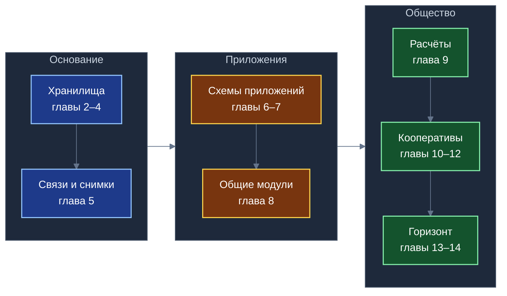
*Схема 1. Книга движется от основания (хранилища) через приложения к обществу (расчёты, кооперативы, горизонт).*

**Схема 2. Путь записи (глава 2)**

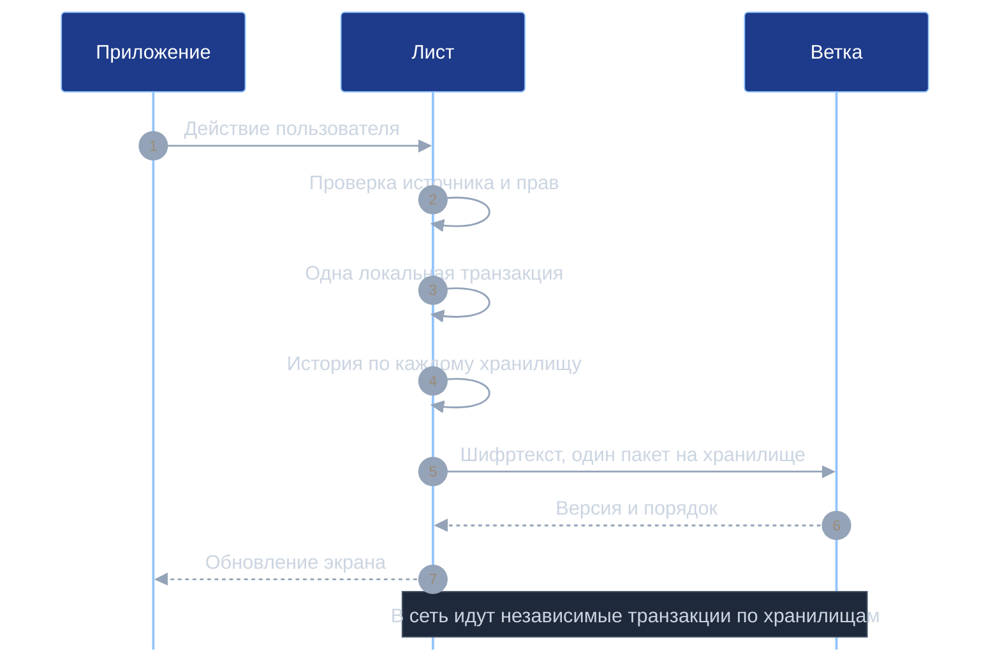
*Схема 2. Многохранилищное действие атомарно только на Листе; в сети оно распадается на независимые транзакции.*

**Схема 3. Независимые хранилища на Ветках (глава 3)**

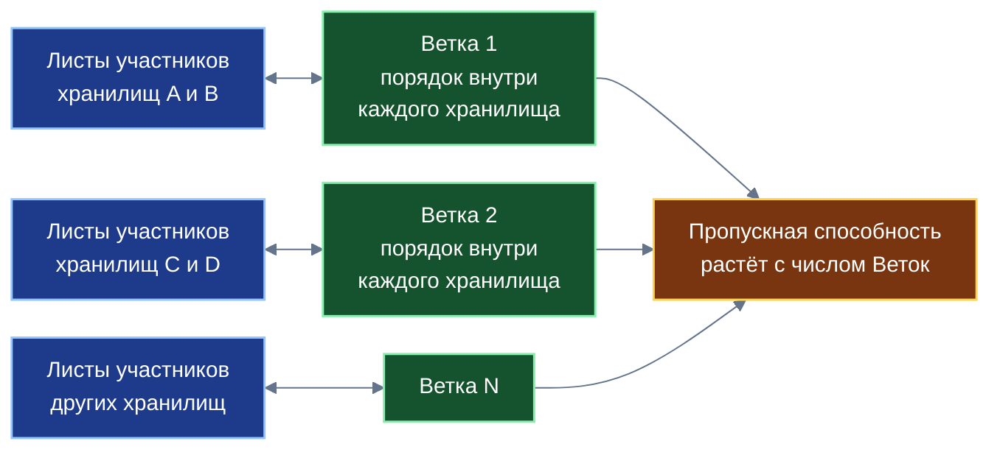
*Схема 3. Общей точки синхронизации и общей блокировки нет; предел задаёт нагрузка каждой Ветки.*

**Схема 4. Топология доверия (глава 4)**

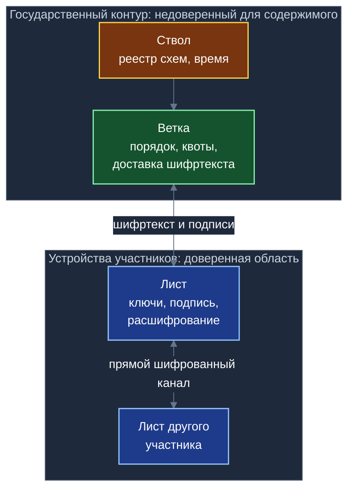
*Схема 4. Ключи и открытый текст есть только на Листе; Ветка и Ствол видят шифртекст, подписи и сведения для маршрутизации.*

**Схема 5. Иерархия ключей (глава 4)**

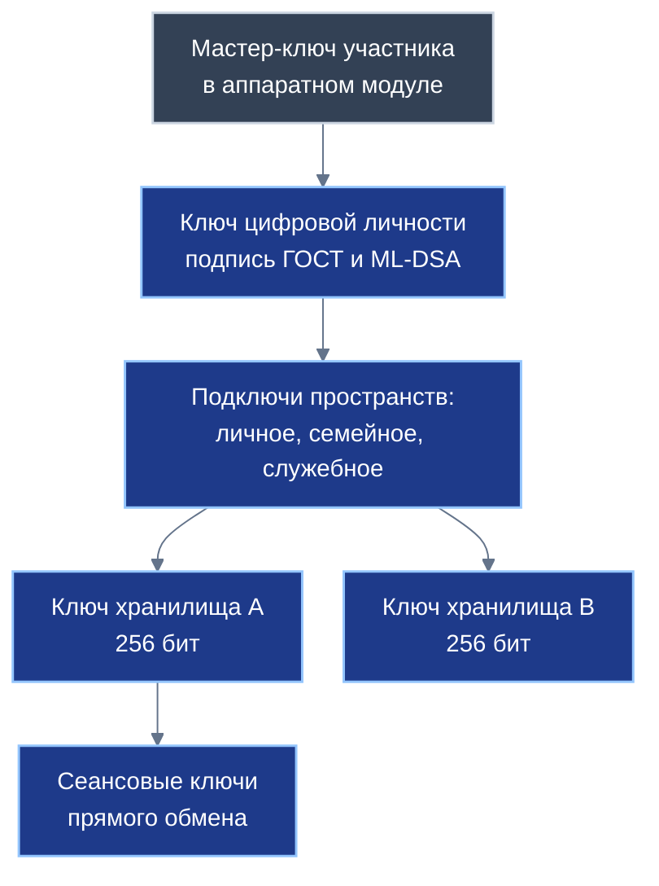
*Схема 5. У каждого хранилища свой ключ: раскрытие одного ключа не раскрывает другие хранилища.*

**Схема 6. Снимок по транзитивному замыканию (глава 5)**

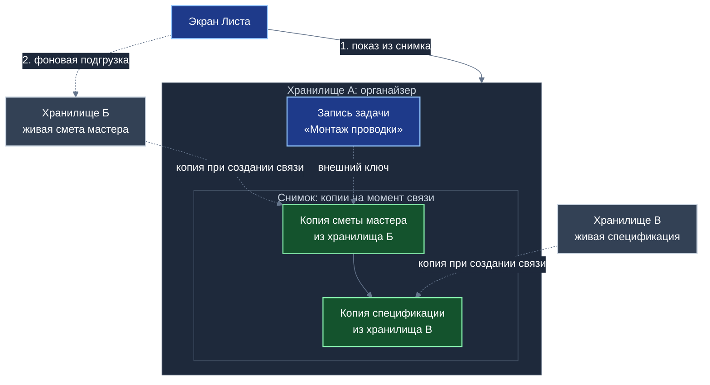
*Схема 6. Экран строится из локального снимка; изменение живых данных в других хранилищах не меняет записанное соглашение.*

**Схема 7. Рост снимка с глубиной ссылок (глава 5)**

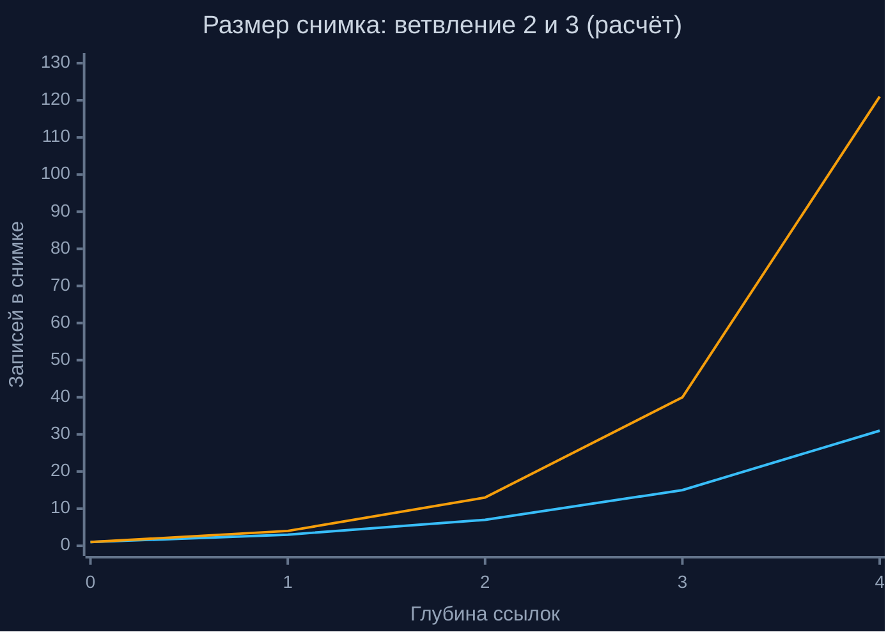
*Схема 7. Нижняя линия — ветвление 2, верхняя — ветвление 3; размер снимка растёт быстро, поэтому глубину ссылок выбирает проектировщик схемы.*

**Схема 8. Базовая запись и расширения приложений (глава 6)**

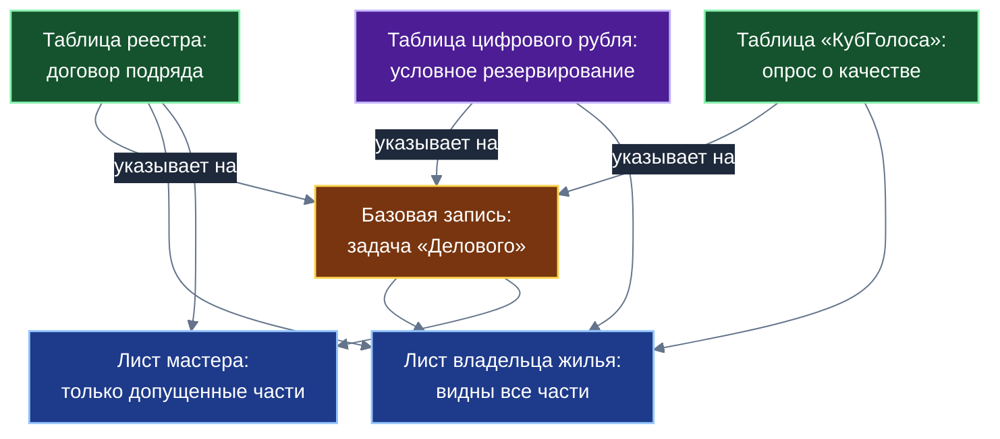
*Схема 8. Каждое приложение добавляет свою таблицу; состав видимых частей на Листе определяют ключи хранилищ участника.*

**Схема 9. Сквозной сценарий реестра (глава 7)**

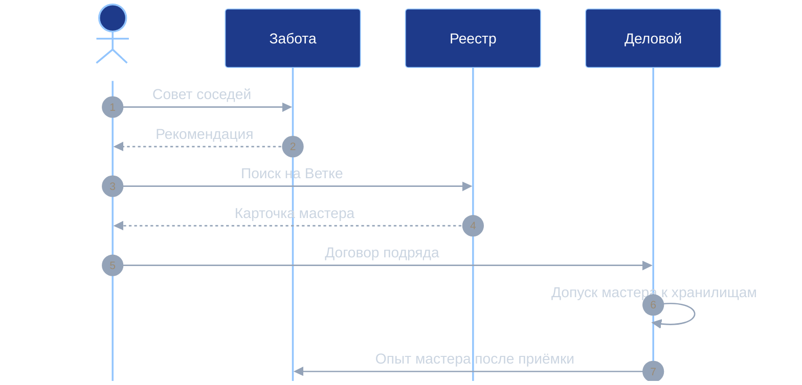
*Схема 9. Сценарий условный: приложения передают друг другу записи и ссылки, но не изменяют чужие схемы; опрос о качестве в «КубГолосе» проводится после подтверждения оплаты.*

**Схема 10. От приложений к общим модулям (глава 8)**

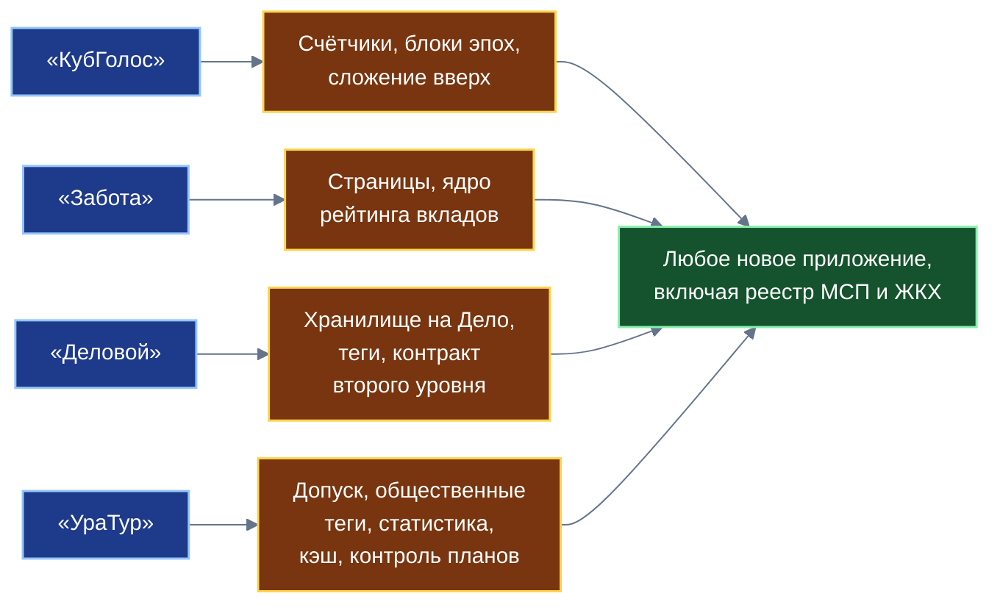
*Схема 10. Каждое начальное приложение отрабатывает свой набор конструкций; вместе они дают основу для любого нового приложения.*

**Схема 11. Три уровня расчётов (глава 9)**

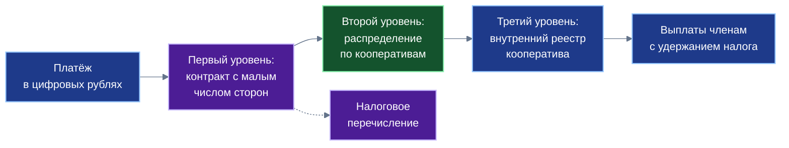
*Схема 11. Контракт первого уровня остаётся малым; массовые выплаты выполняются во внутренних реестрах. Общее число конечных выплат не меняется.*

**Схема 12. Кооператив кооперативов (глава 10)**

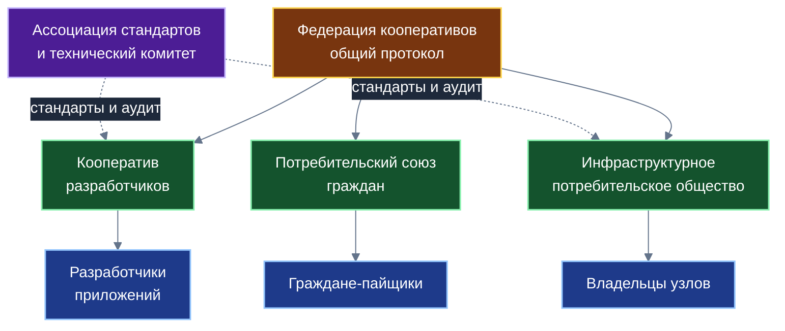
*Схема 12. Предлагаемая конструкция: первичные участники объединяются в кооперативы, кооперативы — в федерацию; стандарты ведёт ассоциация.*

**Схема 13. Разделение рекламной выручки (глава 11)**

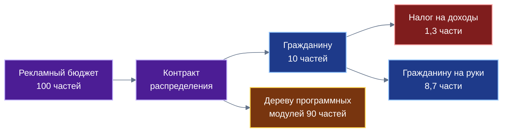
*Схема 13. Налоговая часть показана по ставке 13% (действующее право, сверить); гарантируется правило распределения, а не размер выплаты.*

**Схема 14. Дивиденд по условным сценариям (глава 11)**

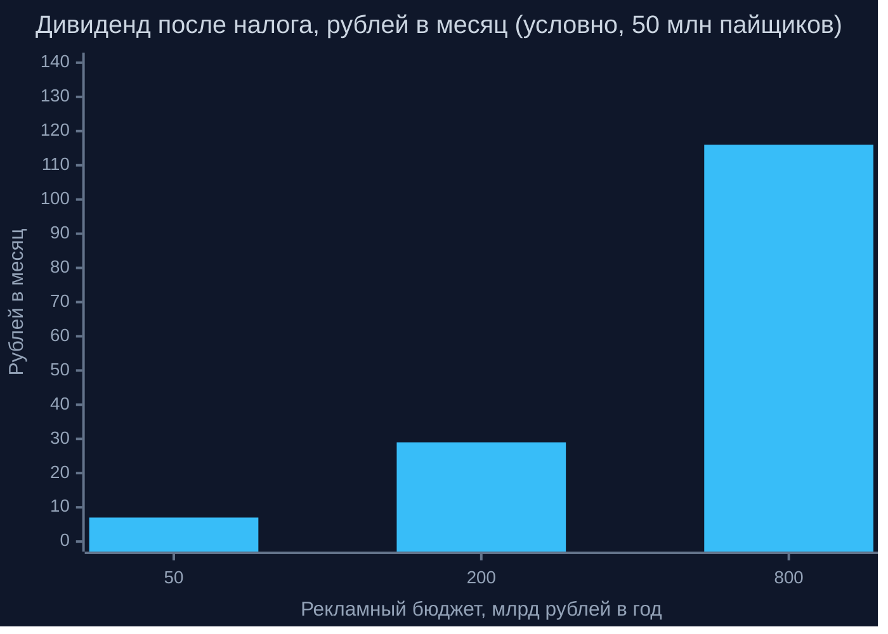
*Схема 14. Даже при смелых допущениях дивиденд — микродоход: от единиц до немногих сотен рублей в месяц. Значения условные.*

**Схема 15. Портфель дохода домохозяйства (глава 13)**

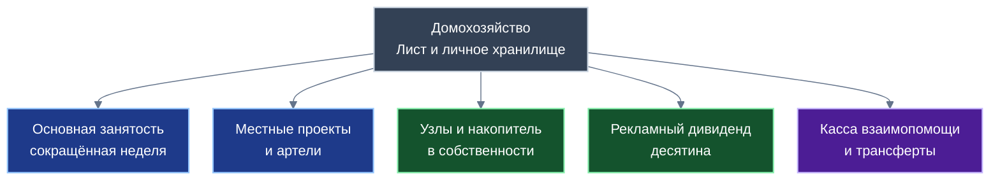
*Схема 15. Устойчивость домохозяйства определяется разнообразием и независимостью пяти компонентов, а не величиной одного из них.*

**Схема 16. Путь исполнения: прототип, проверка, сборка (глава 8)**

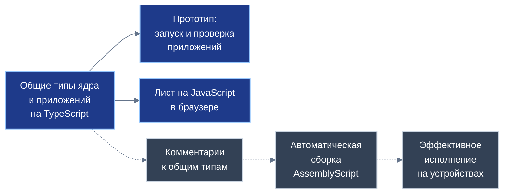
*Схема 16. Сплошные линии — есть сейчас; пунктир — намерение автора, ещё не реализовано.*

**Схема 17. Вызов одного приложения другим (глава 6)**

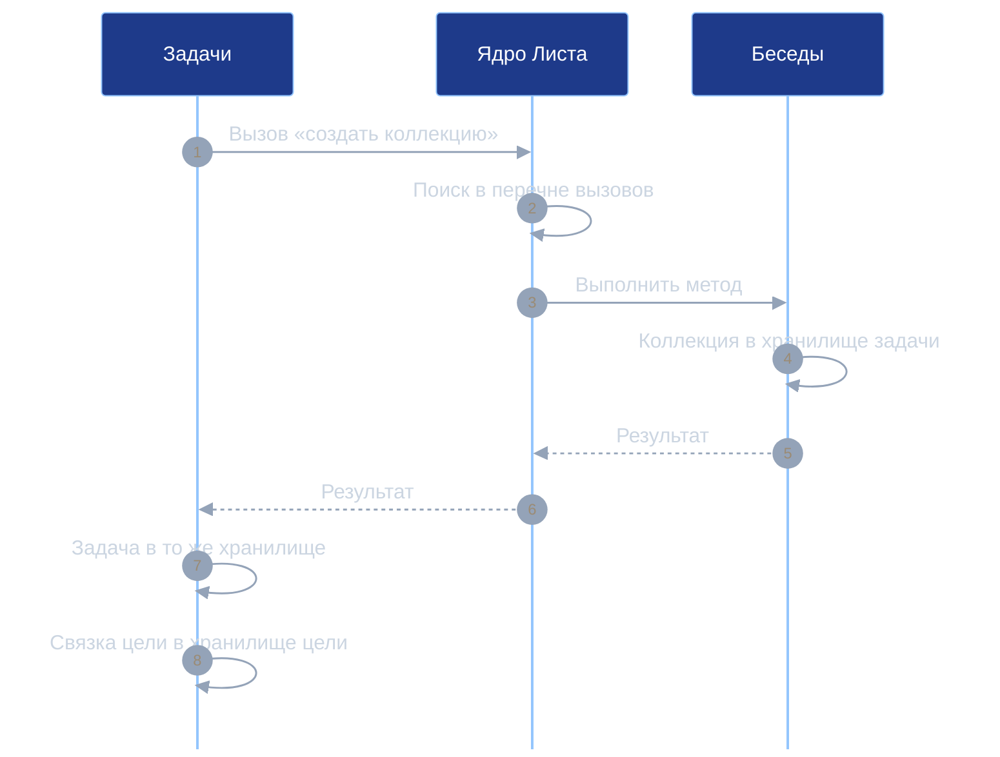
*Схема 17. Приложение бесед остаётся автором своих записей, а хранилище ему передаёт вызывающая сторона; проверка типов аргументов в ядре пока заготовка.*

**Схема 18. Колокация и связующая сущность (глава 6)**

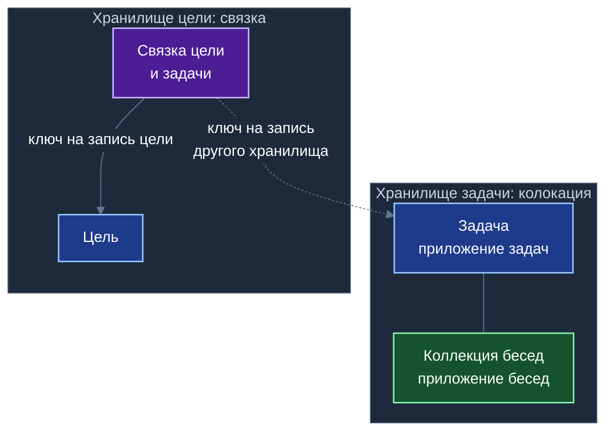
*Схема 18. Записи с общим жизненным циклом лежат в одном хранилище; запись-связка лежит у ссылающейся стороны, и чужой журнал не меняется.*

---

## 8. Таблицы для книги

### 8.1. Что реализовано в коде и что задано спецификацией (главы 1, 2, 4)

Дата сверки с кодом: 11 октября 2026 года, выборочно (`С2`, раздел 3).

| Механизм | Статус | Пометка для книги |
|---|---|---|
| Хранилище, участник, журнал истории (четыре уровня) | Реализовано | Работает в коде ядра |
| Базовая запись с ключом из трёх частей | Реализовано | Работает в коде ядра |
| Таблицы без скрытого номера строки | Реализовано | Не упоминать |
| Глобальный идентификатор записи | Реализовано | Одна фраза |
| Копирование внешней записи и учёт копий | Реализовано | Работает в коде ядра |
| Точки сохранения для вложенных вызовов | Реализовано в драйвере, вызывается менеджером транзакций | Одна фраза |
| Порядок завершения: история → исходящая синхронизация → пересчёт открытых запросов | Реализовано | Одна фраза |
| Песочница приложений и шлюз сообщений | Реализовано | Работает в коде ядра |
| Двухстадийный приём входящих дельт | Реализовано | Одна фраза |
| Формат сообщения синхронизации: одна история одного хранилища | Реализовано | Основание утверждения 2 |
| Ключи и подпись | Реализовано частично (универсальные примитивы браузера) | Писать «частично» |
| Вызовы между приложениями через изолированные среды; диспетчер вызовов; реестр открытых вызовов | Реализовано в прототипе (режим браузера); проверка типов аргументов — заготовка; перечня разрешений нет | Таблица 8.14; главы 6 |
| Колокация и связующие сущности (цель — задача, коллекция — беседа) | Реализовано в прототипе; две других связки только объявлены | Таблица 8.13 |
| Соединение таблиц нескольких приложений в одном запросе | Реализовано в прототипе | Таблица 8.12 |
| Профиль ГОСТ («Кузнечик», «Стрибог», ГОСТ Р 34.10-2012), ML-DSA, деривация ключей | Целевой профиль (в проверенных модулях не найден) | «Задано спецификацией» |
| Ветка и Ствол (секвенсор, согласованное время, квоты, накопители в памяти) | Целевая архитектура | «Задано спецификацией» |
| Ветвление при исключении участника, стирание через уничтожение ключа, три режима регистрации | Целевой профиль | «Задано спецификацией» |

Вывод: модель данных, ключи, журнал, транзакции и изоляция приложений работают в коде. Криптографический профиль ГОСТ и серверные протоколы заданы спецификацией и подлежат реализации и проверке. Доказательства главы 4 относятся к профилю при допущениях A1–A7, а не к уже собранному коду.

### 8.2. Реестр остаточных рисков (глава 4)

Статусы: **Д** — принято по конструкции; **О** — открыто, подлежит дальнейшей проработке.

| № | Риск | Влияние | Направление меры | Статус |
|:-:|---|---|---|:-:|
| Р-1 | Доставка ключей хранилищ без постквантовой защиты | Раскрытие архива через годы | Гибридная инкапсуляция ключей (ML-KEM плюс эллиптическая кривая) | О |
| Р-2 | Ветка выдаёт разным Листам разные последовательности | Нарушение согласованности, обман | Сравнение голов хэш-цепочки по прямому каналу; подпись Веткой версии | О |
| Р-3 | Рассогласование хранилищ при межхранилищном действии | Временная неполнота картины | Порядок шагов, компенсирующие операции, индикация незавершённости | Д |
| Р-4 | Снимок без исходной подписи не защищает от отказа автора исходной записи | Спор о значении | Включение подписи исходной записи в снимок | О |
| Р-5 | Горячее хранилище упирается в одну Ветку | Потолок пропускной способности | Страницы, накопители в памяти; стендовые замеры | О |
| Р-6 | Уязвимость браузера, побочные каналы, ошибка ядра Листа | Выход из песочницы | Обновления, независимый аудит ядра, минимизация доверенной базы | О |
| Р-7 | Правовой статус шифртекста при стирании ключа | Оценка по закону о персональных данных | Заключение регулятора | О |
| Р-8 | Утечка метаданных (граф связей, активность) | Профилирование | Режимы анонимности, перешифрование при переезде, выравнивание размеров | О |
| Р-9 | Клонирование устройства вместе со счётчиком записей | Коллизия ключей, повтор одноразового значения | Новый терминал при клонировании и восстановлении | О |
| Р-10 | Профиль ГОСТ не реализован в проверенном коде | Расхождение документа и кода | Реализация профиля, тесты совместимости | О |

### 8.3. Противники и цели (глава 4)

| № | Противник | Возможности | Что должно быть гарантировано |
|:-:|---|---|---|
| P1 | Скомпрометированная Ветка или Ствол | Полный доступ к памяти и дискам; удаление, задержка, переупорядочение, подмена пакетов | Секретность содержимого; невозможность подделки записей |
| P2 | Внешний наблюдатель сети | Перехват и подмена трафика | То же; защита сеансов прямого обмена |
| P3 | Вредоносное приложение внутри Листа | Исполняет код в песочнице, шлёт сообщения шине | Отсутствие записи в чужие схемы; отсутствие доступа к ключам и базе |
| P4 | Исключённый участник | Знает старые ключи и историю до исключения | Нечитаемость записанного после исключения |
| P5 | Похититель устройства | Физический доступ к Листу | Защита ключей аппаратным модулем; отзыв устройства |
| P6 | Массовое создание учётных записей | Много подставных участников | Экономический барьер и квоты |
| P7 | Квантовый противник | Алгоритм Шора; сбор шифртекста «на будущее» | Постквантовая стойкость подписи и доставки ключей |

### 8.4. Сводный каталог общих модулей (глава 8)

Собран из глав «Что станет базовым модулем» книг № 08–11. Платформенные названия — по книгам; идентификаторы пакетов в книгу не переносятся.

| Отработано в приложении | Общий модуль платформы | Книга |
|---|---|---|
| Многофакторная форма со 100 базисными пунктами | Многомерная оценка любых объектов | № 08 |
| Счётчики в памяти Ветки и блоки эпох | Потоковая аналитика, расчёт рейтингов, фиксация согласий | № 08 |
| Сложение сумм вверх по дереву | Масштабирование показателей по территориальным деревьям | № 08 |
| Дерево тем и префиксный поиск | Единый тематический каркас и локальная фильтрация | № 08 |
| Подсказка о дубликатах на Листе | Встраиваемый модуль выявления дубликатов | № 08 |
| Три режима регистрации | Подсистема идентификации и уровней доверия на узлах Ветки | № 08 |
| Слепой ретранслятор частного контура | Единый транспортный режим сквозного шифрования | № 08 |
| Подписанный блок отсечки по ГОСТ | Формирование юридически значимых электронных протоколов | № 08 |
| Деление списков на запечатываемые страницы | Платформенные страницы коллекций | № 09 |
| Ситуация + Случай + Разговор | Протокол составной антимонопольной сборки сервисов | № 09 |
| Опыт «Голос» и «Показ» | Фиксация свидетельств практикой | № 09 |
| Узлы репутации, эпохи, затухание | Распределённое ядро агрегации социального рейтинга | № 09 |
| Защитные барьеры и штраф за кластеризацию | Защита целостности распределённых оценок | № 09 |
| Правила разделения прав, запрет конвертации анонимного статуса | Единые правила регистрации | № 09 |
| Мотивированный ответ и проверка исходных хранилищ | Стандарт защиты права пользователя на достоверность данных | № 09 |
| «Одно Дело — одно хранилище» | Управление множеством локальных баз на Листе | № 10 |
| Префиксные деревья тегов | Служба тегирования, внешних меток и срезов | № 10 |
| Группы опросов | Межприложенческий модуль коллективного решения | № 10 |
| Мандатный интерфейс поручений | Шлюз контролируемой доставки входящих задач | № 10 |
| Ссылки из трёх частей | Стандарт распределённых ссылок с автономным снимком | № 10 |
| Трёхзвенная проверка чужого кода | Протокол безопасной композиции оболочек | № 10 |
| Контракты первого и второго уровня | Адаптер коммерческих смарт-контрактов | № 10 |
| Связка социального и экономического рейтингов | Протокол пороговой проверки без раскрытия счетов | № 10 |
| Экспоненциальное затухание | Библиотека расчёта актуальности свидетельств | № 10 |
| Возрастной допуск ядра Листа | Модуль возрастной защиты | № 11 |
| Общественные теги и индексная сеть | Открытая каталогизация | № 11 |
| Многотеговые запросы | Оптимизатор многотеговых запросов | № 11 |
| Функция Тоблера, коридоры | Пространственно-временная статистика | № 11 |
| Темп, закат, автомат перестройки | Контроллер исполнения планов | № 11 |
| Буферные зоны подложек | Менеджер пространственного кэша | № 11 |
| Смарт-контракт, разделение графа | Адаптер внешних сервисов | № 11 |

Для справочника: внутренние имена четырёх статистических модулей в `У4` — `@turbase/spatial-temporal-stats`, `@turbase/adaptive-plan-tracker`, `@turbase/spatial-cache-manager`, `@turbase/tag-selectivity-triejoin`; общий контекст — `@turbase/core`. В книгу не переносить.

### 8.5. Институциональная триада для разработчиков (глава 10)

Предложение отчёта `О1`; названия рабочие.

| Роль | Форма | Основание | Что делает | Граница |
|---|---|---|---|---|
| Производственный кооператив разработчиков | Производственный кооператив (артель) | Закон № 41-ФЗ | Собирает выручку по функции распределения, распределяет прибыль по трудовому вкладу и паям, держит неделимый фонд эталонных модулей | Часть прибыли по паям не более 50%; число членов-вкладчиков и наёмных работников ограничено законом; аккредитация как ИТ-организации не решена |
| Ассоциация стандартов | Ассоциация (союз), некоммерческая корпорация | Статья 123.8 Гражданского кодекса | Открытые стандарты схем и интерфейсов, технический комитет, сертификация, третейский арбитраж | Не владеет коммерческой выручкой; полномочия требуют устава |
| Инфраструктурное потребительское общество | Потребительское общество | Закон РФ № 3085-1 | Совместное владение серверами и стендами за счёт паевых взносов; услуги членам по себестоимости | Паевые взносы не облагаются как реализация; граница — деятельность только для членов |

### 8.6. Формы для трёх групп участников (глава 10)

| Группа | Форма | Налоговый и правовой режим (по отчётам; сверить) | Что получает участник | Граница |
|---|---|---|---|---|
| Разработчики приложений | Производственный кооператив + ассоциация + потребительское общество | Закон № 41-ФЗ; ст. 123.8 ГК РФ; Закон № 3085-1 | Выплаты по трудовому вкладу, доля в неделимом фонде, голос | Правовая оценка и регистрация требуются отдельно |
| Владельцы узлов | Аренда оборудования гражданином кооперативу; потребительское общество | Глава 34 ГК РФ; п. 4 ст. 420 НК РФ; налоговый агент по ст. 226 НК РФ | Компенсация затрат; доступ к мощностям неделимого фонда | Риск переквалификации аренды в услуги |
| Граждане-потребители | Потребительское общество и союз | Закон № 3085-1; ст. 217 НК РФ | Доля 10% рекламной выручки; пай; голос через уполномоченных | Размер выплаты не гарантируется |

### 8.7. Защита от недобросовестных узлов (глава 10)

Источник `О2`, раздел 4.3. Меры — направления, без обещаний.

| Риск | Мера | Пояснение |
|---|---|---|
| Узел сообщает о хранении индекса без реального хранения | Доказательство хранения: дерево хэшей по записям связей; периодические проверочные запросы по диапазонам времени | Ответ нужно предоставить за нормативное время (в отчёте менее 250 мс, проектное значение) |
| Возврат устаревших или случайных данных | Показатели качества: доступность, время отклика, потери, ошибки | Узлы с плохими показателями понижаются до резервных |
| Перегрузка узлов с лучшим откликом | Выбор наименее загруженного из двух случайных кандидатов | Равномерность без централизованного балансировщика |
| Создание фиктивных узлов ради арендных выплат | Залог (паевой депозит) либо подтверждённый рейтинг доверия в «Заботе» | Удержание залога в пользу фонда компенсации при доказанной фальсификации |

### 8.8. Размер рекламного дивиденда (глава 11)

См. раздел 6.8.

### 8.9. Виды участия и учёт вклада; условный баланс времени (глава 13)

| Вид участия | Примеры | Как учитывается вклад | Форма выплаты |
|---|---|---|---|
| Основная занятость (сокращённая) | Работа по найму, самозанятость | Договоры вне платформы | Заработная плата; налог по общим правилам |
| Локальные проекты | Реестр МСП и ЖКХ, ремонт, обучение | Запись в хранилище, подтверждённая второй стороной | Выплата по трудовому вкладу в артели |
| Общественные инициативы | «КубГолос», «Забота» | Запись об участии; репутация | Нематериальное признание, зачёт в кассе взаимопомощи |
| Инфраструктурные обязанности | Эксплуатация узла Ветки, ведение индекса тегов | Журнал доступности и проверок | Компенсация затрат и доля микроплатежей |
| Обучение и передача навыков | Наставничество, учебные группы | Запись об участии | Зачёт, стипендия кассы взаимопомощи |

Условный баланс времени — раздел 6.9.

### 8.10. Региональная адаптация форм (глава 12)

| Регион и опыт | Что предлагается перенять | Звено платформы | Граница применимости |
|---|---|---|---|
| Россия: артели, потребительские общества | Выборный староста и круговая порука в малой группе; неделимый фонд; ассоциированное членство | Артель разработчиков; инфраструктурное и потребительское общества | Нужно изменение права, чтобы запись в хранилище признавалась доказательством вклада |
| Германия: Райффайзен, Шульце-Делич | Локальность узла; неделимый резерв; безвозмездное исполнение выборных обязанностей; закон о товариществах | Районные узлы Ветки и их общества | Опирается на плотные местные связи |
| Испания (Страна Басков): Mondragon | Внутренние счета капитала; ограничение разрыва оплаты; касса взаимопомощи | Артель; кооперативная касса | Опыт Fagor: включать работающих вне круга членов |
| Израиль: кибуц и мошав | Личное хозяйство плюс общий сбыт и снабжение | Личное хранилище и общий протокол | Полное обобществление быта не переносится |
| Япония: JA Group | Трёхзвенная федерация с общими банком и страхованием | Союз потребителей и общие услуги | Высокая политическая роль объединения — особенность страны |
| Индия: Amul | Низкий порог входа; учёт на месте сдачи | Массовое присоединение граждан с символическим паем | Опирается на единый товарный поток |
| Латинская Америка: Cooperativa Obrera, Cooxupé | Потребительский дивиденд; объединение мелких хозяйств | Рекламный дивиденд; союз мелких разработчиков и операторов | Расчёт на устойчивые региональные рынки |
| Новая Зеландия и Великобритания: Enspiral, Co-Tech, Autonomic | Совместное бюджетирование, решения по согласию | Круги внутри артели, технический комитет | Малые команды; для миллионов нужна представительская схема |

### 8.11. Сводный реестр утверждений (глава 14)

Д — доказано при названных допущениях; С — сводится к допущению; О — открыто. Номера — по синтезу `С2`.

| Утверждение | Категория | Условие или граница |
|---|:-:|---|
| Ключи записей уникальны без координатора (1) | Д | Счётчик автора не повторяется; клон — новый терминал (Р-9, О) |
| Транзакции разбиваются по хранилищам (2) | Д | Свойство формата сообщения |
| Нет распределённых блокировок между хранилищами (3) | Д | Запись читает только своё хранилище и локальные снимки |
| Сходимость состояний внутри хранилища (4) | Д | Один порядок Ветки, детерминированные дельты |
| Масштабирование добавлением Веток (5) | Д | Нагрузка каждой Ветки не выше её способности; горячее хранилище (Р-5, О) |
| Конфиденциальность перед Веткой (6) | С | A1, A4, A5 |
| Подлинность и целостность записи (7) | С | A2, A3; расщепление представления — Р-2 (О) |
| Отсечение исключённого участника (8) | С | A1; прочитанное остаётся |
| Изоляция приложений (9) | С | A6, A7; уязвимости среды — Р-6 (О) |
| Стирание через уничтожение ключа (10) | С | A1; все копии ключа; правовой статус — Р-7 (О) |
| Рассогласование хранилищ на короткое время | Д (принято) | Р-3 |
| Постквантовая доставка ключей | О | Р-1 |
| Подпись исходной записи в снимке | О | Р-4 |
| Профиль ГОСТ в коде | О | Р-10 |
| Метаданные и график активности | О | Р-8 |
| Защита от массовых учётных записей | О | Нет доказательства; меры институциональные |
| Иерархия расчётов ограничивает арность контракта | Д (по построению) | Не сокращает число конечных выплат |
| Окупаемость узла | О | Нужен объём коммерческих запросов |
| Размер рекламного дивиденда | О | Размер бюджета неизвестен |
| Признание записи в хранилище доказательством вклада | О | Нужно решение законодателя |

### 8.12. Что приложение читает, что пишет и через что (глава 6)

| Действие | Как выполняется | Кто контролирует | Пометка для книги |
|---|---|---|---|
| Чтение данных своего приложения | Запрос к общей локальной базе Листа | Ядро: допуск по ключам хранилищ и возрастной допуск (№ 11) | Работает в прототипе |
| Чтение данных другого приложения | Тот же запрос; соединение таблиц нескольких приложений | То же | Работает в прототипе; три приложения в одном запросе подтверждены |
| Запись в своё приложение | Сохранение записей своей схемы | Приложение | Работает |
| Запись в чужую схему | Не выполняется | Ядро | Прямого пути нет |
| Изменение данных другого приложения | Вызов открытого метода владельца данных | Владелец: его проверки и правила | Работает; проверка типов аргументов — заготовка (Р26); перечня разрешений нет (Р27) |
| Создание записи другого приложения в нужном хранилище | Вызов метода владельца с передачей хранилища | Владелец | Пример: коллекция бесед для задачи |

### 8.13. Колокация и связующая сущность (глава 6)

| Признак | Колокация | Связующая сущность |
|---|---|---|
| Когда применяется | Общий жизненный цикл и круг участников | Записи в разных хранилищах, у разных владельцев или с разным жизненным циклом |
| Где лежит запись | В хранилище основной записи | В хранилище ссылающейся стороны (того, чей владелец вправе её создавать) |
| Транзакция | Одна локальная транзакция | Одна локальная транзакция на Листе; в сети — по одной на каждое затронутое хранилище |
| Изменяется ли чужой журнал | Нет | Нет |
| Как синхронизируется | Вместе с хранилищем основной записи | Вместе с хранилищем связки |
| Пример прототипа | Задача и её коллекция бесед | Цель и задача (в хранилище цели); коллекция и беседа (в хранилище коллекции) |
| Состояние в коде | Работает | Две связки заполняются; две (задача — беседа, упоминание задачи в комментарии) только объявлены (Р28) |

### 8.14. Что подтверждено в отчёте о коде, а что нет (главы 6 и 8)

Сверка отчёта `ЛС4` с исходными текстами `AIRroot` выполнена 11 октября 2026 года выборочно: прочитаны вызов создания задачи и коллекции, схемы связок, диспетчер вызовов, реестр открытых вызовов, заготовка проверки, фрагмент генератора внешних ключей, манифесты приложений, запросы приложения задач. Сгенерированная схема базы и полный путь сообщения (заглушка — окно — терминал) не прочитаны полностью.

| Утверждение отчёта | Статус | Как писать |
|---|---|---|
| Приложения зависят друг от друга: темы ← беседы ← задачи | Подтверждено манифестами | Прототип; цепочка зависимостей |
| Три колонки внешнего ключа на связь порождаются генератором | Подтверждено текстом генератора | Одна строка про автоматическую генерацию |
| Сущность задачи имеет девять колонок внешних ключей | Подтверждено по описанию сущности (три связи) | Допустимо в расчёте раздела 6.11 |
| Колокация коллекции и задачи в одном хранилище | Подтверждено кодом | Пример прототипа |
| Связка цели и задачи хранится в хранилище цели | Подтверждено кодом | Пример прототипа |
| Связка коллекции и беседы хранится в хранилище коллекции | Подтверждено кодом | Пример прототипа |
| Связки «задача — беседа» и «упоминание задачи в комментарии» | Объявлены, использующих вызовов не найдено | «Предусмотрены схемой» (Р28) |
| Соединения между таблицами трёх приложений и системной схемы | Подтверждено запросами | Подтверждает чтение через границы приложений |
| Запросы реактивны (потоки значений) | Подтверждено сигнатурами; механизм пересчёта в ядре не прочитан полностью | «Экран обновляется без опроса» |
| Диспетчер ядра находит метод в перечне и выполняет | Подтверждено | Описать на уровне идеи |
| «Проверка типов аргументов на уровне рантайма» | **Не подтверждено**: заготовка с пометкой «реализовать» (Р26) | «Задано, подлежит реализации» |
| «Проверка права приложения А вызывать метод приложения Б» | **Не подтверждено**: проверяется лишь наличие метода (Р27) | «Перечень разрешений не реализован» |
| «Абсолютная безопасность: скомпрометированное приложение не может повредить другое» | **Не подтверждено, формулировка недопустима** (Р25) | Допущения A6, A7; риск Р-6 |
| «Изоляция в iframe или Web Worker» | iframe подтверждено; рабочие потоки не найдены (Р30) | «Изолированная среда приложения» |
| Скорость соединений «менее 0,1 мс», «0,08 мс» | Замеров нет (Р31) | Не переносить |
| Сопоставление «темы — Забота, беседы — КубГолос, задачи — Деловой» | Противоречит описанию иерархии схем (Р29) | Не использовать |
| Режим исполнения «веб» | В прототипе поддержан; для иных сред отправка сообщения помечена как не реализованная | «Проверено в среде браузера» |

### 8.15. TypeScript в прототипе и AssemblyScript (глава 8, подраздел 8.5)

Левая колонка — по тексту прототипа (выборочно), средняя — по документации AssemblyScript (страницы «Implementation status» и «Concepts», прочитаны полностью 11 октября 2026 года), правая — предложение составителя, не решение автора.

| Что используется в прототипе | Что говорит документация AssemblyScript | Вывод для проектирования |
|---|---|---|
| Асинхронные открытые вызовы, обещания | Асинхронных функций и обещаний нет (нет цикла событий); возможное решение — будущие предложения WebAssembly | Открытый вопрос: как вызывать приложение из приложения без обещаний |
| Реактивные потоки значений | Не обсуждаются; построены на замыканиях и обратных вызовах, а замыкания с захватом локальных переменных не реализованы | Нужно особое описание подписок без захвата |
| Замыкания с захватом переменных (стрелочные функции в запросах и потоках) | Не реализованы; рекомендуют глобальную переменную, передачу значений аргументом или обычный цикл | Переписать на функции без захвата |
| Объекты без заданного типа, свойства, добавляемые на лету | Не допускаются: нет типа «любой» и «не определено»; объекты должны быть классом или словарём; литерал объекта допустим там, где ожидается класс | Общие типы описывать классами |
| Объединённые типы | Не поддерживаются, кроме классов, допускающих пустое значение; замена — обобщённые типы (шаблоны), раскрываемые при компиляции | Ограничить описание типов; рассмотреть обобщённые типы |
| Исключения | Не реализованы; выброс прерывает программу | Ошибки возвращать значениями |
| Декораторы описания сущностей и открытых вызовов; внедрение зависимостей | Пользовательские декораторы игнорируются, пока им не придан смысл преобразованием компилятора; внедрение зависимостей не рассматривается | Аннотации к общим типам читает преобразование компилятора (замысел автора); способ замены внедрения зависимостей не определён |
| Итераторы и циклы по значениям, остаточные параметры | Не реализованы | Переписать |
| Работа с датами, регулярные выражения, JSON, большие целые числа | Даты: начальная поддержка UTC; регулярные выражения и JSON — решения сообщества; большие целые числа заменены 64-разрядными целыми | Использовать решения сообщества либо избегать; для дат работать в UTC |
| Сообщения между изолированными средами | Модуль не обращается к внешним ресурсам без явного импорта; связь через привязки к среде исполнения (веб или иная) | Привязки проектировать для каждой среды; допущения A6 и A7 проверить заново |
| Классы и интерфейсы (в прототипе — классы сущностей, интерфейсы типов) | Классы в основном реализованы; модификаторы доступа не проверяются; интерфейсы поддержаны в зачаточном виде | Опираться на классы; интерфейсы ограничить |

Вывод: приложение, которое должно компилироваться, пишется в подмножестве; перечень подмножества составляется при проектировании. Прототип на TypeScript остаётся средой проверки и основой Листа на JavaScript, где такие ограничения не действуют.

---

## 9. Расхождения источников и как их снять

| № | Расхождение | Где | Как поступить в книге |
|---|---|---|---|
| Р1 | Презентация реестра: «готовность к массовой эксплуатации», «5 готовых сервисов», метрики «2 мс поиск» и «0% эквайринга»; синтез: профиль ГОСТ и серверные протоколы заданы спецификацией, в коде работает ядро данных | `Пр`, слайды 1 и 15; `С2`, раздел 3 | «Проектная концепция; отдельные механики реализованы в прототипах»; таблица 8.1 |
| Р2 | Числа без расчёта: «до 30% выручки мастера», «экономия 2–3% на эквайринге», «+35% товарооборота», «25–35% платформенной дани», «снижение накладных расходов на 25–35%», «менее 10 мс», «менее 0,1 мс», «99,8%» | `Пр`; `ЛС2`, §1.3 и §5; `О1`, §6.1; `ЛС1`, §4.2; `С2`, §5.5 | Не переносить; если нужна иллюстрация — считать самим по раскрытым допущениям |
| Р3 | Оценочные слова: «дань», «монопольные агрегаторы», «катастрофа», «бюрократический коллапс», «обременительные тарифы», «неопровержимо доказывает», «юридически безупречный», «абсолютная юридическая надёжность», «гарантирует неотчуждаемость» | `ЛС2`, `ЛС3`, `О1`, `О3` | Нейтральные формулировки (раздел 2.1, п. 1) |
| Р4 | «Суверенные» хранилища, Лист, совладельцы, цифровая экономика, данные; «ассоциация инженеров суверенных данных» | Мастер-план, планы ступеней, `О1`, `О3`, `ЛС3` | Автономные, частные; суверенитет — только государство |
| Р5 | Англицизмы и жаргон в источниках | Все | Раздел 2.1, п. 8; русские аналоги |
| Р6 | Даты плана симуляции (25.12.2026; 2046) | `Х4`, §4.1 | Не использовать (решение 8) |
| Р7 | «ПАО «Артель Турбаза»»: форма «производственный кооператив» и форма «публичное акционерное общество» исключают друг друга | `О1`, §6.1 | «Производственный кооператив разработчиков (артель)» |
| Р8 | Льготы аккредитованных ИТ-организаций: отчёт — «страховые взносы 7,6% и налог на прибыль 5%»; по вторичным источникам 2026 года 7,6% для всех выплат упразднён, действует 15% в пределах предельной базы и 7,6% сверх; налог на прибыль 5% сохранён | `О1`, §6.1; поиск 11.10.2026 | Не приводить ставки; если приводить — формулировка раздела 5.10, п. 5, с пометкой «сверить» |
| Р9 | Налог на доходы физических лиц: документы базы знаний — «13% или 15% при превышении порога»; с 2025 года пятиступенчатая шкала 13/15/18/20/22% (пороги 2,4 / 5 / 20 / 50 млн руб.); для дивидендов две ступени | `ЛС3`, §2.1; `О0`, §1.2; поиск 11.10.2026 | Раздел 5.10, п. 5; ставка 13% — для сумм ниже порога |
| Р10 | Электроэнергия узла: отчёт «80–260 руб.»; пересчёт даёт 64–262; износ накопителя «25–30», пересчёт 22,5; сумма без резерва 190–490, итог отчёта 250–550 | `О2`, §4.1 | Раздел 6.7; «проектная оценка порядка 250–550» |
| Р11 | Арность контракта первого уровня: «строго 4 участника» (схема) и «не более 4–8» (текст) | `ЛС3`, §4.3 | «Малое число сторон; в примере четыре» |
| Р12 | «Элегантно решает фундаментальную проблему»: иерархия не сокращает общее число конечных выплат | `ЛС3`, §4.3 | Раздел 5.9, п. 4 |
| Р13 | «Хранение данных на устройствах исключает риск изъятия активов, подобного событиям 1956–1960 годов» | `О4` (по `О0`, §7.3) | Формулировка раздела 5.13, п. 7 |
| Р14 | Оценка «Adv ≤ 2^−256» в отчёте о безопасности | `Х2`; `С2`, §7.2 | Корректная форма утверждения 6 |
| Р15 | Путь модуля двухстадийного приёма дельт в отчёте указан без подкаталога | `Х3`; `С2`, §3 | Путь не переносить (в книге путей нет) |
| Р16 | В плане Ступени 06 названы «`@turbase/*`», «`AIREntity`», «виртуальные JOIN» в главах книги; правила комплекта запрещают имена пакетов и сущностей | `Session_06_Plan.md`; `ОП`, §10.1, п. 3 | Русские названия; «внутреннее» и «внешнее» соединение — один раз в скобках |
| Р17 | «Землячество» (слайды 3 и 6 презентации реестра): термин нигде не определён | `Пр` | Не использовать до определения |
| Р18 | «Роялти 1/N» в «API-экономике»: правило не определено; функция распределения содержит заданные доли (10% и 90%), а не равное деление | `Пр`, слайд 13; `ЛС2`, §4 | Не использовать «1/N»; формула долей — открытый вопрос |
| Р19 | Прямые обещания: «0% комиссий», «0% эквайринга» при наличии распределения выручки по функции | `Пр`, слайд 4 | Не использовать |
| Р20 | Прогностический абстракт: горизонт «2046–2066 гг.» (календарные годы совпадают с годом плана симуляции) | `О0`, паспорт | «Через 20–40 лет» |
| Р21 | Презентация реестра: оценка «Забота» как репутационный щит «реальных соседей против анонимных ботов» | `Пр`, слайд 6 | Формулировка из таблицы 2.2 |
| Р22 | «Не менее 10%» во врезке книги № 11 и «10%» в решении автора | Кн.11, врезка; `ОП`, решение 12 | «Десятина, 10%» |
| Р23 | Положение «УраТура» и реестра в иерархии схем нигде не закреплено (в `applications/AGENTS.md` только цепочка из трёх приложений) | `applications/AGENTS.md` | Допущение 4 плана |
| Р24 | В документах пакета и в журналах ссылки на `Session_0X_Log.md` и `Operator_Session_Log.md`: файлы удалены из рабочей копии; правила протоколирования изменены в `AGENTS.md` | Рабочая копия; `AGENTS.md` | Не воссоздавать; атрибуция — в самих документах |
| Р25 | «Абсолютная безопасность: даже если приложение А скомпрометировано, оно не может повредить внутреннее состояние приложения Б»; «полная защита» | `ЛС4`, §5.3 | Не переносить; писать: «приложение не получает прямого доступа к данным другого; допущения A6, A7; риск Р-6 открыт» |
| Р26 | «Валидация типов аргументов на уровне рантайма с полной проверкой типов» | `ЛС4`, §2.2; код: заготовка валидатора с пометкой «реализовать (когда-нибудь)»; проверяется только число аргументов | «Проверка типов задана и подлежит реализации» |
| Р27 | «Ядро проверяет право приложения А вызывать метод приложения Б» | `ЛС4`, §2.2; код: проверяется лишь существование объекта и метода в перечне открытых вызовов приложения-получателя | «Перечень разрешений между приложениями не реализован» (открытый вопрос) |
| Р28 | «Четыре сущности-связки» (цель — задача; задача — беседа; упоминание задачи в комментарии; коллекция — беседа) | `ЛС4`, §4.2; код: заполняются две (цель — задача, коллекция — беседа); две объявлены в схеме, вызовов нет | «Предусмотрены схемой» |
| Р29 | Сопоставление «темы — Забота; беседы — КубГолос; задачи — Деловой», роль «Коллекция — КубГолос» | `ЛС4`, §7.1; `applications/AGENTS.md`, раздел 1 | Не использовать; писать «три базовые схемы прототипа образуют цепочку зависимостей» |
| Р30 | «Песочница iframe или Web Worker» | `ЛС4`, §5.1; код: найдена загрузка в отдельный документ браузера; рабочие потоки не найдены | «Изолированная среда приложения» |
| Р31 | Скорость соединений «≤ 0,1 мс», «0,08 мс»; «Zero-Latency»; «абсолютная безопасность» как итог | `ЛС4`, аннотация и §7.2; замеров нет | Не переносить |
| Р32 | Английские названия приёмов в отчёте `ЛС4`: Unified Local Read, Sandboxed Encapsulated Write, Entity Colocation, Cross-Repository Link Entities, Live Observable, ApiProxy, Package Dependency Graph | `ЛС4` | Раздел 2.1, п. 8: русские названия |
| Р33 | Оценочные слова и суверенитет в отчёте `ЛС4`: «суверенная запись», «фундаментальная асимметрия», «магия композитных ключей», «абсолютная безопасность», «исчерпывающий» | `ЛС4`, §3, §5.3 | Нейтрально; без «суверенной записи» |
| Р34 | Для отчёта `ЛС4` указано «Исследованные источники» без указания версии кода; сверка выполнена 11.10.2026 по рабочей копии `AIRroot` (последний коммит `AIRport`: «Bug fix.») | `ЛС4`, паспорт | Перед публикацией сверить по актуальной версии |

---

## 10. Внешние источники

Статус: **проверено** — сверено при подготовке справочника (11 октября 2026 года) по открытым страницам; **по отчёту** — взято из документов Ступеней 01–04, не проверялось; перед публикацией требует сверки с первичными источниками.

- Налог на доходы физических лиц: пятиступенчатая шкала с 1 января 2025 года (13% до 2,4 млн руб.; 15% от 2,4 до 5 млн; 18% от 5 до 20 млн; 20% от 20 до 50 млн; 22% свыше 50 млн; Федеральный закон от 12.07.2024 № 176-ФЗ); для процентов, дивидендов, продажи имущества и ценных бумаг — две ступени 13% и 15%: **проверено** по страницам ФНС России (nalog.gov.ru/new2025/; nalog.gov.ru/rn72/news/tax_doc_news/15683591/), 11 октября 2026 года. Первичный текст Налогового кодекса перед публикацией сверить.
- Льготы аккредитованных ИТ-организаций в 2026 году (налог на прибыль 5%; взносы: 15% в пределах единой предельной величины базы, 7,6% сверх; предельная база 2 979 000 руб.; условия — аккредитация Минцифры, ежегодное подтверждение и доля ИТ-доходов не менее 70%): **проверено** по сводкам «КонсультантПлюс», «Гарант», «Контур.Бухгалтерия» (klerk.ru) 11 октября 2026 года; это вторичные источники, текст Налогового кодекса и постановления Правительства № 1705 сверить.
- Патент США 10 902 016 B2 («Autonomous interdependent repositories»; заявка 12.02.2018, выдан 26.01.2021): **по отчёту** (`ЛС1`, раздел 1).
- Блог «Small Repositories» (19 февраля 2017): **по отчёту** (`ЛС1`).
- Закон № 41-ФЗ «О производственных кооперативах», ст. 12; Закон РФ № 3085-1 «О потребительской кооперации», ст. 10, 23, 24; ст. 123.8 ГК РФ; глава 34 и ст. 606, 689 ГК РФ; ст. 217, 226, 420 НК РФ; Закон № 422-ФЗ о налоге на профессиональный доход: **по отчёту**.
- Исторические и международные сведения (артели, Mondragon, Fagor, кибуцы, Райффайзен, JA, Amul, Аляска; числа 16%, 114 тыс., 2 млн, 3,6 млн, 80%, 1 000–3 284 долларов): **по отчёту** (`О0`, `О4`).
- B4RN, Guifi.net, NRECA: **по отчёту** (`О2`).
- Авторы идей, названные в источниках: Эванс и Вернон (проектирование, управляемое предметной областью); Фаулер; Клеппман и др. (2019, локально-ориентированное программное обеспечение); Чаянов, Туган-Барановский, Михельс, Вебб: **по отчёту**.
- Вельдхёйзен Т. (2014), прыжковое пересечение (Leapfrog Triejoin): **проверено** при подготовке книги № 11.
- Документация AssemblyScript: страницы «Implementation status» и «Concepts» (assemblyscript.org/status.html и assemblyscript.org/concepts.html): **проверено**, прочитаны полностью 11 октября 2026 года; документация развивается, перед проектированием сверить заново.
- Исходные тексты `AIRroot` (`AIRport`, `AIRline`): **проверено выборочно** 11 октября 2026 года по рабочей копии в каталоге `~/Documents/beyond-decentralized/AIRroot` (таблица 8.14); версия рабочей копии: последний коммит `AIRport` «Bug fix.»; перед публикацией сверить по актуальной версии открытого репозитория.

---

## 11. Контрольный список перед сдачей

Общий контрольный список (`ОП`, раздел 11) и список плана (раздел 7) плюс:
- [ ] Врезка «Из предыдущих книг» содержит 10 понятий.
- [ ] Главы 2–4: четверка хранилища, адресация, журнал, путь записи, утверждения 1–10 с условиями, таблицы 8.1–8.3, реестр 8.2 целиком, врезка «подлежат дальнейшей проработке».
- [ ] Глава 5: размер снимка, четыре эффекта, требование подписи исходной записи (Р-4).
- [ ] Глава 6: правило не вторгаться в чужие схемы; три подхода без оценок; иерархия; соединение на Листе; изоляция по ключам; оговорка об открытых вопросах.
- [ ] Главы 6.2–6.5 и подраздел 8.5: соблюдены правила раздела 2.1, п. 15–17; расхождения Р25–Р34 разрешены, как указано в разделе 9; сравнить с таблицами 8.12–8.15; нет имён из кода; схемы 16–18 вставлены целиком.
- [ ] Глава 7: нет чисел презентации, нет «Землячества», нет «0% комиссий»; статус «проектная концепция».
- [ ] Глава 8: каталог по таблице 8.4; шесть понятийных спецификаций; нет имён пакетов и сущностей.
- [ ] Глава 9: уточнение об иерархии (Р12); расчёт узла по разделу 6.7; налоговые нормы с пометкой «сверить».
- [ ] Глава 10: названия институтов рабочие; нет «ПАО»; ставки льгот не приведены или с пометкой «сверить».
- [ ] Глава 11: нет слов «базовый доход», «пассивный доход»; таблица условных значений с допущениями.
- [ ] Глава 13: нет календарных лет горизонта; три сценария; оговорка о границах хранилищ.
- [ ] Глава 14: реестр утверждений 8.11; открытые вопросы; границы роли.
- [ ] Нет слов из списка раздела 2.1, п. 1, 8, 9.
- [ ] Нет «НЛНК», нет дат 25.12.2026 и 2046.
- [ ] Просмотр в `viewer.html`; проверка схем: «замечаний: 0».
- [ ] Не правились другие документы, кроме документов пакета по плану Ступени 06.
- [ ] Проверки `grep` из `whitepapers/AGENTS.md` (правила 5 и 6): оценочные слова, англицизмы; проверка отсутствия «мы/наш»; проверка отсутствия меток с префиксом процента.

---

## 12. Что осталось неизвестным

- Сведения о первичных источниках по зарубежному опыту (числа раздела 5.12).
- Правовая квалификация предлагаемых институтов: переквалификация аренды в услуги, аккредитация кооператива как ИТ-организации, регистрация союза граждан, правовой статус записи в хранилище как доказательства вклада.
- Размер рекламного бюджета платформы и число пайщиков; порог упрощённого налогового режима для микровыплат.
- Объём коммерческих запросов к индексным узлам; вознаграждение владельцев узлов.
- Формула долей вознаграждения авторов расширений (вместо неопределённого «1/N»).
- Порядок присоединения новых приложений к иерархии схем; полномочия ассоциации стандартов.
- Все риски со статусом О (раздел 8.2) и пять пунктов плана верификации синтеза.
- Состояние прототипов приложений: хранилища и ядро работают в коде; для приложений писать «проектная концепция; отдельные механики реализованы в прототипах», пока автор не подтвердит большее.
- Определение «Землячества» в презентации реестра.
- Реализация проверки типов аргументов и перечня разрешений между приложениями; заполнение связок «задача — беседа» и «упоминание задачи в комментарии».
- Состав аннотаций к общим типам и перечень возможностей TypeScript, допустимых для компиляции в AssemblyScript; способ замены внедрения зависимостей, асинхронных вызовов и реактивных потоков; сохранение изоляции в новой среде исполнения.
- Версия кода, по которой выполнено исследование `ЛС4`; автор отчёта в документе не указан (в атрибуции книги не называть, пока автор не подтвердит).

Новые вопросы, возникающие при написании, исполнитель задаёт автору.

---

*Справочник подготовлен моделью Claude Sonnet 5.5 (Ступень 05) на основе исследовательских отчётов Gemini 3.8 Flash (Ступени 01 и 03), синтеза Ступени 02, прогностического абстракта Ступени 04 и концепции платформы «Турбаза»; автор платформы: Артём Владимирович Шамсутдинов.*
